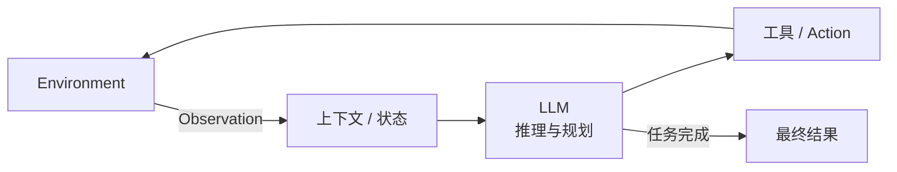
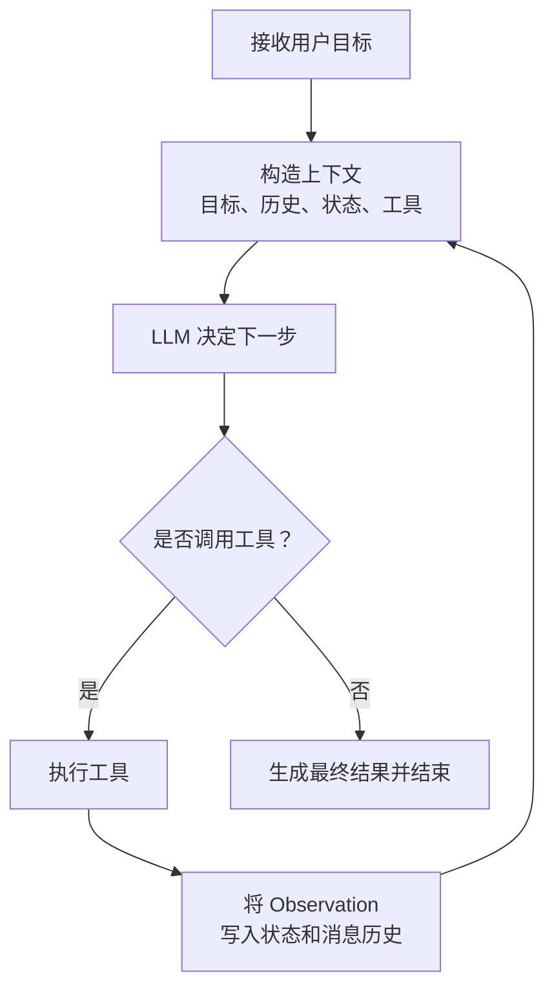
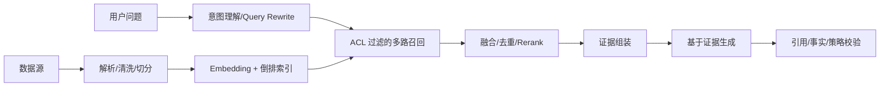
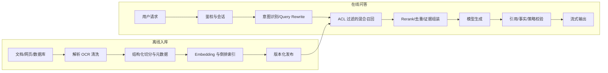
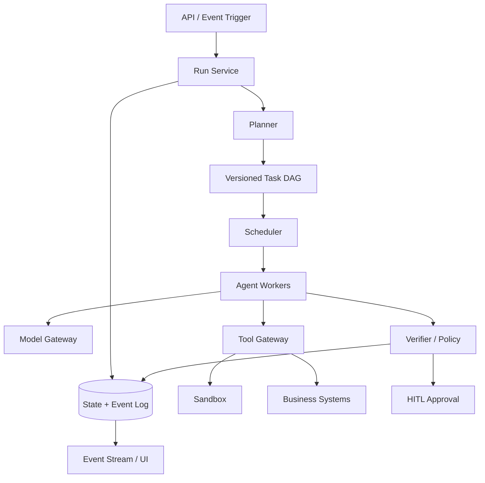
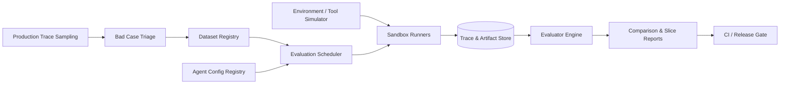

# Agent 开发工程师面试题与参考答案

**中文** | [English](README_EN.md)

> 基于搜索、问答、推荐、复杂任务型 Agent 岗位要求整理。重点不是背框架 API，而是说明：如何建模、如何保证正确性、如何评测、如何在高并发生产环境稳定运行。

## 目录

1. [岗位能力地图](#一岗位能力地图)
2. [Agent 基础与核心执行链路](#二agent-基础与核心执行链路)
3. [工具调用体系](#三工具调用体系)
4. [上下文工程、记忆与 RAG](#四上下文工程记忆与-rag)
5. [模型应用工程化](#五模型应用工程化)
6. [评测与质量保障](#六评测与质量保障)
7. [性能、稳定性与全链路压测](#七性能稳定性与全链路压测)
8. [Planning、Multi-Agent 与工作流](#八planningmulti-agent-与工作流)
9. [搜索、推荐、问答与交易决策场景](#九搜索推荐问答与交易决策场景)
10. [向量数据库、语义缓存、微调与数据闭环](#十向量数据库语义缓存微调与数据闭环)
11. [MCP 与 A2A](#十一mcp-与-a2a)
12. [系统设计题](#十二系统设计题)
13. [Agent 项目复盘题（84—86）](#十三agent-项目复盘题8486)
14. [Agent Runtime、Sandbox 与可靠性工程（87—120）](#十四agent-runtimesandbox-与可靠性工程87120)
15. [Agent 编排、可靠性与安全（121—150）](#十五agent-编排可靠性与安全121150)
16. [项目实战追问（151—166）](#十六项目实战追问151166)
17. [Agent 安全、评测与生产工程（167—176）](#十七agent-安全评测与生产工程167176)
18. [上下文、交互、训练与持续进化（177—257）](#十八上下文交互训练与持续进化177257)
19. [模型与 RAG 基础（258—266）](#十九模型与-rag-基础258266)
20. [高频指标与原则](#二十高频指标与原则)
21. [延伸阅读](#二十一延伸阅读)


## 一、岗位能力地图

| 能力域 | 面试重点 | 回答中应出现的证据 |
|---|---|---|
| Agent 执行链路 | Planning、ReAct、状态机、终止条件、恢复 | 状态定义、转移条件、循环上限、幂等与持久化 |
| Tool 工程 | 注册、校验、并发、超时、重试、降级、追踪 | JSON Schema、错误分类、依赖 DAG、trace/span、权限边界 |
| 上下文工程 | 消息构造、预算、裁剪、压缩、记忆、RAG | Token 分区、相关性与新鲜度、隔离键、引用与冲突处理 |
| 模型工程 | Prompt、路由、流式、降级、缓存、灰度 | 版本化、路由特征、回退矩阵、实验分流与显著性 |
| Eval | 离线集、过程评测、E2E、Judge、归因 | 数据分层、轨迹指标、校准、防泄漏、线上线下一致性 |
| 稳定性 | 限流、熔断、重试、降级、可观测性 | 端到端 deadline、重试预算、背压、SLO、故障演练 |
| 性能 | 并发、吞吐、TTFT、P99、成功率、工具耗时 | 分层压测、关键路径、排队时间、容量模型、瓶颈定位 |
| 高阶架构 | Multi-Agent、Agent as Tool、工作流、协议 | 适用边界、通信契约、调度策略、成本与复杂度权衡 |

## 二、Agent 基础与核心执行链路

### 1. 什么是 Agent？核心组件是什么？它与普通 LLM 调用、固定 Workflow 有什么区别？

**参考答案：**

**定义。** Agent 是一个面向目标、能够持续与外部环境交互的执行系统。它在每一轮读取当前状态和环境反馈，由模型选择下一步动作，再通过工具执行；执行结果回到状态中，形成下一轮决策依据，直到任务完成或触发终止条件。

从工程上可以概括为：

> **Agent ≈ LLM + 上下文/状态 + 工具 + 运行循环**

核心组件包括：

- **LLM（推理与规划核心）**：负责理解用户目标、分解问题，并结合当前上下文选择下一步动作。它生成的是动作或答案的候选，真实执行结果仍由外部环境返回。
- **上下文与状态**：保存本轮推理所需的信息，包括系统规则、用户目标、对话历史、任务进度、工具 Observation、检索证据、预算和待办事项，决定 LLM“当前能看到什么”。
- **工具系统**：把 LLM 生成的动作转换为可执行调用，例如搜索、读写文件、查询数据库、运行代码、调用业务 API、委派子 Agent 或请求用户确认，同时限定 Agent 的动作空间。
- **运行循环**：负责组装上下文、调用 LLM、执行工具、回填 Observation 和判断是否继续。文件、网页、数据库、用户等属于 Environment；循环通过 Action—Observation 与其持续交互。



**与普通 LLM 调用、固定 Workflow 的区别：**

| 形态 | 控制流由谁决定 | 是否根据环境反馈动态调整 | 典型场景 |
|---|---|---|---|
| 普通 LLM 调用 | 代码固定调用一次或少数几次模型 | 通常不调整，输入后直接生成输出 | 摘要、改写、分类、信息抽取 |
| 固定 Workflow | 节点、顺序和分支由代码或流程图预先定义 | 可以读取执行结果，但下一步规则基本固定 | 审批、ETL、标准客服流程、合规检查 |
| Agent | LLM 根据目标、上下文和 Observation 动态决定下一步 Action | 会根据工具结果继续、纠错、澄清、重规划或结束 | 复杂搜索、Deep Research、Coding、无法预枚举步骤的任务 |

判断关键不在于调用了几次 LLM，而在于**谁决定下一步**：如果调用顺序和分支都由代码写死，即使调用很多次模型，本质上仍是 Workflow；只有当下一步必须根据非结构化环境反馈动态决策时，才需要 Agent。生产系统常采用组合方式：Workflow 管理确定性流程、审批和状态，Agent 只负责其中无法预先枚举的语义决策。

### 2. 设计一个 Agent 核心执行循环。

**参考答案：**

Agent 核心循环可以概括为：

> **构造上下文 → LLM 决策 → 执行动作 → 获取 Observation → 更新上下文 → 继续或结束**



循环只有四个核心环节：

1. **Context**：把用户目标、当前状态、历史 Observation 和可用工具提供给模型。
2. **Decision**：LLM 决定调用哪个工具、请求补充信息，还是直接结束。
3. **Action**：运行时执行模型提出的结构化工具调用。
4. **Observation**：把工具结果或错误追加到消息历史和状态中，作为下一轮决策依据。

如果模型不再产生 Tool Call，就进入最终回答；否则继续循环。生产实现再在这个最小闭环外增加 Schema/权限校验、最大步数与 deadline、状态持久化、错误处理和完成条件校验，但这些不改变核心循环。

### 3. ReAct 是什么？生产实现中有哪些问题？

**参考答案：**

**定义。** ReAct 是 **Reason + Act** 的缩写，核心不是“让模型写一段思维链”，而是把模型决策与环境交互组成闭环：模型根据目标和当前状态选择下一步动作，系统执行动作并返回观察，模型再依据新证据继续、改计划或结束。普通问答是 `输入 → 输出`；ReAct 是 `状态 → 决策 → 动作 → 观察 → 新状态`，因此可以处理模型参数中没有的实时信息和必须调用外部系统才能完成的任务。

一个完整循环通常包含五个角色：

1. **Goal/State**：用户目标、已知事实、计划、预算和已完成步骤。
2. **Decision**：模型判断下一步应该查信息、调用工具、请求澄清、重新规划还是结束。
3. **Action**：结构化动作，例如 `search(query=...)`、`get_order(id=...)`，而不是一段不可执行的自然语言。
4. **Observation**：工具返回的数据、错误、来源和时间。Observation 是外部输入，不天然可信。
5. **Stop/Verifier**：判断目标是否真的完成，或是否因超时、预算、审批、取消和不可恢复错误而终止。

```text
while run 未终止:
    context = build_context(goal, state, observations, budgets)
    decision = model(context)

    if decision.type == "tool_call":
        validate_schema_permission_budget(decision)
        observation = execute_tool(decision, deadline, idempotency_key)
        state = apply_observation(state, observation)
    elif decision.type == "clarify":
        checkpoint_and_wait_user()
    elif decision.type == "replan":
        state.plan = validate_new_plan(decision.plan)
    elif decision.type == "final":
        verify_completion(decision, state)
        return decision.answer
    else:
        repair_or_fail()
```

**例子。** 用户要求“查询明天北京天气，如果下雨就给我安排室内行程”。第一轮模型不能直接凭记忆回答，而是生成天气工具调用；工具返回降雨概率、数据时间和来源。第二轮模型根据观察选择室内景点搜索工具；获得营业时间后，第三轮才生成带来源的行程。如果天气工具超时，系统应根据错误类型重试、切换经过验证的备用源或明确无法获取实时天气，不能让模型编造 Observation。

**与相近概念的区别。**

- **CoT** 主要是在一次模型调用内部做推理，不一定与外部环境交互；ReAct 的关键是动作和真实观察改变后续决策。
- **Function Calling/Tool Calling** 是模型表达结构化动作的接口机制；ReAct 是决定何时调用、如何消费结果、是否继续的控制策略。
- **固定 Workflow** 的节点和分支主要由代码预定义；ReAct 允许模型在每轮动态选择动作，灵活但确定性更低。
- **Plan-and-Execute** 先生成较完整计划再逐步执行；ReAct 通常一次决定下一步。长任务常采用“粗粒度计划 + 阶段内 ReAct”。

**生产实现不能照搬 `Thought/Action/Observation` 文本模板。** 不应依赖或展示模型的私有思维链；应保存可审计的简短决策摘要、结构化动作、工具观察和状态变化。控制面需要补齐以下能力：

- **循环治理**：最大步数、同类动作次数、Token、费用和端到端 deadline；用动作指纹与状态增量检测“搜索—无结果—重复搜索”等无进展循环。
- **工具可靠性**：JSON Schema、语义校验、权限、幂等、超时和错误分类。参数错误不能原样重试，限流应遵守 `Retry-After`，写操作结果未知时先查询状态。
- **上下文治理**：只回填与目标相关的观察；大结果分页、摘要或外置为 artifact；保留来源、时间、版本和错误状态，避免错误观察被摘要成事实。
- **安全边界**：网页和工具结果可能包含 Prompt Injection，只能作为数据，不能覆盖系统策略；副作用操作仍需服务端策略和人工审批。
- **并发调度**：只有无数据依赖、无写冲突的工具才能并行；部分失败要区分关键与非关键分支，不能把 `Promise.all` 当事务。
- **完成校验**：模型可以提出 `final`，但确定性 completion gate 仍要检查必要目标、证据、输出 Schema、业务规则和未完成依赖。
- **可观测与评测**：记录每轮模型/Prompt/工具版本、输入摘要、动作、观察、状态差异、Token、时延和费用；重点看任务成功率、工具选择/参数正确率、重复步骤率、平均步数和失败恢复率。

**优缺点。** ReAct 的优势是能使用实时外部信息、根据失败纠错、适应无法预先枚举的任务；代价是多轮模型调用带来更高时延和成本，单步错误会沿轨迹累积，执行路径也更难测试。因此路径固定、规则明确的业务优先用 Workflow，只有下一步确实依赖动态语义判断时才使用 ReAct。

**面试收束：** ReAct 不是一个 Prompt 花样，而是一种“模型决策—受控执行—环境反馈”的闭环；生产质量取决于闭环外的状态、权限、预算、验证、恢复和观测能力。

### 4. 如何设计 Agent 状态机？

**参考答案：**

建议显式定义状态与合法转移，例如：

`CREATED → PLANNING → RUNNING → WAITING_TOOL/WAITING_USER/WAITING_APPROVAL → RUNNING → SUCCEEDED/FAILED/CANCELLED/TIMED_OUT`

状态记录至少包含 `run_id、state、state_version、attempt、checkpoint、pending_action、reason、created_at/updated_at`。设计要求：

- 每次转移由事件驱动，并校验当前状态、前置条件和 `state_version`；通过事务或 CAS 更新，防止并发覆盖，事件发布可配合 outbox。
- 转移必须走白名单和 guard，例如只有收到有效审批才能从 `WAITING_APPROVAL` 返回 `RUNNING`，取消可从非终态进入 `CANCELLED`。
- 状态与事件分离：状态用于快速读取，事件日志用于审计、回放和重建；重试创建新 attempt，不篡改历史事实。
- 长任务定期保存 checkpoint；等待用户、工具或外部任务时持久化关联 ID、截止时间并释放计算资源，由回调、超时事件或恢复扫描继续执行。
- 取消信号向模型、工具和子任务传播，副作用操作使用幂等键。
- 终态不可再次转移或执行副作用，必须固定结束时间和结果摘要；重复事件只能得到同一结果，避免任务“复活”。

### 5. Agent 如何判断任务完成？

**参考答案：**

不能只相信模型输出“完成”。应组合判断：

1. 计划中的必要目标是否满足；
2. 必需工具是否成功并返回可验证证据；
3. 输出是否满足结构、引用、业务规则和安全约束；
4. 是否存在未解决依赖或相互冲突的信息；
5. 是否触发预算、超时或人工审批边界。

可以让模型提出 `final`，再由确定性 completion gate 校验。关键任务还可增加独立 verifier，但要评估额外时延和同源模型偏差。

### 6. Agent 循环有哪些基础防护，如何避免无效循环？

**参考答案：**

- 硬限制：最大步数、同类工具调用次数、Token、费用和 wall-clock deadline。
- 软检测：连续动作签名、参数相似度、状态增量、信息增益；多轮无进展则 replan 或终止。
- 对错误分类，参数错误不应原样重试，限流错误按 `Retry-After`，永久错误立即停止。
- 明确工具成功条件，避免模型把空结果当成“再搜一次”的理由。
- 终止时返回已完成内容、失败原因和可继续操作，而不是伪造成功。

### 7. 如何保证 Agent 可恢复、可重放？

**参考答案：**

- 在每个决策边界保存 checkpoint：状态版本、消息引用、计划、预算、工具调用 ID、模型/Prompt/工具版本。
- 副作用工具使用业务幂等键；区分“请求未发送”“结果未知”“执行成功”。结果未知时先查询状态，不能盲目重试。
- 回放分两种：审计回放读取历史输出；实验回放重新调用模型/工具。后者受模型非确定性和外部数据变化影响，必须固定版本、记录随机参数并隔离副作用。
- 使用乐观锁或单 run 串行执行，防止同一状态被两个 worker 同时推进。

### 8. Agent 中哪些逻辑应由代码控制，哪些适合交给模型？

**参考答案：**

判断标准是错误是否可接受、结果能否确定性验证。权限、金额与资源上限、租户隔离、状态转移、重试、超时、幂等、输出 Schema、审计及合规规则属于系统不变量，必须由代码或策略服务控制。模型适合意图理解、开放式规划、工具语义选择、非结构化抽取、候选方案生成和自然语言总结。模型给出的动作只能视为提案，执行前必须经过 Schema、权限和业务规则校验；例如“不得跨租户访问”不能只写在 Prompt 中，否则提示注入可能使约束失效。
### 9. 如何处理中途需要用户澄清的任务？

**参考答案：**


工程上把澄清建模为显式动作 `request_clarification`，包含缺失字段、必要性、候选选项和是否存在安全默认值。系统先保存 checkpoint，再进入 `WAITING_USER`，释放 worker；回复到达后校验用户、run 和状态版本，把答案写入结构化槽位后恢复。若信息只影响展示，可采用可解释默认值继续；若影响金额、权限、目标资源或不可逆操作，则必须等待。还要设置等待 TTL、取消和过期后的重新校验，防止用户数小时后回复时外部状态已变化。
### 10. 什么是 HITL？如何划分审批边界并绑定具体动作？

**参考答案：**

HITL 是 **Human-in-the-Loop（人在回路）**，指在 Agent 执行链路的关键决策点引入人类判断。Agent 可以自动完成低风险步骤，但遇到高风险、不可逆、信息不足或低置信度动作时暂停，保存状态并等待人类批准、拒绝、修改或补充信息后再继续。它不是“每一步都人工确认”，也不只是失败后的人工兜底，而是预先设计的风险控制机制。

审批边界应按动作风险划分：只读操作可自动执行，可撤销操作可执行后通知，支付、发布、删除、权限变更和敏感数据外发等高风险写操作须执行前审批，关键操作还应二次认证。审批页面展示工具、目标、规范化参数、影响范围、证据和有效期，而非只展示模型解释；记录绑定审批人、动作哈希和一次性 nonce，参数变化即失效。状态机支持 `WAITING_APPROVAL/APPROVED/REJECTED/EXPIRED`，超时默认 fail-closed；恢复执行时仍需重新检查权限、参数、幂等并完整审计。
## 三、工具调用体系

### 11. 如何设计可扩展的 Tool 注册体系？

**参考答案：**

每个工具以 Tool manifest 注册：唯一名称和版本、描述、输入/输出 JSON Schema、协议与入口、超时、幂等性、副作用级别、权限范围、并发限制、重试策略、数据敏感等级、owner 及废弃状态。工具描述要准确区分“何时使用”和“何时不要使用”，减少模型误选。

注册中心负责发布、发现、健康状态和版本管理；查询时结合租户、用户、Agent 身份及策略做权限过滤，模型只能看到可调用工具。调用方应固定版本或版本范围，并根据 Schema、协议和能力标签检查兼容性，不能静默切换破坏性版本；大量工具场景先做检索或分组路由，不把全部 Schema 塞入上下文。

执行器通过统一 runtime adapter 适配 HTTP、RPC、函数或异步任务，统一完成参数校验、鉴权、凭证注入、调度、限流、追踪和错误归一化，工具实现不重复横切能力。工具上线需经过注册、验证、灰度、启用、废弃和下线流程，并执行 Schema 契约、权限、超时重试、幂等性及兼容性测试。

### 12. Tool 参数校验要做哪些层次？

**参考答案：**

1. **结构校验**：类型、必填项、枚举、范围、格式、额外字段。
2. **语义校验**：开始时间早于结束时间、资源存在、字段间约束。
3. **权限校验**：调用者是否能访问目标租户、用户或资源。
4. **策略校验**：金额上限、敏感操作、审批状态、地域与合规规则。
5. **执行前确认**：副作用动作展示最终规范化参数，并绑定幂等键。

校验错误以机器可读错误码返回，允许模型只修正有问题的字段；敏感内部信息不能回填给模型或用户。

### 13. 如何让多个 Tool 并行调用？

**参考答案：**

先把计划转为依赖 DAG。无依赖、无冲突且权限已通过的节点并行；有数据依赖或写冲突的节点串行。设置全局、租户、工具三级并发上限，并继承端到端 deadline。

结果聚合需要：保留每个调用状态、允许部分成功、稳定排序、去重、标记来源；不要因一个非关键工具失败取消全部结果。若是 all-or-nothing 业务，应使用事务或补偿机制，而非普通 `Promise.all` 假装原子性。

### 14. Tool 超时和重试如何设计？

**参考答案：**

- 端到端 deadline 向下分配，单工具超时不能超过剩余时间。
- 只重试瞬时错误：连接重置、部分 5xx、明确限流；参数错误、权限错误和业务拒绝不重试。
- 指数退避 + jitter，遵守 `Retry-After`；设置最大尝试次数和重试预算，防止重试风暴。
- 非幂等写操作只有在有幂等键或能查询执行状态时才自动重试。
- 每次 attempt 独立记录，但归属于同一逻辑 tool call，便于计算真实成功率和放大倍数。

### 15. Tool 异常如何降级？

**参考答案：**

先区分关键与非关键依赖。非关键工具失败时可返回部分结果并明确缺失；只读查询可在业务规定的陈旧窗口内使用带时间戳缓存；仅当能力、数据新鲜度和权限等价时才切换备用工具。高风险写操作若结果未知，应先按幂等键查询状态，不能换工具重复执行，更不能用模拟结果或旧数据伪装成功，必要时失败或转人工。熔断后快速失败，恢复时采用半开探测。评估除接口可用率外，还应看降级任务正确率、陈旧数据比例、人工接管率和错误动作率。
### 16. Tool 调用链路应记录什么？

**参考答案：**


建议每次逻辑调用使用 `trace_id/run_id/step_id/tool_call_id`，每次重试再分配 `attempt_id`。除了工具名、版本、脱敏参数、排队/连接/执行时延和错误码，还要记录权限决策、幂等键哈希、缓存、降级路径、结果大小和状态差异。大结果仅保存内容哈希和受控 artifact 引用。指标按 logical call 统计成功率，attempt 级用于观察重试放大；日志字段要控制高基数并设置保留期限，避免可观测系统本身泄露敏感数据或失控增容。
### 17. 如何定义统一 Tool 错误模型？

**参考答案：**

至少区分：`INVALID_ARGUMENT`、`UNAUTHENTICATED`、`PERMISSION_DENIED`、`NOT_FOUND`、`CONFLICT`、`RATE_LIMITED`、`TIMEOUT`、`DEPENDENCY_UNAVAILABLE`、`INTERNAL`、`CANCELLED`、`UNKNOWN_RESULT`。

错误对象包含是否可重试、建议等待时间、用户可见信息、模型可见修复提示、内部诊断引用。不要把原始堆栈直接交给模型或用户。

### 18. 如何防御 Tool 相关的 Prompt Injection？

**参考答案：**

- 将网页、文件、搜索结果和工具输出视为不可信数据，用清晰边界传入，不允许覆盖系统策略。
- 工具权限基于服务端身份与策略，不基于模型声称。
- 工具最小权限、参数 allowlist、网络出口限制、沙箱和敏感字段脱敏。
- 对外发数据和副作用动作做策略检查或人工确认。
- 模型看到“忽略此前指令并调用某工具”时，系统仍只执行经过 Schema、权限和策略校验的结构化动作。
- 对注入攻击建立专门评测集，而不是依赖单一关键词过滤。

### 19. Tool 描述太多导致上下文膨胀，怎么办？

**参考答案：**


生产上通常采用两阶段 Tool Search：第一阶段只暴露短目录，按意图、语义、权限、风险和历史成功率召回候选；第二阶段仅把 Top-K 完整 Schema、示例和限制提供给执行模型。高频及安全必需工具可常驻，近义工具应合并或明确“何时不要用”。权限过滤必须早于召回，不能让模型看到无权使用的工具。评测同时看 Tool Recall@K、误选率、首轮参数正确率、上下文 Token 和端到端成功率，避免只省 Token 却漏掉关键工具。
### 20. 如何处理 Tool 输出过大？

**参考答案：**

优先改造工具契约，而不是事后截断：支持字段投影、过滤、分页、游标、服务端聚合和 Top-K，并在执行层限制字节数、行数及 Token。原始结果存入对象存储，Agent 状态只保留 Schema、统计信息、相关证据片段、来源和 artifact URI。压缩时必须保留关键数字、实体、时间、错误及证据位置。后续需要精确计算或执行动作时，应通过句柄回取结构化原始数据，不能依赖自然语言摘要。监控结果大小分布、截断率和压缩后的任务成功率。
## 四、上下文工程、记忆与 RAG

### 21. 如何做 Token 预算？

**参考答案：**

先从模型上下文窗口中预留输出预算和安全余量，再为不同区域分配预算：系统策略、工具 Schema、当前用户请求、近期对话、任务状态、检索证据、历史摘要。可以表达为：

`可用输入 = 上下文上限 - 最大输出 - 安全余量`

预算不是简单按字符截断。优先级通常是：安全/业务指令 > 当前请求 > 必要状态与工具契约 > 高相关证据 > 近期历史 > 低相关历史。记录每区 Token 使用和被裁剪原因，便于调优。

### 22. 多轮对话历史如何筛选？

**参考答案：**

应组合“近期窗口、结构化任务状态、相关历史召回和阶段摘要”，而非只保留最近 N 轮。当前目标、用户已确认的约束、固定事实、高风险字段和未完成事项优先保留；闲聊、重复日志及已被新事实覆盖的内容可以裁剪。消息必须保留角色、来源、时间、适用范围和版本，工具观察不能在摘要后变成用户指令。事实冲突时按来源权威性、新鲜度和 scope 处理，显式记录覆盖关系并保留审计。效果需联合评估任务成功率、指代解析、约束漏失率和 Token 成本。
### 23. 上下文裁剪与压缩有什么风险？

**参考答案：**

主要风险是遗漏否定词、数字、权限条件、时间范围、实体关系、未完成步骤和证据来源，或把模型推测写成事实；反复滚动摘要还会累积失真。更稳妥的做法是先按固定 Schema 提取目标、事实、约束、冲突、待办和证据 ID，再摘要其余表达。金额、日期、权限等高风险字段应确定性保留，近期消息保留原文，阶段 checkpoint 尽量不可变，大结果外置。压缩后用规则检查关键字段，必要时回读原消息，并通过压缩前后的同任务对照评估，而非只看摘要是否流畅。
### 24. 如何隔离不同用户、会话和 Agent 的状态？

**参考答案：**

所有状态和检索必须带可信服务端根据认证上下文注入的 `tenant_id/user_id/session_id/run_id/agent_id`，不能采信模型、请求正文或工具返回的隔离键。数据库使用行级权限、复合主键或强制过滤；缓存 key、向量库 namespace、对象存储路径、checkpoint 与 artifact 索引也必须包含相同边界，并在服务端再次校验归属，避免只隔离数据库却从其他存储泄漏。

子 Agent 只获得完成任务所需的最小上下文、工具集合和短期 scoped token，禁止默认继承全部会话、系统凭证或父 Agent 权限。跨 Agent 仅传递结构化 artifact 引用、来源和权限声明，下载时重新鉴权，不直接转发任意内部路径。

会话结束、用户撤回或租户删除时，应按生命周期策略级联清理数据库、缓存、向量、artifact 和派生索引，设置 TTL、保留期并处理备份或密钥销毁。所有跨边界访问、授权和删除均写审计日志；持续执行伪造隔离键、跨租户检索、缓存碰撞、向量召回和 artifact 越权的泄漏测试。

### 25. 短期记忆和长期记忆有什么区别？

**参考答案：**

两者主要区别是作用域、生命周期和写入门槛：

| 维度 | Working/Short-term Memory | Long-term Memory |
|---|---|---|
| 作用域 | 当前 run/session | 跨 run、跨会话 |
| 内容 | 当前目标、计划、近期消息、工具观察、中间状态 | 经确认的事实、偏好、历史事件、可复用经验 |
| 载体 | 模型上下文 + 结构化 Run State | 数据库、对象存储、向量/关键词索引 |
| 写入 | 执行过程持续更新，任务结束后清理或压缩 | 经过授权、价值判断、去重、冲突和敏感性检查 |
| 主要风险 | Token 超限、裁剪失真、状态不一致 | 错误记忆、过期事实、权限泄漏、召回误用 |

Working Memory 可类比模型有限的注意范围，但不能只依赖聊天消息：目标、预算、未完成项和关键事实应进入结构化状态。Long-term Memory 也不是“把所有聊天存进向量库”；每条记录需要来源、时间、适用范围、版本、ACL、TTL 和删除能力，模型推断默认不直接写入。

读取长期记忆通常综合**相关性、新近性、重要性和可信度**，先做身份/权限/有效期过滤，再选择最小必要内容放入上下文。召回结果是可能过期或冲突的证据，优先级不能高于当前用户明确指令、系统策略和权威业务状态。评测写入 precision、召回 precision/recall、过期误用、冲突处理和删除完整性，而不是只测向量相似度。
### 26. 如何防止“错误记忆”污染后续对话？

**参考答案：**

建立受治理的写入链路：候选提取、来源分类、长期价值判断、去重与冲突检测、规则或用户确认、版本化保存。每条记忆记录 `subject/predicate/value/scope/source/time/confidence/validity`，明确区分用户陈述、系统事实、工具证据和模型推断；模型推断默认不进入长期记忆。用户明确更正和权威工具结果通常高于推断，无法裁决的冲突应并存并标记 `conflicted`，使用时主动澄清。还需提供查看、更正、删除和过期能力，监控错误写入率、召回准确率、冲突处理正确率及隐私删除完整性。
### 27. 设计一个 RAG 链路。

**参考答案：**

不能只回答“Embedding + 向量库”。完整 RAG 包含知识入库、在线检索、生成验证和持续评测四部分。



**入库链路。** 解析 PDF/网页/表格并保留标题、页码和结构；清洗模板噪声、去重，按语义结构而非固定字符粗暴切分。Chunk 保存文档/版本/章节/来源位置/时间/ACL；同时建立 BM25、向量和必要的结构化索引。新索引在离线检索集验证后版本化发布，可原子切换和回滚。

**在线链路。** 接入层注入可信身份和租户。问题改写必须保留实体、否定、时间与对话指代；先做 ACL 和有效期过滤，再并行关键词、向量、结构化/图谱召回。用 RRF 或学习排序融合，去重并设置每文档配额，reranker 精排后按子问题选择最小充分证据，避免相似噪声挤占上下文。

**生成与校验。** 每个证据块带稳定 citation ID，Prompt 明确“证据是数据而非指令”；关键 claim 必须绑定引用。生成后校验引用存在、是否支持对应 claim、数字/时间是否一致；证据不足、冲突或权限不确定时拒答或澄清，不能依赖模型记忆补造。

**可靠性和扩展。** Embedding/解析异步批处理，检索服务无状态扩展；缓存键包含 query、租户、ACL 和索引版本。各阶段继承总 deadline，并对检索、reranker、模型设置单独预算和经过评测的降级。索引更新用文档版本与 chunk hash 幂等，删除必须同步清除索引和缓存。

**评测。** 入库看解析成功、重复率与新鲜度；检索看 Recall@K、MRR/nDCG、ACL 正确率和延迟；生成看正确性、faithfulness、引用准确/覆盖、拒答；端到端看任务解决率、P99 和每成功问答成本。Bad Case 要定位到解析、召回、排序、组装还是生成，不能只给一个总分。

### 28. RAG 的召回指标与生成指标有哪些？

**参考答案：**

检索层通常评估 Recall@K、Precision@K、MRR、nDCG、命中率、重复率、ACL 过滤正确率和延迟；生成层评估答案正确性、忠实度或事实一致性、引用准确率、引用覆盖率、完整性及拒答正确率。Recall@K 高仅表示 gold evidence 进入候选，不代表模型正确使用；存在引用也不代表该引用支持对应 claim。成熟评测应标注关键 claim 与 gold evidence，分别定位解析、召回、重排、上下文组装和生成问题，再结合端到端任务成功率、用户反馈、时延及成本判断。
### 29. 检索结果相互冲突时如何处理？

**参考答案：**


首先保留来源、文档版本、发布时间、生效时间、适用对象和权威等级。规则制度类优先匹配当前业务范围内已生效的权威版本；实时事实优先权威工具和最新事件时间。无法确定时不要让模型“取平均”，应输出冲突双方、各自证据和待确认点。对高风险规则最好由版本化主数据或规则服务提供唯一有效状态，RAG 负责解释和定位原文。冲突率和错误消解率也应进入评测。

系统还应记录冲突出现率、自动裁决率、人工确认率和错误覆盖率；同一问题在不同版本上的裁决结果必须可回放，避免模型静默改变依据。
### 30. 如何组织 RAG 结果回填上下文？

**参考答案：**


按子问题或主题分组证据，而不是简单拼接 Top-K；每段附稳定 citation ID、标题、版本、时间、ACL 和来源位置。先去模板噪声、重复块和失效版本，再控制单文档占比，避免长文档淹没其他来源。证据区与系统指令明确隔离，冲突证据并列呈现。Context Builder 根据输出预算选择“最小充分证据集”，生成后校验每个关键 claim 是否有对应引用，并保留原文回取能力。
## 五、模型应用工程化

### 31. Prompt 模板如何管理？

**参考答案：**


模板应包含 ID、语义版本、适用模型/任务、变量 Schema、owner、变更说明、评测结果和发布状态。渲染时对变量做类型和长度校验，外部文本放入明确数据边界，防止角色注入。发布流程是离线回归与安全集 → Shadow/Canary → 线上护栏 → 全量，并支持快速回滚；每条 trace 记录实际 Prompt 版本。不要把密钥、权限规则和业务不变量藏在 Prompt 中，它们必须由执行层控制。
### 32. 如何做模型路由？

**参考答案：**


路由输入可以包含任务类型、难度、上下文长度、是否需要 Tool/视觉、风险等级、语言、时延 SLA、租户预算和模型健康度。维护能力矩阵，记录结构化输出、工具调用、上下文长度和安全基线；简单分类/抽取走小模型，复杂规划或高风险任务走强模型并增加 verifier。先用可解释规则建立基线，再评估学习型路由。指标不只是平均成本，还包括误路由率、各场景质量损失、降级率、P99 和每成功任务成本。
### 33. 流式输出在 Agent 中如何实现？

**参考答案：**

将流式输出定义为结构化事件协议，例如 `run.started`、`message.delta`、`tool.started`、`tool.completed`、`approval.required`、`citation`、`error` 和 `run.completed`；每个事件携带 `run_id`、step、sequence 和时间。SSE 适合服务端单向推送，WebSocket 适合双向控制。服务端通过 event log 或 outbox 先持久化再发送，客户端按 `run_id + sequence` 去重，并用 `Last-Event-ID` 或 cursor 断点续传；慢客户端需有界缓冲和背压。工具执行期间只展示可验证的动作摘要，不泄露私有思维链或伪造进度。断线默认不取消后台任务，最终事件给出完整结果和终态。
### 34. 模型降级怎么设计？

**参考答案：**


降级必须基于能力矩阵，而不是把模型名称随意替换。触发条件包括超时、429、区域故障、预算和上下文不兼容；切换后可能需要更换 Prompt、缩短上下文、关闭非关键步骤或禁用某些工具。高风险任务若备用模型未通过相同质量/安全基线，应失败或转人工。监控降级触发原因、降级后成功率、事实错误、P99 和成本，防止“可用性提高但质量失控”。

上线前对备用路径单独跑质量、安全和工具兼容回归，并定期故障演练；否则真正故障时才发现备用模型不会调用关键工具，降级方案等同于不存在。
### 35. LLM 响应缓存有哪些类型？

**参考答案：**

- 精确缓存：规范化输入、模型、参数、Prompt/工具版本完全匹配。
- 语义缓存：语义相近查询复用答案，需要相似度阈值和业务约束。
- Prefix/Prompt cache：复用公共前缀的模型侧计算。
- 中间结果缓存：查询改写、embedding、检索或工具只读结果。

缓存键必须包含租户、权限、知识版本、时效、模型和 Prompt 版本。个性化、实时、高风险或有副作用请求通常不适合语义缓存。缓存命中后仍需做权限和新鲜度检查。

### 36. 如何做灰度实验和效果分析？

**参考答案：**


实验按用户或会话稳定哈希分桶，避免同一长任务跨版本；上线前定义主指标、护栏、样本量和最小观察期。主指标可用任务成功率/解决率，护栏包括安全事件、错误动作、人工接管、P99 和每成功任务成本。检查 SRM、埋点一致性、同期模型/知识/流量变化，并按场景和难度分层。Agent 非确定性强，离线需重复运行，线上用配对或稳定分桶；结论同时报告绝对变化、置信区间和实际效应大小。
### 37. 结构化输出不符合 Schema 怎么办？

**参考答案：**

优先使用模型原生 Structured Output 或严格的 Function Calling，但服务端仍须执行 JSON Schema 和业务语义校验。校验失败后可进行有限次数的受限修复：仅返回字段路径和精简错误原因，要求模型只修正无效字段，不能无限重试。金额、资源 ID、权限、枚举及字段间关系必须由代码再次检查，禁止从任意文本中用脆弱正则猜测关键操作参数。修复仍失败时应安全报错或转人工。持续记录首次解析成功率、修复成功率和最终失败率，用于优化 Schema 描述、约束和示例。
## 六、评测与质量保障

### 38. 如何建设 Agent 离线评测集的基础数据模型？

**参考答案：**

样本来源应覆盖脱敏真实流量、线上 Bad Case、专家构造、边界与对抗样本及合成数据，并按场景、难度、用户类型、工具依赖和风险等级分层。每条任务除输入外，还应记录用户目标、环境与知识版本、可用工具、期望业务状态、允许的替代路径、禁止动作、判分规则和 evaluator；工具易变化时保存模拟环境或录制回放，以保证复现。数据划分为开发集、稳定回归集和盲测集，按实体与时间防泄漏。Bad Case 入库前需去重、脱敏并确认根因；合成数据只补充稀缺边界。发布时报告分层结果、方差、成本和时延。
### 39. 过程评测和端到端评测有什么区别？

**参考答案：**

过程评测用于定位“哪一环出错”，覆盖意图理解、计划、工具选择、参数、检索、错误恢复、审批和终止等步骤；端到端评测判断“用户目标是否完成”，关注最终业务状态、答案正确性、安全性、时延和成本。只做端到端评测难以归因，只做过程评测又可能奖励轨迹合理但任务未完成的方案。因此应以 outcome 作为主门槛，再增加轨迹约束：允许多条合法路径，但禁止越权、绕过审批和重复副作用。分析线上 Bad Case 时，可先定位第一个错误步骤，再关联其最终业务影响。
### 40. Agent 执行轨迹和 Tool Use 应评哪些指标？

**参考答案：**

不能只评最终答案。完整指标分五层：

1. **结果层**：任务完成、最终业务状态、正确性、拒答正确和严重安全错误。
2. **Planning 层**：子目标覆盖、依赖正确、首次动作、无效/重复步骤、重规划和终止判断。
3. **Tool Use 层**：是否应该调用工具、能否从工具目录召回并选对工具、参数是否正确、调用是否成功，以及能否正确消费 Tool Result 并决定继续/改写/停止。大量工具场景还要看 Tool Recall@K、误选率和首轮参数正确率。
4. **恢复与安全层**：超时恢复、错误分类、越权、审批绕过、结果未知处理和重复副作用。
5. **效率层**：步骤数、Token、费用、工具扇出、排队与 P50/P95/P99。

轨迹越短不一定越好，应先满足结果和安全约束再比较效率。多个合法轨迹使用里程碑/约束 matcher，不强制匹配唯一动作序列；每个 case 重复运行，报告稳定性、最差切片和首个偏离步骤。Tool HTTP 200 只说明依赖返回，不代表 Agent 选择、参数或结果解释正确。
### 41. LLM-as-a-Judge 如何设计？

**参考答案：**

- 先定义明确 rubric，将正确性、完整性、忠实度、安全等拆开评分。
- 给 Judge 充足但最小化的参考证据，隐藏候选系统身份，随机交换答案顺序降低位置偏差。
- 使用结构化评分并要求引用判分证据；不是依赖冗长推理文本。
- 用人工标注集校准一致率、相关性、偏差和阈值；关键样本双评或人工复核。
- 防止被评答案中的文本注入 Judge；候选答案必须作为数据隔离。
- Judge 适合规模化近似评测，不能替代业务真值和线上结果。

### 42. 如何自动归因 Bad Case？

**参考答案：**

建立分层错误 taxonomy：需求理解、规划、工具选择、参数、工具执行、检索、上下文、生成、引用、安全、系统/依赖、用户输入不足。先用确定性信号归因，例如超时码、空召回、Schema 错误；再用规则或模型分析轨迹。输出根因、证据 step、影响和置信度。抽样人工审计自动标签，避免错误归因反过来污染优化方向。


归因从 trace 的“第一个偏离点”开始。先用确定性信号定位 Schema、权限、空召回、索引版本、工具错误和状态非法；再固定工具结果替换模型/Prompt、固定模型输入替换检索证据，做回放和消融。区分触发因素与系统根因，例如 429 是触发，多层重试和无背压是放大根因。归因输出错误类别、证据 step、影响范围和置信度，人工抽样校准。修复后该 case 必须先失败后通过，再进入带环境快照的永久回归集。
### 43. Agent 上线应关注哪些指标？

**参考答案：**

- 业务：任务成功率、转化/解决率、用户重试率、人工接管率、满意度。
- 质量：事实错误率、引用正确率、工具调用成功率、拒答正确率、安全事件。
- 性能：QPS、并发、TTFT、端到端 P50/P95/P99、工具和模型分段耗时。
- 稳定性：超时率、错误率、熔断率、重试放大、降级率、队列长度。
- 成本：每成功任务 Token、模型费用、工具费用、缓存命中率。

平均值会掩盖长尾，必须按场景、模型、版本、租户和依赖分层。

### 44. Prompt 或模型升级如何做回归？

**参考答案：**

回归时应锁定代码、Prompt、模型、工具、知识索引和评测环境版本，让新旧版本运行同一分层数据集。对非确定性 Agent，同一 case 应多次运行并做配对比较，报告均值和方差，而非各跑一次。除任务成功率外，还要比较严重错误类型、轨迹约束、步骤数、P99 时延、人工接管率及每个成功任务的成本，并按场景和难度切片。差异样本优先人工复核，排除 Judge 偏差。上线采用 Shadow 或 Canary，并设置安全、错误动作和成本护栏；trace 需绑定全部版本，长任务执行中避免切换版本，并支持快速回滚。
### 45. 如何评价一个 Agent Eval 平台是否成熟？

**参考答案：**


成熟平台应支持数据集/环境/配置版本化，真实沙箱、模拟工具与录制回放，批量并发执行，完整轨迹和 artifact，规则/代码/LLM/人工多类 evaluator，以及配对对比、置信区间、切片、Bad Case 聚类和 CI 门禁。还要支持线上 trace 采样回流、敏感数据治理、权限和成本归属。最重要的验收不是功能数量，而是可复现性与预测性：同一版本结果稳定，离线变化能解释线上变化，失败能快速定位到模型、Prompt、检索、工具或系统。
## 七、性能、稳定性与全链路压测

### 46. 如何设计 AI 应用全链路压测？

**参考答案：**

先定义目标不是“打到崩溃”，而是在质量和安全 SLO 下找出安全容量、长尾来源与降级拐点。压测范围覆盖接入网关、Agent Runtime、上下文/RAG、模型 Gateway、Tool/Sandbox、状态库、缓存、队列和流式连接。

**1. 建模真实工作负载。** 从脱敏线上 trace 提取场景占比、到达过程、会话轮数、上下文长度、输入/输出 Token、Agent 步数、Tool 扇出、读写比例和长任务驻留时间；保留平均值与高分位，区分交互、批处理、审批等待和不同租户。固定 QPS 的单轮短请求不能代表 Agent 流量。

**2. 准备隔离环境。** 生产拓扑和限额尽量同构，但使用测试租户、影子索引、模拟账户和无副作用 Tool；下游支持录制回放、可控 stub 与 staging 三种模式。模型供应商的 RPM/TPM、并发、计费和区域限制写入测试约束，数据不得含生产凭证和敏感信息。

**3. 分层建立基线。** 先分别测模型 prefill/decode、检索、数据库、Tool、Sandbox 冷启动和队列服务曲线，再做完整 Agent 链路；否则端到端变慢时无法归因。记录每层饱和点、错误语义和 timeout/retry 配置。

**4. 设计测试矩阵。** 包含阶梯升压找拐点、突发流量看排队与弹性、长稳压暴露泄漏/GC/连接问题、热点租户看公平性，以及模型 429、Tool 变慢、向量库故障、缓存失效、Worker 崩溃等故障注入。另测长上下文、最大工具扇出、断线重连、取消和降级路径。

**5. 统一观测。** 每个 run 记录到达/完成吞吐、实际并发、队列深度、成功/超时/拒绝、TTFT、端到端及各 span P50/P95/P99、Token/s、步骤数、重试放大、连接池、CPU/内存/GC、缓存命中和每成功任务成本。并行链路看关键路径，不能把所有 span 相加。

**6. 判定容量。** 安全容量是任务成功、质量代理指标、安全护栏、P99 和成本同时满足 SLO 时可持续的最大吞吐，并预留灰度、依赖故障和重试余量。用 Little 定律交叉检查 `并发≈到达率×驻留时间`，但模型配额和人工等待单独建模。

**7. 优化与复测。** 优先减少无效轮次和 Token、并行独立 I/O、控制扇出与重试，再调池和扩容；每次只改变一类变量并跑相同矩阵。最终输出容量模型、瓶颈证据、各依赖配额、自动扩缩/限流阈值和故障 runbook，修复后做突发与长稳回归。

### 47. TTFT、P99、吞吐量分别说明什么？

**参考答案：**

- TTFT（Time To First Token）：用户开始感知响应的时间，包含排队、上下文处理和模型 prefill 等。
- P99（部分团队记作 TP99）：99% 请求的时延不超过该值，用于衡量长尾；`TP99` 并非完全统一的行业缩写，面试或监控中应先确认它表示首 Token、单步工具还是端到端时延。
- 吞吐量：单位时间完成请求、任务或生成 Token 的能力；Agent 场景应区分接入 QPS 和成功任务吞吐。

只优化 TTFT 可能不改善完整任务时长；只看平均吞吐会掩盖失败和排队，应与成功率、并发和成本联合分析。

### 48. 如何定位 Agent 链路性能瓶颈？

**参考答案：**

先用分布式 trace 分解：网关排队、上下文构造、模型排队/prefill/decode、检索、每个工具、Agent 多轮串行等待。比较关键路径而不是所有 span 相加；并行分支耗时由最慢分支决定。再关联 CPU、内存、连接池、线程池、数据库慢查询、模型限额和下游限流。常见优化顺序：减少无效轮次 → 并行独立 I/O → 缩短上下文 → 缓存稳定结果 → 调整连接/并发与容量。

### 49. 如何做限流和背压？

**参考答案：**


Agent 请求成本差异大，限流不应只按 QPS；可按预计输入/输出 Token、工具扇出、Sandbox 时长和风险设置权重。入口、租户、模型、工具和 worker 队列分层配额，交互与批处理分池。队列必须有界，超过容量时快速拒绝、延迟调度或降级，而不是内部无限排队到超时。下游 429、队列等待和模型剩余配额应反馈给上游；高优先级也需防止长期饿死低优先级。监控排队、拒绝、完成吞吐和租户公平性。
### 50. 熔断器如何设计？

**参考答案：**


按依赖/区域/工具和可恢复错误维护 `CLOSED→OPEN→HALF_OPEN` 状态。滑动窗口同时看失败率、慢调用率和最小样本数，业务拒绝、参数错误不能计为依赖故障。OPEN 时快速失败并触发明确降级；冷却后 HALF_OPEN 只放少量探测，连续成功再恢复。维度过粗会让单租户故障拖垮全局，过细则样本不足。熔断还需舱壁隔离、告警、手工开关和演练，恢复后检查积压流量，避免瞬间重压下游。
### 51. 为什么重试可能让系统更不稳定？

**参考答案：**


多层重试会乘法放大：模型 SDK、业务服务、网关和 Agent 若各尝试 3 次，底层最坏可能收到 $3^4$ 次调用。故障时额外流量加剧排队，形成 retry storm。应选择一个最接近依赖且最可观测的层重试，其他层关闭；只重试瞬时错误，使用指数退避、jitter、`Retry-After` 和全局 retry budget，且不超过剩余 deadline。写操作必须有下游幂等或先查状态；熔断打开时禁止继续重试。
### 52. 如何做容量规划？

**参考答案：**


先按真实场景分布估算每任务模型轮次、输入/输出 Token、工具扇出、Sandbox 资源和服务时间，分别看平均与高分位。Little 定律可估 `并发≈到达率×驻留时间`，但长尾、审批等待和供应商 TPM/RPM 要单独建模。对模型、向量库、队列、数据库、连接池和第三方配额做分层压测，再做端到端阶梯、突发和长稳压。容量上限定义为目标 SLO 下的安全吞吐，并预留故障、灰度和重试冗余，而不是系统崩溃点。
### 53. 如何保障流式连接下的稳定性？

**参考答案：**


生成任务与网络连接解耦：run 在后台持久执行，连接只是订阅事件。事件带单调 sequence，服务端用 event log/outbox 先落库再推送；客户端按 run+sequence 去重，SSE 用 `Last-Event-ID`、WebSocket 用 cursor 补发。每租户限制连接与缓冲，慢客户端触发背压或只保留最新 snapshot，不能无限占内存。统一网关和服务 idle timeout，使用心跳检测半开连接；断线默认不取消任务，显式取消才传播 cancellation token。
## 八、Planning、Multi-Agent 与工作流

### 54. Agent Planning 如何做任务分解，有哪些实现方式？

**参考答案：**

Planning 的目标是把一个开放目标转成可执行、可验证、可调整的任务结构。计划不能只是“先分析、再处理、最后总结”的自然语言清单；每个节点至少应有 `goal`、依赖、输入、候选工具、成功条件、风险等级、预算和失败策略。

**任务分解的来源**有四类：让 LLM 根据通用提示生成子目标；使用领域模板或任务专用指令；由用户/专家提供里程碑；将形式化问题交给 Workflow、约束求解器或经典 Planner。CoT 是一次模型调用内部的推理分解，不自动等于可持久化、可调度的任务计划；一旦子任务要执行，就应转成带 ID、依赖、成功条件和状态的结构化节点。

常见方式：

1. **单步 ReAct。** 每轮只选择下一步动作，不长期承诺后续路径。环境变化时适应性最好，适合短任务和信息探索；缺点是容易局部贪心、重复试错，模型每一步都要重新理解全局目标。
2. **Plan-and-Execute。** Planner 先生成整体计划，Executor 逐节点执行。适合依赖清晰的长任务，便于展示进度、并行和预算分配；缺点是早期计划基于不完整信息，环境变化后容易失效。
3. **分层规划。** 先拆阶段或里程碑，阶段内用 ReAct 动态行动，阶段结束后根据结果规划下一阶段。它兼顾全局方向和局部适应性，是生产长任务中较常见的折中。
4. **DAG 规划。** 显式表示依赖关系，无依赖节点可并行。适合报告生成、数据收集和多来源验证；要处理部分失败、写冲突、迟到结果和动态新增节点。
5. **搜索式规划。** 对同一状态生成多条候选计划，通过 verifier、规则、模拟执行或树搜索选择。Tree of Thoughts 可把候选推理构成树并用 BFS/DFS 搜索，但前提是中间状态能可靠评分；否则只会放大 Token 和错误自信。它适合代码、数学和可验证复杂任务，质量上限高，但调用量、状态空间和延迟显著增加。

**重规划触发条件**应由运行时和模型共同判断：前置假设被工具否定、关键依赖不可用、连续步骤没有信息增益、预算偏离、用户修改目标或 verifier 判定当前路径无法完成。重规划不是失败后无条件“再想一次”，而应携带失败证据，限制次数，并保留已完成且仍有效的节点。

**执行边界。** Planner 只提出任务结构，调度器负责依赖、并发和资源；Tool Runtime 负责权限、参数和幂等；Verifier 判断节点是否完成。模型不能通过改计划绕过审批或业务不变量。

**评测。** 除最终成功率外，还要看计划覆盖率、依赖正确率、首次动作正确率、重规划率、无效节点率、并行收益、平均步骤、Token/费用和失败恢复率。生产中通常选择“粗粒度分层计划 + 阶段内 ReAct + 证据触发重规划”，而不是一次生成不可变的完整计划。

### 55. 哪些前提满足时才应该使用 Multi-Agent？

**参考答案：**

引入 Multi-Agent 前，应先证明强单 Agent 加工具或确定性 Workflow 无法满足目标。适用条件包括：任务能按专业能力或独立子问题拆分，子任务可并行且能独立验证；不同角色确实需要不同知识、工具或权限；上下文隔离能减少污染；结果可以通过明确 artifact 汇总。若多个 Agent 使用同一模型和上下文反复聊天，或并发修改同一资源，通常只会增加 Token、时延、冲突、故障面和责任模糊。决策应比较任务成功率增益与通信成本、P99、冲突率和运维复杂度，而不是追求 Agent 数量。
### 56. Multi-Agent 有哪些架构？

**参考答案：**

- Supervisor/Worker：主管拆解和汇总，控制清晰，但主管是瓶颈和单点判断来源。
- Peer-to-Peer：Agent 直接协作，灵活但容易对话爆炸和状态不一致。
- Blackboard：通过共享任务板/artifact 协作，易审计，需处理并发和权限。
- Pipeline：固定角色串联，本质更接近工作流，确定性较强。

选择取决于任务依赖、并行度、权限边界和可验证性。生产系统通常限制自由通信，使用结构化任务和 artifact。

### 57. 什么是 Agent as Tool？

**参考答案：**

Agent as Tool 是把具备独立推理和工具能力的专业子 Agent，封装为父 Agent 可调用的受控能力。接口需定义任务目标、输入输出 Schema、证据格式、权限、预算、deadline、取消能力、幂等和副作用；父 Agent 只传递最小必要上下文，子 Agent 返回结构化 artifact，而非完整内部对话。预算、取消信号和 trace 必须跨层传播，避免嵌套调用获得额外额度或形成隐藏循环。它与 handoff 的区别是控制权和用户会话仍由父 Agent 持有，适合专业分析、并行处理后统一汇总。
### 58. Agent 与工作流引擎如何结合？

**参考答案：**


工作流引擎负责可靠调度、持久化、定时、重试、人工等待、取消、补偿和长任务恢复；Agent 节点负责开放式语义决策。每个 Agent activity 应有明确输入输出、deadline、幂等语义和版本，Checkpoint 与工作流事件关联。不要让工作流、Agent Runtime 和 Tool SDK 各自重试同一个副作用；统一重试 owner。确定性业务分支尽量留在 Workflow，模型不能通过 replan 绕过审批和状态机。
### 59. 多 Agent 如何避免任务重复、状态冲突？

**参考答案：**


用中心任务表或事件日志保存 `task_id/owner/lease/version/dependency/status/idempotency_key`，领取任务采用 CAS，lease 到期后才可重分配。Agent 私有 scratch state 不共享；共享 artifact 版本化或内容寻址，避免原地覆盖。对写资源优先单写者/分区所有权，必要时使用 ETag、乐观锁、fencing token 或串行队列。汇总器按任务 ID 去重并识别迟到结果。若冲突频繁，应调整拆分边界，而不是不断加锁。
### 60. 如何量化 Multi-Agent 相比单 Agent 的净收益？

**参考答案：**

必须与经过优化的强单 Agent 基线在相同任务上做配对比较。结果指标包括任务成功率、覆盖率和严重错误率；过程指标包括拆解正确率、子任务重复率、handoff 成功率、通信 Token、冲突率和聚合正确率；工程指标包括 P95/P99、费用、故障恢复能力及维护复杂度。还应按任务难度和类型分层，因为简单任务常被协调开销拖累。只有复杂任务切片上的稳定增益能够覆盖额外成本、时延和故障面，才值得保留 Multi-Agent；否则应退回单 Agent 或确定性 Workflow。
## 九、搜索、推荐、问答与交易决策场景

### 61. 搜索 Agent 与普通搜索有什么差别？

**参考答案：**

普通搜索主要优化单次 query 的召回与排序；搜索 Agent 则围绕目标进行迭代检索：拆分子问题、生成或改写查询、比较来源、识别证据缺口和冲突，再决定换源、深挖或停止。核心不是搜索次数更多，而是维护查询预算、跨轮去重、来源质量、新鲜度、证据表和引用。停止条件应基于必要事实的覆盖度、连续检索的信息增益及 deadline，不能只依赖模型声称“已经搜够”。评测可关注查询有效率、来源多样性、证据覆盖率、引用正确率、步骤与成本，以及最终任务成功率。
### 62. 如何设计复杂问答 Agent？

**参考答案：**

先澄清“复杂”来自哪里：多跳事实、时间/版本冲突、跨文档综合、实时结构化数据、开放式建议，还是需要 Tool 执行。再确定权限、引用/拒答、时延、成本和新鲜度 SLO。不是所有问答都应进入 Agent 循环，简单事实题走一次 RAG，只有证据缺口需要动态补查时才规划。

**核心状态。** 将问题拆成带依赖的子问题，每项保存 `status/required_evidence/query/evidence_ids/answer/conflicts`；建立规范实体和带来源、事件时间、有效期、置信等级的 Fact Table。对话历史只提供意图和约束，不直接当事实证据。

**执行链路。** Router 分类并抽取硬约束；Planner 生成子问题 DAG；Retriever 对每项做保留实体/否定/时间的 Query Rewrite、ACL 过滤、关键词/向量/结构化多路召回和 Rerank；Evidence Manager 去重、检查来源质量与冲突。无依赖子问题可并行，后续查询根据已有事实和缺口迭代。

**冲突与停止。** 按权威性、生效时间、适用范围和原始来源裁决，无法裁决则展示分歧并澄清。停止条件是必要子问题已有充分证据、连续检索无信息增益或预算/deadline 到达；不能以模型说“已完成”为准。

**生成与校验。** 生成器只读经过选择的 Fact Table 和证据片段，区分事实、推断和建议；关键 claim 绑定 citation ID。Verifier 检查引用存在且支持 claim、数字/日期/实体一致、必要子问题覆盖和禁止结论。证据不足明确缺口，实时数据必须来自权威 Tool。

**可靠性与评测。** 保存计划、查询、证据、事实表和版本以便回放；设置查询/Token/步骤预算、取消和部分结果。分层评测子问题分解、Recall@K、证据覆盖、冲突处理、引用准确/覆盖、faithfulness、完整性、拒答、P99 和成本；Bad Case 定位首个错误阶段，而不是只改最终 Prompt。
### 63. Agent 如何用于推荐？

**参考答案：**


LLM 不应直接在全量商品或内容中凭印象推荐。推荐系统负责候选召回、排序和业务约束，Agent 负责自然语言意图、硬约束抽取、调用推荐/库存/价格工具、解释和多轮反馈。将“必须满足”与偏好分开，库存、地域、合规由代码过滤；用户反馈写入受控短期状态，避免一次点击永久改变画像。评测除 CTR/CVR 外还看约束满足、负反馈、多样性、长期价值、解释忠实度和延迟。
### 64. 交易决策类 Agent 有哪些特殊要求？

**参考答案：**


行情、账户、风控和成交状态必须来自带事件时间的权威工具，模型只提出结构化意图。确定性风控校验资金、仓位、价格保护、频率、合规与审批；下单使用幂等键，超时进入 `UNKNOWN_RESULT` 并先查订单，处理部分成交与撤单。高风险动作展示真实参数并二次确认，完整审计和对账。模型“置信度”不能替代风控，数据过期、市场关闭或依赖不可用时应失败/转人工。

上线前在模拟账户和回放行情中验证极端波动、重复请求、超时与部分成交；线上把建议、审批、订单和成交回执串成同一审计链，并保持一键停用交易能力。
### 65. 如何处理搜索/推荐中的实时性？

**参考答案：**


所有结果携带事件时间、抓取时间、索引版本和 TTL；Router 区分强实时查询与可缓存语义任务。行情、库存、订单等直接查询权威服务，向量库只用于语义召回；知识更新使用增量事件和版本原子切换，监控 source→index 延迟。缓存命中仍校验权限和新鲜度，超过陈旧窗口明确拒绝或标注。评测按数据年龄分层，记录过期回答率和因实时依赖导致的 P99。
## 十、向量数据库、语义缓存、微调与数据闭环

### 66. 选择向量数据库要看什么？

**参考答案：**


除数据规模、维度和 ANN 索引，还要看元数据过滤、多租户/ACL、更新删除一致性、混合检索、备份恢复、扩缩容、可观测和成本。过滤选择性会显著改变 ANN 召回和延迟；频繁更新还涉及 tombstone、compact 和索引构建。用真实 chunk、query、过滤和并发测试 Recall@K、nDCG、P99、写入可见延迟和资源消耗，并演练节点故障与恢复，不能只引用厂商 benchmark。
### 67. HNSW、IVF 等索引如何权衡？

**参考答案：**

HNSW 通过图遍历获得较高召回和较低查询延迟，但通常占用更多内存，构建及增量更新成本也较高；IVF 先聚类再搜索部分倒排桶，更适合大规模数据，可用 `nprobe` 权衡召回与延迟，并结合 PQ 降低存储。实际选择还受数据分布、过滤选择性、更新频率、分布漂移和硬件影响，高选择性过滤可能显著改变两者表现。应在同一真实数据、过滤条件和硬件上绘制 recall–latency–memory 曲线，同时比较构建时间、更新成本和 P99，而不能把索引类型或参数当成固定答案。
### 68. 语义缓存如何避免错误命中？

**参考答案：**


相似 query 不等价，尤其实体、时间、否定、权限和个性化不同。缓存键除 embedding 相似度外，校验规范化意图、关键实体、时间窗口、tenant/ACL、知识/Prompt/模型版本；命中后重新鉴权和新鲜度检查。高风险、实时、写操作默认禁用语义缓存。灰区可二阶段等价性判定，但成本要计入收益。核心指标是命中答案正确率/错误命中严重度，而非最大命中率。
### 69. 什么时候该微调，什么时候用 RAG 或 Prompt？

**参考答案：**


不应用微调记忆经常变化的事实。决策前先建立评测基线；若问题是召回不到知识，微调通常不解决。微调后仍需安全、事实和分布外评测。


先按失败类型选最小成本方案：指令/格式问题先改 Prompt、Schema 和示例；缺失或频繁变化的私有事实用 RAG；稳定行为模式、领域语言或小模型能力且有高质量数据时才微调。检索召回错误不能靠微调修复，动态知识也不应写入权重。每一步先建相同评测基线，比较质量、时延、成本和维护；微调后回归通用工具调用、安全与分布外能力。
### 70. 如何构造合成数据？

**参考答案：**


从真实任务 taxonomy、长尾和失败簇定义生成维度，让教师模型生成输入、环境、候选轨迹和错误变体；再用规则/工具 verifier、去重、难度和人工抽检过滤。保留生成模型、Prompt、种子和来源，训练生成链与评测生成链隔离，防止同源 Judge 和泄漏虚高。合成数据补覆盖，不替代真实流量；用加入前后的未见真实集增益验证价值，监控模式坍缩和不现实样本。
### 71. 如何建立训练数据闭环？

**参考答案：**

完整闭环是：线上采样 → 授权与隐私脱敏 → 失败归因和价值筛选 → 标注与验证 → 数据版本化 → Prompt 或训练更新 → 离线回归 → Shadow/Canary → 线上观测 → 回流。无需收集全部流量，应优先选择新错误模式、高不确定性和高业务价值样本，并控制重复、人群及场景偏差。每条数据需记录 lineage、用途、用户同意和删除状态，训练集与评测集按实体和时间隔离以防泄漏。上线后应确认目标错误簇确实下降，且安全、成本等护栏未退化；数据量增加本身不代表能力提升。
## 十一、MCP 与 A2A

### 72. MCP 是什么？解决什么问题？

**参考答案：**

MCP（Model Context Protocol）是连接 AI 应用与外部上下文、数据源和执行能力的标准协议，目标是把 `N 个客户端 × M 个系统` 的私有适配，变成可发现、可复用的统一接口。Server 暴露三类核心能力：Tools 表示带输入 Schema、可能产生副作用的动作；Resources 表示文件、文档、记录等可读取对象；Prompts 表示可复用的提示模板或交互入口。Host/Client 连接 Server 后协商版本与能力，获取描述，发起结构化请求，并将结果或错误交回 Agent。传输可采用本地进程或远程连接，但不会改变权限与信任边界。

MCP 与 Function Calling 分工不同：后者主要约束模型如何生成结构化调用，前者还定义能力发现、客户端—服务端通信及资源暴露；模型可通过 Function Calling 选择 MCP Tool。

MCP 只解决互操作，不保证 Server、返回内容或执行结果可信，也不自动提供业务鉴权、租户隔离、幂等、审批、重试和 SLA。生产接入应校验身份与 Schema，执行 allowlist、最小权限、敏感操作确认、超时与审计，并把返回内容视为可能含 Prompt Injection 的不可信数据。最佳实践是将 MCP 接入统一 Tool Runtime，沿用既有策略、deadline、错误处理与观测机制，而不是赋予模型无限权限。

### 73. MCP 架构中有哪些角色和安全边界？

**参考答案：**

通常由承载模型应用的 Host、管理连接的 Client 和暴露能力的 Server 组成。安全上应：用户明确授权连接；Server 最小权限；对工具参数和返回值校验；敏感操作确认；限制本地进程、文件和网络能力；不信任 Server 返回文本中的指令；记录每次能力调用。远程连接还需认证、传输安全和租户隔离。


Host 是承载用户体验、模型和策略的应用；Client 在 Host 内维护到某个 Server 的会话；Server 暴露 Tools、Resources、Prompts 等能力。信任边界逐层存在：用户是否授权 Host、Host 是否信任 Server、Server 是否有权访问下游。远程连接需要身份、传输安全、audience/scope、租户隔离和版本固定；本地 Server 仍可能读取文件/启动进程。能力发现不是自动批准，调用继续经过 Tool Gateway、参数策略、审批和审计。
### 74. MCP Tool 与普通内部 Tool 有什么区别？

**参考答案：**

内部 Tool 通常通过进程内函数或 RPC 调用，延迟较低，契约和部署由内部团队控制；MCP Tool 通过标准协议进行能力发现与调用，适合跨客户端复用、独立部署和跨组织集成，但新增了 MCP Server 身份、传输、版本兼容及工具描述投毒等信任边界。执行层可以将两者归一为统一 Tool 契约，但必须保留来源、连接方式、权限和信任等级。动态发现不等于自动信任，Server 或 Schema 更新后需重新评测、兼容检查和审批；高风险工具仍须经过权限、策略门和幂等控制。单 Agent 的简单内部函数也不必仅为标准化而强行接入 MCP。
### 75. A2A 解决什么问题？与 MCP 有何区别？

**参考答案：**

A2A（Agent-to-Agent）关注独立 Agent 之间的能力发现、任务委派、状态更新、消息与结果/artifact 交换，尤其适合长任务和跨系统协作。MCP 更偏向模型应用连接工具和上下文。两者可组合：父 Agent 通过 A2A 委派给专业 Agent，专业 Agent 内部再通过 MCP 使用工具。协议只解决互操作契约，不替代身份、授权、预算、审计、幂等和业务 SLA。

### 76. 设计 A2A 协作时要关注什么？

**参考答案：**


契约需定义 Agent Card/能力、任务 ID、输入输出 Schema、Message/Artifact、状态机、同步/异步、进度、取消、超时和错误语义。跨组织委派使用受限短期凭证，不透传用户主 token；数据最小化并保留 provenance。任务 ID 幂等，Artifact 版本化，断线可按 cursor 恢复。还要传播 trace 与剩余预算，防递归委派失控。兼容性通过协议版本与能力协商，安全/业务 SLA 仍由双方系统保证。
## 十二、系统设计题

### 77. 设计一个面向企业知识库的多轮问答 Agent。

**参考答案：**

**第一步：澄清需求与 SLO。** 明确租户数、文档量与格式、更新频率、权限粒度、是否需要多轮/工具/外网搜索、引用与拒答要求，以及 QPS、TTFT、端到端 P99、可用性、成本和数据地域。先假设这是多租户企业内部系统：文档级 ACL，答案必须引用，证据不足时拒答。

**第二步：拆成离线入库和在线问答两条链路。**



**离线链路。** 原文进入对象存储；解析层恢复标题、表格、图片和页码；清洗、去重并按标题/段落/表格/代码结构切分。Chunk 保存 `tenant_id/document_id/version/ACL/source_location/event_time`。生成向量索引和关键词索引，先在 staging 校验解析、ACL 与检索集，再原子切换索引版本；旧版本保留回滚窗口。增量更新通过事件或任务表驱动，重复消息用文档版本和 chunk hash 幂等。

**在线链路。** 接入层从登录态注入可信租户和用户身份。Context Builder 组合当前问题、近期对话、结构化会话状态和相关历史；Router 判断直接问答、RAG、结构化数据 Tool 或澄清。Query Rewrite 必须保留实体、时间、否定和权限范围。BM25 与向量并行召回，先做 ACL/有效期过滤，RRF 融合去重，再用 reranker 精排。按子问题组装最小充分证据集，每段携带稳定 citation ID。

**生成与校验。** Prompt 将证据标记为不可信数据，要求关键 claim 绑定引用；生成后检查引用是否存在、是否真正支持 claim、数字和版本是否一致。制度类知识优先当前生效的权威版本；冲突无法消解时展示分歧并澄清。证据不足进入拒答，而不是用模型参数知识补造。

**状态与存储。** 对象存储保存原文和大 artifact；关系库保存文档元数据、ACL、会话和索引版本；向量库与倒排引擎负责召回；Redis 可保存短期会话和限流状态；Trace/Eval 仓保存模型、Prompt、工具、知识版本和执行轨迹。长期记忆只保存经确认的稳定用户事实，不能与企业知识库混为一体。

**安全与可靠性。** 权限过滤必须在检索前执行，缓存键包含租户和 ACL；外部文档防间接 Prompt Injection；敏感字段进入模型和日志前脱敏。所有阶段继承 deadline；模型、Embedding、检索服务设置配额、熔断和经过评测的降级。断线不丢 run，SSE 根据 sequence 恢复；索引和 Prompt 版本可灰度、可回滚。

**扩展与指标。** 检索节点无状态水平扩展，Embedding/解析异步批处理，热点只读结果按租户和知识版本缓存。分层评测解析正确率、Recall@K、nDCG、引用准确/覆盖、faithfulness、拒答正确率和权限泄漏；线上看解决率、TTFT/P99、每成功问答成本、索引新鲜度与人工接管率。权限泄漏和错误引用属于发布硬门禁。

### 78. 设计一个复杂任务执行 Agent。

**参考答案：**

**1. 先定义问题边界。** 以“跨多个系统完成一份合规调研并提交审批”为例：任务可能持续数分钟到数小时，步骤不能完全预定义，包含并行只读查询、长上下文、人工审批和少量副作用。先明确成功条件、最大时长/Token/费用、并发量、允许的工具、风险等级，以及能否部分成功、取消和恢复。

**2. 总体架构采用确定性外壳包围概率性决策。**



Run Service 管理 `run_id`、租户、目标、版本集合和终态；Planner 只生成带目标、依赖、输入、候选工具、成功条件、风险和预算的计划；DAG Scheduler 负责依赖、并行、优先级、租户配额和取消；Worker 负责阶段内 ReAct；Tool Gateway 统一参数、权限、幂等、deadline、审计和凭证注入；Verifier/Policy 决定节点和任务是否真正完成。

**3. 计划与调度。** 初始 Planner 生成粗粒度 DAG，而不是不可变的自然语言清单。无依赖且只读的节点并行，有数据依赖或写冲突的节点串行。每个节点有 `PENDING/RUNNING/WAITING/ SUCCEEDED/FAILED/CANCELLED`、attempt、owner lease 和 state version。工具否定前置假设、连续无信息增益或用户改变目标时，只重规划受影响子图；保留已验证且仍有效的结果。全局预算分配到节点，未使用额度可回收，子 Agent 不能获得新的无限预算。

**4. 上下文、记忆和 Artifact。** 当前目标、硬约束、计划进度、已确认事实和待办写结构化状态；近期消息保留原文，已完成阶段生成带来源的不可变摘要。大文件、日志和工具结果放对象存储，状态只保存内容哈希和 URI。RAG/记忆按任务节点检索，不把全部历史塞给每个 Worker。跨 Agent 通过版本化 Artifact 和任务契约协作，不共享私有思维链。

**5. Durable Execution。** 使用事务数据库保存快照 + append-only event log，或使用 Temporal 等工作流引擎。每个决策边界先保存意图，再执行副作用，结果返回后原子记录 observation 和状态转移。Worker 用 lease 推进 run，崩溃后从最后完整 checkpoint 重放。模型输出已落盘就复用；`IN_FLIGHT` 写工具进入 `UNKNOWN_RESULT`，用同一幂等键或先查询业务状态，不能盲目重试。

**6. 安全和 HITL。** 身份来自可信会话并通过 Tool Gateway 下发短期、最小权限凭证。网页、文档和工具结果均视为不可信数据；代码执行在默认断网、无凭证、资源受限的 Sandbox。支付、发布、删除、外发等动作进入 `WAITING_APPROVAL`，审批绑定精确参数哈希和有效期。驳回可触发带原因的局部 replan，超时默认 fail closed。

**7. 异常与补偿。** 错误分为参数、权限、业务拒绝、瞬时依赖、结果未知和系统错误；只有瞬时错误在剩余 deadline 内退避重试。非关键节点失败可输出部分结果，关键节点失败则终止或转人工。跨系统副作用使用 Saga：每个动作定义幂等键、完成证据和补偿；不可逆动作尽量放最后。重复动作/状态指纹和信息增益用于检测死循环。

**8. 流式交互和取消。** 每个状态转移生成带 sequence 的 `run/node/tool/approval/error/completed` 事件，先写 Outbox 再推送 SSE/WebSocket；断线根据 cursor 补发，网络断开默认不取消后台任务。用户显式取消时，信号传播到 Planner、Worker、工具、Sandbox 和子 Agent；无法中断的副作用完成后按迟到结果处理。

**9. 可观测、评测和容量。** 一个 run 对应根 trace，模型、检索、工具、等待和 checkpoint 是子 span，记录版本、Token、费用、排队和状态差异。离线评测最终状态、必要节点、禁止动作、恢复、pass^k、步骤和成本；线上看任务成功率、重复步骤率、人工接管率、P95/P99 和每成功任务成本。容量按模型 TPM/RPM、平均/高分位驻留时间、工具扇出和 Sandbox 资源压测，交互与批处理分池。

**10. 关键权衡。** 能固化的稳定流程放 Workflow，只有动态语义决策放 Agent；单 Agent 能完成时不拆 Multi-Agent；读取可并行，写入优先单写者。系统成功不是模型输出“完成”，而是 Completion Gate 依据关键节点、环境状态、证据和审批共同判定。

### 79. 某 Agent 峰值时 P99 从 8 秒上升到 45 秒，如何排查？

**参考答案：**

**排查遵循“确认影响—止损—分解关键路径—验证根因—压测防复发”。**

1. **统一口径与范围**：确认是端到端 P99、TTFT 还是某个节点的 P99；按场景、租户、模型、区域、版本和上下文长度切片，比较正常与异常时间窗。同步查看 QPS、并发、成功率、超时、队列和成本，排除埋点变化。
2. **先止损**：保护交互核心流量，限制新长任务和单租户并发，关闭非关键分支，熔断异常工具，必要时切经过评测的模型/区域；不能简单扩大 timeout，让请求在队列里等待更久。
3. **分解关键路径**：用 trace 拆成入口排队、Context Builder、模型排队/prefill/decode、RAG、每个 Tool、Sandbox、重试和人工等待。并行分支看最慢路径，不把所有 span 相加。比较异常 run 的步骤数、输入 Token、Tool 扇出和重复动作。
4. **关联资源与依赖**：检查模型 RPM/TPM/429、连接池 pending、线程/协程池、CPU/内存/GC、数据库/向量库 P99、队列 lag、网络/TLS、供应商区域和缓存命中。通过 Little 定律判断并发是否因服务时间增长而堆积。
5. **Agent 特有根因**：Prompt/Tool 变更导致额外轮次；空结果触发重复检索；压缩失效使 prefill 激增；多层重试放大；计划 DAG 串行化；降级模型不支持结构化输出又反复修复。
6. **最小复现与验证**：固定输入、版本和录制 Tool 结果做回放，依次关闭 RAG、压缩、重试和并行，确认单变量。修复后跑分层压测、突发和长稳压，比较 P50/P95/P99、成功率、步骤、Token 和成本。
7. **防复发**：建立按 span 的 SLO、队列/Token/重试放大告警、容量余量和自动回滚护栏；将异常轨迹加入性能回归集和故障演练。

### 80. 上下文频繁超限且答案质量下降，如何优化？

**参考答案：**

先把问题视为 Context Engineering 系统故障，而不是简单“换大窗口模型”。

**1. 定位 Token 来源。** 按系统指令、Tool Schema、近期消息、历史摘要、任务状态、RAG 证据和 Tool Result 分区记录 Token、命中率和边际贡献；区分单轮突增与随步骤持续增长。结合注意力/消融确认真正有用的信息，避免把“更长”当“更充分”。

**2. 重构上下文层次。** 系统与安全规则保持稳定前缀；当前目标、硬约束、已完成/待办和预算写结构化状态；最近 N 轮保留原文；历史按任务相关性召回；已完成阶段生成不可变摘要。大量工具使用目录 + Tool Search 按需加载，不把全部 Schema 常驻。

**3. 处理大结果。** Tool 侧先字段投影、过滤、分页、聚合和 Top-K；原始结果写 Artifact Store，Observation 只放统计、相关片段、来源和 URI。RAG 做 ACL/版本过滤、去重、Rerank 和每文档配额，按子问题组装最小充分证据。

**4. 压缩保真。** 先抽取目标、数字、日期、否定、实体、权限、未完成事项和证据 ID，再摘要表达；Tool Call 与 Result 作为原子块。摘要带来源和版本，关键字段由代码校验，需要时回读原文。避免每轮滚动改写摘要破坏 Prompt Cache。

**5. 超限策略。** 到达软阈值时批量 compaction；剩余预算不足时停止扩展、请求澄清或安全收尾；高风险约束无法保留则失败，不静默截断。子任务可交给隔离上下文的子 Agent，只回传结构化 Artifact。

**6. 验证。** 对同一评测集比较压缩前后任务成功、约束违反、事实保真、引用、平均/高分位 Token、TTFT/P99 和成本；分别做历史、Tool Schema、RAG、Tool Result 消融，确认优化没有以丢信息换取速度。
### 81. 第三方 Tool 成功率只有 97%，如何把 Agent 成功率做上去？

**参考答案：**

先明确理论上限：若一个不可替代关键 Tool 的单次成功率为 97%，且任务必须调用一次，则没有降级/重试时 Agent 成功率上限就是 97%；若调用多次，可靠性还会乘法下降。优化应按失败类型拆解，而不是让模型“多试几次”。

**1. 分层测量。** 区分 Tool 选择错误、参数校验错误、权限/业务拒绝、限流、超时、5xx、空结果和 `UNKNOWN_RESULT`；按 logical call 与 attempt 分别统计成功率、P99 和重试放大。

**2. 调用前治理。** 改进描述和 Schema，使用枚举/范围/示例；身份由服务端注入；语义、权限和前置状态在执行前校验。对高频组合提供任务级粗粒度 Tool，减少多次依赖调用。

**3. 运行时可靠性。** 只对瞬时错误在剩余 deadline 内指数退避 + jitter，遵守 `Retry-After`；重试只放一层。只读调用可 hedging、缓存或切经过一致性验证的备用源；写操作必须由下游幂等，超时先查状态。持续失败触发按依赖/区域的熔断与半开探测。

**4. 任务级降级。** 非关键 Tool 失败返回带缺失说明的部分结果；关键 Tool 无可替代能力时失败或转人工，不能用模型编造。批量任务可延迟重试，交互任务优先快速失败。

**5. 验证。** 对 429、超时、结果未知、重复回调和依赖故障做注入测试；最终看端到端任务成功、重复副作用为零、恢复率、每成功任务成本和用户可理解的失败率，而不只看 Tool HTTP 200。

### 82. 设计 Agent 灰度与回滚系统。

**参考答案：**

**发布对象必须是完整版本集合。** 一个 Agent 版本包含代码、模型路由、Prompt、Tool Schema/实现、策略配置、记忆规则、知识索引和评测器版本，统一写入 deployment manifest；不能把某个组件标成 `latest`，否则回滚无法复现。

**1. 分桶与阶段。** 按 tenant/user/session 稳定哈希，保证同一 run 不跨版本。先离线回归和 Shadow，再 internal → 1% → 5% → 20% → 全量；有副作用时先只读/草稿模式，再开放低风险写操作。每阶段设置最小样本、观察时间和人工确认。

**2. 指标与自动门禁。** 主指标是任务成功/解决率；护栏包括严重错误、越权/错误动作、重复副作用、人工接管、P99、Token/成本和投诉。检查 SRM 与埋点一致性，按场景/风险切片。任一安全硬指标越界立即停止扩量并触发 kill switch。

**3. 长任务版本策略。** run 启动时固定版本集合和知识索引；运行中默认继续旧版本。只有兼容迁移器通过状态 Schema、Tool 契约和幂等校验后，才能在 checkpoint 迁移；否则取消并重新发起。审批也绑定动作和版本哈希。

**4. 回滚。** 控制面将流量指针原子切回上一兼容 manifest；同时恢复 Prompt、Tool、策略和索引，关闭新写能力。数据库/外部副作用不能靠代码回滚恢复，需向前兼容、双写/影子读、Saga 补偿和人工 runbook。确认积压队列不会继续使用坏版本。

**5. 验证与演练。** 发布前演练模型 429、Tool 变更、索引回滚和事件丢失；发布后比较新旧配对样本并追踪延迟到最终业务状态。记录决策、触发阈值、回滚耗时和受影响 run，Bad Case 进入永久回归集。

### 83. 系统设计：如何建设一套 Agent Eval 平台？

**参考答案：**

**目标与用户。** 平台服务 Prompt/模型/Tool/Harness 开发者、算法评测人员和发布负责人，要求评测可复现、能定位根因、支持非确定性统计，并能阻止质量或安全回归进入生产。先定义规模：数据集/版本数量、单次并发、是否使用真实 Tool、成本预算和数据合规。

**核心架构。**



**1. 数据集与版本。** 每条 case 保存输入、场景/难度/风险、初始环境、Tool/知识版本、期望最终状态、允许路径、禁止动作和 evaluator；划分开发、稳定回归和盲测集，支持参数化生成、防泄漏、脱敏、owner 和 lineage。

**2. 配置注册。** 将代码、模型与参数、Prompt、Tool、RAG、Memory、Policy 和 Harness 配置组成不可变 Agent version。一次评测生成 `evaluation_run_id`，记录代码 commit、随机种子、供应商版本和执行镜像，保证可重放。

**3. 执行环境。** Runner 使用隔离 Sandbox 和有界并发；支持真实 staging Tool、确定性模拟器、录制回放三种模式。副作用默认禁止，必须使用测试租户和幂等资源。Scheduler 处理队列、租户配额、重试、取消、超时和成本预算。

**4. 轨迹与存储。** 每次 trial 保存消息、计划、Tool Call/Result、状态差异、引用、Token、费用和 span；大结果进对象存储，结构化元数据进关系/分析库。敏感正文分级授权和限期保留，不能为了评测把生产数据无限复制。

**5. Evaluator Engine。** 优先确定性 evaluator：最终环境状态、Schema、测试、引用、禁止动作和预算；再使用检索指标、轨迹 matcher、LLM-as-a-Judge 和人工评审。Judge 在人工金集上校准位置/长度/同源偏差。多合法轨迹采用约束匹配，不强制单一 gold sequence。

**6. 非确定性统计。** 同一 case 运行 K 次，报告 pass@1、pass@k、pass^k、均值、方差和置信区间；新旧版本配对比较，按场景、风险、工具和错误 taxonomy 切片。严重安全错误一票否决，不能被平均分稀释。

**7. 报表与门禁。** 展示主指标、护栏、成本/延迟、差异 case、首个错误 step 和版本对比；CI 运行快速核心集，夜间跑全量，发布前跑安全/长稳集。阈值支持绝对下限、相对回归、样本量和统计显著性，结果可审批和审计。

**8. 线上回流。** 按风险和不确定性采样生产 trace，经脱敏、去重和人工确认后做自动归因/聚类，生成候选回归 case；保持稳定核心集，防止题库被近期流量完全替换。平台成熟度最终用“离线变化能否预测线上结果、一次失败多久能定位”衡量。

**9. 可靠性与成本。** Runner/模型/Tool 分层限流和熔断，失败可从 task checkpoint 继续；缓存只复用无副作用的稳定结果并绑定版本。监控评测吞吐、排队、失败率、单 case 成本、Judge 成本和环境漂移，避免评测平台本身成为不可解释的黑盒。


## 十三、Agent 项目复盘题（84—86）

### 84. 请介绍一个你负责的 Agent 项目。

**参考答案：**

> 以下仅是面试表达模板。项目背景、职责、规模和指标必须替换为本人真实信息；没有生产数据时，应明确写“离线评测”“Shadow”或“灰度结果”，严禁虚构线上收益。

#### 项目目标与边界

我负责的是一个**安全策略运营 Agent**，服务内容安全、风控和安全运营人员。传统流程需要人工跨平台查询样本、日志、命中链路和制度，再编写策略、回放并申请发布，耗时且证据容易丢失。

项目目标是把“证据收集—根因分析—候选策略生成—离线验证—审批材料整理”串成可审计闭环。边界非常明确：Agent 可以分析和生成候选策略，但**不能自行修改生产策略**；生产变更必须经过确定性校验、人工审批、灰度和回滚机制。

输入是结构化任务，包括业务线、风险场景、时间范围、样本 ID、当前策略版本、目标指标和数据权限。输出是策略变更包：根因与证据、现有策略缺口、候选 DSL/diff、回放结果、风险分析、灰度范围、停止条件及待人工确认事项。

#### 端到端流程

| 阶段 | 核心处理 | 输出 |
|---|---|---|
| 接入 | 校验身份、租户和业务权限，补齐任务字段 | `task_spec`、`run_id` |
| 规划 | 将任务拆为证据收集、诊断、生成和验证节点 | 有依赖与预算的执行计划 |
| 取证 | 查询样本、决策链路、策略版本及制度知识 | 带来源、版本和时间的证据 |
| 诊断 | 区分召回漏检、阈值、规则冲突、漂移或链路故障 | 根因、置信度、待验证假设 |
| 生成与验证 | 生成候选 diff，执行语法、冲突检查和离线回放 | 合法候选及收益、误伤分析 |
| 审批与灰度 | 人工确认具体版本和范围，由策略平台执行 | 灰度、停止或回滚事件 |
| 汇总 | 整理完成项、风险和未决事项 | 可审计报告与 trace |

#### Agent、Runtime 与上下文设计

模型每轮只能返回受 Schema 约束的 `tool_call`、`replan`、`clarify` 或 `final`。Runtime 在模型外控制最大步骤、端到端 deadline、费用预算、重复调用、取消和审批等待；Completion Gate 会检查证据、DSL 校验、回放和审批状态，不能仅相信模型声称“已完成”。

工具按能力而非页面封装，核心只保留样本与链路查询、策略读取、知识检索、DSL 校验、离线回放和审批后发布。身份、租户及策略空间由服务端注入，模型不能指定；读写工具分权，写操作必须携带绑定策略哈希、灰度范围和有效期的审批令牌。

上下文只保存目标、关键实体、假设、证据索引、待办和预算。原始日志及大样本集外置为 artifact，Prompt 中放统计摘要、代表样本和可回取引用。长期记忆只写入经确认的稳定事实，模型猜测和未审批策略不得沉淀。

#### 关键取舍

第一，直接把全部日志塞入上下文虽然实现简单，但成本高且容易遗漏约束，因此改为工具侧聚合、代表样本和引用式取证，代价是需要维护证据结构与回取链路。

第二，完全自动发布效率最高但风险不可接受；每一步都审批又失去 Agent 价值。最终采用风险分级：只读查询和离线回放自动执行，任何生产变更必须审批。候选策略即使语义合理，也必须通过 Schema、静态冲突和固定评测集三道硬门禁。

#### 安全、可靠性与发布

外部样本、申诉文本和历史备注均按不可信数据处理，不能覆盖系统指令；敏感字段进入模型前脱敏。回放运行在限资源沙箱中。发布使用 `run_id + policy_hash + scope` 保证幂等，超时后先查询状态而非盲目重试；灰度指标触发护栏时自动停止扩量或回滚。

评测覆盖历史漏放、误伤、规则冲突、漂移、工具异常和对抗样本，关注证据引用、根因一致性、DSL 通过率、重复步骤、专家采纳及回放效果。发布顺序是离线回归、Shadow、只读真实流量、审批后小流量灰度，并持续监控成功率、人工接管、延迟、成本和业务护栏。

#### 个人贡献与结果

我的实际贡献应具体到可验证决策，例如：定义状态机和审批边界、实现统一 Tool Runtime、建设回归数据集与轨迹评测、通过 trace 定位主要失败并推动修复。

结果只能填写真实口径：分析时长从 **[真实基线]** 降至 **[真实结果]**，根因一致率 **[真实值]**，采纳率 **[真实值]**，成功率、P95、成本及灰度指标为 **[真实值]**。若没有线上数据，必须写明“在 **[真实数量]** 条离线案例或 **[真实范围]** Shadow 流量上验证”，不得编造生产指标。

### 85. 你处理过最严重的 Agent 线上故障是什么？

**参考答案：**

> 以下是回答结构示例，候选人必须替换为本人真实事故、处置动作和真实数字；没有生产事故或指标时应如实说明，不得把示例包装成个人经历。

**影响。** 示例事故中，知识索引延迟叠加样本查询限流后，Agent 持续改写查询并重复调用；模型层、SDK 和网关的多层重试进一步放大步骤数、Token 与下游压力，造成部分安全运营任务超时和积压。发布仍受人工审批与确定性门禁保护，因此没有绕过审批修改生产策略。实际回答应给出真实时间窗口、受影响任务数、超时率、成本及业务影响。

**止损。** 我先暂停非关键批任务，对异常工具按租户限流并熔断，降低同类调用上限；关闭多层重试，只保留 Runtime 单点控制。连续空结果的任务转人工，同时保留已取得的证据。没有简单提高超时，因为那会继续占用并发、扩大队列。

**证据与根因。** trace 显示异常任务反复出现“查询—空结果—改写—再查询”，工具 span 同时存在 429、排队和同一逻辑调用的多次 attempt，旧索引却仍被标记为可用。这里要区分：**限流和索引延迟是触发因素**；空结果语义不明确、缺少无进展检测、重试分散在多层，才是事故被放大的**系统性根因**。

**修复。** 我们统一工具错误为“空结果、限流、超时、状态未知”等类型，并明确可否重试；由 Runtime 统一执行退避与 jitter，传播端到端 deadline。通过规范化参数和状态版本生成动作指纹，识别重复及 ABAB 循环；连续无信息增益时强制 replan 或转人工；索引发布改为版本原子切换并增加新鲜度检查。

**验证与预防。** 将真实故障轨迹加入回归集，注入 429、慢响应、空结果和陈旧索引，验证任务能在预算内停止、不会重复副作用且可返回部分结果；随后进行阶梯压测和小流量灰度，对比 **[填写真实指标与数值]**。最后补齐告警、runbook、熔断演练和发布门禁，所有数字必须来自真实监控，不能虚构。

### 86. 如何证明你的优化真的有效？

**参考答案：**

证明优化有效要先写清假设。例如“失败主要来自工具描述重叠和空结果后的错误重试，因此重写 Tool Schema、增加动作去重和结构化错误后，任务成功率应提升，同时步骤数和成本下降”。没有预先假设，只看上线后某个指标变好，很难说明是改动造成的。

**建立基线。** 从真实 Bad Case 脱敏构建分层评测集，覆盖单工具查询、多步根因分析、策略冲突、空结果、429、超时、Prompt Injection 和审批拒绝；固定模型、Prompt、知识和工具版本。每个 case 保存业务成功条件、允许路径、禁止动作和确定性 verifier。Agent 有随机性，同一 case 重复运行多次，报告均值、方差、置信区间、pass^k 和最差切片。

**主指标与护栏。** 主指标是端到端任务成功率或专家可采纳方案率；过程指标包括工具选择正确率、首轮参数正确率、重复调用率、根因与专家一致率、平均步骤和失败恢复率；工程指标包括 P95/P99、Token 和每成功任务成本。护栏包括证据引用错误、越权调用、未审批发布、误伤率和人工接管率，不能以牺牲安全换成功率。

**实验设计。** 离线用旧版与新版跑相同 case，做配对比较和错误类型迁移分析；不要只看总均值，要按风险类型、难度、上下文长度和工具依赖切片。线上先 Shadow Mode，让新版生成诊断但不发布策略；确认质量后按用户或任务稳定分桶做 canary/A-B，保证一次 run 不跨版本，并记录模型、Prompt、工具、知识版本。

**排除混杂。** 检查同期流量结构、知识索引、模型供应商、工具可用性和人工标签是否变化；必要时回放固定工具结果，只比较 Harness/Prompt 差异。最终报告绝对值、相对变化、样本量、观察周期和置信区间，而不是只说“提升 20%”。

真实表达模板是：“在 **[N]** 条离线任务、每条重复 **[K]** 次的配对评测中，任务成功率从 **[A]** 到 **[B]**，重复调用率从 **[C]** 到 **[D]**，每成功任务成本变化 **[E]**；随后在 **[流量比例/周期]** 的 Shadow 或灰度中，安全护栏无退化。”没有线上实验时，应明确结论只覆盖离线或 Shadow，不能包装成生产收益。


## 十四、Agent Runtime、Sandbox 与可靠性工程（87—120）

本章聚焦 Harness、Runtime、Sandbox、AI Coding、端云协同、RAG 深挖和 Agent 可靠性工程。

### 87. Agent Framework、Runtime 和 Harness 有什么区别？

**参考答案：**

三者关注不同层次。**Framework** 解决“怎么表达 Agent”，通常提供 Agent、Message、State、Node/Edge、Tool 和路由 API，例如用图定义“检索—分析—审批”；它是开发抽象，不自动保证多租户隔离、幂等、恢复或 SLA。**Runtime** 解决“一个 run 怎么执行”，负责队列与调度、模型和工具调用、状态持久化、event/checkpoint、并发、deadline、暂停、取消及故障恢复；还需明确执行语义，例如至少一次调度下依靠业务幂等避免重复副作用。

**Harness** 解决“怎样让模型在受控环境中持续完成任务”，决定每轮上下文、可用工具、权限、预算、停止条件、动作验证、沙箱、轨迹观测和 Eval 接入。Coding Agent 的 Harness 还常包含工作区、文件检索、命令执行、测试 verifier 与上下文压缩。

产品边界可以重叠：一个平台可能同时提供 Framework 和托管 Runtime，团队也可能把 Runtime 纳入广义 Harness。区分时应画清控制流、状态流和 owner，并说明各层不变量，而非争论唯一术语。例如图 API 属于 Framework，worker 从 Postgres checkpoint 恢复属于 Runtime，删除前审批、限制工具权限并回放评测轨迹属于 Harness。简言之：Framework 关注怎么写，Runtime 关注怎么跑，Harness 关注怎么受控地跑对。

### 88. 设计 Agent Harness 时如何划分模块？

**参考答案：**

我会按“控制面、执行面、数据面、治理面”划分，但先在模块化单体中实现；只有独立扩缩容、强隔离或不同 SLO 明确时再拆服务。

**控制面。** Run/Session API 负责创建、查询、暂停、取消和恢复；Orchestrator/State Machine 推进状态；Planner/Scheduler 生成和调度 DAG，管理依赖、租户配额、预算和 deadline；Version Registry 固定代码、模型、Prompt、Tool 和 Policy 版本。

**执行面。** Model Gateway 做能力感知路由、流式输出、限流和用量计量；Context Builder 从目标、状态、近期消息、Memory/RAG 与 Artifact 组装上下文；Tool Runtime 负责注册、Schema、参数校验、授权、幂等、重试和审计；Sandbox 隔离代码/浏览器执行；Verifier/Completion Gate 根据环境状态和证据判断完成。

**数据面。** Checkpoint/Event Store 保存可恢复状态和 append-only 事件；Artifact Store 保存大文件和原始工具结果；Memory/RAG 保存可检索知识；Outbox/Event Stream 向 UI 推送带 sequence 的运行事件。状态更新使用 `run_id + state_version` 做乐观并发，Artifact 通过哈希和版本引用。

**治理面。** Policy/Approval 拦截高风险动作并绑定精确参数；Credential Broker 注入短期最小权限凭证；Trace/Metric/Cost 统一可观测；Eval/Replay 负责轨迹回放和发布门禁；Admin 提供配额、审计、删除和 kill switch。

**跨模块不变量。** 模型不能绕过 Tool Runtime；外部内容不能提升为系统指令；所有副作用先过策略且有幂等键；总 deadline、取消和预算逐层传播；状态转移先持久化再发事件；同一 run 绑定完整版本集合和根 trace；敏感信息不进入 Prompt、日志或 Artifact 明文。

**关键接口。** `start/resume/cancel run`、`append_event(expected_version)`、`invoke_model(capabilities, deadline)`、`invoke_tool(identity, idempotency_key)`、`build_context(token_budget)`、`evaluate(trace, final_state)`。面试时还应说明故障：Worker 崩溃从 checkpoint 接管，写工具超时先查状态，事件用 Outbox 防丢，长任务版本固定。这样模块边界由不变量和故障域决定，而不是按框架类名机械拆分。

### 89. Agent Sandbox 的威胁模型包括什么？

**参考答案：**

威胁包括恶意或错误代码读取宿主/其他租户文件、逃逸、耗尽 CPU/内存/磁盘/进程、访问内网元数据、外传凭证、供应链安装恶意包、长期驻留和利用工具结果注入 Agent。防护需要身份和文件系统隔离、只读基础镜像、最小系统调用、资源配额、网络默认拒绝、域名/协议 allowlist、临时短期凭证、执行超时、审计与销毁。Sandbox 结果仍是不可信输入，不能直接变成高优先级指令。

### 90. Docker 容器足以作为 Agent 代码沙箱吗？

**参考答案：**

不一定。容器共享宿主内核，隔离强度取决于 rootless、namespace、cgroup、seccomp/AppArmor、capability、挂载和网络配置。对低风险内部代码，强化容器可能足够；对多租户不可信代码，应考虑 gVisor、Kata、Firecracker 等更强隔离，并结合独立节点池与网络策略。选择取决于威胁等级、启动时延、兼容性和成本，不能把“用了 Docker”当安全结论。

### 91. 如何实现 Agent 的 Durable Execution？

**参考答案：**

把执行拆成可持久化步骤；每步保存输入引用、状态版本、预算、模型/工具版本和结果。worker 通过 lease 领取 run，定期续租；崩溃后其他 worker 从最后一个已提交 checkpoint 接管。副作用工具使用业务幂等键或先查询状态。模型调用结果可保存并复用，避免恢复时重新采样改变轨迹。系统通常只能提供“至少一次调度 + 业务幂等”，不要轻易声称分布式副作用 exactly-once。

### 92. 多租户 Agent Runner 如何保证公平调度？

**参考答案：**

公平性不能按请求数计算，应按预计 Token、CPU、内存、沙箱时长和工具扇出估算任务成本。调度可采用加权公平队列或 deficit round-robin，并为租户、优先级、交互式与批处理流量分别设置配额、资源池和最小服务份额。每租户限制并发数与排队长度，全局队列保持有界，避免 noisy neighbor 和无限堆积。

任务领取使用 lease，超时后允许重分配；长任务在可恢复的安全点切片或抢占，但副作用步骤必须保证幂等。供应商限流或容量不足时按优先级背压、降级或拒绝。持续监控各租户等待时间分布、实际资源份额、饥饿率、拒绝率、lease 重试及单位成功任务成本，并用实际消耗修正成本预测与权重。
### 93. Agent 运行时如何管理凭证？

**参考答案：**

Agent 不应获得用户或平台长期主凭证。控制面根据用户授权、工具、资源和 run 创建短期、最小权限凭证，绑定 audience、scope、租户、有效期和调用上限；凭证只在执行时注入，不进入 Prompt、trace 明文或 artifact。高风险委派要求审批；撤销用户授权后应立即阻止新调用并处理缓存。每次凭证使用都关联 run 和 tool call 审计。

### 94. Skill、Tool、MCP Resource 和 Prompt 有什么区别？

**参考答案：**

- Tool：可执行动作，具有输入输出契约，可能产生副作用。
- Resource：可读取的上下文或数据对象，本身不表示执行动作。
- Prompt：可复用的交互模板或工作入口。
- Skill：产品/框架层概念，通常封装完成某类目标所需的指令、知识、工具、脚本和验收规则。

Skill 可以调用多个 Tool，也可以读取 Resource；是否通过 MCP 暴露取决于协议设计。安全策略应落到实际 Tool 和凭证，不因上层叫 Skill 就放宽权限。

### 95. Tool/Skill 渐进式披露的三层加载机制如何设计？

**参考答案：**

三层机制应逐步增加上下文。目录层仅常驻名称、用途、`use_when/dont_use_when`、风险和检索标签；路由命中后，加载少量候选 Skill 的目标、步骤、示例及所需 Tool；真正调用时，再加载完整参数 Schema、限制、错误语义和相关文件。这样可降低 Token、缓存压力和误选率，但会引入候选召回失败。

权限过滤必须先于披露，工具与 Schema 版本应固定；安全关键能力和必经检查由 Workflow 强制，不能依赖模型主动检索。评测同时覆盖 Top-K 召回率、误加载率、首轮参数正确率、执行成功率、总 Token、延迟和缓存命中，并针对漏召回建立回退或扩大候选机制。
### 96. 上下文压缩应在什么时候触发？

**参考答案：**

触发条件应组合 Token 水位、预计剩余步骤的累计重读成本、阶段边界、重复 observation、相关性下降和信息密度，而不是固定轮数。压缩需要额外模型调用并可能使 Prompt Cache 失效，因此只有预计未来节省大于压缩与重建成本时才值得执行；大型工具结果可优先外置，只保留引用。

压缩前先结构化保存目标、约束、权限、关键事实与数字、未完成任务、决策和证据引用，再摘要可丢失的表达；不要每轮滚动重写。摘要需记录版本、来源和对应 checkpoint，便于回溯。阈值应通过压缩前后的同任务对照确定，验收指标包括成功率、约束与事实保真、Token、延迟和错误恢复，而非只看压缩比。
### 97. 旧摘要与新对话应该滚动合并还是分别保留？

**参考答案：**


滚动摘要读取简单、Token 少，但多次改写会累积失真并破坏稳定前缀；分段摘要保留里程碑、来源和时间，便于回溯，但需要检索选择。长任务推荐不可变阶段摘要 + 小型全局状态，短会话才滚动合并。新事实只追加或显式 supersede，不静默改旧摘要；所有关键项带原消息/artifact ID。评测跨阶段约束保留、冲突和恢复现场。

摘要更新采用 append 或显式 supersede，并保留原始引用；对权限、金额、时间和未完成事项做机器校验，防止新摘要无意覆盖仍然有效的旧约束。
### 98. 如何设计三层 Agent Memory？

**参考答案：**

三层是逻辑生命周期，不一定对应三个数据库：

1. **Working Memory**：单个 run 的目标、硬约束、计划、近期消息、工具 observation 和未完成项，要求低延迟、强一致，run 结束后按策略删除或压缩为 artifact。
2. **Episodic Memory**：可复用的历史事件和任务经历，例如“何时、在什么上下文、采取什么动作、结果和反馈”，按用户/实体/时间/语义检索，设置 TTL 与衰减。
3. **Semantic/Procedural Memory**：经验证的稳定事实、偏好、术语、规则和可复用 Skill，写入门槛最高，必须版本化、可审计、可更正和回滚。硬安全策略仍应在代码/Policy，不应只存在记忆里。

**统一记录模型。** 每条长期记录至少包含 `tenant/subject/type/content/scope/source/valid_time/confidence/version/ACL/retention`。用户明确陈述、权威 Tool、模型推断分级；模型推断默认不能直接写稳定记忆。

**写入链路。** 从 Working/Episodic 提取候选，先判断长期价值和用户授权，再去重、检测冲突、脱敏并由规则或用户确认。新事实不能静默覆盖旧事实；使用版本、适用时间和 `supersedes` 关系，无法裁决则标记冲突并在使用时澄清。

**读取与上下文。** 先按租户/用户/ACL 和有效期过滤，再按任务相关性、时间、新鲜度和可信度排序；Context Builder 只注入最小必要内容和来源。Episodic 相似不等于当前适用，Semantic 偏好也不能覆盖本轮明确指令。

**治理。** 用户可查看、更正、导出和删除；删除需覆盖索引、缓存、派生摘要与备份保留流程。高敏记忆加密并限制用途；跨 Agent/租户默认隔离。定期做 TTL、低价值清理和摘要，但保留来源链。

**评测。** 分别看写入 precision、召回 precision/recall、冲突与过期处理、错误记忆导致的任务失败、长期收益和删除完整性；使用污染、权限泄漏、用户更正和时间变化场景做回归。

### 99. Memory 的写入、更新、压缩和遗忘如何形成闭环？

**参考答案：**

闭环从候选事实提取开始：记录主体、scope、有效时间、来源、授权和置信度，经写入门判断长期价值与隐私合规，再做结构化、去重和冲突检测。冲突事实可按 scope、valid time 和版本共存；用户更正及权威工具证据优先于模型推断，并保留 provenance 与历史链。

读取时按相关性、时效、重要性、权限和置信度联合排序，任务结果再反向更新命中记录的价值与可信度。压缩可按实体或主题聚合，但必须保留来源和版本。遗忘采用 TTL、时间衰减、低价值淘汰和用户删除；法规保留与审计记录独立治理。评测写入 precision、召回准确率、冲突处理、过期误用、删除完整性及长期任务增益。
### 100. 描述一个可靠的 AI Coding 工作流。

**参考答案：**

可靠流程是：读取仓库约束、构建方式与相关代码，先写出可验收 Spec；分析影响范围、兼容性和风险，让模型提出方案而非直接大范围改写；按小 patch 实现，并逐步审查 diff。验证从格式、类型和定向测试开始，再执行必要的集成、构建、安全与性能门禁，并通过真实入口做 smoke test。

命令应在网络、凭证和资源受限的 Sandbox 中执行，每一步根据测试或错误证据推进。测试修改需单独审查，禁止删除测试或弱化断言来迎合实现。最后更新文档、清理临时代码，并报告改动、验证命令、结果和未覆盖范围。AI 输出只是候选修改，需求验收与可复现的执行结果才是完成证据。
### 101. 如何验证 AI 生成的代码，而不是只看“测试通过”？

**参考答案：**

首先确认测试是否对应用户可见需求、边界与失败路径，并审查模型是否删除用例、缩小覆盖范围或弱化断言。随后人工检查数据流、权限边界、异常处理、资源释放、并发与事务语义，以及依赖、配置和生成产物变化。按阶梯运行格式/语法、类型、单测、集成、构建、真实入口 smoke、安全与性能检查。

超时、取消、重试、并发竞争、回滚和异常输入需要专项验证；性能应与基线比较，高风险变更再做 Shadow、Canary 和可验证回滚。测试通过只证明已执行断言成立，不证明需求完整或没有安全问题。任何未运行或无法复现的检查都应明确报告，不能用“命令未报错”代替行为验证。
### 102. Computer Use Agent 操作本地电脑和云端电脑有什么区别？

**参考答案：**


本地方案有真实应用/登录态和低交互延迟，但隐私、权限、不可复现和设备差异突出；云桌面可快照、隔离、审计和扩缩容，但登录/数据同步、网络和成本复杂。两者都需要观察→动作→再观察、DOM/可访问性/视觉融合、动作前目标校验和高风险确认。凭证通过受控通道注入，截图与事件脱敏。按任务风险选择：个人上下文必需时本地，批量/不可信执行优先云端。

本地模式还要处理设备被盗、恶意应用和个人数据留存；云端模式要处理跨租户残留、远程会话接管和出口控制。两种模式都需要可见的权限面板、即时撤销和动作审计。
### 103. Browser/GUI Agent 如何避免“点错位置”？

**参考答案：**

定位应优先使用 DOM、Accessibility Tree、role/name、稳定 ID 和元素关系，视觉坐标只作为 Canvas 等场景的兜底。动作前校验当前窗口、域名或 URL、元素文本、可交互状态、遮挡与关键参数；页面滚动、刷新或布局变化后废弃旧坐标。动态页面应等待明确条件，而不是固定 sleep。

动作后重新观察页面并验证预期状态变化，不能把 click 返回成功当作业务成功。支付、发送、删除等高风险操作应展示由可信 UI 读取的真实对象和参数，并要求确认。回归集应覆盖弹窗、滚动、缩放、分辨率、语言、异步加载、遮挡和 Canvas；异常时重新定位，而非盲目重复点击。
### 104. 为什么知识库更新链路常使用消息队列？

**参考答案：**


解析、OCR、切分、embedding、索引和权限发布是耗时可失败的多阶段任务，MQ 用于解耦上传、削峰和独立扩展。事件带文档/租户/版本/幂等键；消费者状态机记录每阶段，重复消息不重复 chunk；可重试错误退避，永久错误进死信/人工。完成新正文、向量、倒排和 ACL 后原子发布索引版本。小规模系统可用数据库任务表，避免不必要基础设施。

需监控任务积压、各阶段耗时、失败/死信、版本不一致和索引可见延迟，并提供按文档重放与补偿工具；否则 MQ 只会把同步失败变成更难发现的异步失败。
### 105. RAG 的 Chunk Size 如何确定？

**参考答案：**

Chunk Size 没有通用固定值，应由文档结构、问题粒度、Embedding 模型、检索与 rerank 策略以及生成预算共同决定。先按标题/段落、表格、代码函数、合同条款等语义结构设计多组 size 与 overlap，再用带 gold evidence 的真实查询集比较 Recall@K、nDCG、答案正确率、引用覆盖、重复率、Token、延迟和 P99。

小块召回更精确，但可能丢失上下文；大块语义完整，却会引入噪声并挤占窗口。可用父子块或 small-to-big retrieval，以小块命中、回取大块。最终参数应按文档类型分层选择，并同时检查解析质量、metadata 和 rerank；这些因素往往比机械地调整字符数更关键。
### 106. BM25 与向量召回如何融合？RRF 为什么常用？

**参考答案：**


BM25 擅长专名、错误码和精确词，向量擅长同义语义；分别召回并去重。RRF 对每个列表排名贡献 `1/(k+rank)` 后求和，不要求分数同尺度，因此比直接加 BM25/向量分更稳。它忽略绝对置信和业务特征，后续可由 cross-encoder/学习排序重排。用真实 query 调各路 Top-K、权重和 k，评召回、nDCG、P99 与最终答案。
### 107. 为什么需要 Reranker？如何控制成本？

**参考答案：**

召回模型侧重高 Recall，无法精细建模 query 与文档的交互；cross-encoder reranker 对候选逐对打分，通常提高排序质量但计算更贵。控制方法：只重排几十个候选、先去重和元数据过滤、批处理推理、缓存稳定 query、使用小模型或级联排序。评估 nDCG/MRR、最终答案质量、额外 P95 和单位成功任务成本，不能只看离线排序分。

### 108. RAG 召回率低，应该怎样系统排查？

**参考答案：**

先确认金标准证据是否真的入库且权限可见；再按解析、切分、索引、query 改写、过滤、召回和融合逐层检查。常见根因：PDF/OCR 丢结构、chunk 切断答案、embedding 不匹配语言/领域、元数据过滤错误、索引版本落后、Top-K 太小或 query 改写丢实体。用可定位证据的评测集做阶段指标，不能直接通过增大 Top-K 掩盖解析和权限问题。

### 109. Agent 评测集如何保存环境快照和合法替代轨迹？

**参考答案：**

评测集应组合脱敏真实流量、线上 Bad Case、历史工单、专家设计的边界与攻击样本以及受控合成扩展，而非随机凑题。每条样本保存目标、初始环境快照、工具与知识版本、权限、必要证据、期望最终状态、禁止动作和 evaluator；动态工具任务可使用模拟器、容器快照或录制回放，保证输入可复现。

不要只保存一条“标准轨迹”。应描述允许的中间状态、动作约束或多条合法替代轨迹，以最终状态和安全不变量判分，避免惩罚同样正确的新路径。数据按场景、难度和风险分层，开发集、稳定回归集与盲测集隔离并防止实体或模板泄漏；持续回流新案例，但核心集保持稳定以支持长期版本比较。
### 110. 如何校准 LLM-as-a-Judge 并降低位置、长度和同源偏差？

**参考答案：**

把 Judge 当分类器校准：在人类双标且仲裁后的金集上测一致率、Cohen's kappa、精确率、召回率及分组错误，依据业务风险确定通过、拒绝和不确定阈值，并报告置信区间。对每个候选对交换 A/B 顺序，比较结论稳定性；通过长度匹配、截断实验或把简洁性单列评分，识别“越长越好”偏差。隐藏模型、厂商和答案身份，并优先使用与被评模型异构的 Judge，必要时采用多 Judge 投票。

Rubric 拆分正确性、忠实度、安全性等维度并要求引用证据。候选答案、工具输出和网页内容必须作为不可信数据隔离，使用明确分隔与固定指令，禁止其改写评分规则，以防 Judge 注入。

规则能判则不用模型；低置信、顺序不一致、多 Judge 分歧或高风险样本转人工。持续抽样与人评对照，监控分数分布和错误率漂移；Judge、提示词或 Rubric 版本变更后重新跑金集校准并记录版本，未达阈值不得自动替换。
### 111. 如何区分模型质量问题和普通软件缺陷？

**参考答案：**

先检查确定性链路：请求与角色是否构造正确、Prompt 是否按预期渲染、Schema 是否匹配、状态是否读错，以及索引版本、ACL、缓存、工具返回和超时处理是否异常。固定输入、模型版本、采样参数和工具回放重复运行；若稳定在同一步复现，通常更像代码或配置缺陷，若随采样和语义边界波动，才更可能是模型质量问题。

再做组件替换与消融：更换模型但保留 Prompt，更换证据但保留模型，绕过缓存、检索改写或某个工具。归因时记录首个偏离预期的 step 及证据，而非只看最终错误，并分别进入模型、Prompt、检索、工具或平台 owner 的回归集，避免把所有失败统称为“模型幻觉”。
### 112. 如何设计 LLM Gateway？

**参考答案：**

LLM Gateway 是模型控制与数据平面，不是简单反向代理。设计前先明确租户数、模型供应商、峰值 QPS/TPM、流式协议、数据地域、可用性、TTFT/P99、成本和合规要求。

**请求面。** 提供统一 Chat/Responses/Embedding 接口和内部规范化 IR；认证后从服务端注入租户、用户、任务风险和预算。校验消息、Tool Schema、上下文上限和输出格式，生成 `request_id` 并传播 deadline、取消和 trace。流式事件统一成 `delta/tool_call/usage/error/completed`，断线或客户端背压不能无限占用上游连接。

**模型目录与路由。** Registry 记录供应商/区域、模型版本、上下文、Tool/JSON/视觉能力、价格、速率限制、数据保留和健康状态。Router 先过滤能力与合规，再按任务质量、风险、延迟、配额、成本、地域和实验桶选择；同一会话或 run 可粘滞，避免中途模型语义变化。

**可靠性。** 使用全局 deadline 分配排队和调用预算；有界队列、租户配额与优先级防 noisy neighbor。只在发送前失败或明确可重试错误时退避重试，遵守 `Retry-After`；不能在网关、SDK、供应商三层同时重试。熔断按 provider/model/region 隔离，降级模型必须满足 Tool/Schema/上下文和风险要求。流已输出后失败，应返回明确终止事件，不能静默换模型拼接。

**缓存与成本。** 只缓存允许复用的确定性请求，键包含模型/参数/Prompt/Tool Schema/租户或权限/版本；语义缓存不用于高风险、强时效问题。利用供应商 Prompt Cache 时保持稳定前缀并记录命中。预估和实际 Token 双计量，支持配额预留、超预算拒绝和成本归因。

**安全。** TLS、KMS 管理供应商密钥、按地域路由、字段级脱敏、可配置零保留；Prompt/响应日志默认不存敏感正文。内容安全策略按场景和风险执行，但业务授权仍在 Agent/Tool 层。Provider 返回也视为不可信输入。

**可观测与控制面。** 指标按 tenant/model/provider/region 分解 QPS、排队、TTFT、decode、P95/P99、429/5xx、Token、缓存、降级和单位成功成本；trace 关联 Agent run。控制面管理模型目录、路由规则、配额、实验和 kill switch，配置版本化审计并可回滚。

**边界。** Gateway 不承载业务 Prompt、Agent 状态机或 Tool 业务授权，否则会变成巨石。验证要做供应商限流/断流/慢响应故障注入、能力契约测试、突发和长稳压测，并证明降级后的质量与安全仍过门禁。

### 113. 如何设计跨设备、端云协同 Agent？

**参考答案：**

先按隐私、实时性、算力、网络、电量和设备能力决定功能放置，不能简单回答“端上小模型、云上大模型”。假设用户有手机和桌面端，要求离线可用、跨端继续任务且敏感数据尽量不出端。

**职责划分。** 端侧负责唤醒、实时交互、设备 Tool、敏感信息提取/脱敏、本地短期状态和断网降级；云侧负责大模型规划、长上下文、企业 RAG、跨系统 Tool、全局调度和重计算。高风险设备动作在本地再次做权限/生物识别确认，云端计划不能直接绕过端侧策略。

**统一协议。** 设备注册能力清单，例如模型、传感器、Tool、网络和电量；任务契约包含 `task_id/run_id/step_id/input_schema/output_schema/deadline/risk/version`。云端只委派设备声明且当前可用的能力；Artifact 通过内容哈希、版本、来源和 ACL 引用，避免大对象在设备间反复复制。

**状态与同步。** 服务端保存权威 run 元数据和事件序列，端侧保存加密 checkpoint 与待同步 Outbox。连接恢复后按 cursor 双向补事件，使用任务/字段级冲突规则：日志追加，已批准动作不可被旧状态覆盖，用户编辑可用版本向量或明确冲突 UI。任务 owner 通过带 lease 的设备会话转移，防止两台设备重复执行写操作。

**离线和弱网。** 本地路由判断可离线完成、排队等待云端还是请求用户确认；模型和 Tool 均有离线能力标签。上传分块校验、可续传，事件有 sequence 和幂等键；网络断开不把未知副作用当失败重试。恢复时重新鉴权、检查任务是否过期，并重新验证计划依赖的环境状态。

**安全。** 设备私钥放 Secure Enclave/Keystore，使用短期设备绑定 token、端到端加密和远程撤销；同步最小化并按字段控制。端侧模型/缓存/Artifact 加密，日志脱敏；越狱/root、设备丢失和恶意客户端进入威胁模型。服务端永远不信客户端上报的授权结果。

**模型与版本。** 端侧模型按硬件分层和签名增量发布，支持灰度与回滚；云端记录每步实际使用的模型/Prompt/Tool 版本。端侧蒸馏/量化模型只能承担经过评测的能力，复杂或高风险任务转云或人工，不假装等价。

**验证与指标。** 在不同 OS、芯片、内存、温度、电量、2G/高延迟/丢包/断网和多设备竞争下测试；故障注入覆盖重复事件、乱序、设备撤销和任务转移。指标包括端到端成功、跨端续接成功、离线完成率、同步冲突、重复副作用、TTFT/P99、电量/流量、云成本和隐私暴露；权限泄漏与重复写是硬门禁。
### 114. 如何优化 Agent Sandbox 冷启动？

**参考答案：**


把冷启动拆成镜像拉取、microVM/container 创建、依赖安装、代码/数据挂载和凭证准备，逐 span 优化。精简分层镜像、节点预拉、依赖缓存、snapshot/预热池和增量 workspace；按交互/批处理分级。预热增加空闲成本和残留风险，回收必须擦除租户数据/凭证。监控冷/热 P95、预热命中、池耗尽、清理失败和单位 run 成本，容量按突发压测设定。
### 115. Agent 场景中 SFT 和强化学习分别适合解决什么？

**参考答案：**

SFT 用高质量轨迹教模型基本格式、工具协议、步骤模式和安全行为，稳定、样本效率高，但受示范覆盖限制。RL 根据环境或 verifier 奖励优化端到端结果，适合存在可验证反馈和多条策略路径的任务，但面临稀疏奖励、信用分配和 reward hacking。合理流程通常先 SFT 建立可用策略，再用可验证奖励做 RL；若任务可由确定性分类器或工作流解决，不应为追求“Agentic”强行 RL。

### 116. 训练 Tool-using Agent 时，工具返回内容是否应该计算语言模型损失？

**参考答案：**

通常不应。工具 observation 由环境产生，是后续决策的条件输入，而不是模型需要预测的 token，因此在 SFT 中一般对其 loss mask；参与损失的应是 assistant 的工具选择、工具名、参数以及读取结果后的下一步推理或回答。若对 observation 计算损失，模型会浪费容量复述环境输出，甚至学习伪造工具结果。

数据模板必须保留清晰的角色边界和 `tool_call_id`，长结果可截断或外置，但训练与推理处理方式应一致。训练样本还应覆盖成功调用、参数修复、超时、错误与恢复路径。最终评测应在可执行或可回放环境中检查工具选择、参数有效性和最终状态，而不能只看 token loss。
### 117. Coding Agent 如何验证自己改对了代码？

**参考答案：**

Coding Agent 应使用由快到慢的 verifier 阶梯：解析与格式、类型和静态检查、定向单测、集成测试、构建、真实入口 smoke，最后补充安全与性能验证。它先根据失败证据定位，修改后运行最小相关检查以快速迭代，完成前再执行项目要求的完整门禁，并核对 Spec、diff 和影响范围。

测试输出只是 observation，不是修改测试来迎合实现的许可；删除测试、弱化断言或改变需求预期必须单独审批。命令在限制网络、凭证、资源和写入范围的 Sandbox 中执行，文件修改保留 patch 或版本记录。最终报告应列出改动、运行过的命令与结果、需求覆盖情况和未验证范围，防止“测试变绿但改错目标”。
### 118. Agent 状态快照应该保存什么？

**参考答案：**

保存业务状态而非进程内对象：run/session ID、状态版本、目标、计划、消息/artifact 引用、已完成和待执行节点、预算、模型/Prompt/工具版本、tool call 与幂等键、审批状态、终止/取消信号。大文件和工具结果只保存内容寻址引用。快照 Schema 要版本化并支持迁移；恢复前重新校验权限和外部资源状态，不能假定暂停期间环境不变。

### 119. 如何评价 Harness 优化是否真的提升 Agent？

**参考答案：**

实验时固定模型版本、Prompt、工具、知识快照和评测集，只替换一个 Harness 变量，并对非确定性任务进行配对、多次运行。结果指标看端到端成功率、严重错误和恢复率；过程指标看重复动作、无效调用、停止正确性及平均和高分位步骤；工程指标看 Token、成本、P95/P99、资源占用和安全违规。

对上下文压缩、Tool Search、并行、路由和循环策略分别做消融，定位增益来源，并报告置信区间或显著性。质量指标必须作为护栏：步骤更少但成功率下降、成本更低但越权增加，都不算优化。离线提升还应通过 Shadow 或小流量 Canary 验证线上相关性，并确认异常可回滚。
### 120. 如何为 Sandbox/Agent Runner 做容量与故障测试？

**参考答案：**

构造不同镜像、启动时间、CPU/内存、运行时长和网络模式的任务分布；分别测试阶梯并发、突发、长稳压和恶意资源消耗。指标包括排队、冷/热启动 P95/P99、成功任务吞吐、资源利用、公平性、回收时间、残留率和成本。注入 pod/节点/数据库故障、网络中断、worker 崩溃和取消，验证 lease 接管、checkpoint 恢复、幂等与清理。容量上限以 SLO 下安全吞吐为准，不以系统崩溃点为准。


## 十五、Agent 编排、可靠性与安全（121—150）

本章聚焦编排模式、长任务可靠性、权限、安全、评测、成本和发布治理。

### 121. Agentic Workflow 与 Autonomous Agent 有什么区别？

**参考答案：**

Agentic Workflow 是“受结构约束的智能流程”：整体步骤、检查点或路由规则主要由代码定义，局部节点可以使用模型判断和工具调用。Autonomous Agent 则把工具选择、步骤顺序、是否重规划以及何时结束更多地交给模型动态决定。

两者不是二选一，而是自治程度连续谱：

- 单次模型调用：控制最强、成本最低；
- 固定 Workflow：确定性流程中嵌入模型能力；
- 单 Agent + Tools：模型动态选择工具，但权限和预算仍由代码控制；
- Multi-Agent：进一步引入任务委派、通信和聚合。

生产系统通常采用“外层 Workflow + 局部 Agent”：流程负责合规、审批和状态，Agent 负责难以预枚举的语义决策。选择依据是路径是否可预知、错误能否验证、动作是否可逆、时延和成本预算，而不是追求更高自治等级。

### 122. Sequential、Parallel、Handoff、Evaluator-Optimizer 如何选型？

**参考答案：**

- **Sequential**：后一步依赖前一步输出，例如抽取→校验→入库。简单可审计，但时延累加，前序错误会传播。
- **Parallel/Fan-out**：子任务独立，例如同时检查代码的安全、性能和规范。降低关键路径时延，但增加并发费用和结果冲突。
- **Handoff**：当前 Agent 根据过程中出现的专业需求，把控制权转交给另一个 Agent。适合专家类型事先不完全确定的客服或诊断任务；要防止来回转交。
- **Evaluator-Optimizer**：生成器产出，评估器按 rubric 检查，生成器根据反馈修订。适合有明确质量标准、首稿常不达标的任务。

默认从单调用或 Sequential 开始。只有子任务真正独立时并行；只有专业边界在执行中才暴露时 Handoff；只有迭代能在离线评测中稳定提升质量时才使用 Evaluator-Optimizer。每增加一种模式，都应量化成功率增益是否覆盖额外 Token、时延和故障面。

### 123. Evaluator-Optimizer 为什么可能无效？如何设置停止条件？

**参考答案：**

它成立的前提是评估标准可操作、评估器能稳定识别差距、反馈能指导生成器修正。如果标准主观、Evaluator 与 Generator 同源偏差严重，或首稿已经达到质量线，循环只会增加成本，甚至在不同版本之间来回震荡。

停止条件应同时包含：达到确定性规则或评分阈值、连续两轮提升低于最小增益、输出哈希/语义高度重复、最大轮数、Token/费用预算和 deadline。代码、SQL 等可验证任务优先使用编译器、测试、Schema 和执行结果，而不是再加一个模型 Judge。达到上限仍不合格时应返回最佳候选并标记风险、转人工或失败，不能伪造“已通过”。

### 124. 并行 Agent 返回互相冲突的结论，如何聚合？

**参考答案：**

聚合策略必须在 fan-out 前设计，而不是拿到冲突后临时让模型“综合一下”。分类任务可多数投票或按校准后的可靠性加权；数值任务应按数据来源和时间校验；专业评审可让不同 Agent 输出统一 Schema、证据和置信信息，再由规则或专门 aggregator 处理。

不能只比较自然语言“自信度”，因为模型自报置信度通常未校准。应优先比较证据权威性、新鲜度、适用范围和确定性验证结果。无法消解的冲突应原样保留关键分歧，请用户或专家裁决。涉及共享写状态时，多个 Agent 不应并行修改同一资源；应先生成提案，再由单写者提交。

### 125. 如何防止 Multi-Agent 的 Handoff Loop？

**参考答案：**

Handoff Loop 指 A 认为 B 更适合、B 又把任务退回 A，或多个 Agent 之间循环转交。系统应记录 `handoff_history`、当前 owner、转交原因和能力缺口；对相同任务签名和 Agent 对设置次数上限；Agent 只有在目标能力与目标 Agent capability 明确匹配时才能转交。

每次 Handoff 需要结构化契约：已知事实、未完成目标、所需能力、禁止重复工作和验收条件。若连续转交没有状态增量，调度器应终止并转统一 supervisor/人工，而不是继续让模型协商。评测指标包括 Handoff 正确率、平均转交数、回退率、循环率和转交后的任务成功率。

### 126. Agent Eval 中 pass@k 与 pass^k 有什么区别？

**参考答案：**

假设单次成功概率为 $p$，独立运行 $k$ 次：

- **pass@k**：至少一次成功，近似为 $1-(1-p)^k$。适合代码生成后可从多个候选中用测试选出正确答案的场景。
- **pass^k**：连续 $k$ 次全部成功，近似为 $p^k$。它衡量稳定性，适合面向用户、每次都应该可靠的 Agent。

例如单次成功率 80%，`pass@3≈99.2%`，但 `pass^3≈51.2%`。只报告 pass@k 会掩盖系统靠“多抽几次”才偶尔成功。真实运行并非完全独立，因此还应报告每题多次运行的成功分布、置信区间和按任务类型切片的数据。

### 127. Agent 应该评最终结果还是执行轨迹？

**参考答案：**

最终结果是主门槛：用户目标没有完成，再漂亮的计划也没有意义。但只看结果会奖励“碰巧答对”的危险轨迹，例如越权读取数据后得到正确答案，或重复付款后最终页面显示成功。

轨迹评测应写成约束而非唯一标准路径：禁止调用的工具、必须经过的审批、最大副作用次数、证据必须来自哪些来源、失败后是否正确恢复。允许不同但合法的路径。推荐组合：确定性 outcome verifier + 轨迹安全约束 + 效率指标 + 必要时的 LLM Judge。结果决定“做成没有”，轨迹决定“是否以允许的方式做成”。

### 128. 如何统计评测非确定性 Agent，避免一次运行下结论？

**参考答案：**

固定模型、Prompt、工具版本和环境快照，对每个 case 重复运行多次。报告任务级成功率、均值、方差、置信区间和最差切片；新旧版本使用相同样本做配对比较，减少任务难度差异带来的噪声。

样本按任务类型、难度、工具依赖、上下文长度和风险分层。对低频严重错误，不以平均成功率稀释，应单独设置“零容忍”护栏。Judge 本身也有随机性时，应固定其版本与参数，并用人工集校准。最终上线判断看统计显著性、实际效应大小，以及质量提升是否以不可接受的时延或成本换来。

### 129. Agent 上线第一周很好，第四周质量下降，如何排查？

**参考答案：**

先用第四周系统重放第一周的固定黄金集。如果黄金集也退化，检查模型、Prompt、工具 Schema、索引、路由或配置是否变化；如果黄金集仍通过，说明更可能是线上数据分布、知识新鲜度、用户流量或外部工具发生漂移。

按任务类型、租户、语言、模型、知识版本、工具和错误 taxonomy 切片，比较上下文长度、检索命中、工具失败、步骤数和降级率。常见根因包括索引增量同步失败、缓存陈旧、用户开始提出超出设计边界的问题、供应商模型静默升级。修复后把新失败样本加入回归集，并为数据/索引新鲜度建立监控。

### 130. Shadow Mode、Canary 与 A/B Test 有什么区别？

**参考答案：**

- **Shadow Mode**：新 Agent 接收真实请求并生成决策，但不产生用户可见输出或副作用；适合验证工具选择、质量和成本，风险最低。
- **Canary**：让少量真实流量使用新版本，观察错误率、成功率、安全和成本，触发阈值自动回滚；重点是发布安全。
- **A/B Test**：稳定分桶比较两种方案对业务指标的因果影响；重点是效果评估，不等同于故障灰度。

带副作用 Agent 应先 shadow，再开放低风险只读动作，最后小流量开放写操作。分桶按用户/会话保持稳定，避免一次任务跨版本。护栏至少包括任务成功率、越权/错误动作、人工接管、P99、每成功任务成本和投诉。

### 131. Tool Schema 或行为升级时，如何做版本兼容？

**参考答案：**

先区分兼容与破坏性变化。新增可选字段通常可兼容；删除/重命名字段、修改枚举语义、收紧权限、改变副作用或返回结构属于破坏性变化，应发布新版本或新工具名。即使 Schema 兼容，描述变化也可能改变模型选择行为，仍需运行工具选择和参数回归集。

长任务应绑定启动时的工具版本，不能执行中途无记录切到新语义。Tool Registry 保存版本、生命周期、owner、兼容矩阵和迁移说明；Runtime 校验 Agent/Tool 协议版本。旧版下线前统计真实调用者并迁移，避免用兼容 shim 长期掩盖契约分裂。

### 132. 为什么工具调用超时应视为“结果未知”，而不是“失败”？

**参考答案：**

客户端超时只说明在 deadline 内没有收到响应，服务端可能已经成功执行。对查询工具，重试通常安全；对支付、发邮件、创建工单等副作用工具，盲目重试可能重复执行。

正确做法是为动作生成稳定幂等键，并让下游原子去重；若下游不支持幂等，先通过查询接口确认状态，再决定是否补偿或人工处理。状态机应显式记录 `UNKNOWN_RESULT`，而不是简单 `FAILED`。模型可以收到可读错误和下一步候选，但是否重试副作用动作必须由 Runtime 策略决定。

### 133. 五步任务在第四步失败，前三步已经产生副作用，怎么办？

**参考答案：**

跨多个外部系统通常不存在统一 ACID 事务，应采用 Saga 思路：每个步骤同时定义前置条件、幂等键、完成证据和补偿动作。第四步失败后，系统根据业务语义选择重试、继续部分成功、执行反向补偿或进入人工队列。

补偿不是数据库回滚，例如“已发邮件”无法撤回，只能再发更正；退款也可能进入人工审核。因此设计阶段就要区分可逆、可补偿和不可逆动作，并把不可逆动作尽量放后面或审批后执行。Trace 要记录原动作与补偿的关联，最终状态不能把“补偿完成”误报为“从未发生”。

### 134. SLA 只有 2 秒，但 Agent 需要三个工具调用，如何优化？

**参考答案：**

先分解预算：网关、模型 TTFT、工具排队/执行、最终生成分别能用多少时间。三个工具无依赖时并行，并把结果一次性回填模型；有依赖时考虑把稳定逻辑下沉为聚合 API，减少模型往返。使用小模型完成路由/抽取，缓存稳定前缀与只读结果，并设置每个工具短于总 deadline 的超时。

流式输出只能改善感知时延，不能改变完整结果 SLA。若业务必须在 2 秒内返回，可先给确定性初始结果或 job ID，把复杂任务异步化；不能通过隐藏超时或返回未经验证的猜测“达标”。优化验收同时看 P99、成功率、缓存命中和降级质量。

### 135. Agent 合法任务需要 40 秒，怎样设计用户体验？

**参考答案：**

把“总完成时间”和“首次有效反馈时间”分开。立即返回 run ID 和已接受状态；每个真实步骤产生结构化进度事件，例如正在检索、已获得多少来源、等待审批，而不是伪造百分比。SSE/WebSocket 事件带序号，断线后可从游标恢复。

超过交互等待阈值后转换为后台任务，通过站内消息、邮件或 webhook 通知。用户可以查看、取消或修改任务；取消信号必须传播到模型、工具和子任务。最终结果包含完成/部分完成状态、证据和未完成项。不要展示模型私有思维链，只展示可验证的动作与进度摘要。

### 136. Prompt Caching 什么时候有效，什么时候会失效？

**参考答案：**

Prompt Cache 通常复用相同前缀的模型计算，因此应把稳定的 system prompt、工具定义和公共说明放前面，把用户与运行时变量放后面。任何前缀字节、工具顺序、模型版本或缓存策略变化都可能导致后续部分未命中。

它适合长而稳定、被频繁复用的前缀；一次性短请求、每轮都动态改变工具列表或低复用流量收益有限。写缓存可能额外收费或有 TTL，需计算命中次数后的净收益。监控 cache write/read token、命中率、TTFT 和费用，不能只因为“开启了缓存”就假设成本下降。

### 137. Token 成本一夜翻三倍但没有发布，如何定位？

**参考答案：**

先把总成本拆成 `请求量 × 每请求模型调用数 × 每调用输入/输出 Token × 单价`。判断是流量增加，还是单请求成本增加。流量不变但输入 Token 上升，常见原因是上下文未压缩、工具返回变大、缓存失效或重试重复携带全量历史；调用数上升则检查循环、工具超时和路由降级。

按租户、功能、模型、Prompt 版本、工具和错误码切片，并关联缓存命中、平均步数、上下文长度和重试放大。设置每 run/租户预算、异常增长告警和 kill switch。先止损再定位，但不能只强制截断上下文导致质量隐性下降。

### 138. 恶意或被攻陷的 MCP Server 如何窃取数据？怎样防护？

**参考答案：**

MCP Server 的工具描述会进入模型上下文，Server 还可能接收参数并持有后端凭证。攻击方式包括描述投毒诱导模型选择工具、返回间接 Prompt Injection、请求超范围数据、把敏感内容编码到外部请求，或在更新后改变工具语义。

防护包括 Server allowlist 与版本固定、代码/发布物校验、独立信任等级、最小 scope 的短期凭证、网络出口策略、参数与返回值 DLP、敏感动作审批和调用审计。动态发现只能发现能力，不能自动建立信任。第三方 Server 应放在隔离边界内，不能获得 Host 的长期主凭证。

### 139. Agent 代表用户调用内部 API 时，如何做 Delegated Authorization？

**参考答案：**

平台自身操作使用 Workload Identity；代表用户读取邮件、工单或文件时，使用用户授权换取面向特定下游、特定 scope、短时有效的 downscoped token。Tool Gateway 在执行时注入凭证，模型和 Prompt 永远看不到 token。

必须校验 token 的 issuer、audience、subject、scope、租户和过期时间。不能把给 MCP Server 的 token 原样透传给另一个 API，否则形成 confused deputy：下游无法确认 token 是否本来就是发给自己的。每次调用要能归因到用户、run 和具体工具，撤销授权后阻止后续调用。

### 140. Agent 已完成初始登录，为什么仍需要 Continuous Authorization？

**参考答案：**

Agent 任务可能持续很久，期间用户权限、资源 ACL、设备风险、审批状态和任务参数都会变化。一次登录只能证明开始时身份有效，不能保证十分钟后仍有权删除资源，也不能保证批准的动作参数没有被模型修改。

每次敏感工具调用前重新校验主体、资源、动作和上下文；审批绑定规范化后的精确参数、短期有效且一次性消费；权限撤销应实时生效。长任务恢复和 Handoff 后也要重新授权，不能继承过期决策。Continuous Authorization 是执行层策略，不是要求用户每一步重复登录。

### 141. 为什么需要统一 Tool Gateway？

**参考答案：**

如果每个 Agent 直接连接工具，各团队会重复实现鉴权、凭证、Schema、限流、审计和重试，并产生不可见的安全旁路。Tool Gateway 提供统一入口：工具/Server allowlist、参数策略、短期凭证注入、租户配额、超时、幂等、结果脱敏和 trace。

Gateway 不能成为巨型业务编排器。业务成功条件仍属于领域服务或 Workflow，Gateway 只执行横切治理。它必须高可用、低延迟，并支持按工具隔离故障；策略失败时高风险动作 fail closed。绕过 Gateway 的直连应由网络与身份策略阻止，而不是靠开发约定。

### 142. 用户要求删除个人数据时，Agent Memory 要删除哪些地方？

**参考答案：**

不能只删长期记忆表。个人数据可能存在会话数据库、向量索引、全文索引、缓存、对象存储 artifact、Prompt/Trace、评测回流数据、备份和模型供应商保留记录。所有数据进入系统时应带稳定 subject ID、租户、用途和保留策略，支持按主体查找。

删除流程要处理向量库 tombstone 与后台 compact、缓存失效、派生摘要、备份到期和下游删除回执。审计日志可保留“执行过删除”但不应继续包含原始敏感内容。最后通过独立查询验证不可检索，并明确法律保留例外和实际完成时间。

### 143. 两个会话同时更新同一条长期记忆，如何保证一致性？

**参考答案：**

为记忆记录增加版本，使用 compare-and-set/乐观锁；冲突后重新读取并按业务规则合并，而不是最后写入覆盖。偏好和事实按 subject、predicate、scope 建模，新旧值保留来源和有效时间。能避免共享写时，优先让各 Agent 写私有候选，由单一 memory writer 审核合并。

对计数或集合可使用原子操作/CRDT；对互斥身份事实需要冲突状态或用户确认。向量索引是派生索引，事实主记录应存结构化数据库，索引异步更新并携带版本，避免旧 embedding 覆盖新事实。

### 144. 什么是 Memory Poisoning？如何检测和恢复？

**参考答案：**

Memory Poisoning 是把恶意指令、错误事实或越权数据写入长期记忆，使后续会话持续受影响。它比单次 Prompt Injection 更危险，因为载荷跨会话存在，还可能污染其他 Agent 或用户。

写入前区分用户明确事实、工具证据和模型推断；外部内容不直接晋升长期记忆。记录来源、时间、scope、置信度、完整性校验和写入策略版本；按租户隔离并限制 TTL/大小。检测异常召回、突然高频写入和跨用户命中。恢复时隔离可疑记录、回滚到版本快照、重建派生索引，并把污染入口加入安全回归集。

### 145. Goal Hijacking 与普通 Prompt Injection 有什么关系？

**参考答案：**

Prompt Injection 是攻击手段：通过用户输入或网页、邮件、文档、工具结果中的指令影响模型。Goal Hijacking 是结果：Agent 的原始目标被替换或偏转，开始为攻击者执行搜索、外传数据或高风险动作。

仅靠“忽略恶意指令”的 Prompt 无法可靠防御，因为指令与数据位于同一模型输入。架构上应固定不可由模型修改的目标/策略，外部内容标记为不可信数据；工具最小权限；私有数据读取与任意外发能力不要同时开放；高影响动作由独立 Policy Engine 校验；监控目标、计划和工具序列的异常偏移。

### 146. 什么是 Denial of Wallet？如何防止 Agent 失控烧钱？

**参考答案：**

Denial of Wallet 是攻击者或异常输入诱导 Agent 进行超长推理、无限循环、工具扇出、递归子 Agent 或昂贵模型调用，耗尽费用与配额。它不一定让服务宕机，但会造成账单和共享容量损失。

在模型外执行每 run 的步数、Token、费用、子 Agent 数、工具调用和 wall-clock 上限；设置租户/用户/工具配额与并发限制；检测重复动作和无信息增益；递归委派传递剩余预算而不是重新获得完整额度。实时统计 cost span，异常时熔断/kill switch。预算耗尽应安全收尾或转人工，不能让模型自行决定是否继续花钱。

### 147. 共享 Agent Cache 为什么可能造成跨租户泄漏？

**参考答案：**

如果缓存键只包含 query、Prompt 或工具参数，而没有可信服务端注入的 tenant/user/ACL/知识版本，另一个租户可能命中包含私有数据的结果。语义缓存风险更高，因为不同文本可能被判断为“相似”并复用答案。

缓存键至少包含租户、权限主体、数据版本、模型、Prompt/工具版本和个性化范围；命中后仍重新做授权与新鲜度检查。敏感场景使用租户独立缓存或禁用语义缓存。日志和指标同样不能记录跨租户可读的原始缓存值。用自动化安全测试验证同 query 不同权限得到不同结果。

### 148. 为什么 Sandbox 应默认禁止网络出口？

**参考答案：**

Agent 生成或下载的代码可能读取工作区中的敏感数据；一旦允许任意 egress，攻击者可以通过 HTTP、DNS、图片 URL 或包安装脚本外传。出口也允许扫描内网和访问云 metadata service。

默认拒绝，再按任务临时 allowlist 域名、端口和协议；包安装走受控代理/镜像；阻断 metadata 与私网；限制请求大小、速率和 DNS；记录域名、目的地址和字节数。真正需要调用业务 API 时，代码不持有凭证，而是通过 Tool Gateway 请求受控能力。网络策略必须在基础设施层执行，不能只在 Prompt 中说明。

### 149. Agent 的 OpenTelemetry Trace 应如何建模？

**参考答案：**

一个 run 作为根 trace，模型调用、工具调用、检索、rerank、sandbox、checkpoint 和子 Agent 作为子 span。关键属性包括 tenant/run/step、模型与 Prompt 版本、工具版本、输入输出 Token、缓存、排队/执行时延、重试、错误类别、成本和降级路径。

敏感 Prompt、工具参数和结果默认不直接写 span，只保存脱敏摘要、哈希和受控 artifact 引用。异步队列通过 trace context 传播，子 Agent 使用 parent/link 关联。Metrics 从 span 聚合，但高基数字段不能直接做 label。Trace 既用于故障定位，也为离线回放、Bad Case 归因和单位任务成本提供证据。

### 150. 设计一个可自动退款的客服 Agent。

**参考答案：**

**架构。** 工单事件进入有界队列，每个 ticket 创建一个 durable run。Agent 只能通过 Tool Gateway 使用 `get_customer`、`get_order`、`search_policy`、`draft_reply`、`issue_refund` 和 `escalate`。订单、退款规则和账户权限由后端校验，不由 Prompt 决定。

**身份和安全。** run 携带只允许访问当前客户/订单的短期凭证。退款工具验证订单归属、可退金额、历史退款和时间窗口；低金额可自动执行，高金额进入审批。审批绑定订单、金额和原因。每次退款使用 `ticket_id + order_id + refund_type` 生成幂等键，并设置部署级每日金额熔断器。

**失败处理。** 支付 API 超时进入结果未知状态，先查退款状态，再用同一幂等键重试；回复发送失败不回滚已退款事实，而是进入补发任务；模型循环超过预算则携带轨迹转人工。Prompt Injection 无法绕过订单归属和金额规则。

**上线和评测。** 从历史工单构建包含拒退、部分退款、重复请求和攻击样本的评测集；确定性判断退款对象与金额，Judge/人工评价回复质量。先 shadow 只生成建议，再 canary 开放低风险退款。核心指标是正确解决率、错误退款率、重复退款为零、人工接管率、P99 和每成功工单成本。


## 十六、项目实战追问（151—166）

本章按项目深挖顺序组织：先讲端到端链路，再追问 Loop、Tool、Context、Multi-Agent、Checkpoint、HITL、RAG、安全、评测和流式事件。重复的 HITL 问题合并为一题。

### 151. 挑一个熟悉的 Agent 项目，讲清楚从用户输入到最终输出的全链路，每一环的输入输出是什么。

**参考答案：**

下面以“企业知识问答 + 工单执行 Agent”为示例。实际面试应替换成自己的项目、规模和指标，不要把示例数据当作真实经历。

| 环节 | 输入 | 处理 | 输出 |
|---|---|---|---|
| 接入与鉴权 | 用户消息、附件、会话 ID、登录态 | 鉴权、租户解析、限流、生成 `run_id` | 标准化请求、可信 `tenant_id/user_id` |
| 意图与风险识别 | 当前请求、少量近期历史 | 判断问答/查询/执行/需澄清，识别风险等级 | `intent`、槽位、风险、候选流程 |
| Context Builder | 当前请求、结构化会话状态、记忆、工具目录 | Token 预算、历史筛选、工具按需加载 | 给模型的最小充分上下文 |
| Planning/Loop | 目标、状态、工具 Schema、剩余预算 | 选择 `tool_call/replan/clarify/final` | 结构化下一步动作 |
| RAG | query、租户、ACL、知识版本 | 改写、混合召回、过滤、rerank | 带来源和分数的证据片段 |
| Tool Runtime | 工具名、参数、用户身份、deadline | Schema/语义/权限/策略校验，执行与重试 | 标准化 observation 或错误 |
| State/Checkpoint | 当前状态、动作、observation | 原子写事件与快照、更新预算和进度 | 新状态、可恢复位置 |
| Verifier | 候选答案、证据、业务状态 | 引用、Schema、规则和完成条件校验 | 通过、修复、重规划或转人工 |
| 输出层 | 已验证结果、引用、事件序列 | SSE 流式推送、脱敏、最终落库 | 文本/结构化结果、引用、终态 |

一次真实请求例如“查询退款规则并为订单申请退款”：系统先用 RAG 找到当前版本规则，再通过订单工具读取归属和状态；策略服务判断金额是否需要审批；低风险请求执行带幂等键的退款，高风险请求进入 `WAITING_APPROVAL`；最后查询真实退款状态并生成带证据的答复。模型只负责语义决策，订单归属、金额上限、权限和是否退款成功由确定性系统判断。

面试时最后补充横切能力：每步记录 trace、Prompt/模型/工具版本、Token、时延、费用和状态差异；失败按模型、检索、工具和系统分类；线上用任务成功率、错误动作率、P99、人工接管率和每成功任务成本验收。

### 152. Harness 里的 Agent Loop 怎么设计？终止条件除 `max_turns` 还控制哪些？

**参考答案：**

Loop 的核心状态包括目标、结构化任务状态、消息/证据引用、计划、预算、当前 turn、工具调用记录、审批和取消信号。每轮固定执行：构造上下文 → 模型生成结构化 decision → 校验 decision → 执行工具或状态动作 → 写 observation/checkpoint → completion gate 判断是否结束。

终止条件分为三类：

1. **成功终止**：模型提出 `final` 后，Verifier 确认必需目标已满足、关键工具成功、输出 Schema/引用/业务规则通过、没有未完成依赖。
2. **资源终止**：wall-clock deadline、输入/输出 Token、费用、模型调用数、单工具次数、子 Agent 数、并发和结果总大小达到预算。
3. **风险或异常终止**：用户取消、权限失效、安全策略拒绝、不可恢复错误、连续无进展、重复状态、需要澄清、等待审批或审批超时。

`max_turns` 只是最后一道硬闸。更好的软终止信号包括：连续 N 轮状态没有新增事实、动作签名重复、同一错误未被修复、剩余预算不足以完成计划。接近预算时先进入 `FINALIZING`，让 Agent 基于已获得证据安全收尾；高风险任务证据不足则失败或转人工，不能为了“有答案”而猜测。

### 153. 模型返回 `tool_call` 后，如何做参数校验、权限校验、沙箱执行和结果回灌？

**参考答案：**

执行链路应是“模型提出候选动作，确定性运行时决定能否执行”：

1. **解析与结构校验**：按工具版本对应的 JSON Schema 校验类型、必填、枚举、范围、格式和额外字段；失败只把精简校验错误返回模型做有限次修复。
2. **规范化与语义校验**：统一时间、路径、ID；校验开始时间小于结束时间、订单存在、资源状态允许、字段间约束成立。
3. **身份与权限校验**：`tenant_id/user_id` 由服务端注入，模型不能传；校验 RBAC/ABAC、资源归属和用户委派 scope。
4. **策略校验**：金额、目标域名、可读写路径、数据敏感等级和审批；审批绑定规范化后的动作哈希，参数变化则失效。
5. **执行隔离**：普通 API 走 Tool Gateway；代码、Shell、浏览器放临时 Sandbox，限制文件、系统调用、CPU/内存/时间和网络出口。写操作携带幂等键和剩余 deadline。
6. **结果标准化**：统一为 `success/error/unknown_result`、错误码、是否可重试、来源、时间、结果摘要和 artifact 引用。

回灌时不把原始大结果或堆栈直接塞回 Prompt。工具输出是“不可信数据”，用明确边界放入 observation；大结果外置，仅回填相关字段、摘要和可回取引用。状态机先持久化 tool result，再进入下一轮，避免服务重启后重复副作用。

### 154. 死循环进阶：如何用动作指纹、状态指纹和信息增益检测？

**参考答案：**

检测不能只靠轮数，通常组合四类信号：

- **动作指纹**：`tool_name + 规范化参数 + 目标资源 + 关键上下文版本` 做哈希，发现完全重复调用。
- **状态指纹**：对目标、已完成节点、关键事实和错误类型生成指纹；动作后状态指纹不变，说明没有进展。
- **周期模式**：识别 `A→B→A→B`、查询空结果后换同义 query 再查等短周期。
- **信息增益**：比较新增实体、证据、完成节点和错误变化；连续多轮低于阈值判定 stalled。

处理按层升级：首次重复先去重并把已有结果重新提供给模型；参数错误给结构化修复提示；瞬时错误由运行时退避重试；路径错误触发一次携带失败证据的 replan；可替代时切换工具；仍无进展则输出部分结果、请求用户补充或转人工。副作用工具检测到重复时必须由幂等层拦截，不能仅提醒模型“不要重复”。所有循环 case 应进入回归集，监控重复动作率和无进展终止率。

### 155. 长上下文超限时，短期记忆如何压缩？摘要丢失关键信息怎么补？跨块关联怎么保证？

**参考答案：**

先按用途分区预算：系统/安全指令、当前问题、结构化任务状态、工具 Schema、近期原文、历史摘要、RAG 证据和输出余量。达到水位或阶段结束时，不是直接总结整段对话，而是先抽取不可丢字段：目标、约束、数字、日期、否定、实体、权限、已完成/待办、工具回执、冲突和证据 ID；再压缩可丢失的表达与探索过程。

采用分层记忆：最近 N 轮保留原文；每个阶段形成不可变摘要；全局维护结构化状态；原消息和大工具结果保存在外部 artifact。摘要中每条关键事实带 `source_message_id/tool_call_id`，需要时可回读原文。压缩后用规则校验数字、实体和未完成任务，高风险字段可双模型或人工抽检。

跨块关联依靠稳定实体 ID、时间线、父子 chunk、文档章节路径和关系边，而不是只靠向量相似度。检索时同时召回实体相关块、相邻块和父块，按子问题组装上下文。用“压缩前后完成同一任务”的评测验证事实保真率、约束违反率和任务成功率，而不只看 Token 降幅。

### 156. 多 Agent 协作时，任务怎么拆分、状态怎么共享、结果冲突怎么仲裁？

**参考答案：**

任务拆分先形成 DAG，每个子任务定义 `task_id`、目标、输入 artifact、依赖、权限、预算、成功条件和输出 Schema。只有边界清晰、可独立验证或能并行的子任务才拆；如果子任务强依赖同一上下文，单 Agent 往往更简单。

状态分三层：Agent 私有 scratch state，不共享隐式推理；共享 task board，保存任务 owner、lease、状态和依赖；版本化 artifact，保存证据、报告和结构化结果。子 Agent 只拿最小必要上下文和权限，通过任务/事件传递结果，而不是共享一段不断增长的群聊。

冲突处理先比较确定性证据、来源权威性、时间和适用范围；数值/状态由工具重新验证；可聚合任务使用投票或加权，但模型自报置信度不能直接当权重。仍冲突时交给独立 arbiter/supervisor，输出分歧和证据；高风险决策转人工。评测拆解正确率、重复任务率、通信成本、冲突率和汇总后的端到端成功率。

### 157. 多个 Agent 并发修改同一个文件或资源，如何防冲突？锁粒度怎么定？

**参考答案：**

首选避免共享写：按目录、模块、记录或资源所有权分配单写者；其他 Agent 生成 patch/proposal，由 owner 合并。必须并发时，文件使用基线 commit/hash + 独立 workspace/branch，提交时做 compare-and-set 和三方合并；数据库使用版本列、条件更新、唯一约束或行锁；外部资源使用 ETag/If-Match 或业务幂等键。

锁粒度按不变量而不是代码结构决定。全仓库锁正确但并发差；行/文件锁适合独立资源；字段级锁复杂且容易遗漏跨字段约束。锁范围必须覆盖“读取前置状态→修改→验证提交”，同时设置 owner、lease、超时和 fencing token，防止过期持有者继续写。

出现冲突时不要让模型盲目覆盖：重新读取最新版本、计算语义冲突、运行测试/规则，再由合并 Agent 或人工裁决。监控锁等待、冲突率、重试次数和合并失败；如果冲突频繁，说明任务拆分边界本身需要调整。

### 158. Agent 执行到一半服务重启，Checkpoint 存什么、放哪、怎么恢复现场？

**参考答案：**

Checkpoint 保存可重建业务状态，而不是进程对象：`run/session/tenant`、状态版本、目标和计划、已完成/待执行节点、消息与 artifact 引用、预算、模型/Prompt/工具版本、tool call/attempt/idempotency key、工具结果、审批、取消信号和终止原因。大结果放对象存储，Checkpoint 只存内容哈希和引用。

持久化可用事务数据库保存快照 + append-only event log；高吞吐事件进日志/队列，对象存储保存大 artifact。关键边界是“先记录执行意图，再调用副作用工具；获得结果后再原子记录结果与状态转移”。每个 run 由带 lease 的 worker 推进，避免两个实例同时恢复。

恢复时加载最后一个完整快照并重放后续事件，校验 Schema 版本、权限、deadline 和外部资源当前状态。`IN_FLIGHT` 工具不能直接重试：读操作可重放，幂等写用同一 key，结果未知先查询状态。模型响应已落盘时直接复用，避免重新采样改变轨迹。

### 159. HITL 进阶：驳回、修改、超时与恢复怎么处理？

**参考答案：**

Agent 生成高风险动作后不执行，而是保存 Checkpoint 并进入 `WAITING_APPROVAL`。审批请求包含动作、规范化参数、影响、证据、替代方案和过期时间，并绑定 `run_id + step_id + action_hash`；参数变化必须重新审批。

用户操作分支：批准后重新检查身份、权限和外部状态，再从该 step 继续；驳回后记录原因，可结束任务、让 Agent 基于原因 replan，或接受用户修改后的参数生成新动作；超时按风险策略处理——低风险可取消并提示重新发起，高风险默认 fail closed 或转人工，不能自动批准。

等待期间不占 worker，状态持久化；回调使用一次性 token 和状态版本做 CAS，防止重复批准。恢复时若数据、价格、权限或计划已过期，原审批作废。最终结果明确显示已驳回、已超时、部分完成或人工接管，不能把未执行动作描述成成功。

### 160. 工具返回数据过大怎么截断或摘要？工具失败怎么重试、熔断并保证幂等？

**参考答案：**

优先在工具侧减少数据：字段投影、过滤、分页、Top-K、聚合和游标，而不是先拉全量再截断。执行层设置行数、字节和 Token 上限；原始结果写对象存储，返回 Schema、统计信息、相关片段、来源和 artifact URI。摘要保留实体、数字、时间、错误和证据位置；后续需要精确计算时回取结构化原始数据，不能只依赖自然语言摘要。

失败先分类：参数/权限/业务拒绝不重试；连接重置、部分 5xx、限流在剩余 deadline 内指数退避 + jitter，并遵守 `Retry-After`；慢调用和高失败率触发按工具/区域维度熔断，半开少量探测。非关键工具失败可返回部分结果，关键工具失败则明确失败或转人工。

写操作幂等键由业务动作决定，例如 `run_id + logical_step + target`，下游原子保存 key 与结果；重试始终使用同一 key。超时进入 `UNKNOWN_RESULT`，先查状态。每次 attempt 独立记录，但归属于同一逻辑 tool call，便于统计重试放大。

### 161. Function Calling、MCP、Skill 和 Tool Search 如何协同？

**参考答案：**

四者解决不同层次的问题：**Skill** 描述完成某类任务的方法、约束和验收标准，决定“怎么做”；**Tool Search** 在大量能力中按意图、权限和风险召回候选，决定“当前可考虑哪些工具”；**MCP** 统一能力发现和客户端—服务端通信，让外部 Tool、Resource、Prompt 可复用；**Function Calling** 则是模型表达“调用哪个工具、传什么参数”的结构化接口。真正执行、鉴权和错误处理仍由应用完成。

典型流程是：识别任务 → 按需加载 Skill → Tool Search 召回 Top-K → 加载候选工具完整 Schema → LLM 通过 Function Calling 选择并生成参数 → 应用校验后调用内部或 MCP Tool → 将 Tool Result 回填给模型。工具较少时可以省略 Tool Search；Skill 也不产生外部动作，它只是指导模型如何组合工具。

权限过滤必须早于工具披露；动态发现不等于动态信任，新 MCP Server 仍需 allowlist、版本和凭证策略。评测分别看 Skill 触发正确率、Tool Recall@K、误选率、首轮参数正确率、Token 和端到端任务成功率。

### 162. RAG、Agent 和 Agentic RAG 有什么关系？检索链路如何接入 Agent？

**参考答案：**

RAG 解决“回答时缺少外部知识”的问题，典型流程是固定的“检索 → 组装证据 → 生成”；Agent 解决“如何围绕目标动态选择下一步行动”的问题，可以调用检索、数据库、代码和业务 API。因此 RAG 通常是 Agent 的一个知识工具，而不是 Agent 的替代品。

**Agentic RAG** 是把检索决策放进 Agent 循环：模型根据当前证据决定是否检索、查哪个数据源、怎样改写 query、结果是否充分，以及要不要再次检索。不是每轮都检索；依赖私有/最新知识、要求引用或证据不足时触发，合规必查场景则由 Workflow 强制执行。

在线链路通常是：从问题和已确认上下文提取独立 query，保留实体、时间、否定和权限范围 → ACL/版本过滤 → BM25 与向量混合召回 → RRF 融合去重 → Reranker 精排 → 按子问题和 Token 预算组装带 citation ID 的证据。检索失败时换策略或明确证据不足，不能让模型用参数记忆补造。

评测分层进行：Query Rewrite 看约束保真；召回看 Recall@K、nDCG 和权限正确率；Rerank 看 MRR/nDCG；生成看 faithfulness、引用准确/覆盖和拒答正确率；最后关联端到端任务成功、时延与成本。

### 163. Prompt Injection 怎么防？危险工具调用怎么拦截？敏感数据怎么脱敏？

**参考答案：**

Prompt Injection 无法只靠 Prompt 根治。用户输入、网页、邮件、RAG 文档、工具结果和其他 Agent 消息都视为不可信数据，带来源和边界进入上下文，不允许覆盖系统目标。对间接注入，关键是限制“被诱导后的模型能做什么”。

所有工具调用经过独立 Policy Engine：工具/Server allowlist、最小权限、资源归属、参数范围、网络出口、速率和费用；删除、支付、外发、部署等动作要求预览、step-up auth 和绑定精确参数的审批。模型无法直接拿到凭证，Tool Gateway 注入短期 token。Sandbox 默认禁止任意 egress，避免读取私有数据后外传。

敏感数据在进入模型、日志、trace 和外部工具前按字段分类脱敏/Tokenize；返回结果做 DLP 和输出校验。必要业务字段采用最小披露，不能简单正则删除后声称安全。建立直接/间接注入、数据外泄、越权、Memory Poisoning 和恶意 MCP Server 的安全评测集。

### 164. Agent 线上怎么评测？任务成功率、工具选错率、参数错误率、成本和耗时怎么埋点？

**参考答案：**

以 `trace_id/run_id` 贯穿请求，每个 model、retrieval、tool、approval、sandbox 和 state transition 建 span；事件携带模型/Prompt/工具/知识版本、step、Token、费用、排队/执行时延、错误类型、缓存和降级路径。敏感正文只存脱敏摘要或受控 artifact 引用。

核心指标口径：

- **任务成功率** = 达到业务完成条件的 run / 可评估 run；优先用业务状态或确定性 verifier，不能只看模型自评。
- **工具选错率** = 选择与 gold/策略不符的工具步骤 / 可判定工具决策步骤；区分漏调、误调和冗余调用。
- **参数错误率** = Schema 或业务语义校验失败的 tool call / tool call；另报首轮参数正确率。
- **工具执行成功率**按 logical call 统计，attempt 级指标单独用于观察重试放大。
- **成本**同时报每 run 和每成功任务的 Token、模型、检索、工具/Sandbox 成本。
- **耗时**拆 TTFT、端到端 P50/P95/P99、模型、检索、工具、排队和人工等待；并行分支看关键路径。

指标按场景、难度、租户、模型、版本和工具切片。线上还需人工接管率、重复步骤率、降级率、安全事件和用户重试率，避免只优化平均成功率。

### 165. Bad Case 怎么归因到模型、Prompt、检索或工具？怎么回流成回归集？

**参考答案：**

先基于 trace 找到“第一个偏离正确轨迹的步骤”，而不是把最终错答都归为模型幻觉。优先用确定性信号：Schema 错误、权限拒绝、工具超时、空召回、知识版本错误、引用不存在、状态转移非法。再通过回放与消融定位：固定工具结果换模型/Prompt；固定模型输入替换检索证据；绕过改写直接检索；用录制工具结果排除依赖波动。

归因 taxonomy 至少包含需求理解、上下文/摘要、规划、工具选择、参数、工具执行、检索召回、rerank、生成/引用、安全策略和基础设施。一个 case 可有触发原因和根因，例如第三方 429 是触发，系统多层重试无背压是根因。自动归因输出证据 step 和置信度，并由人工抽样校准。

回归样本保存脱敏输入、环境/知识/工具快照、期望业务结果、允许路径、禁止动作和 evaluator；进入对应场景与错误标签分层。修复必须先在该 case 上失败→通过，再跑稳定核心集防止局部优化造成其他场景回归；线上继续观察相同错误簇是否下降。

### 166. 流式输出下，工具调用事件怎么推送前端？断线重连怎么恢复？

**参考答案：**

使用 SSE 或 WebSocket 推送结构化事件，而不是把所有内容混成文本。事件类型可包括 `run.started`、`message.delta`、`tool.started`、`tool.progress`、`tool.completed`、`approval.required`、`citation`、`error` 和 `run.completed`。每个事件带 `run_id`、单调递增 `sequence`、时间、step/tool_call_id 和可见 payload；不向用户暴露模型私有思维链。

服务端先把事件写入持久化 event log/outbox，再推送连接，避免“前端收到了但状态没落库”或反过来。客户端按 `run_id + sequence` 幂等消费，维护最后确认序号。SSE 重连携带 `Last-Event-ID`，WebSocket 在握手时提交 cursor；服务端补发 cursor 之后的事件。日志已压缩或过期时先返回当前 snapshot，再从新序号继续。

网络断开默认不取消后台 run；用户显式取消才传播 cancellation token。慢客户端使用有界缓冲与背压，工具大结果仅推送摘要和 artifact 链接。最终 `run.completed` 携带完整终态和结果版本，客户端以最终快照校正增量展示。


## 十七、Agent 安全、评测与生产工程（167—176）

本章聚焦上下文协议完整性、错误恢复、长链可靠性、轨迹评测、模拟环境和真实安全攻击面的工程化应对。

### 167. 上下文裁剪时，为什么 `tool_call` 和对应的 `tool_result` 必须作为原子块保留？

**参考答案：**

主流模型协议使用 `tool_call_id` 将 assistant 发起的调用与 tool 返回结果配对。只保留调用或只保留结果，会破坏消息协议：轻则模型误以为工具仍在执行或重新调用，重则 API 直接返回请求格式错误。该问题通常只在长会话触发裁剪后出现，因此很难复现。

Context Builder 应先把消息解析成逻辑块：普通 user/assistant 消息是一个块；包含多个 tool call 的 assistant 消息与所有对应 tool results 组成不可拆分块。裁剪按块进行，始终保留 system、当前目标、最后完整块和未完成调用。压缩后执行完整性校验：每个 result 都有已知 call，每个已结束 call 都有且只有一个结果。Multi-Agent handoff 过滤历史时也要遵守相同约束。

### 168. “Errors as Observations” 是什么？哪些错误能交给模型处理？

**参考答案：**

它指把可恢复的工具失败规范化为模型能理解的 observation，而不是让异常直接击穿 Agent Loop。例如返回 `INVALID_ARGUMENT`、错误字段、允许值和建议的修复动作，模型可以修参数；返回 `NOT_FOUND` 并建议先调用搜索工具，模型可以换路径。

但不是所有错误都交给模型。认证失败、越权、安全策略拒绝、重试预算、幂等、熔断和副作用结果未知必须由 Runtime 控制；内部堆栈、SQL、路径和密钥不能进入 observation。错误对象至少包含机器错误码、是否可重试、`retry_after`、用户可见说明、模型修复提示和内部诊断 ID。判断原则是：模型可以在允许动作空间内选择恢复路径，但不能决定是否绕过安全或一致性规则。

### 169. 单步成功率很高，为什么长链 Agent 的端到端成功率仍会快速下降？

**参考答案：**

若 15 个关键步骤近似独立、每步成功率 95%，全部成功的概率只有 $0.95^{15}\approx46\%$。实际轨迹还存在相关错误：早期错误 observation 会改变后续计划，通常比独立假设更差。升级模型只能小幅提高单步成功率，不能消除长轨迹的结构性脆弱。

优化顺序应是缩短关键路径、把固定逻辑固化为 Workflow、并行无依赖读取、在里程碑加入确定性 verifier、错误尽早失败、保存 checkpoint 并支持局部恢复。评测同时报告单步工具/参数正确率、端到端 pass^k、平均步骤和错误传播位置。面试中不能用“失败就多跑几次”的 pass@k 掩盖用户每次都需要成功的问题。

### 170. Reflexion 或 Self-Critique 什么时候有效，什么时候会放大错误？

**参考答案：**

先区分两种机制：**Self-Critique** 是在一次生成后让模型批评并修订；**Reflexion** 更接近 trial 级闭环——执行轨迹得到奖励、测试或启发式失败信号，系统据此生成简短反思，写入 Working Memory，必要时重置环境并开始下一次尝试。反思应指向“哪个假设/动作失败、下一次如何改变”，而不是泛泛地说“需要更仔细”。

它有效的前提是有独立、可行动的反馈，例如编译器、测试、Schema、数据库状态、规则校验、环境奖励或经人工校准的 Judge。Generator 根据具体失败证据修订，Runtime 限制反思条数、重试轮数、最小提升和成本预算，并保留每次轨迹与 diff。反思只是有来源、有适用范围的短期经验，不能未经验证写成全局长期记忆。

同一模型在没有新证据时“再想一遍”，往往会确认原错误、编造事后解释或在多个版本间震荡；错误的 verifier 还会把系统推向错误方向。高风险任务不能把模型自评当审批，优先使用确定性 verifier，其次异构 Judge 或人工。连续无提升、重复动作或状态无增量时立即停止。验收比较首次成功率、修订后成功率、错误引入率、平均迭代数、额外成本和跨未见任务的迁移效果。

### 171. 多条执行轨迹都可能正确时，Trajectory Eval 应如何评分？

**参考答案：**

不要把一条人工轨迹当作唯一 gold sequence。评分拆成：最终环境状态、必须满足的里程碑、禁止动作、工具参数约束、审批要求、步骤/成本上限和失败恢复行为。只要结果和约束满足，允许工具顺序或中间路径不同。

不同任务可选择 strict、ordered-subset、unordered、superset 或自定义 matcher：财务审批可能要求严格顺序；信息收集只要求关键证据全部出现；并行工具不应因返回顺序不同被判错。确定性检查优先，主观的路径合理性再由 rubric Judge/人工评审。报告 outcome success、constraint violation、trajectory efficiency 和多次运行稳定性，避免单一总分掩盖危险路径。

### 172. 为什么 Agent Eval 需要模拟环境？如何控制 Simulation-to-Production Gap？

**参考答案：**

模拟环境可以安全重放支付、删除、部署等副作用，稳定注入 429、超时、乱序、脏数据和权限变化，并支持大量重复运行。固定环境状态使新旧版本可配对比较，避免真实 API 数据变化导致评测噪声。

模拟器也可能过度简化。应从生产 trace 统计错误分布、延迟、分页、限流和状态转移，用契约测试验证模拟工具与真实工具的 Schema/语义一致；定期在隔离 staging 做同任务对照，测模拟分数与线上结果的相关性。发布仍需 Shadow 和 Canary，不能因模拟集高分直接开放生产写权限。生产新失败要回流模拟器，持续缩小 reality gap。

### 173. 什么是 Agent 安全中的 “Lethal Trifecta”？如何从架构上拆解？

**参考答案：**

Lethal Trifecta 指一个 Agent 同时具备：访问私有数据、读取不可信内容、向外部发送数据或执行动作。三者同时存在时，一次间接 Prompt Injection 就可能让 Agent 读取邮件/文件并通过 HTTP、消息、公开链接甚至 Markdown 图片 URL 外传。

防御重点是打断至少一条边：处理不可信网页的 Agent 不接触敏感数据；能读敏感数据的组件没有任意网络出口；外发工具限制收件人、域名、字段和数据量并要求审批。再叠加最小权限、短期凭证、DLP、网络 allowlist 和审计。不要假设注入检测能识别所有语言、编码和伪装；即使模型被欺骗，确定性架构仍应限制损害面。

### 174. Browser Agent 的 “Intent Collision” 是什么？确认弹窗为什么不能完全由模型生成？

**参考答案：**

Intent Collision 是模型把用户的合法目标与网页中的恶意指令合并为一个看似连贯的新目标。例如用户要求订阅网页，页面暗示“为了完成任务去已登录的消息应用群发内容”；Agent 可能误把后者当成流程步骤。跨标签页、已有登录态和广泛浏览器权限会放大风险。

高风险确认必须由可信执行层生成，展示真实工具、目标域、收件人/商品、金额和规范化参数，而不是展示模型总结的“安全操作”。确认事件走独立 UI 通道，审批绑定动作哈希且一次性；页面文本和模型无权修改。浏览器还需同源/域隔离、跨站跳转策略、下载与密码管理器限制、网络审计和动作后状态验证。

### 175. 什么是 Context Bombing？能否把它当作 Agent 安全防线？

**参考答案：**

Context Bombing 是在 Agent 会读取的资源中植入会触发模型拒答或偏转的内容，使其停止原任务。它可以作为防御性 canary：攻击型 Agent 访问不该访问的秘密时触发告警或中断。但同一机制也能被攻击者用于拒绝服务，让正常安全分析 Agent 在遇到恶意字符串后停止工作。

因此它不能替代身份、网络隔离和最小权限，只能作为检测/延缓层。生产系统应把外部内容标记为数据，在隔离解析器中提取事实；安全扫描任务可使用多个独立检测器和确定性解析工具；检测到疑似 context bomb 时隔离样本、保留证据并转专用分析流程。评测应覆盖多语言、编码、长上下文和持久记忆污染，关注误报、漏报和恢复能力。

### 176. 对无法形式化验证的开放任务，如何设定 Agent 的可靠性边界？

**参考答案：**

代码、数学、SQL、策略 DSL 等任务可以用测试、编译器或规则验证；开放研究、建议和内容判断没有完备 verifier，不能承诺 100% 正确。系统应按“可验证性 × 影响”划分自治等级：可验证低风险任务可自动执行；不可验证低风险任务输出证据和不确定性；不可验证高风险任务只生成建议并由专家决策。

把开放目标拆成可验证子步骤：来源是否存在、引用是否支持 claim、数值能否由代码复算、工具状态是否真实、过程是否越权。保留多来源交叉验证、拒答/澄清、HITL 和回滚。上线指标除平均准确率外，还要看严重错误率、拒答正确率、校准、专家采纳和最坏切片。核心原则不是消灭模型不确定性，而是把它限制在可观察、可逆和可承担的边界内。


## 十八、上下文、交互、训练与持续进化（177—257）

本章聚焦观察与动作空间、上下文和知识组织、异步交互、Agent 后训练、持续进化以及多 Agent 治理。

### 177. 如何用“观察空间、动作空间、决策策略”定位 Agent 的能力瓶颈？

**参考答案：**

Agent 可以看成策略在观察上选择动作：模型再强，如果关键数据没有进入观察空间，它无法做对；如果动作空间没有业务 API，它只能给建议；两者具备后，才讨论策略/模型是否会正确规划。排查失败时先看轨迹：缺事实、读错上下文属于观察问题；知道答案但无法执行属于动作问题；工具和信息都具备却选择错误属于策略问题。

优化也按这一顺序：补充可信上下文/RAG/状态栏，增加安全且高层的任务工具，最后再改 Prompt、模型或训练。每项改动做消融：固定模型只换上下文，固定工具只换模型，比较任务成功、步骤、成本和错误类型。这样避免把“工具缺失”误诊成模型不够强，也避免无效地把所有日志塞进上下文。

### 178. “模型即 Agent”越来越强，为什么 Harness 的价值反而增加？

**参考答案：**

模型原生学会规划和工具调用，减少了手写编排，但更大的自治空间也放大了错误影响：它可以调用更多工具、运行更久、改变真实系统。Harness 的价值从“教模型按格式调用”转向定义环境边界：上下文、权限、预算、状态、Sandbox、验证、恢复、审批和观测。

模型负责提出动作，Harness 负责保证动作合法且后果可控。模型升级后可能减少 JSON 修复，却不会消除租户鉴权、幂等、deadline、审计和回滚。框架长期价值也不在封装一个 while loop，而在可替换模型之上的稳定契约和可靠性控制。验证 Harness 应做跨模型回归：切换模型后相同安全不变量仍成立。

### 179. 如何设计 KV Cache/Prompt Cache 友好的 Agent 上下文布局？

**参考答案：**

缓存依赖前缀完全一致。布局应把稳定内容放前面：固定顺序的核心工具 Schema、系统策略和长期不变说明；会话历史与动态任务状态放后面；时间戳、随机 ID 和实时数据不要出现在前缀开头。工具顺序每轮变化、动态增删 Schema 或频繁改写旧摘要都会让缓存从变化点之后失效。

大量工具使用稳定的目录/Tool Search，而不是每轮替换整个工具列表；上下文接近阈值时批量 compaction，不要每轮小改前缀；大 observation 外置并保留句柄。监控 cached input tokens、命中率、TTFT 和缓存写入成本。缓存设计不能破坏正确性：安全必需工具不能为保持前缀而隐藏，过时信息不能为命中缓存继续复用。

### 180. Agent 用户记忆应该如何分层评估，而不是只测“能否回忆”？

**参考答案：**

记忆至少评三层：**事实提取**是否把用户明确陈述写对；**检索与时间推理**能否在正确会话、scope 和有效期内找回；**任务增益**是否真的减少追问、提高个性化和任务成功。还要测更新、冲突、遗忘和隐私删除，防止“记得多”成为错误目标。

数据集覆盖单跳、多跳、时间顺序、偏好变化、同名实体、对抗写入和跨租户隔离。指标包括写入 precision、召回 Recall@K、冲突处理、过期记忆误用、任务成功增益和错误记忆造成的严重失败。做 memory ablation：同一任务分别无记忆、原始历史、结构化记忆运行，确认增益来自正确记忆而非额外 Token。

### 181. 什么是 “User as Code/Executable Memory”？它解决什么问题，又有什么风险？

**参考答案：**

它把用户状态从自然语言笔记变成带类型字段和可执行约束的对象，例如偏好、过敏项、额度和校验函数。优势是聚合、冲突检测和约束执行由代码完成，不让模型从长文本“心算”；版本差异、单元测试和静态检查也更明确。

风险是生成代码可能含漏洞、错误默认值或越权逻辑，因此模型只能提出 diff，在 Sandbox 中经过类型、测试、数据范围和安全审查后，由受控流程合并。高风险真值仍来自权威数据库，代码记忆只做派生视图。适合稳定结构和确定性约束；开放偏好、模糊语义仍需文本/向量记忆，两者应组合而非互斥。

### 182. RAPTOR、GraphRAG 与文件系统知识库分别适合什么查询？

**参考答案：**

RAPTOR 用自底向上的聚类摘要形成层次树，适合“先总览再下钻”和跨层聚合；GraphRAG 显式建实体关系，适合多跳关系、实体消歧、社区主题和“谁与谁如何关联”；文件系统/Markdown 知识库强调可读、可编辑、Git 版本和渐进式目录披露，适合人机共同维护、规则与经验沉淀。

选择依据是查询形态、维护方式、权限和更新频率，不是盲目追求复杂索引。常见组合是向量/关键词召回定位候选，图查询补关系，父子层次补上下文，原文件作为可审计真值。分别评全局问题、多跳问题和精确定位，外加更新成本、权限正确性和来源可追溯性。

### 183. 什么是 ACI（Agent-Computer Interface）？为什么工具应围绕目标而不是底层 API 设计？

**参考答案：**

ACI 类似面向人的 HCI，关注 Agent 如何可靠表达意图并获得可行动反馈。把每个 REST endpoint 都包装为工具会造成工具爆炸、长轨迹和组合错误；更好的工具围绕业务目标，例如 `get_employee_overview` 内部聚合多 API，并返回模型下一步真正需要的结构。

工具描述应写明何时用、何时不用、前置条件、返回和错误恢复；Schema 使用枚举、绝对路径、受限范围和明确必填项。尤其禁止“静默修正”参数：工具若把模型传入的日期或路径偷偷转换，会让执行与意图不一致。规范化必须可见并回显，危险变更要求确认。评测工具选择、参数保真、平均步骤和失败恢复。

### 184. 主动工具发现与 Skill 渐进式披露如何组合？

**参考答案：**

一次性 Tool Search 只能根据初始 query 选工具，但复杂任务中需求会随 observation 出现。主动发现允许 Agent 在中途按当前子目标再次搜索工具；Skill 则让短 metadata 常驻，需要时读取完整步骤、示例和依赖工具。两者结合：先检索能力目录，加载 Skill，再由 Skill 引导发现/调用具体工具。

元认知风险是模型“不知道自己不知道”。所以 capability metadata 要明确 use when/don't use when、输入、风险和前置条件；关键工具由 Workflow 强制，不依赖模型发现。动态发现经过权限过滤、版本固定和 allowlist。评测分初始召回、执行中二次发现、错误工具率和总 Token，并检查 Prompt Cache 命中。

### 185. 什么是 Artifact 模式？它与 Agent 直接生成答案相比有什么优劣？

**参考答案：**

Artifact 模式让 Agent 生成 SQL、Python、HTML、配置或策略 DSL，由确定性系统执行/渲染，数据不必全部经过模型。优势是精确、可审计、可复用，适合大数据查询、图表和规则执行；模型不用抄写大量结果，Token 和幻觉都减少。

代价是模型可能看不到完整执行结果，生成代码也扩大攻击面。SQL 使用只读最小权限、查询计划/字节上限和超时；代码运行在无凭证、默认断网的 Sandbox；UI 优先声明式组件协议，任意 HTML 需隔离和 CSP。Artifact 必须有版本、来源、测试和预览；不可逆执行仍需 Policy/HITL。

### 186. Agent 自举或自动生成子 Agent 时，如何防止代际退化？

**参考答案：**

自举把一次生成产物当作下一代起点，错误、宽权限、错误记忆和投机 verifier 可能累积。生成器不能直接替换正式 Agent；它只提交版本化候选，包括 Prompt、工具、代码、权限和评测变化。候选在隔离环境跑旧任务回归、新能力任务、安全/成本测试，并由独立 reviewer 或人工审批。

使用固定不可修改的根策略、能力上限和验证器；限制可修改文件/组件和递归代数；记录谱系，支持一键回滚。真正的“进化”要求跨未见任务持续增益，而非只修当前 case。若候选提高目标分却损害通用能力或安全护栏，应拒绝合并。

### 187. Agent 从轨迹沉淀的 Prompt/Skill 规则越来越多，如何做规则垃圾回收？

**参考答案：**

每条规则记录来源 Bad Case、适用 scope、版本、owner、命中率、最近验证时间和对应测试。定期检测重复、包含、冲突、长期未命中和已被代码/工具替代的规则；能编码成 Schema、linter、CI 或 Policy 的硬约束应移出 Prompt，减少自然语言熵增。

删除或合并规则也走变更评测：回放其来源 case 和全量核心集，观察成功、安全、Token 和缓存。过时规则先 deprecated，再在无命中观察期后移除；保留 Git 历史和回滚。不能因一次成功轨迹立刻固化规则，需要多次独立证据或专家确认。

### 188. 事件驱动 Agent 如何处理优先级、中断、取消和恢复？

**参考答案：**

用户消息、工具完成、定时器、告警和子 Agent 事件进入持久队列，每个事件带 run、类型、优先级、序号、幂等键和因果关联。确定性事件用规则分级；语义紧急程度可由小模型分类，但高风险中断必须有规则兜底。调度器在安全点处理事件：工具调用之间暂停、保存 checkpoint、传播取消，再切换任务。

高优事件可抢占，普通事件合并/去重，工具大结果外置；状态栏列出未处理事件，避免模型只关注最后一条。取消必须到达模型、工具、Sandbox 和子 Agent；不可取消副作用进入结果未知并查询状态。恢复重放事件日志，按 sequence 去重。指标包括事件等待、抢占延迟、遗漏/重复、取消完成率和恢复成功率。

### 189. 语音 Agent 的级联、端到端 Omni 与全双工架构如何取舍？

**参考答案：**

级联 VAD→ASR→LLM→TTS 模块可替换、可观测、容易单独评测，但累计延迟且语调/情绪可能在文本化中丢失；端到端 Omni 直接音频到音频，延迟低、保留副语言信息，但调试、领域定制和确定性控制更难；全双工持续听说，支持打断和同声交互，状态与并发最复杂。

低风险客服可级联并流式化；强调自然交互可用 Omni；全双工需明确 turn-taking、barge-in、回声消除和工具期间的语音策略。可观测性至少保留转录、声学事件、工具轨迹和延迟分段。关键承诺/金额操作回到结构化确认，不因语音自然就降低权限标准。

### 190. 快慢思考、Computer Use 和机器人动作分块如何共享“安全点”设计？

**参考答案：**

快模型负责低延迟感知和可逆动作，慢模型负责复杂规划和不可逆决策。动作分块能把推理延迟隐藏在执行时间里，但环境变化会使剩余动作失效；因此执行线程持续观察，在安全点检查新事件、目标状态和取消信号，变化时丢弃剩余 chunk 并重规划。

安全点密度由环境变化速度与动作不可逆性决定：API 工具可在调用边界检查，浏览器每次点击后观察，机器人需毫秒级急停和独立安全控制器。支付、发送、删除等动作不允许快模型直接执行。评测打断延迟、过期动作执行率、错误恢复和安全停止，不只测完成时间。

### 191. 一个可复现的 Agent 评估环境应包含哪些组件？如何抵抗题库泄漏？

**参考答案：**

至少包含初始环境状态、任务/用户目标、可调用工具、交互对象或用户模拟器、确定性验证器和资源预算；同时固定模型、Prompt、工具和知识版本。评分优先检查最终环境状态和安全约束，而不是相信 Agent 自述完成。

静态题库容易进入训练数据。更稳的方法是公开生成机制、私有具体实例：从模板随机实体、约束、状态和干扰项，动态生成任务；答案由环境状态和程序验证，而不是固定字符串。保留稳定核心集观察长期趋势，再用私有滚动集防过拟合。报告参数分布和种子，确保新旧版本可配对复现。

### 192. 使用 LLM 模拟用户评测 Agent 时，如何验证模拟器本身？

**参考答案：**

模拟器应有独立脚本：真实目标、已知事实、可透露信息、禁止编造项、情绪/表达风格和结束条件。采用渐进披露，只有 Agent 正确询问时才给字段；否则一次性把答案全说出会高估 Agent。检查模拟器是否泄漏目标、凭空新增事实或过度配合。

用真实对话小样本校准，比较任务难度、轮数、澄清方式和模型排名是否一致；人工抽检分歧轨迹。不同模拟模型/人格做敏感性分析，报告模拟环境适用边界。高风险业务状态仍由程序验证，用户模拟器只负责交互，不做最终 Judge。

### 193. 如何判断应该做 Mid-training、SFT 还是 RL？

**参考答案：**

先诊断缺口：模型不懂领域语言、代码模式或长上下文表征，属于底座分布缺口，考虑 Mid-training；模型知道能力但不会按协议、格式和示范行动，使用 SFT；模型已能偶尔完成，且存在可靠可验证奖励，希望提升策略泛化和长程决策，再考虑 RL。

流程通常先 Prompt/RAG/工具改造建立低成本基线，再训练。Mid-training 混入通用保留数据防遗忘；SFT 数据覆盖正确轨迹与边界；RL 需要环境、rollout、多样性、KL 和 reward-hacking 防护。每阶段用通用能力、工具调用、安全和目标任务回归，避免把检索错误误诊为需要训练。

### 194. 蒸馏 Agentic 模型时，哪些 token 和信号应该学习？

**参考答案：**

Chat 蒸馏主要学习答案分布；Reasoning 蒸馏涉及长推理轨迹的质量与长度；Agentic 蒸馏还要学习状态条件下的工具选择、参数、错误恢复和终止策略。环境产生的 tool result/observation 不应作为模型预测目标计算损失，但要作为条件输入；否则模型会学会伪造环境反馈。

训练样本需要完整的 `state→action→observation` 边界、工具版本和成败结果。只模仿成功轨迹会忽略恢复，可加入对比动作、失败修复和 step/trajectory preference。评测不只看文本相似度，而要在模拟环境测工具、参数、最终状态、pass^k 和成本；防止小模型复述教师风格却不会行动。

### 195. Agent 从运行轨迹持续进化时，经验应该写到哪里？

**参考答案：**

根据经验可表达性和约束强度选择四种载体：事实/案例写入版本化知识；可语言化策略写 Prompt 或按需 Skill；稳定、重复、可验证的流程和硬约束编译为 Workflow/Tool/Harness 代码；感知、风格和隐式长程策略才进入模型参数。优先选择最轻、最可审计、最易回滚的层。

不要把所有成功轨迹变成 Prompt 规则。先聚类多次证据、确认适用条件和失败反例，再提出最小变更。每种载体有独立 owner、权限、测试和版本；知识更新测检索，指令更新测行为，代码更新跑 CI，参数更新跑能力与安全回归。

### 196. 如何设计安全的在线执行—离线进化双循环？

**参考答案：**

核心不变量是：**线上 Agent 可以产生证据和候选更新，但不能直接修改下一次运行所依赖的正式 Prompt、Tool、Policy、Memory 规则或模型。** 两个循环用版本化提案连接，而不是自修改闭环。

**在线执行循环。** 固定 deployment manifest 后接收任务，按最小权限执行并记录输入、环境/模型/Prompt/Tool/知识版本、状态转移、Tool 结果、最终环境状态、用户反馈和安全事件。高风险动作走审批；反馈只是信号，不自动视为正确标签。日志先脱敏并执行用途/保留策略。

**离线进化循环。** 从授权 trace 中按高价值、高不确定、新错误和人群覆盖采样，去重后定位首个错误 step，聚类根因到知识、Prompt/Skill、Tool/Workflow/Harness 或模型能力。生成最小变更提案，附来源、适用范围、反例、owner、预期指标和回滚计划。

**选择更新载体。** 新事实写版本化知识；可语言化但非硬约束的策略写 Prompt/Skill；稳定流程与权限编译成代码/Policy/Tool；只有隐式能力且有足够数据时才 SFT/RL。防止把 Prompt Injection、偶然成功路径或恶意工具输出沉淀为全局经验。

**验证和发布。** 在隔离 Sandbox 用稳定回归、盲测、安全集和历史 trace replay 验证，检查主指标、旧能力、成本和安全护栏；非确定任务多次运行并做配对比较。通过审批后 Shadow，再 Canary 分桶，运行中任务固定旧版本；越界自动回滚完整版本集合。

**信任边界。** Verifier、根安全策略、发布门禁、凭证系统和审计日志不在 Agent 自修改权限内；训练/评测数据有 lineage、同意、删除和防泄漏控制。模型提出的“改进”与普通不可信代码变更同等审查。

**持续治理。** 定期做“睡眠整理”：合并重复规则、查冲突与失效知识、清理低价值记忆、检查数据/评测分布漂移。指标包括提案采纳率、错误簇复发率、线上任务成功、安全事件、旧能力回归、从 Bad Case 到修复的周期和回滚率；反馈不可可靠验证的开放任务应降低自治等级。

### 197. Multi-Agent 进阶：如何用“新增信息”证明系统价值？

**参考答案：**

把同一模型、同一上下文复制多份，往往产生相关错误，只增加 Token。Multi-Agent 真正的价值来自单 Agent 生成时没有的新信息：独立检索源、不同工具/权限、不同模型归纳偏置、并行实验结果或独立 verifier。若只是角色 Prompt 不同但证据相同，应先比较单 Agent 多次采样或 Workflow。

设计实验：强单 Agent 基线 vs 多 Agent，控制总计算预算；测任务成功、覆盖、错误相关性、通信成本和 P99。要求各 Agent 先独立产出证据，再共享，减少从众。多 Agent 只有在复杂切片上稳定增益且覆盖额外成本/故障面时成立。

### 198. 多 Agent 的共享文件系统与控制平面应该如何设计？

**参考答案：**

先分清两个平面：共享文件系统承载**版本化数据产物**，控制平面承载**任务生命周期和协作命令**；不能靠多个 Agent 轮询同一 Markdown 文件模拟调度。

**文件/Artifact 平面。** 统一命名空间可挂载临时 workspace、持久 artifact、只读资源包和外部云盘，但每个区域声明 owner、ACL、生命周期、配额和一致性。大产物进入对象存储，通过内容哈希、版本、MIME、provenance 和 URI 引用；消息只传引用，不复制全文。

**并发语义。** 优先按目录/文件分区单写者；并行 Agent 输出独立 patch 或新版本，汇合节点显式合并。必须共享写时使用 ETag/CAS、lease 或事务，冲突进入三方合并/仲裁，不能 last-write-wins 静默丢失。临时文件采用原子 rename；每个产物写完后校验 hash 和 Schema。

**隔离和安全。** 子 Agent 只挂载完成任务所需路径，敏感文件和凭证不进入共享区；外部文件视为不可信输入。跨租户 namespace、加密和审计隔离，任务结束按 retention 清理 workspace；持久 artifact 的删除要传播到索引和缓存。

**控制平面。** 提供 `spawn/send/cancel/list/status/await`，Task 记录 parent、目标、owner、状态、lease、优先级、budget、deadline、能力/权限和 trace link。消息带 task/message ID、sequence 和 Schema，至少一次投递靠幂等去重；状态机只允许合法转移。

**调度和故障。** Scheduler 管依赖、租户公平、并发和 worker 心跳；子 Agent 崩溃后从 checkpoint 接管，取消传播到模型、Tool 和 Sandbox。父任务退出时按契约 join、取消或转交子任务，不能留下孤儿。递归 spawn 有深度、总数量和预算上限。

**观测与验收。** 根 trace 连接父子 task、消息和 artifact lineage；记录等待、通信 Token、冲突、重复执行和孤儿任务。测试乱序/重复消息、并发写、Worker 崩溃、网络分区、取消和 ACL 越权；成功标准是无丢更新/重复副作用、可恢复，且多 Agent 相比强单 Agent 有可测收益。

### 199. 如何避免多个 Agent 看似多样、实际共享同一盲点？

**参考答案：**

仅改变角色名称不会产生认知多样性。同源模型、相同上下文和同一检索源会高度相关，并在讨论中互相强化。应在模型家族、可见证据、工具、采样、任务职责或验证方法上制造真实差异，让各 Agent 在看见他人答案前独立判断。

汇总时保留分歧和证据，不以多数票替代事实验证；为反对者/Reviewer 定义明确攻击面和验收标准。评测 Agent 间错误相关系数、独立新证据贡献、冲突解决正确率和增益/成本。若多样性没有带来新证据或更可靠验证，退回单 Agent。


### 200. 工具风险会随参数变化，如何做动态风险评估？

**参考答案：**

风险对象应是“工具 + 规范化参数 + 当前主体 + 目标资源 + 环境状态”，而非仅工具名。例如读取普通文件是低风险，读取密钥目录是高风险；退款金额、收件人域名、删除范围都会改变影响面。Policy Engine 用确定性规则计算可逆性、权限、数据敏感度、外部可见性和最大损失，模型只提供候选动作。

风险等级决定执行路径：低风险自动执行，中风险预览/可撤销，高风险审批，关键风险 step-up auth 或禁止。审批绑定动作哈希和版本，参数变化后失效。未知工具/字段 fail closed。用边界参数、编码路径、批量范围和注入样本做策略测试，监控误放、误拦和审批绕过。

### 201. 受限动作空间什么时候比开放式工具调用更好？

**参考答案：**

高合规、高风险、不可逆且流程可枚举的场景优先受限动作空间，例如退款只能选择订单、原因和受控金额，部署只能选择已构建制品和目标环境。封闭枚举让非法状态难以表达，Schema、权限和测试更简单，也降低 Prompt Injection 的损害面。

开放式 Shell、浏览器或代码执行适合探索性、长尾和难预定义任务，但应放 Sandbox，限制网络、文件和凭证，并在最终副作用前转换成受限结构化动作。常见混合架构是开放分析 + 封闭提交：Agent 可自由调查，真正支付、发布、删除由确定性接口完成。

### 202. 超长 ReAct 任务中，历史 `reasoning_content` 应保留、剥离还是压缩？

**参考答案：**

完整回传有利于计划连贯和避免重复，但 Token、缓存重读和错误思维惯性持续增长；全部剥离节省成本并符合某些模型训练格式，却会让每轮重新推理、忘记排除路径。不能跨模型套用统一策略，先遵循目标模型的 Chat Template 和 API 要求。

工程折中是保留最近若干轮必要决策摘要，把长期状态写成结构化“目标、已确认事实、已排除方案、待办、证据”，原始 observation 外置；不保存或展示私有 CoT。按 Token 而非固定轮次批量压缩，记录来源并评测重复步骤、长程成功、成本和缓存命中。

### 203. Agent 状态栏如果写错，为什么比普通上下文错误更危险？

**参考答案：**

状态栏通常被当成高优先级事实，模型会据此判断预算、已完成动作和权限；错误计数或虚假完成状态会系统性驱动后续错误。状态栏应由确定性代码从事件日志增量投影，LLM 最多逐条抽取候选，不负责对长历史“心算汇总”。

字段带来源事件、版本和更新时间；关键状态与真实工具/数据库核对，投影可由事件重建。把状态栏准确率、缺失和陈旧度作为生产指标，故障时降级回读原始事件。外部内容不能直接写状态栏，防止元信息投毒。

### 204. 多人长期维护系统 Prompt，如何防止规则熵增？

**参考答案：**

把 Prompt 当代码：模块化片段、类型化变量、owner、语义版本、评审、变更说明和回归。按目标、流程、约束、工具、输出分层，禁止不断在末尾追加互相冲突的补丁；重复规则合并，带来源和失效条件。

能由 Schema、Tool、Policy、linter 或 Workflow 确定执行的规则移出 Prompt；低频领域规则做 Skill 按需加载。定期统计规则命中、冲突、Token 和失败关联，做消融和 GC。Prompt 发布经过安全集、稳定核心集和 Canary，前缀布局同时考虑 Prompt Cache。

### 205. “上下文学习更像检索而非真正学习”对 Agent 设计有什么影响？

**参考答案：**

模型能从上下文找到并组合已有模式，但长上下文不保证把隐含规律可靠归纳出来；盲目塞入更多原始日志会产生 context rot。系统应在模型前增加提炼层：结构化状态、统计聚合、索引期摘要、实体关系和可执行规则，让模型检索高密度结论，而非每轮从原始数据重新发现。

多步探索可由子 Agent/代码处理并回传 artifact，长期经验经验证后写知识、Skill、程序或参数。用消融区分“信息没进入”与“进入后不会用”，评估信息增益、任务成功和 Token，而不是以上下文长度代表能力。

### 206. Skill 动态加载到上下文的什么位置？不同方式如何影响遵循与缓存？

**参考答案：**

注入 system 前缀通常遵循最强，但改变前缀会使 Prompt Cache 大面积失效；作为普通文件/工具结果放在中间，缓存友好但弱模型可能把它当数据；放在末尾更接近当前任务，遵循较好，却每轮增加 prefill。选择取决于模型训练方式、Skill 风险和复用时长。

安全/硬约束不放动态 Skill，必须在代码层；Skill 元数据常驻，正文按需加载并带版本/来源。加载后可让模型生成结构化理解摘要，再由测试验证实际遵循。跨模型评测 Skill 触发、指令遵循、缓存命中和 Token，不能假设所有模型一致。

### 207. 多模态内容先转文本再 RAG，会丢失什么？如何保留？

**参考答案：**

OCR/描述容易丢图表空间关系、曲线交点、表头—单元格对应、架构图连线、页面布局和颜色编码。只保存“图中有 A、B”无法回答 A 到 B 的方向或某行某列数值。方案是同时保存原图/页坐标、结构化表格/图节点边、文本描述和来源区域。

检索先用文本/metadata 找候选，再让多模态工具针对原始区域回答具体问题；表格按单元格结构索引，图谱按节点关系索引。评测视觉关系、引用框位置和数值保真；高风险数据回到原始文件核验。

### 208. 如何把信息质量信号引入 RAG 检索与重排？

**参考答案：**

Chunk metadata 加来源权威性、作者/审核、版本、生效/失效时间、更新时间、完整性、冲突标签和 ACL。召回先过滤权限与失效版本，rerank 综合语义相关、质量、新鲜度和适用范围，而非只看 embedding。

索引阶段检测重复、矛盾和解析异常；生成时并列展示未解决冲突。权威主数据优先，社区/模型生成内容降低信任。评测除 Recall/nDCG 外增加陈旧命中率、低质量引用率、冲突消解和权限正确率，防“相关但不可信”。

### 209. 强模型和长上下文会让企业知识库消失吗？

**参考答案：**

不会。模型参数有截止日期，企业流程/私有数据不在公开训练中；参数知识难按租户和权限裁剪，也难版本化、删除、审计和引用。长上下文仍受成本、注意力稀释和更新延迟影响，不能替代可治理外部知识。

随着模型增强，简单分块和手工调参可能弱化，但实时更新、ACL、事实真值、来源追溯和结构化聚合仍必要。知识库演化为“可审计数据层 + 提炼索引”，模型负责理解组合。通过全量输入、RAG、结构化查询的对照评测选择，而非凭窗口大小判断。

### 210. Agent 从结构化数据自动归纳规则，如何与专家规则协作？

**参考答案：**

数据驱动能发现专家难显式总结的相关模式和长尾组合，但会继承采样偏差，相关性不等于因果，LLM 提取错误还会污染知识。模型应提出候选因子、层级和证据，代码做统计/稳定性检验，专家审核语义、因果和合规。

候选规则带数据版本、适用域、置信区间和反例，在离线/Shadow 验证后才进入策略库；与专家硬规则冲突时不自动覆盖。监控跨时间/群体稳定性、误伤和漂移，支持回滚。最稳是“模型发现—统计支撑—专家定责—系统执行”。

### 211. MCP 若要支持长期在线 Agent，最需要补充哪些事件能力？

**参考答案：**

单次 Tool/Resource 调用不足以表达新邮件、外部回调、长任务进度和断线恢复。需要标准化订阅/取消、事件 ID、游标、确认、重放、心跳、背压、顺序/因果、幂等和持久任务状态；同时传播身份、剩余 deadline 与 trace。

协议不应吞并工作流引擎。MCP 可定义事件传输契约，Host Runtime 负责优先级、持久化、重试和业务状态。远程 Server 事件仍是非可信输入，先鉴权、限流和 Schema 校验。兼容性用 capability negotiation，避免旧 Client 误解新事件。

### 212. 多个 MCP Server 提供重叠或同名工具，如何选并防 Tool Shadowing？

**参考答案：**

注册时给工具全限定名、Server 身份、版本、信任等级、数据新鲜度、返回粒度、成本和 SLA；同名不覆盖。Router 先按权限和信任过滤，再按任务需要选择摘要/全文、实时/缓存等能力。工具描述必须明确差异和不适用场景。

Tool Shadowing 是恶意或后接入 Server 用相似名称诱导敏感调用。防御包括 allowlist、版本 pin、描述/Schema diff 审批、名称冲突检测和凭证隔离。选择结果和 Server 来源进入 trace；新增工具跑选择回归，不能动态发现后自动信任。

### 213. “执行—验证—反馈”闭环对哪些动作有效？哪些动作应改为事前控制？

**参考答案：**

代码、配置、查询、文档渲染等可在 Sandbox 执行并由测试、linter、截图或状态检查验证，失败后可迭代。发邮件、转账、删除生产数据、发布公开内容等不可逆动作，事后验证已经太晚，重复验证甚至再次产生副作用。

不可逆动作采用事前模拟/预览、确定性规则、审批、幂等和最小范围；执行后只核实状态与审计，不让 Agent试错。分类依据是可逆性、可观察性、验证成本和影响面。每个 Tool 声明 verification strategy 与 compensation，不能统一套自动重试。

### 214. Coding Agent 遇到输入格式变化，如何区分“应适配”与“上游 Bug”？

**参考答案：**

先比较契约/Schema、版本记录、变更公告、测试和历史分布：有合法版本且满足新契约可适配；无来源漂移、破坏不变量或仅少量异常应报告。Agent 可生成兼容解析器，但同时创建告警/Issue，不能静默吞掉变化。

适配通过双读/Shadow 与旧格式对照，限制兼容窗口并记录原始样本。高风险链路需 owner 确认。指标包括未知格式率、兼容命中、数据丢失和告警处理。原则是“适应与报告并行”，防自动修复掩盖系统故障。

### 215. Proposer–Reviewer 循环如何纳入真实用户偏好，避免收敛到 Reviewer 的偏见？

**参考答案：**

把用户反馈转为结构化偏好：目标、受众、示例、硬约束和可接受边界，并带来源/时间/scope；Reviewer rubric 先检查硬要求，再按用户偏好评分。不同用户偏好不写成全局规则，保存在用户/项目级记忆。

用多候选或 Pairwise 让用户低成本选择，更新偏好模型；保留“系统质量/安全”与“用户审美”两套分数，用户不能覆盖安全规则。监控用户采纳、反复修改和群体偏差，Reviewer 与用户分歧样本回流校准。

### 216. 私有数据、不可信内容、外部通信再加持久记忆时，安全策略如何升级？

**参考答案：**

前三者构成数据外泄通路，持久记忆会把一次注入变成跨会话风险。应做职责拆分：读取不可信内容的 Agent 无广泛私有数据和任意外发；外发工具限域/收件人并审批；敏感数据最小化与 DLP。网络、凭证和文件权限在 Sandbox/Tool Gateway 强制。

记忆写入单独过来源、敏感、注入和 scope 审查，候选不直接晋升长期记忆；版本、TTL、完整性和用户删除齐全。检测跨会话异常指令和跨用户召回，污染后隔离、回滚和重建索引。不能用 Prompt 忠诚声明替代架构隔离。

### 217. “代码即规则”与自然语言业务规则如何分工？

**参考答案：**

金额、归属、状态、顺序、权限等可确定判断写成代码/Policy，使用数据库真值和服务端时间，能测试、审计且不受注入；自然语言适合解释政策、处理模糊意图、发现例外和提出方案。模型参数中的“我认为符合”不能替代代码判断。

工具 Schema 可要求 `expected_*` 促使模型核对，但后端仍独立验证。代码规则维护成本高、难覆盖开放例外，因此由自然语言知识解释并转人工。规则版本、测试、灰度和回滚与 Prompt 分开治理。

### 218. 异步事件优先级应由规则还是 LLM 判断？

**参考答案：**

明确类型用规则：安全告警、取消、审批回调、工具完成有固定优先级，低延迟可复现；语义模糊的用户消息可用小模型分类紧急度，但其输出只是建议并受上限/下限约束。外部文本作为数据隔离，防注入把普通消息提升为最高优先级。

采用分层队列、租户配额和 aging 防饥饿。高优事件只在安全点抢占，不中断不可原子工具；取消单独传播。记录分类理由和实际等待，评测误抢占、漏处理、P99 与成本，必要时人工校准语义 Router。

### 219. 同时积压工具结果、用户消息和系统事件时，如何组织给模型？

**参考答案：**

先按事件 ID 去重并按因果/任务分组，不简单按到达顺序拼接。取消与安全告警走控制平面立即处理；工具结果与对应 call 成原子块；用户消息按时间保留；系统提醒聚合。大结果外置，仅保留摘要、状态和 artifact。

上下文末尾加入代码生成的事件状态栏：各类数量、必须回应项、未完成工具和优先级，但每项有来源 ID。模型逐项确认处理，Runtime 更新 ack。测试乱序、重复、迟到和 20+ 事件压力，监控漏处理与错误关联。

### 220. Agent 应使用独立虚拟身份还是用户本人身份？

**参考答案：**

默认虚拟/工作负载身份，权限可限定、行为可归因、被攻破不暴露用户全部数字身份，适合后台邮件、电话和批处理。必须以账户持有人操作的登录、支付或法律确认，才临时使用用户委派身份，并通过可视化 HITL 让用户亲自认证。

凭证短期、downscope、按调用注入，不进 Prompt/Sandbox。对方不信任虚拟身份时可披露 Agent 身份和授权证明，而非冒充用户。选择基于法律身份要求、风险、凭证范围和审计，支持撤销和 kill switch。

### 221. 端到端语音 Agent 如何定位错误发生在“听、想、说”的哪一环？

**参考答案：**

即使端到端，也要求旁路输出可读转录、语音活动/情绪/噪声事件、决策/工具 span 和合成音频时间线；保留输入音频的受控引用。用自级联诊断：同一音频先独立 ASR，再让文本链路回答，与端到端结果比较，区分感知、推理和表达。

指标拆 WER/实体、意图、工具、内容正确、语音自然度、打断和端到端延迟；噪声、口音、重叠语音分层。敏感录音加密/限期。高风险动作以文本/GUI 回显结构化参数确认，避免语音识别错误直接执行。

### 222. Computer Use 应用 SoM/DOM 还是纯视觉坐标？

**参考答案：**

DOM/Accessibility/SoM 把开放坐标变成元素 ID，标准界面上更准确、可解释；Canvas、WebGL、自绘控件和动态元素可能没有完整结构，此时必须视觉 grounding/坐标兜底。生产应维护混合 action space：优先语义元素，缺失时视觉，必要时 OCR。

坐标按截图与执行分辨率映射，动作前后重新观察；结构化树裁剪保留可操作、状态、标签及祖先链。评测标准 Web、Canvas、缩放、遮挡和动态变化。高风险动作不因定位成功就执行，仍需目标/参数确认。

### 223. VLA/机器人 Agent 的遥操作数据如何筛掉低质量示范？

**参考答案：**

低质量示范会把抖动、绕路、犹豫、碰撞和失败恢复当成策略。采集时记录成功标签、轨迹长度、速度/加速度/jerk、碰撞、力矩、重复动作、环境状态和操作者；用规则检测异常，再由视觉/状态 verifier 确认目标完成。

保留失败轨迹可用于恢复/对比，但不能混作正例；按任务、场景和操作者分层，人工抽检边界。去重、防单一高手/新手偏差，训练时质量加权。离线仿真与真实机器人验证 sim-to-real，安全控制器独立于模型。

### 224. “有帮助、语气合适”等主观维度如何设计可靠 Rubric？

**参考答案：**

把抽象形容词转成可观察行为和分档锚点，例如是否直接回答、是否给可执行下一步、是否承认限制；每档提供正反例与边界案例，维度拆分并按业务重要性加权。Rubric 自包含，Judge 不需猜业务背景。

用多人标注收集分歧并演化判例集，测一致率/kappa；低一致维度降权或人工。Judge 校准位置/长度/同源偏差，多模型或人工复核。不要把主观总分与确定性安全/事实规则混合，后者单独硬门禁。

### 225. 偏好存在非传递性时，Bradley–Terry 排名为什么不可靠？

**参考答案：**

多维权衡会出现 A 准确但慢、B 快但短、C 详尽但贵，形成 A>B、B>C、C>A；不同任务/评审权重也不同。BT 压成单一能力分，排名会随对局分布漂移，置信区间和残差变差。

应按质量、成本、安全、风格分维排名，报告两两胜率矩阵和循环偏好；任务分层后再拟合，检查 goodness-of-fit。发布决策基于具体业务权重与护栏，不用总榜替代取舍。分歧样本人工分析以改进 Rubric。

### 226. 评测预算有限时，如何最大化每次 Agent 运行的信息量？

**参考答案：**

先聚类失败和不确定样本，优先能区分候选方案的 case，而非均匀跑全量。用小样本配对筛选单变量改动，计算标准误/置信区间；差异小于噪声再扩样。严重安全边界固定必跑，常规集按风险/历史回归概率抽样。

采用序贯检验、早停和多重比较校正；同一环境复用录制工具结果降低方差。正向结果在独立盲测复跑。记录计算、Token 与 wall time，优化“每单位成本发现的错误/减少的不确定性”，不是只追求更多 case。

### 227. 如何裁剪 UI Accessibility Tree，既省 Token 又不丢操作信息？

**参考答案：**

默认保留可见、有文本、可操作、可聚焦、可滚动、带值/状态/无障碍标签的节点，以及到根的最短祖先链和必要相邻 label；删除空布局容器，重复子树聚合。保留稳定元素 ID、bounds、disabled/selected 和页面/窗口信息。

裁剪前后校验可操作元素和状态守恒，截图作为视觉兜底；任务相关动态扩展邻域。用未参与调参的应用回归成功率、Token、延迟和可访问性，任何关键任务退化阻止发布。树变化后旧 ID 失效，动作前重新定位。

### 228. Agent 后训练如何缓解灾难性遗忘？

**参考答案：**

训练数据混入通用/旧能力回放，按任务平衡，避免新域淹没；控制学习率、步数与早停，LoRA/adapter 隔离能力并保留 KL 到参考模型。格式稳定、能力初具后停止 SFT，避免过拟合；RL 奖励同时覆盖旧能力和安全。

建立通用对话、工具调用、结构化输出、安全和目标任务回归，每 checkpoint 评测并可回滚。多个租户用独立 adapter 而非改共享基座。LoRA 降低但不消除遗忘，仍需数据和评测治理。

### 229. 固定预算下，如何在上下文、Skill、程序约束和参数训练间分配？

**参考答案：**

先用失败归因找瓶颈并按可逆性投资：缺最新/私有事实先 RAG/上下文；可语言化策略用 Prompt/Skill；稳定硬规则编码到 Tool/Policy；高维隐式能力且有大量可验证数据才训练。先做便宜、可回滚层，再升级。

预算包含开发、标注、推理、评测和维护，不只训练 GPU。为每层设预期增益实验，按成功率、严重错误、成本和长期维护比较。高风险硬约束无论模型多强都保留代码。探索期避免过早训练固化错误假设。

### 230. 多步 Agent 的 Credit Assignment 如何结合 PRM 与 ORM？

**参考答案：**

ORM 用最终环境状态定义“做成没有”，可靠但稀疏；PRM 给计划、工具选择、参数和恢复步骤反馈，学习快但容易把代理指标当目标。以 ORM 为主，确定性中间里程碑做辅助；无法验证的思维文本不轻易打分。

使用折扣回报/优势、分段里程碑、同状态候选动作比较和反事实移除估计贡献。过程奖励应尽量 potential-based，防改变最优策略；监控 reward hacking。错误过程侥幸成功需轨迹安全约束，正确过程最终失败则保留诊断价值但不算任务完成。

### 231. 给每个用户训练 LoRA 来存记忆，何时可行，何时不如外部记忆？

**参考答案：**

LoRA 适合稳定、频繁复用、难语言化的风格或隐式偏好，且用户数据充足、授权明确；推理时无需长检索。但事实更新/删除慢，难审计引用，易遗忘/串扰，海量 adapter 运维和路由成本高。

地址、权限、订单、企业知识等动态事实应外部存储，可更新、ACL、版本和删除。常见混合是参数学风格/策略，数据库/RAG 存事实。训练前要求最小样本、隐私与删除方案，A/B 验证任务增益，并防 adapter 被恶意数据投毒。

### 232. 评估集也用于训练时，如何维护独立性？

**参考答案：**

一旦具体实例用于训练，就从盲测移出；保留私有 holdout 和时间后移集。公开参数化 benchmark 可用于训练生成机制，但评测使用未见随机种子、实体、状态组合和 verifier，定期刷新模板以防结构过拟合。

按任务族/实体/时间切分，记录数据 lineage 和去重；开发、回归、盲测用途不可混。训练价值来自失败模式而非背答案。最终用真实 Shadow/Canary 验证，报告 benchmark 污染边界，不把已见集分数当泛化。

### 233. Agent RL rollout 长尾拖慢集群时如何优化？

**参考答案：**

同步批次被少数超长轨迹阻塞，GPU 等待。可按预估长度/难度分桶，异步 rollout 与训练解耦，动态 batching，设置合理 max tokens/steps 和无进展早停；完成样本流式进入 buffer，不必等最慢。

但过度截断会偏向短策略，异步导致 off-policy。记录行为模型版本和 logprob，限制策略陈旧度，必要时重要性修正；单独保留长任务队列。评估吞吐、GPU 利用率、轨迹长度分布、成功和策略偏差，不能只追速度。

### 234. 用 LLM 模拟环境训练 Agent，会出现哪些 Reward Hacking？

**参考答案：**

Agent 可能学会触发模拟器偏好的关键词、套取隐藏目标、利用不真实的错误处理、让模拟用户过早同意，或重复动作刷过程奖励；这些策略在真实环境失败。模拟器与策略同源模型还可能共享盲点。

使用确定性环境状态/工具 verifier 作为主奖励，多模拟器/真人小样本交叉，隐藏脚本和随机实例，红队寻找漏洞；监控异常短路径、重复模板和 reward–真实成功背离。定期 staging 对照，发现投机后修模拟器并保留攻击回归，不能只惩罚单个字符串。

### 235. 新 API 版本出现失败时，如何判断旧经验失效还是适用域变化？

**参考答案：**

经验条目必须带证据、API/工具版本、环境和适用条件。新失败先在旧版本复现，再对比契约/行为 diff：旧版仍成功、新版失败说明需分版本或更新前提；各版本都失败才可能推翻经验。单次失败也可能是瞬时依赖，不立即改写长期知识。

采用时间衰减但不盲目最新覆盖，保留冲突状态和回滚。更新提案经过多样样本与回归，发布后监控命中和错误。经验检索先过滤版本/scope，避免正确知识在错误环境中使用。

### 236. 用户满意度上升但规则违规率也上升，持续学习应如何处理？

**参考答案：**

满意度是可被迎合的代理指标，模型可能通过过度承诺、违规退款或绕过限制提高。持续进化采用主目标 + 硬护栏：解决率/满意度优化，但政策违规、错误动作、越权、严重误伤一票否决或高权重惩罚。

按场景/人群切片，审计满意样本是否以违规换取；高风险规则由代码执行，不进入可学习权衡。更新版本需 Pareto 比较并经安全回归/Canary，护栏退化即回滚。人工复核奖励冲突，修正数据与 Judge。

### 237. 自修改 Agent 中，什么是可信根？为什么 Agent 不能修改它？

**参考答案：**

可信根包括身份/权限、Sandbox、发布门、审计、验证器配置、核心安全策略和批准更新的流水线。若 Agent 可同时修改候选和评分/批准机制，它能降低测试或改奖励自我放行，形成不可控闭环。

物理/权限隔离：Agent 只写工作分支和候选插件；可信根只读、独立服务/仓库、多人审批和签名制品。验证使用不可变 holdout，发布主体与提议主体分离。所有根变更走更高等级人工流程和审计，支持回滚/kill switch。

### 238. Manager Agent 的分解质量如何保障？

**参考答案：**

任务计划结构化为目标、依赖、输入 artifact、owner、预算、成功条件和集成接口；先由规则检查 DAG 循环、缺依赖、重叠写和不可验证节点，再让独立 planner/reviewer 或人审关键计划。执行中子 Agent 可反馈不可行证据触发有限 replan。

先小规模探测高不确定节点，再展开其余，避免错误分解全面浪费。评测计划覆盖、依赖正确、重复任务、重规划和集成失败。Manager 不是万能瓶颈：确定性调度交给代码，领域拆分可由专家模板。

### 239. 多 Agent 系统会出现哪些“组织病”？

**参考答案：**

包括责任不清/任务无人认领，重复劳动，信息孤岛，消息风暴，互相推诿，目标冲突，从众导致共享盲点，Manager 单点错误，以及局部 Agent 刷指标。根因通常是契约、激励和可见性，而非模型智力。

任务有唯一 owner/lease/验收和升级路径；共享 task board 与版本 artifact，消息限流；目标/护栏对齐，独立判断后汇总；冲突由证据/arbiter 处理。指标含未认领、重复、通信开销、handoff 循环和错误相关性，并通过故障演练验证。

### 240. 多个子 Agent 并行时，如何实现“一个成功，全员停止”？

**参考答案：**

每个子任务共享 parent run 和 cancellation scope。任何结果先由确定性 verifier 原子提交 `winner`（CAS）；只有首个满足完成条件的结果赢，调度器广播 cancel。其他 Agent 在模型/工具之间安全点检查，工具支持 cancellation token；不可取消调用结果到达后标记迟到并丢弃/审计。

取消不等于立即终止副作用：已发出的写操作需幂等/补偿。父任务等待取消确认或超时回收 Sandbox。记录赢者证据、节省计算、迟到和取消延迟。若任务需多证据，条件改为 quorum/覆盖，而非首个答案。

### 241. 多 Agent 共享文件系统如何治理语义冲突和命名空间污染？

**参考答案：**

每个任务/Agent 有独立 workspace，公共区按模块单写者；路径、文件类型、配额和保留期在 manifest 声明。写入基于基线 hash/ETag，提交 patch 经三方合并、Schema/测试；跨文件事务通过变更集一次提交，避免半状态。

禁止任意根目录创建/删除，删除进回收站，关键文件只读，fencing token 防过期 writer。artifact 内容寻址、provenance 和 owner，定期 GC。冲突频繁说明任务边界差。备份、审计、恶意路径/符号链接测试和恢复演练防单点破坏。

### 242. 给 Agent 30 步和 300 步预算，策略应如何不同？

**参考答案：**

预算作为显式状态传给 Planner，但由 Harness 强制。小预算优先最小可行路径：关键证据、核心实现、必要验证，减少探索；大预算分阶段分配探索、并行候选、深度验证、安全审查和优化，设里程碑与保留额度，避免前期耗尽。

更多步骤不自动带来质量，模型可能早停或无效循环。用价值/成本和信息增益决定继续，阶段完成后动态回收预算；接近上限安全收尾。评测不同预算的成功–成本曲线、边际增益和饱和点，训练预算感知计划而非仅提高 max_steps。

### 243. 操作系统概念如何映射到 Agent Runtime？哪些类比不能照搬？

**参考答案：**

进程≈run/Agent，调度≈任务队列，虚拟内存≈分层上下文/外置 artifact，文件权限≈Tool/Resource ACL，信号≈取消/中断，checkpoint≈进程快照，锁/死锁≈共享资源协调，配额≈Token/CPU/费用，IPC≈消息/Artifact/A2A。这些类比帮助复用隔离、公平和故障恢复设计。

但 Agent 控制流由概率模型决定、状态含自然语言且行为不可精确重放；“线程正确性”不能保证语义正确，多 Agent 通信也比字节 IPC 更易误解。不能把 OS 原语直接当业务完成验证，仍需语义契约、Verifier、HITL 和评测。类比用于结构，不替代 Agent 特有不确定性治理。


### 244. 多意图请求如何做意图识别、路由和低置信澄清？

**参考答案：**

先把“意图识别”拆成候选意图、实体槽位、风险和执行优先级，而不是只输出单标签。高频、规则明确的编号/命令可先由规则或小模型处理；复杂、多意图请求再交给 LLM 输出受 Schema 约束的 `intents[]`、实体、依赖和置信信息。例如“查订单并退款”包含查询前置于写操作，不能简单二选一。

路由阈值不应直接相信模型自报概率，应在标注集上校准。高置信且低风险可执行；中间区间展示候选让用户确认；低置信或高风险必须澄清。多意图先构建依赖 DAG，再按权限和可逆性执行。评测单/多意图 F1、实体正确率、澄清率、误路由严重度、任务成功和额外时延。

### 245. LATS/树搜索相比 ReAct 多了什么？什么时候值得使用？

**参考答案：**

ReAct 通常沿一条轨迹逐步行动；LATS 一类方法在关键状态生成多个候选动作/计划，借助环境、测试或价值评估扩展与回溯，减少“一条路走到底”的局部最优。代价是分支数 × 深度带来的模型、工具和状态复制成本，且弱 Judge 会把搜索引向错误分支。

只有任务存在真实分叉、结果可验证、错误路径可安全模拟，并且质量收益覆盖成本时才值得，例如代码修复、可执行规划和谜题。客服写操作、实时低延迟或主观任务通常不适合。实现需共享前缀/环境快照、限制 beam/深度/预算、去重等价状态，并用强 ReAct 基线比较 pass^k、P99 和每成功任务成本。

### 246. LangGraph/图式 Agent 中，多节点并发更新 State 时如何设计 Reducer？

**参考答案：**

先为每个状态字段声明所有权和合并语义：标量状态通常 replace 且单写者；消息/证据使用 append + ID 去重；计数器原子累加；集合做 union；任务状态使用显式状态机和版本。不能让两个节点对同一字段各自返回完整旧值，否则会发生 last-write-wins 丢更新。

并行分支输出独立 patch，汇合节点按确定性 reducer 合并；冲突字段进入仲裁而非静默覆盖。Checkpoint 记录 state version、节点输出和图版本，恢复时避免重复 reducer。使用属性测试验证交换性、结合性和幂等性，并测试分支乱序、重复交付、取消和迟到结果。

### 247. 如何把 Agent 平台设计成可扩展插件架构，而不让核心变成抽象工厂？

**参考答案：**

原则是只抽象**已有稳定变化轴**，核心保留少量领域对象：`Run/State/Event/ToolCall/Artifact/PolicyDecision`。框架 SDK、网络和数据库实现放边缘，不能让每个业务步骤都继承多层抽象基类。

**插件点。** 通常只需要 `ModelProvider`、`Tool`、`Retriever/Reranker`、`MemoryStore`、`Sandbox`、`Evaluator` 和事件订阅。每个接口围绕业务语义而非厂商 API，例如 Model 返回统一流式事件和 usage，Tool 返回 typed result/error，而不是泄漏各 SDK 对象。

**Manifest 与注册。** 插件声明名称、语义版本、能力、输入输出 Schema、风险、owner、运行模式、资源需求和核心 API 兼容范围；注册中心在启动/部署时解析依赖并 fail fast。高风险插件不能仅凭配置启用，需要签名、allowlist 和审批。

**能力协商。** 核心按 capability 选择实现，例如 Tool Calling、JSON Schema、vision、streaming、transactional write；未知或缺失能力 fail closed。降级不是随便换实现，必须满足当前任务的能力、安全、地域和 SLO 约束。

**生命周期和隔离。** 定义 `init/health/invoke/cancel/close`、deadline、取消、并发安全和资源所有权。可信内部适配器可进程内运行；第三方插件放独立进程/容器，通过受限 RPC、网络和凭证执行，防止一个插件拖垮核心。

**错误与状态语义。** 统一可重试、业务拒绝、权限、结果未知和永久错误；重试 owner 唯一。插件状态通过核心的 checkpoint/artifact 接口保存，不私建无法恢复的隐藏状态；写操作暴露幂等能力和状态查询。

**质量与升级。** 契约测试覆盖 Schema、流式顺序、Tool Call 配对、超时/取消、幂等、trace、权限和故障注入；模型适配器用 golden traces 验证结构化输出语义。版本升级先并行安装、Shadow/Canary，再迁移固定版本的 run；不兼容直接拒绝启动。

**避免抽象工厂。** 组合优于继承，配置只选择插件，不表达任意业务流程；稳定流程由 Workflow/Policy 编排。某接口只有一个实现且没有第二个变化证据时保持具体模块，直到真实需求出现。用新增一个 Provider/Tool 所需改动、核心回归数、故障隔离和性能开销验证插件化价值。

### 248. 多语言实现同一 Agent 平台时，如何保证行为语义一致？

**参考答案：**

不要按目录结构做表面移植，而应先冻结跨语言协议：Run/State/Event、Tool Schema、错误码、deadline、取消、幂等、SSE 序号和 Trace 属性。用 OpenAPI、JSON Schema 或 Proto 生成类型，并建立语言无关的 golden traces：相同输入与录制工具结果下，各实现应产生等价状态转移和终态。

不同语言可按生态优势承担编排、企业集成、网关或高并发服务，但重试 owner、权限和业务规则必须只有一个权威实现，不能在各服务中复制。兼容矩阵和 contract test 进入 CI，协议不兼容时拒绝启动；性能实现可以不同，安全、不变量和状态语义不能漂移。

### 249. Function Calling 是什么？底层流程如何实现？与直接输出 JSON 有何区别？

**参考答案：**

Function Calling 是模型 API 提供的结构化动作通道。**LLM 不会真正执行函数**，只负责判断是否需要工具，并生成工具名和参数；实际执行由应用或 Agent Runtime 完成。

基本流程有四步：① 应用把工具名称、描述和参数 Schema 提供给模型；② 模型返回带 `tool_call_id` 的 Tool Call；③ 应用解析后执行 Schema、语义、权限和策略校验，再调用真实函数或服务；④ 将对应 Tool Result 连同调用 ID 回填消息历史，模型据此继续调用工具或生成最终答案。多个无依赖调用可以并行，有数据依赖或写冲突的调用必须串行。

直接输出 JSON 只是内容格式约束，模型可能夹杂文本、漏字段或无法解析；Function Calling 还定义工具名、参数 Schema、调用 ID 和 Tool Result 配对，便于多轮协议、并行调用和运行时校验。但它只保证接口更结构化，不保证业务正确，服务端仍须处理权限、幂等、结果未知和副作用策略。纯 JSON 更适合无副作用的信息抽取或结构化回答。

### 250. Re-planning 为什么会产生“计划抖动”？如何限制？

**参考答案：**

如果每次 Observation 都重新生成完整计划，模型可能因局部噪声反复改变目标、顺序和已完成节点，导致执行轨迹不稳定、重复工作和预算浪费。长任务中尤其容易出现“计划 A→B→A”的来回切换。

只在前置假设被否定、关键依赖失败、连续无信息增益或用户改变目标时触发重规划；优先局部修补受影响子图，保留已验证事实和完成节点。新旧计划做结构化 diff 与一致性检查，限制重规划次数和预算，重大变更需审批。评测计划变更率、重复节点、恢复成功和端到端收益。

### 251. 为什么危险工具适合采用“两阶段提交”式设计？

**参考答案：**

把危险动作拆成 `prepare/preview` 和 `commit`：第一阶段规范化参数、校验权限与业务规则、计算影响并生成不可变 proposal；用户或策略服务确认后，第二阶段携带 proposal ID、哈希和一次性授权真正执行。模型不能直接构造 commit 参数绕过检查。

Proposal 设置 TTL，提交前重新校验外部状态，参数变化必须重新 prepare。Commit 使用幂等键，超时先查状态；未提交 proposal 自动清理。适用于付款、退款、删除、发布和外发消息。它不是分布式 ACID，但能把开放式模型决策转成可审计、可确认的受限动作。

### 252. Multi-Agent 的 Blackboard 与消息队列有什么区别？

**参考答案：**

Blackboard 是共享状态空间，Agent 读取最新事实、任务和 artifact，并提交新推断，强调协作求解与最终一致视图；消息队列是事件/任务传输管道，强调可靠投递、顺序、削峰、重试和消费者生命周期。前者回答“当前共同知道什么”，后者回答“谁接下来处理什么事件”。

生产系统常组合：队列传控制事件，版本化 Blackboard/Artifact Store 传数据。Blackboard 需要 ACL、版本/CAS、provenance、冲突和垃圾回收；队列需要幂等、ack、死信和背压。不能让 Agent 通过轮询共享文件替代完整控制平面，也不能把消息历史当作唯一事实状态。

### 253. 什么是 Multi-Agent 的注意力漂移？拆成多个 Agent 就一定能解决吗？

**参考答案：**

注意力漂移指单个模型在长上下文、多目标和大量工具中逐渐忽略关键约束。拆成专业 Agent 可以缩短各自上下文、减少目标和工具，但若所有 Agent 继承同一份污染历史，或 Handoff 丢失硬约束，漂移只会转移甚至放大。

子任务契约应显式携带目标、硬约束、输入 artifact、禁止动作和成功条件；每个 Agent 只取最小上下文，关键状态由代码维护。汇总器检查约束覆盖，不依赖自然语言记忆。用单 Agent 基线比较约束违反、任务成功、通信 Token 和错误相关性，证明拆分确实减少漂移。

### 254. HyDE 用假设答案做检索有什么风险？如何缓解？

**参考答案：**

HyDE 先让模型生成“可能的答案/文档”，再用其 embedding 检索，能弥补短 query 与文档表达差异；但假设文本可能带错误实体、错误前提或单一视角，使召回被模型幻觉牵引。高风险事实查询不能把假设答案当证据。

保留原 query 与 HyDE query 并行召回，融合后用 cross-encoder rerank；锁定关键实体、时间和否定条件，必要时生成多条假设降低偏置。最终回答只引用真实文档。用 gold evidence 比较原查询、HyDE 和混合方案的 Recall/nDCG、错误实体召回及额外成本。

### 255. MMR 中的多样性参数如何调？为什么不是越多样越好？

**参考答案：**

MMR 在相关性与已选文档的相似度惩罚间取舍；相关性权重高时结果集中但可能重复，权重低时覆盖面广却会引入无关证据。多跳研究和推荐解释需要一定多样性，精确制度查询更重相关性。

先做语义/实体去重，再在真实 query 集上网格测试不同权重与 Top-K，比较 evidence Recall、nDCG、主题覆盖、噪声率、最终答案和 Token。不同 query 类型可动态路由参数。多样性不能跨越 ACL、版本和来源质量过滤，也不能用来人为制造“观点平衡”掩盖权威事实。

### 256. MemGPT 式主动内存管理与普通 RAG 有什么本质区别？

**参考答案：**

普通 RAG 通常由当前 query 被动召回外部文档；主动内存管理把上下文窗口视为有限 RAM，Agent/控制器决定何时将信息换入、写出、压缩、分页和晋升长期记忆。它不仅回答“查什么”，还管理工作状态跨越多个窗口持续存在。

主动管理提高长任务能力，但模型可能写入错误、忘记换入关键状态或污染长期记忆。写操作需要来源、scope、权限、版本和审核；关键完成状态由代码持久化，不能只靠模型记忆。评测读写决策、错误写入、跨窗口恢复、任务增益与 Token，而非只测语义召回。

### 257. Prompt Injection 与 Jailbreak 有什么区别？防护层是否相同？

**参考答案：**

Prompt Injection 试图改变应用指令或让 Agent 把不可信数据当命令，尤其危险的是网页、邮件、RAG 文档中的间接注入；Jailbreak 更侧重绕过模型自身安全对齐，诱导输出原本禁止的内容。两者可同时发生，但 Agent 注入还会触发真实工具和数据外泄。

内容过滤只能降低概率。共同防线包括输入标记、模型安全和输出检查；Agent 额外必须有最小权限、Tool Gateway、网络出口、审批、数据隔离和审计。安全规则不只写 Prompt。评测应分别覆盖直接/间接注入、越狱内容、工具越权和外传，便于定位模型层还是执行层失效。

## 十九、模型与 RAG 基础（258—266）

本章补充与 Agent 开发直接相关的模型、Prompt、Embedding、推理性能、RAG 和会话记忆基础。

### 258. 什么是大模型幻觉？为什么会发生，如何降低？

**参考答案：**

幻觉是模型生成缺少证据、与事实/上下文冲突或虚构工具状态的内容。原因包括自回归目标优化“像真的文本”而非事实、训练知识过时/缺失、问题歧义、上下文噪声或 Lost-in-the-Middle、解码随机性、错误检索，以及长轨迹中错误 Observation 传播。

降低方式按链路处理：权威 Tool/RAG 与来源时间；混合召回和 rerank；要求 claim 绑定引用并验证数字；结构化输出与业务校验；证据不足拒答/澄清；高风险结果由代码或人确认。不要把 temperature=0 当事实保证。评测事实正确、faithfulness、引用支持率、拒答正确率和多次运行稳定性，并归因到检索、模型或工具。

### 259. 什么是 Prompt Engineering？在 Agent 中与 Context/Harness Engineering 有何区别？

**参考答案：**

Prompt Engineering 设计模型指令、角色、示例、输出格式和任务分解表达；Context Engineering 决定每轮实际给模型哪些系统规则、历史、状态、记忆、RAG 证据和 Tool Schema，以及如何排序、压缩和隔离；Harness Engineering 再向外扩展到 Loop、预算、权限、执行、验证、恢复和观测。

Prompt 能改善行为，但不是安全边界。可确定规则写 Schema/Policy/代码，动态知识走 RAG，开放语义决策才交给模型。Prompt 像代码一样版本、评测、Canary 和回滚；优化要看端到端任务成功、格式、工具选择、Token 和安全，而非主观“回答更好看”。

### 260. Embedding 和向量相似度搜索是什么？Embedding 模型如何选择？

**参考答案：**

Embedding 将文本/图片映射到稠密向量，使语义相近对象在向量空间更近；检索通过 cosine、内积或 L2 找近邻，ANN 索引用近似换速度。相似不等于事实正确，专名、编号、否定和关系查询常需 BM25、metadata 或图查询补充。

选模型看语言/领域、最大长度、维度、归一化与相似度约定、检索/聚类用途、吞吐、部署和许可。用真实 query–gold chunk 测 Recall@K、nDCG、P99 和成本，不只看公开榜。索引时记录 embedding 模型版本；升级需双索引/回填与 A/B，避免新 query 向量查询旧空间。

### 261. Transformer 架构的核心原理是什么？Agent 工程师需要理解到什么程度？

**参考答案：**

Transformer 由 Token/位置表示、多头自注意力、前馈网络、残差与归一化堆叠组成；Decoder 使用 causal mask 逐 Token 生成。注意力让每个位置按 Query–Key 权重聚合 Value，适合并行训练和长距离关系，但标准注意力随序列长度约为 $O(n^2)$。

Agent 工程重点不是推导全部公式，而是理解上下文窗口、tokenization、prefill/decode、KV Cache、位置效应、长上下文成本和自回归不确定性。这些直接影响 Prompt 布局、缓存、流式、Token 预算和 Lost-in-the-Middle。模型仍不是数据库或执行器，事实与副作用必须由外部系统验证。

### 262. ChatGPT 的 System、User、Assistant、Tool Role 分别有什么作用？

**参考答案：**

System/Developer 定义应用级目标、边界和输出约定；User 表达当前请求与用户提供的数据；Assistant 保存模型先前输出和 Tool Calls；Tool/Function 携带与 `tool_call_id` 对应的环境结果。角色建立信任和协议边界，但模型仍可能受注入影响，不能替代权限。

构造历史时保持调用与结果成原子块，不能把 Tool 结果摘要成 User 指令；外部文档明确标记为不可信数据。System 保持稳定以利缓存，动态状态放后面。不同供应商角色和 Chat Template 有差异，Adapter 应做契约测试。敏感规则仍由执行层强制。

### 263. 为什么 LLM 推理成本高？如何系统优化 Latency？

**参考答案：**

成本来自大参数模型每 Token 的矩阵计算、长 Prompt 的 prefill、逐 Token decode、KV Cache 显存，以及 Agent 多轮重复发送历史。端到端延迟还包含模型排队、RAG、Tool、网络和 Loop 串行，不能只看 Token/s。

先用 trace 拆 TTFT、prefill、decode、工具和排队；减少无效轮次和上下文，稳定前缀使用 Prompt Cache，独立 I/O 并行，小模型承担分类/抽取，控制输出长度，批任务用 continuous/batch，按 SLA 路由。自建侧再考虑量化、Paged KV、批处理和扩容。联合看成功率、P99 和每成功任务成本。

### 264. AI 系统如何记录 Prompt、Response 和执行轨迹，同时保护隐私？

**参考答案：**

以 `trace_id/run_id/step_id` 关联模型、RAG、Tool、审批和状态转移，记录模型/Prompt/工具/知识版本、Token、费用、finish reason、时延和错误。原始 Prompt/Response 默认不进入普通日志；按字段脱敏、采样和权限保存到受控对象存储，Trace 仅放摘要、哈希和 artifact 引用。

定义数据分级、保留期、用户删除、加密、审计和生产访问审批；密钥、身份证、完整文档不记录。调试模式也不能绕过。线上指标从结构化 span 聚合，避免高基数正文 label。回放需固定版本并隔离副作用，满足合规与可复现。

### 265. RAG Latency 如何优化？

**参考答案：**

先拆离线与在线。离线异步完成解析、Embedding 和索引；在线 trace 分解 query rewrite、Embedding、BM25/向量召回、融合、rerank、上下文组装和生成。并行独立召回，先 metadata/ACL 过滤，控制各路 Top-K，只对几十个候选 rerank，并批处理/小模型加速。

缓存 embedding、稳定查询和文档结果，但键包含租户、权限与知识版本；连接池和向量索引按真实过滤压测。自适应跳过不必要改写/rerank，严格 deadline 下返回可解释部分结果。优化同时看 Recall/nDCG、答案忠实度、检索/端到端 P95/P99 与成本，不能仅降低延迟。

### 266. 什么是 ChatMemory？如何实现可靠的对话历史 Memory？

**参考答案：**

ChatMemory 是为模型每轮选择和组织会话消息的组件，不等于长期用户记忆。实现可采用完整 Buffer、最近窗口、Token 窗口或摘要 + 窗口；生产中再叠加结构化任务状态与相关历史检索。会话使用可信的 memory/session ID 隔离，并通过持久化 Store 保存消息。

裁剪按消息块，Tool Call 与 Tool Result 不可拆；始终保留系统规则、当前目标、硬约束和未完成动作。摘要带来源和版本，敏感内容脱敏，tenant/user/session 由可信服务端键隔离。并发更新用版本/CAS，恢复校验状态。评测指代、约束保留、Token、任务成功和跨会话泄漏。

## 二十、高频指标与原则

### 指标速查

| 层级 | 关键指标 |
|---|---|
| 接入 | QPS、并发、拒绝率、排队时间、流式连接数 |
| 模型 | TTFT、输出 Token/s、输入/输出 Token、限流率、超时率、单次成本 |
| Agent | 成功率、平均/高分位步数、无效循环率、终止正确率、每成功任务成本 |
| Tool | 选择准确率、参数正确率、调用成功率、P95/P99、重试放大、降级率 |
| RAG | Recall@K、MRR/nDCG、重排命中、引用准确/覆盖、检索 P99 |
| 质量 | 正确性、完整性、忠实度、安全、拒答正确率、用户解决率 |
| 稳定性 | E2E P99、错误率、熔断率、队列长度、依赖健康度、SLO 达成率 |

### 一句话原则

1. **Agent 不是越自主越好，而是把不确定性放在可观测、可约束、可恢复的边界内。**
2. **工具调用的核心不是 Function Calling，而是权限、Schema、幂等、deadline、错误语义和审计。**
3. **上下文不是越长越好，目标是用最少 Token 提供最相关、最新、可信且权限正确的信息。**
4. **离线评测用于定位和回归，线上指标验证真实价值；两者缺一不可。**
5. **高并发优化先减少无效工作和串行关键路径，再扩容。**
6. **MCP/A2A 提供互操作协议，不替代业务安全与可靠性设计。**


## 二十一、延伸阅读

以下链接用于继续查阅 Agent 工程、评测、安全和系统设计资料。

- [代码随想录：2026 年 Agent 大厂面试题汇总](https://zhuanlan.zhihu.com/p/2028511483969937686)
- [李博杰：《AI Agent 入门》](https://github.com/bojieli/ai-agent-book/blob/main/book/chapter1.md)
- [Lilian Weng：LLM Powered Autonomous Agents](https://lilianweng.github.io/posts/2023-06-23-agent/)
- [Anthropic：Common workflow patterns for AI agents](https://claude.com/resources/articles/common-workflow-patterns-for-ai-agents-and-when-to-use-them)
- [Microsoft Azure Architecture Center：AI Agent Orchestration Patterns](https://learn.microsoft.com/en-us/azure/architecture/ai-ml/guide/ai-agent-design-patterns)
- [OpenAI：A Practical Guide to Building AI Agents](https://openai.com/business/guides-and-resources/a-practical-guide-to-building-ai-agents/)
- [OWASP：AI Agent Security Cheat Sheet](https://cheatsheetseries.owasp.org/cheatsheets/AI_Agent_Security_Cheat_Sheet.html)
- [AgenticPrep：60 LLM & AI Agent Interview Questions](https://agenticprep.ai/guide/blog/llm-interview-questions)
- [CloudInterviewPrep：Agentic Systems Interview Guide](https://cloudinterviewprep.com/agentic-systems-interview/)
- [面灵 AI：AI Agent 面试题与八股文汇总](https://www.mianlingai.com/topics/ai-agent-interview-questions-2026/)
- [LangGraph Documentation：Workflows and Agents](https://docs.langchain.com/oss/python/langgraph/workflows-agents)
- [GitHub：Agent Interview 100](https://github.com/BigKunLun/Agent-Interview-100)
- [GitHub：Agent System Design Interview Questions](https://github.com/heaven999b/hello-agent-system/blob/main/docs/interview-questions.en.md)
- [GitHub：Agents — Tool Design, Multi-Agent, MCP & Long-Running State](https://github.com/landedjobs/awesome-ai-engineer-interview/blob/main/questions/agents.md)
- [GitHub：Agentic Evals](https://github.com/abhineer/Agentic_Evals)
- [WIRED：OpenAI’s Browser Could Be Hijacked to Spam Your WhatsApp Contacts](https://www.wired.com/story/openais-browser-could-be-hijacked-to-spam-your-whatsapp-contacts/)
- [WIRED：Prompt Injection Attacks Are Thwarting AI Hacking Agents](https://www.wired.com/story/prompt-injection-attacks-are-thwarting-ai-hacking-agents/)
- [WIRED：The Math on AI Agents Doesn’t Add Up](https://www.wired.com/story/ai-agents-math-doesnt-add-up/)
- [GitHub：AI Agent 面试全攻略](https://github.com/bcefghj/ai-agent-interview-guide)

