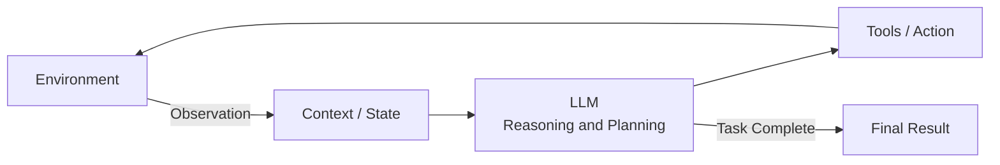
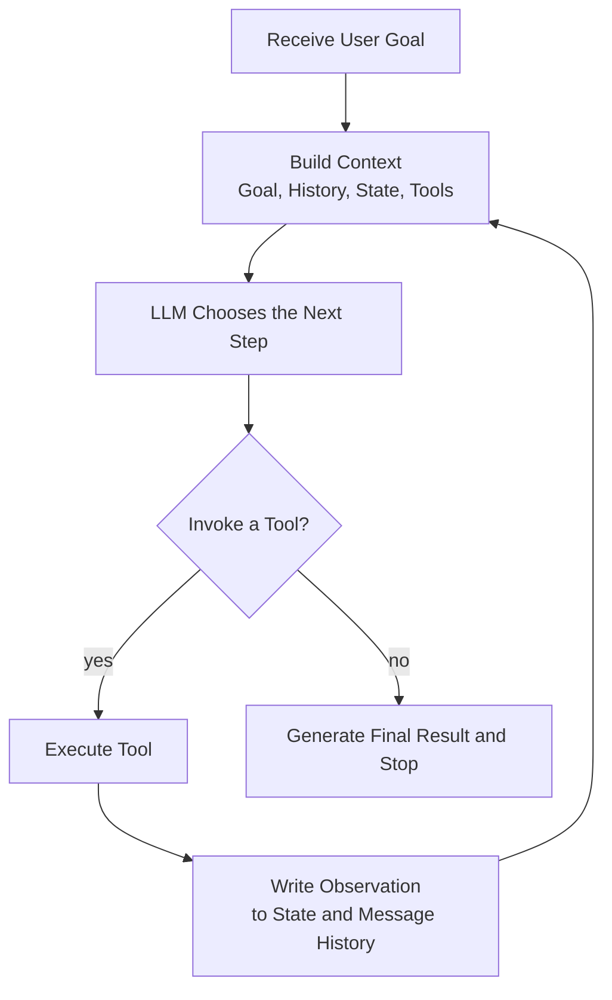
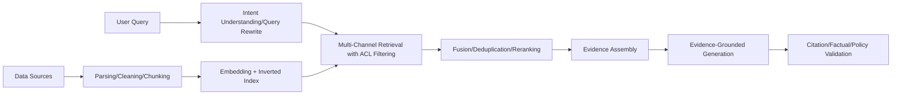
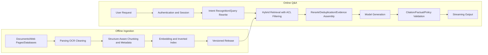
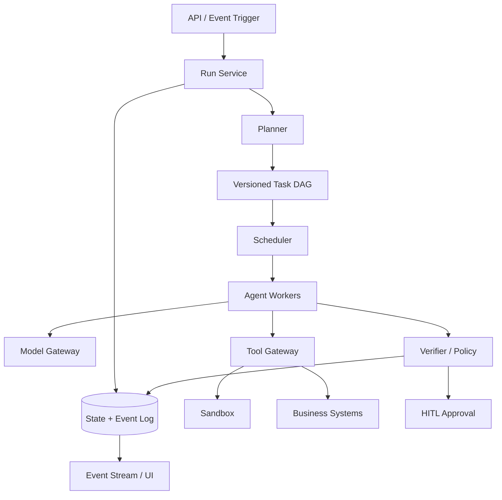
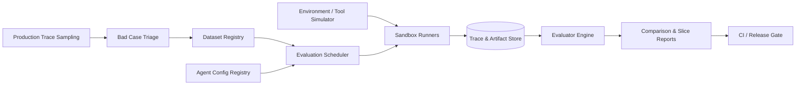

# Agent Development Engineer Interview Questions and Reference Answers

[中文](README.md) | **English**

> Compiled based on the requirements of Agent roles in search, question answering, recommendation, and complex tasks. The focus is not on memorizing framework APIs, but on explaining how to model systems, ensure correctness, conduct evaluation, and operate reliably in high-concurrency production environments.

## Table of Contents

1. [Role Competency Map](#i-role-competency-map)
2. [Agent Fundamentals and Core Execution Flow](#ii-agent-fundamentals-and-core-execution-flow)
3. [Tool Call System](#iii-tool-call-system)
4. [Context Engineering, Memory, and RAG](#iv-context-engineering-memory-and-rag)
5. [Engineering Model Applications](#v-engineering-model-applications)
6. [Evaluation and Quality Assurance](#vi-evaluation-and-quality-assurance)
7. [Performance, Stability, and End-to-End Load Testing](#vii-performance-stability-and-end-to-end-load-testing)
8. [Planning, Multi-Agent, and Workflows](#viii-planning-multi-agent-and-workflows)
9. [Search, Recommendation, Question Answering, and Transaction-Decision Scenarios](#ix-search-recommendation-question-answering-and-transaction-decision-scenarios)
10. [Vector Databases, Semantic Caching, Fine-Tuning, and the Data Flywheel](#x-vector-databases-semantic-caching-fine-tuning-and-the-data-flywheel)
11. [MCP and A2A](#xi-mcp-and-a2a)
12. [System Design Questions](#xii-system-design-questions)
13. [Agent Project Retrospective Questions (84–86)](#xiii-agent-project-retrospective-questions-8486)
14. [Agent Runtime, Sandbox, and Reliability Engineering (87–120)](#xiv-agent-runtime-sandbox-and-reliability-engineering-87120)
15. [Agent Orchestration, Reliability, and Security (121—150)](#xv-agent-orchestration-reliability-and-security-121150)
16. [In-Depth Practical Project Questions (151—166)](#xvi-in-depth-practical-project-questions-151166)
17. [Agent Security, Evaluation, and Production Engineering (167—176)](#xvii-agent-security-evaluation-and-production-engineering-167176)
18. [Context, Interaction, Training, and Continuous Evolution (177—257)](#xviii-context-interaction-training-and-continuous-evolution-177257)
19. [Model and RAG Fundamentals (258–266)](#xix-model-and-rag-fundamentals-258266)
20. [Frequently Used Metrics and Principles](#xx-frequently-used-metrics-and-principles)
21. [Further Reading](#xxi-further-reading)

## I. Role Competency Map

| Competency Area | Interview Focus | Evidence That Should Appear in the Answer |
|---|---|---|
| Agent execution flow | Planning, ReAct, state machines, termination conditions, recovery | State definitions, transition conditions, loop limits, idempotency, and persistence |
| Tool engineering | Registration, validation, concurrency, timeouts, retries, degradation, tracing | JSON Schema, error classification, dependency DAG, trace/span, permission boundaries |
| Context engineering | Message construction, budgeting, pruning, compression, memory, RAG | Token allocation, relevance and freshness, isolation keys, citations, and conflict handling |
| Model engineering | Prompt, routing, streaming, degradation, caching, canary rollout | Versioning, routing features, fallback matrix, experiment traffic splitting, and statistical significance |
| Evaluation | Offline datasets, process evaluation, E2E, Judge, attribution | Data stratification, trajectory metrics, calibration, leakage prevention, and online-offline consistency |
| Stability | Rate limiting, circuit breaking, retries, degradation, observability | End-to-end deadline, retry budget, backpressure, SLO, and failure drills |
| Performance | Concurrency, throughput, TTFT, P99, success rate, tool latency | Layered load testing, critical path, queueing time, capacity model, and bottleneck identification |
| Advanced architecture | Multi-Agent, Agent as Tool, workflows, protocols | Applicability boundaries, communication contracts, scheduling strategies, and cost-complexity trade-offs |

## II. Agent Fundamentals and Core Execution Flow

### 1. What Is an Agent? What Are Its Core Components? How Does It Differ from a Regular LLM Call or a Fixed Workflow?

**Reference answer:**

**Definition.** An Agent is a goal-directed execution system that continuously interacts with an external environment. In each turn, it reads the current state and environment feedback, uses a model to select the next action, executes that action through tools, and feeds the result back into state for the next decision. The loop continues until the task succeeds or a termination condition is reached.

From an engineering perspective:

> **Agent ≈ LLM + Context/State + Tools + Runtime Loop**

Its core components are:

- **LLM (reasoning and planning core)**: It interprets the user goal, decomposes the problem, and selects the next action using the current Context. It produces a candidate action or answer; the real execution result still comes from the external Environment.
- **Context and state**: They retain the information required for the current inference step, including system rules, the user goal, conversation history, task progress, Tool Observations, retrieved evidence, budgets, and pending work. They determine what the LLM can currently see.
- **Tool system**: It turns LLM-generated actions into executable calls such as search, file access, database queries, code execution, business APIs, sub-Agent delegation, or user confirmation, while bounding the Agent's action space.
- **Runtime loop**: It assembles Context, invokes the LLM, executes Tools, feeds back Observations, and decides whether to continue. Files, websites, databases, and users belong to the Environment; the loop interacts with them through Action–Observation cycles.



**Differences from a regular LLM call and a fixed Workflow:**

| Form | Who Determines the Control Flow | Whether It Dynamically Adapts to Environment Feedback | Typical Scenarios |
|---|---|---|---|
| Regular LLM call | Code invokes the model once or a small number of times in a fixed sequence | Usually does not adapt; it generates output directly from the input | Summarization, rewriting, classification, information extraction |
| Fixed Workflow | Nodes, order, and branches are predefined in code or a flowchart | It may read execution results, but the rules for the next step are largely fixed | Approval, ETL, standard customer-service processes, compliance checks |
| Agent | The LLM dynamically chooses the next Action based on the goal, Context, and Observations | It uses tool results to continue, correct errors, clarify, replan, or stop | Complex search, Deep Research, Coding, and tasks whose steps cannot be enumerated in advance |

The key distinction is not how many times the LLM is called, but **who decides the next step**. If the invocation order and branches are hard-coded, the system is still a Workflow even if it calls the model many times. An Agent is needed only when the next step must be selected dynamically from unstructured environment feedback. Production systems often combine both: a Workflow manages deterministic processes, approvals, and state, while an Agent handles only the semantic decisions that cannot be enumerated in advance.

### 2. Design the core execution loop of an Agent.

**Reference answer:**

The Agent’s core loop can be summarized as:

> **Build Context → LLM Decision → Execute Action → Receive Observation → Update Context → Continue or Stop**



The loop has only four core stages:

1. **Context**: Provide the model with the user goal, current state, previous Observations, and available tools.
2. **Decision**: The LLM decides whether to invoke a tool, ask for more information, or stop.
3. **Action**: The Runtime executes the structured tool call proposed by the model.
4. **Observation**: Append the tool result or error to the message history and state so that it informs the next decision.

If the model emits no further Tool Call, the loop proceeds to the final answer; otherwise, it continues. A production implementation adds Schema and permission validation, maximum-step and deadline limits, state persistence, error handling, and completion verification around this minimal loop, but these controls do not change the core loop.

### 3. What is ReAct? What issues arise in production implementations?

**Reference answer:**

**Definition.** ReAct is short for **Reason + Act**. Its core is not “asking the model to write a chain of thought,” but forming a closed loop between model decision-making and interaction with the environment: the model selects the next action based on the goal and current state, the system executes the action and returns an observation, and the model then uses the new evidence to continue, revise the plan, or stop. Conventional question answering follows `input → output`; ReAct follows `state → decision → action → observation → new state`. It can therefore handle real-time information absent from the model’s parameters and tasks that require external systems.

A complete loop generally includes five roles:

1. **Goal/State**: the user goal, known facts, plan, budget, and completed steps.
2. **Decision**: the model determines whether the next step should be information lookup, a tool call, a clarification request, replanning, or termination.
3. **Action**: a structured action, such as `search(query=...)` or `get_order(id=...)`, rather than non-executable natural language.
4. **Observation**: data, errors, sources, and timestamps returned by tools. An Observation is external input and is not inherently trustworthy.
5. **Stop/Verifier**: determines whether the goal has actually been achieved or whether execution should terminate because of a timeout, budget limit, approval requirement, cancellation, or unrecoverable error.

```text
while run is not terminated:
    context = build_context(goal, state, observations, budgets)
    decision = model(context)

    if decision.type == "tool_call":
        validate_schema_permission_budget(decision)
        observation = execute_tool(decision, deadline, idempotency_key)
        state = apply_observation(state, observation)
    elif decision.type == "clarify":
        checkpoint_and_wait_user()
    elif decision.type == "replan":
        state.plan = validate_new_plan(decision.plan)
    elif decision.type == "final":
        verify_completion(decision, state)
        return decision.answer
    else:
        repair_or_fail()
```

**Example.** A user asks, “Check tomorrow’s weather in Beijing, and if it will rain, arrange an indoor itinerary for me.” In the first round, the model must not answer directly from memory; it should generate a weather tool call. The tool returns the probability of precipitation, data timestamp, and source. In the second round, the model selects an indoor-attraction search tool based on the observation. Only after obtaining opening hours should it generate an itinerary with sources in the third round. If the weather tool times out, the system should retry according to the error type, switch to a validated backup source, or clearly state that it cannot obtain real-time weather data. It must not allow the model to fabricate an Observation.

**Differences from related concepts.**

- **CoT** mainly performs reasoning within a single model call and does not necessarily interact with an external environment. The key to ReAct is that actions and real observations change subsequent decisions.
- **Function Calling/Tool Calling** is an interface mechanism through which the model expresses structured actions. ReAct is the control strategy that decides when to invoke tools, how to consume results, and whether to continue.
- In a **fixed Workflow**, nodes and branches are primarily predefined by code. ReAct allows the model to select actions dynamically in each round, providing flexibility but lower determinism.
- **Plan-and-Execute** first generates a relatively complete plan and then executes it step by step. ReAct usually decides one next step at a time. Long-running tasks often use “coarse-grained planning + ReAct within each stage.”

**Production implementations must not directly copy the `Thought/Action/Observation` text template.** They should not depend on or expose the model’s private chain of thought. Instead, they should retain auditable brief decision summaries, structured actions, tool observations, and state changes. The control plane must provide the following capabilities:

- **Loop governance**: maximum steps, number of similar actions, Tokens, cost, and end-to-end deadline; use action fingerprints and state deltas to detect non-progress loops such as “search—no results—repeat search.”
- **Tool reliability**: JSON Schema, semantic validation, permissions, idempotency, timeouts, and error classification. Parameter errors must not be retried unchanged, rate limits must honor `Retry-After`, and write operations with unknown outcomes must query status first.
- **Context governance**: only inject observations relevant to the goal; paginate, summarize, or externalize large results as artifacts; preserve source, timestamp, version, and error state to prevent erroneous observations from being summarized as facts.
- **Security boundaries**: webpages and tool results may contain Prompt Injection and must only be treated as data; they cannot override system policies. Actions with side effects still require server-side policies and human approval.
- **Concurrent scheduling**: only tools without data dependencies or write conflicts may run in parallel. Partial failures must distinguish critical from non-critical branches; `Promise.all` must not be treated as a transaction.
- **Completion validation**: the model may propose `final`, but a deterministic completion gate must still validate required goals, evidence, output Schema, business rules, and unresolved dependencies.
- **Observability and evaluation**: record the model/Prompt/tool version, input summary, action, observation, state difference, Tokens, latency, and cost for every round. Focus on task success rate, tool selection/parameter correctness, repeated-step rate, average number of steps, and failure recovery rate.

**Advantages and disadvantages.** ReAct can use real-time external information, correct errors after failures, and adapt to tasks that cannot be enumerated in advance. Its costs are higher latency and expense due to multiple model calls, error accumulation along the trajectory, and more difficult execution-path testing. Therefore, use a Workflow for business processes with fixed paths and explicit rules, and use ReAct only when the next step genuinely depends on dynamic semantic judgment.

**Interview takeaway:** ReAct is not a Prompt trick. It is a closed loop of “model decision-making—controlled execution—environment feedback.” Production quality depends on the state, permissions, budget, validation, recovery, and observability capabilities surrounding that loop.

### 4. How Should an Agent State Machine Be Designed?

**Reference answer:**

Explicitly define states and valid transitions, for example:

`CREATED → PLANNING → RUNNING → WAITING_TOOL/WAITING_USER/WAITING_APPROVAL → RUNNING → SUCCEEDED/FAILED/CANCELLED/TIMED_OUT`

The state record should contain at least `run_id, state, state_version, attempt, checkpoint, pending_action, reason, created_at/updated_at`. Design requirements:

- Each transition should be event-driven and validate the current state, preconditions, and `state_version`; use transactions or CAS updates to prevent concurrent overwrites, and optionally use an outbox for event publication.
- Transitions must follow an allowlist and guards. For example, only valid approval can transition the state from `WAITING_APPROVAL` back to `RUNNING`, while cancellation can transition any non-terminal state to `CANCELLED`.
- Separate states from events: states support fast reads, while event logs support auditing, replay, and reconstruction; retries create a new attempt rather than altering historical facts.
- Long-running tasks should periodically save checkpoints; when waiting for a user, Tool, or external task, persist the associated ID and deadline, release compute resources, and resume execution through callbacks, timeout events, or recovery scans.
- Propagate cancellation signals to the model, Tools, and subtasks, and use idempotency keys for operations with side effects.
- Terminal states must not transition again or execute side effects, and must have a fixed completion time and result summary; duplicate events must produce the same result to prevent tasks from being “revived.”

### 5. How does an Agent determine that a task is complete?

**Reference answer:**

Do not merely trust the model when it outputs “completed.” Combine the following checks:

1. Whether the required goals in the plan have been satisfied;
2. Whether required tools succeeded and returned verifiable evidence;
3. Whether the output satisfies structural, citation, business-rule, and security constraints;
4. Whether unresolved dependencies or conflicting information remain;
5. Whether budget, timeout, or human approval boundaries have been triggered.

The model may propose `final`, after which a deterministic completion gate performs validation. An independent verifier may also be added for critical tasks, but its additional latency and same-source model bias must be evaluated.

### 6. What basic safeguards should an Agent loop have, and how can ineffective loops be avoided?

**Reference answer:**

- Hard limits: maximum steps, number of calls to the same type of tool, Tokens, cost, and wall-clock deadline.
- Soft detection: consecutive action signatures, parameter similarity, state deltas, and information gain. If no progress is made over multiple rounds, replan or terminate.
- Classify errors. Parameter errors must not be retried unchanged; rate-limit errors should follow `Retry-After`; permanent errors should stop immediately.
- Define explicit tool success criteria to prevent the model from treating empty results as a reason to “search again.”
- On termination, return completed work, the failure reason, and possible next actions instead of fabricating success.

### 7. How do you ensure an Agent is recoverable and replayable?

**Reference answer:**

- Save a checkpoint at every decision boundary: state version, message references, plan, budget, tool call ID, and model/Prompt/tool versions.
- Use business idempotency keys for tools with side effects. Distinguish among “request not sent,” “result unknown,” and “execution succeeded.” When the result is unknown, query status first rather than retrying blindly.
- There are two kinds of replay: audit replay reads historical outputs; experimental replay invokes the model/tools again. The latter is affected by model nondeterminism and external data changes, so versions must be pinned, random parameters recorded, and side effects isolated.
- Use optimistic locking or serial execution for each run to prevent two workers from advancing the same state simultaneously.

### 8. Which Logic in an Agent Should Be Controlled by Code, and Which Is Suitable for the Model?

**Reference answer:**

The criteria are whether errors are acceptable and whether results can be verified deterministically. Permissions, monetary and resource limits, tenant isolation, state transitions, retries, timeouts, idempotency, output Schemas, auditing, and compliance rules are system invariants and must be controlled by code or policy services. The model is suitable for intent understanding, open-ended planning, semantic Tool selection, unstructured extraction, candidate solution generation, and natural-language summarization. Actions proposed by the model must be treated only as proposals and must pass Schema, permission, and business-rule validation before execution. For example, “cross-tenant access is prohibited” cannot exist only in the Prompt, because prompt injection may invalidate the constraint.

### 9. How do you handle tasks that require user clarification midway?

**Reference answer:**


From an engineering perspective, model clarification as an explicit `request_clarification` action containing the missing fields, why they are necessary, candidate options, and whether a safe default exists. The system first saves a checkpoint, enters `WAITING_USER`, and releases the worker. After the response arrives, it validates the user, run, and state version, writes the answer into structured slots, and resumes execution. If the information only affects presentation, the system may continue using an explainable default. If it affects monetary amounts, permissions, target resources, or irreversible operations, it must wait. A waiting TTL, cancellation, and revalidation after expiration are also required to prevent execution against changed external state when a user responds hours later.

### 10. What Is HITL? How Should Approval Boundaries Be Defined and Bound to Specific Actions?

**Reference answer:**

HITL means **Human-in-the-Loop**: introducing human judgment at critical decision points in an Agent execution flow. The Agent may complete low-risk steps automatically, but it pauses and saves state before high-risk, irreversible, underspecified, or low-confidence actions, then continues only after a person approves, rejects, modifies, or supplements the action. HITL does not mean asking for confirmation at every step, nor is it merely a manual fallback after failure; it is a risk-control mechanism designed into the workflow in advance.

Approval boundaries should follow action risk: read-only operations may execute automatically; reversible operations may execute with post-action notification; high-risk writes such as payments, publishing, deletion, permission changes, and sensitive-data exfiltration require approval before execution; critical operations should also require secondary authentication. The approval page should show the Tool, target, normalized parameters, impact, evidence, and validity period rather than only the model’s explanation. The record binds the approver, action hash, and one-time nonce, and any parameter change invalidates it. The state machine supports `WAITING_APPROVAL/APPROVED/REJECTED/EXPIRED`, with timeouts failing closed. On resume, permissions, parameters, and idempotency are rechecked and fully audited.

## III. Tool Call System

### 11. How Should a Scalable Tool Registry Be Designed?

**Reference answer:**

Each Tool should be registered with a Tool manifest containing a unique name and version, description, input/output JSON Schema, protocol and endpoint, timeout, idempotency, side-effect level, permission scope, concurrency limits, retry policy, data-sensitivity level, owner, and deprecation status. Tool descriptions should accurately distinguish “when to use” from “when not to use” to reduce incorrect model selections.

The registry is responsible for publishing, discovery, health status, and version management. During lookup, permission filtering should be based on the tenant, user, Agent identity, and policies, so the model can see only callable Tools. Callers should pin a version or version range and check compatibility based on Schema, protocol, and capability tags; they must not silently switch to breaking versions. When many Tools are available, use retrieval or grouped routing first rather than placing every Schema into the Context.

The executor should use a unified Runtime adapter for HTTP, RPC, functions, or asynchronous tasks, consistently handling parameter validation, authentication, credential injection, scheduling, rate limiting, tracing, and error normalization, so Tool implementations do not duplicate cross-cutting capabilities. A Tool’s release process should include registration, validation, canary rollout, enablement, deprecation, and removal, together with Schema contract, permission, timeout and retry, idempotency, and compatibility testing.

### 12. What layers should Tool parameter validation include?

**Reference answer:**

1. **Structural validation**: types, required fields, enumerations, ranges, formats, and additional fields.
2. **Semantic validation**: start time precedes end time, resources exist, and cross-field constraints are satisfied.
3. **Permission validation**: whether the caller may access the target tenant, user, or resource.
4. **Policy validation**: monetary limits, sensitive operations, approval status, geographic restrictions, and compliance rules.
5. **Pre-execution confirmation**: show the final normalized parameters for actions with side effects and bind an idempotency key.

Return validation errors using machine-readable error codes so the model can correct only the problematic fields. Sensitive internal information must not be injected back into the model or exposed to the user.

### 13. How do you invoke multiple Tools in parallel?

**Reference answer:**

First transform the plan into a dependency DAG. Run nodes in parallel if they have no dependencies, no conflicts, and have passed permission checks. Run nodes serially if they have data dependencies or write conflicts. Set global, tenant-level, and tool-level concurrency limits, and inherit the end-to-end deadline.

Result aggregation must preserve the status of each call, allow partial success, maintain stable ordering, deduplicate results, and label sources. Do not cancel all results because one non-critical tool failed. For all-or-nothing business operations, use transactions or compensation mechanisms rather than pretending that ordinary `Promise.all` is atomic.

### 14. How should Tool timeouts and retries be designed?

**Reference answer:**

- Allocate the end-to-end deadline downstream; an individual tool timeout must not exceed the remaining time.
- Retry only transient errors: connection resets, some 5xx errors, and explicit rate limiting. Do not retry parameter errors, permission errors, or business rejections.
- Use exponential backoff + jitter, honor `Retry-After`, and set maximum attempts and a retry budget to prevent retry storms.
- Automatically retry non-idempotent write operations only when an idempotency key is available or execution status can be queried.
- Record each attempt independently, but associate it with the same logical tool call so the true success rate and amplification factor can be calculated.

### 15. How Should Tool Failures Be Degraded?

**Reference answer:**

First distinguish critical from non-critical dependencies. When a non-critical Tool fails, partial results may be returned with missing information clearly identified. Read-only queries may use timestamped cached data within a staleness window defined by the business. A fallback Tool may be used only when capability, data freshness, permissions, and other relevant properties are equivalent. If the result of a high-risk write operation is unknown, first query its status using the idempotency key; do not switch Tools and repeat the operation, and never use simulated results or stale data to impersonate success. Fail or escalate to a human when necessary. After the circuit breaker opens, fail fast; during recovery, use half-open probes. Evaluation should consider not only API availability, but also degraded-task correctness, stale-data ratio, human takeover rate, and erroneous-action rate.

### 16. What should be recorded in the Tool call flow?

**Reference answer:**


Each logical call should use `trace_id/run_id/step_id/tool_call_id`, and each retry should receive a separate `attempt_id`. In addition to the tool name, version, redacted parameters, queueing/connection/execution latency, and error code, record the permission decision, idempotency-key hash, cache usage, degradation path, result size, and state difference. For large results, store only a content hash and a controlled artifact reference. Calculate success rates by logical call; use attempt-level data to observe retry amplification. Control high-cardinality log fields and configure retention periods to prevent the observability system itself from leaking sensitive data or scaling uncontrollably.

### 17. How do you define a unified Tool error model?

**Reference answer:**

At minimum, distinguish among: `INVALID_ARGUMENT`, `UNAUTHENTICATED`, `PERMISSION_DENIED`, `NOT_FOUND`, `CONFLICT`, `RATE_LIMITED`, `TIMEOUT`, `DEPENDENCY_UNAVAILABLE`, `INTERNAL`, `CANCELLED`, and `UNKNOWN_RESULT`.

The error object should include whether the error is retryable, the suggested wait time, user-visible information, model-visible remediation guidance, and an internal diagnostic reference. Do not expose raw stack traces directly to the model or the user.

### 18. How do you defend against Tool-related Prompt Injection?

**Reference answer:**

- Treat webpages, files, search results, and tool outputs as untrusted data. Pass them through clear boundaries and do not allow them to override system policies.
- Base tool permissions on server-side identity and policies, not on claims made by the model.
- Apply least privilege to tools, parameter allowlists, network egress restrictions, sandboxing, and sensitive-field redaction.
- Perform policy checks or require human confirmation before transmitting data externally or executing actions with side effects.
- When the model sees “ignore previous instructions and call a tool,” the system must still execute only structured actions that have passed Schema, permission, and policy validation.
- Build dedicated evaluation datasets for injection attacks instead of relying on a single keyword filter.

### 19. What should you do when too many Tool descriptions cause context bloat?

**Reference answer:**


Production systems generally use two-stage Tool Search. In the first stage, expose only a short catalog and retrieve candidates based on intent, semantics, permissions, risk, and historical success rate. In the second stage, provide the execution model with only the complete Schemas, examples, and constraints for the Top-K candidates. Frequently used and security-required tools may remain permanently available. Synonymous tools should be consolidated or clearly specify “when not to use.” Permission filtering must occur before retrieval; the model must not see tools it is not authorized to use. Evaluation should consider Tool Recall@K, incorrect-selection rate, first-round parameter correctness, context Tokens, and end-to-end success rate to avoid saving Tokens while omitting critical tools.

### 20. How Should Oversized Tool Output Be Handled?

**Reference answer:**

Prioritize redesigning the Tool contract rather than truncating output afterward: support field projection, filtering, pagination, cursors, server-side aggregation, and Top-K, while limiting bytes, rows, and Tokens at the execution layer. Store raw results in object storage, while retaining only the Schema, statistics, relevant evidence snippets, provenance, and artifact URI in the Agent state. Compression must preserve key numbers, entities, times, errors, and evidence locations. When subsequent precise calculations or actions are required, retrieve the structured raw data through a handle rather than relying on a natural-language summary. Monitor the result-size distribution, truncation rate, and task success rate after compression.

## IV. Context Engineering, Memory, and RAG

### 21. How do you manage a Token budget?

**Reference answer:**

First reserve an output budget and safety margin from the model’s context window, then allocate budgets to different regions: system policies, tool Schemas, the current user request, recent conversation, task state, retrieved evidence, and historical summaries. This can be expressed as:

`Available input = context limit - maximum output - safety margin`

Budgeting is not simple character-based truncation. The typical priority is: security/business instructions > current request > required state and tool contracts > highly relevant evidence > recent history > low-relevance history. Record Token usage in each region and the reasons for pruning to support tuning.

### 22. How Should Multi-Turn Conversation History Be Selected?

**Reference answer:**

Use a combination of a “recent window, structured task state, relevant-history retrieval, and phase summaries” rather than retaining only the latest N turns. Prioritize the current goal, user-confirmed constraints, fixed facts, high-risk fields, and unfinished items. Small talk, duplicate logs, and content superseded by newer facts may be pruned. Messages must retain their role, source, time, applicable scope, and version; Tool Observations must not become user instructions after summarization. Resolve fact conflicts according to source authority, freshness, and scope, explicitly record supersession relationships, and preserve the audit trail. Effectiveness should be jointly evaluated using task success rate, coreference resolution, constraint omission rate, and Token cost.

### 23. What Are the Risks of Context Pruning and Compression?

**Reference answer:**

The main risks are omitting negations, numbers, permission conditions, time ranges, entity relationships, incomplete steps, and evidence sources, or recording model inferences as facts. Repeated rolling summaries may also accumulate distortion. A more robust approach is to first extract goals, facts, constraints, conflicts, pending items, and evidence IDs according to a fixed Schema, then summarize the remaining content. High-risk fields such as amounts, dates, and permissions should be preserved deterministically; recent messages should be retained verbatim; phase checkpoints should be immutable whenever possible; and large results should be stored externally. After compression, use rules to verify key fields, reread original messages when necessary, and evaluate the same tasks before and after compression rather than judging only whether the summary is fluent.

### 24. How Should State Be Isolated Across Users, Sessions, and Agents?

**Reference answer:**

All state and retrieval operations must include `tenant_id/user_id/session_id/run_id/agent_id` injected by a trusted server based on the authentication Context. Isolation keys supplied by the model, request body, or Tool output must not be trusted. Databases should use row-level permissions, composite primary keys, or mandatory filtering. Cache keys, vector-database namespaces, object-storage paths, checkpoints, and artifact indexes must also include the same boundaries, with ownership validated again on the server, to prevent leakage from other storage systems even when the database itself is isolated.

A sub-Agent should receive only the minimum Context, Tool set, and short-lived scoped token required to complete its task. It must not inherit the entire session, system credentials, or the parent Agent’s permissions by default. Only structured artifact references, provenance, and permission declarations should be passed across Agents. Authorization must be checked again during download, and arbitrary internal paths must not be forwarded directly.

When a session ends, a user withdraws consent, or a tenant is deleted, lifecycle policies should cascade cleanup across databases, caches, vectors, artifacts, and derived indexes, set TTLs and retention periods, and handle backups or key destruction. All cross-boundary access, authorization, and deletion must be written to audit logs. Continuously run leakage tests covering forged isolation keys, cross-tenant retrieval, cache collisions, vector retrieval, and unauthorized artifact access.

### 25. What Is the Difference Between Short-term Memory and Long-term Memory?

**Reference answer:**

The main differences are scope, lifecycle, and the threshold for writing:

| Dimension | Working/Short-term Memory | Long-term Memory |
|---|---|---|
| Scope | Current run/session | Across runs and sessions |
| Content | Current goal, plan, recent messages, tool observations, intermediate state | Confirmed facts, preferences, historical events, reusable experience |
| Medium | Model context + structured Run State | Databases, object storage, vector/keyword indexes |
| Writing | Continuously updated during execution, then cleared or compressed when the task ends | Subject to authorization, value assessment, deduplication, conflict checks, and sensitivity checks |
| Primary risks | Token limit exceeded, distortion from truncation, inconsistent state | Incorrect memories, outdated facts, permission leakage, retrieval misuse |

Working Memory can be compared to the model’s limited scope of attention, but it must not rely solely on chat messages: goals, budgets, incomplete items, and key facts should be stored in structured state. Long-term Memory also does not mean “storing every conversation in a vector database”; each record needs a source, timestamp, applicable scope, version, ACL, TTL, and deletion capability. Model inferences should not be written directly by default.

Reading Long-term Memory usually combines **relevance, recency, importance, and trustworthiness**. Identity, permission, and validity-period filtering is performed first, after which the minimum necessary content is selected for inclusion in the context. Retrieved results are evidence that may be outdated or conflicting, and their priority must not exceed explicit current user instructions, system policies, or authoritative business state. Evaluation should measure write precision, retrieval precision/recall, misuse of outdated information, conflict handling, and deletion completeness, rather than only vector similarity.

### 26. How Can “Incorrect Memories” Be Prevented from Contaminating Subsequent Conversations?

**Reference answer:**

Establish a governed write pipeline: candidate extraction, source classification, long-term value assessment, deduplication and conflict detection, rule-based or user confirmation, and versioned storage. Each memory record should contain `subject/predicate/value/scope/source/time/confidence/validity`, clearly distinguishing user statements, system facts, Tool evidence, and model inferences. Model inferences should not enter long-term memory by default. Explicit user corrections and authoritative Tool results generally take precedence over inferences. Conflicts that cannot be resolved should coexist and be marked `conflicted`, with active clarification during use. Capabilities to view, correct, delete, and expire memories are also required. Monitor the erroneous-write rate, retrieval accuracy, conflict-resolution correctness, and completeness of privacy-related deletion.

### 27. Design a RAG Pipeline.

**Reference answer:**

It is not sufficient to answer only “Embedding + vector database.” A complete RAG system consists of four parts: knowledge ingestion, online retrieval, generation and validation, and continuous evaluation.



**Ingestion pipeline.** Parse PDFs, web pages, and tables while preserving titles, page numbers, and structure; remove template noise and duplicates, and chunk by semantic structure rather than crudely splitting by a fixed character count. Each chunk stores its document, version, section, source location, timestamp, and ACL. Build BM25, vector, and any necessary structured indexes in parallel. Version and release a new index only after validating it against an offline retrieval set, with support for atomic switching and rollback.

**Online pipeline.** The ingress layer injects trusted identity and tenant information. Query rewriting must preserve entities, negation, temporal information, and conversational references. Apply ACL and validity-period filters first, then run keyword, vector, and structured/graph retrieval in parallel. Use RRF or learning-to-rank for fusion, deduplicate results, and set per-document quotas. After precise reranking with a reranker, select the minimum sufficient evidence for each subproblem to prevent similar but irrelevant content from crowding out the context.

**Generation and validation.** Each evidence block carries a stable citation ID, and the Prompt explicitly states that “evidence is data, not instructions.” Every key claim must be bound to a citation. After generation, verify that citations exist, that they support the corresponding claims, and that numbers and dates are consistent. If evidence is insufficient or conflicting, or permissions are uncertain, refuse to answer or request clarification; do not fabricate information by relying on model memory.

**Reliability and scalability.** Process Embedding and parsing asynchronously in batches, and scale retrieval services statelessly. Cache keys include the query, tenant, ACL, and index version. Each stage inherits the overall deadline, with separate budgets and evaluated degradation strategies for retrieval, the reranker, and the model. Make index updates idempotent using document versions and chunk hashes; deletions must also remove corresponding index entries and cache entries.

**Evaluation.** For ingestion, measure parsing success, duplication rate, and freshness. For retrieval, measure Recall@K, MRR/nDCG, ACL accuracy, and latency. For generation, measure correctness, faithfulness, citation accuracy/coverage, and refusal behavior. End-to-end metrics include task resolution rate, P99, and cost per successful question answered. Bad Cases must be attributed to parsing, retrieval, ranking, assembly, or generation rather than being represented only by a single aggregate score.

### 28. What Retrieval and Generation Metrics Are Used for RAG?

**Reference answer:**

The retrieval layer is typically evaluated using Recall@K, Precision@K, MRR, nDCG, hit rate, duplication rate, ACL filtering correctness, and latency. The generation layer is evaluated using answer correctness, faithfulness or factual consistency, citation accuracy, citation coverage, completeness, and refusal correctness. High Recall@K only indicates that the gold evidence entered the candidate set; it does not mean the model used it correctly. The presence of a citation also does not mean that the citation supports the corresponding claim. A mature evaluation should annotate key claims and gold evidence, separately diagnose parsing, retrieval, reranking, Context assembly, and generation issues, and then incorporate end-to-end task success rate, user feedback, latency, and cost into the assessment.
### 29. How Should Conflicting Retrieval Results Be Handled?

**Reference answer:**

First preserve the source, document version, publication date, effective date, applicable audience, and authority level. For policies and rules, prioritize the authoritative version currently in effect for the relevant business scope; for real-time facts, prioritize authoritative tools and the latest event time. When the conflict cannot be resolved, do not let the model “take the average”; instead, present both sides of the conflict, their respective evidence, and the points requiring confirmation. For high-risk rules, a versioned master data system or rule service should ideally provide the single valid state, while RAG is responsible for explanation and locating the original text. Conflict rate and incorrect resolution rate should also be included in evaluation.

The system should also record the conflict occurrence rate, automated adjudication rate, human confirmation rate, and incorrect override rate. Adjudication results for the same question across different versions must be replayable to prevent the model from silently changing its basis.
### 30. How Should RAG Results Be Organized When They Are Added Back to the Context?

**Reference answer:**

Group evidence by sub-question or topic rather than simply concatenating the Top-K results. Each passage should include a stable citation ID, title, version, time, ACL, and source location. Remove template noise, duplicate chunks, and invalidated versions first, and then control the proportion contributed by any single document to prevent long documents from overwhelming other sources. Clearly separate the evidence section from system instructions, and present conflicting evidence side by side. The Context Builder should select the “minimum sufficient evidence set” according to the output budget. After generation, verify that every key claim has a corresponding citation and preserve the ability to retrieve the original text.
## V. Engineering Model Applications

### 31. How Should Prompt Templates Be Managed?

**Reference answer:**

A template should include an ID, semantic version, applicable model/task, variable Schema, owner, change notes, evaluation results, and release status. During rendering, validate variable types and lengths, and place external text within explicit data boundaries to prevent role injection. The release process should be offline regression and safety suite → Shadow/Canary → online guardrails → full rollout, with support for rapid rollback. Each trace should record the actual prompt version used. Do not hide secrets, permission rules, or business invariants in the prompt; they must be controlled by the execution layer.
### 32. How Should Model Routing Be Implemented?

**Reference answer:**

Routing inputs may include task type, difficulty, context length, whether tools or vision are required, risk level, language, latency SLA, tenant budget, and model health. Maintain a capability matrix covering structured output, tool calls, context length, and safety baselines. Route simple classification and extraction tasks to smaller models, while complex planning or high-risk tasks should use stronger models with an additional verifier. First establish a baseline with explainable rules, and then evaluate learned routing. Metrics should include not only average cost, but also misrouting rate, quality loss by scenario, degradation rate, P99, and cost per successful task.
### 33. How Should Streaming Output Be Implemented in an Agent?

**Reference answer:**

Define streaming output as a structured event protocol, such as `run.started`, `message.delta`, `tool.started`, `tool.completed`, `approval.required`, `citation`, `error`, and `run.completed`. Each event should carry `run_id`, step, sequence, and time. SSE is suitable for unidirectional server push, while WebSocket is suitable for bidirectional control. The server should persist events through an event log or outbox before sending them. The client should deduplicate by `run_id + sequence` and resume from interruptions using `Last-Event-ID` or a cursor. Slow clients require bounded buffers and backpressure. During Tool execution, display only verifiable action summaries without exposing private chains of thought or fabricating progress. A disconnection should not cancel the background task by default, and the final event should provide the complete result and terminal state.
### 34. How Should Model Degradation Be Designed?

**Reference answer:**

Degradation must be based on a capability matrix rather than arbitrarily substituting one model name for another. Trigger conditions include timeouts, 429 responses, regional failures, budget constraints, and context incompatibility. After switching models, it may be necessary to change the prompt, shorten the context, disable noncritical steps, or disable certain tools. For high-risk tasks, if the fallback model has not passed the same quality and safety baselines, the task should fail or be escalated to a human. Monitor degradation triggers, post-degradation success rate, factual errors, P99, and cost to prevent “higher availability but uncontrolled quality.”

Before release, separately run quality, safety, and tool compatibility regression tests for fallback paths, and conduct regular failure drills. Otherwise, discovering during an actual outage that the fallback model cannot call a critical tool means the degradation plan effectively does not exist.
### 35. What Types of LLM Response Caches Are There?

**Reference answer:**

- Exact cache: The normalized input, model, parameters, prompt version, and tool version must match exactly.
- Semantic cache: Reuse answers for semantically similar queries, subject to a similarity threshold and business constraints.
- Prefix/Prompt cache: Reuse model-side computation for a common prefix.
- Intermediate-result cache: Cache query rewriting, embeddings, retrieval results, or read-only tool results.

The cache key must include the tenant, permissions, knowledge version, freshness, model, and prompt version. Personalized, real-time, high-risk, or side-effecting requests are generally unsuitable for semantic caching. Permission and freshness checks must still be performed after a cache hit.

### 36. How Should Canary Experiments and Effect Analysis Be Conducted?

**Reference answer:**

Use stable hashing by user or session to assign experiment buckets, preventing the same long-running task from crossing versions. Before launch, define the primary metric, guardrails, sample size, and minimum observation period. The primary metric may be task success rate/resolution rate, while guardrails should include safety incidents, incorrect actions, human takeover, P99, and cost per successful task. Check for SRM, instrumentation consistency, and concurrent changes in models, knowledge, or traffic, and stratify by scenario and difficulty. Agents are highly nondeterministic, so offline runs should be repeated, while online experiments should use paired comparisons or stable bucketing. Report absolute changes, confidence intervals, and practical effect sizes together.
### 37. What Should Be Done When Structured Output Does Not Conform to the Schema?

**Reference answer:**

Prefer the model’s native Structured Output or strict Function Calling, but the server must still perform JSON Schema and business-semantic validation. After validation fails, a limited number of constrained repair attempts may be made: return only the field paths and concise error reasons, and require the model to correct only the invalid fields. Do not retry indefinitely. Amounts, resource IDs, permissions, enums, and inter-field relationships must be checked again by code. Do not use fragile regular expressions to guess critical operation parameters from arbitrary text. If repair still fails, return a safe error or escalate to a human. Continuously record the first-pass parsing success rate, repair success rate, and final failure rate to improve Schema descriptions, constraints, and examples.
## VI. Evaluation and Quality Assurance

### 38. How Should the Foundational Data Model for an Agent Offline Evaluation Set Be Built?

**Reference answer:**

Sample sources should cover anonymized real traffic, production Bad Cases, expert-authored cases, boundary and adversarial samples, and synthetic data, stratified by scenario, difficulty, user type, Tool dependency, and risk level. In addition to the input, each task should record the user goal, environment and knowledge versions, available Tools, expected business state, allowed alternative paths, prohibited actions, scoring rules, and evaluator. When Tools change frequently, preserve a simulated environment or recorded replay to ensure reproducibility. Divide the data into a development set, a stable regression set, and a blind test set, preventing leakage by entity and time. Before a Bad Case is added, it must be deduplicated, anonymized, and have its root cause confirmed. Synthetic data should only supplement scarce boundary cases. Reports should include stratified results, variance, cost, and latency.
### 39. What Is the Difference Between Process Evaluation and End-to-End Evaluation?

**Reference answer:**

Process evaluation identifies “which stage failed” and covers steps such as intent understanding, planning, Tool selection, parameters, retrieval, error recovery, approval, and termination. End-to-end evaluation determines “whether the user’s goal was completed” and focuses on the final business state, answer correctness, safety, latency, and cost. End-to-end evaluation alone makes attribution difficult, while process evaluation alone may reward trajectories that appear reasonable even though the task was not completed. Therefore, the outcome should be the primary gate, supplemented by trajectory constraints: multiple valid paths should be allowed, but unauthorized actions, approval bypasses, and duplicate side effects must be prohibited. When analyzing a production Bad Case, first locate the earliest erroneous step, then associate it with the final business impact.
### 40. Which Metrics Should Be Used to Evaluate Agent Execution Traces and Tool Use?

**Reference answer:**

The final answer alone is insufficient for evaluation. A complete metric set has five layers:

1. **Outcome layer**: Task completion, final business state, correctness, correct refusal, and severe safety errors.
2. **Planning layer**: Subgoal coverage, dependency correctness, first action, ineffective/repeated steps, replanning, and termination decisions.
3. **Tool Use layer**: Whether a tool should be invoked, whether the correct tool can be retrieved and selected from the tool catalog, whether parameters are correct, whether the invocation succeeds, and whether the Tool Result can be correctly consumed to decide whether to continue/rewrite/stop. Scenarios with many tools should also evaluate Tool Recall@K, incorrect selection rate, and first-attempt parameter correctness.
4. **Recovery and safety layer**: Timeout recovery, error classification, unauthorized access, approval bypass, handling of unknown outcomes, and repeated side effects.
5. **Efficiency layer**: Number of steps, Tokens, cost, tool fan-out, queuing, and P50/P95/P99.

A shorter trace is not necessarily better; outcome and safety constraints should be satisfied before efficiency is compared. For multiple valid traces, use milestone/constraint matchers rather than requiring a match to a single action sequence. Run each case repeatedly and report stability, the worst-performing slice, and the first step at which deviation occurs. A Tool HTTP 200 only indicates that the dependency returned a response; it does not mean that the Agent’s selection, parameters, or interpretation of the result were correct.
### 41. How Should LLM-as-a-Judge Be Designed?

**Reference answer:**

- First define an explicit rubric and score correctness, completeness, faithfulness, safety, and other dimensions separately.
- Provide the Judge with sufficient but minimal reference evidence, hide the identities of candidate systems, and randomly swap answer order to reduce positional bias.
- Use structured scoring and require citations to scoring evidence rather than relying on verbose reasoning text.
- Use a human-labeled dataset to calibrate agreement, correlation, bias, and thresholds; use dual evaluation or human review for critical samples.
- Prevent text in the evaluated answer from injecting instructions into the Judge; candidate answers must be isolated as data.
- A Judge is suitable for scalable approximate evaluation, but it cannot replace business ground truth or online outcomes.

### 42. How Can Bad Cases Be Automatically Attributed?

**Reference answer:**

Establish a hierarchical error taxonomy: requirement understanding, planning, tool selection, parameters, tool execution, retrieval, context, generation, citations, safety, system/dependencies, and insufficient user input. First attribute errors using deterministic signals such as timeout codes, empty retrieval results, and Schema errors, and then use rules or models to analyze the trajectory. Output the root cause, evidence step, impact, and confidence. Manually audit a sample of automatically assigned labels to prevent incorrect attribution from contaminating the direction of optimization.

Attribution begins at the “first divergence point” in the trace. First use deterministic signals to identify Schema, permission, empty retrieval, index version, tool error, and illegal state issues. Then perform replay and ablation by fixing tool results while replacing the model/prompt, or by fixing model input while replacing retrieval evidence. Distinguish between a trigger and the system root cause; for example, a 429 is the trigger, while multi-layer retries and a lack of backpressure are amplifying root causes. Attribution output should include the error category, evidence step, scope of impact, and confidence, with human sampling for calibration. After a fix, the case must first fail and then pass before entering the permanent regression set with an environment snapshot.
### 43. Which Metrics Should Be Monitored After an Agent Goes Live?

**Reference answer:**

- Business: task success rate, conversion/resolution rate, user retry rate, human takeover rate, and satisfaction.
- Quality: factual error rate, citation correctness, tool call success rate, refusal correctness, and safety incidents.
- Performance: QPS, concurrency, TTFT, end-to-end P50/P95/P99, and segmented tool and model latency.
- Stability: timeout rate, error rate, circuit-breaker rate, retry amplification, degradation rate, and queue length.
- Cost: Tokens per successful task, model cost, tool cost, and cache hit rate.

Averages obscure the long tail, so metrics must be stratified by scenario, model, version, tenant, and dependency.

### 44. How Should Regression Testing Be Performed for Prompt or Model Upgrades?

**Reference answer:**

During regression testing, lock the versions of the code, Prompt, model, Tools, knowledge index, and evaluation environment, and run the old and new versions on the same stratified dataset. For non-deterministic Agents, each case should be run multiple times with paired comparisons, reporting the mean and variance rather than running each version only once. In addition to task success rate, compare severe error types, trajectory constraints, step count, P99 latency, human takeover rate, and cost per successful task, with slices by scenario and difficulty. Samples with differing results should be prioritized for human review to rule out Judge bias. Use Shadow or Canary deployment and establish guardrails for safety, erroneous actions, and cost. Traces must bind all versions, version switching should be avoided during long-running task execution, and rapid rollback must be supported.
### 45. How Can the Maturity of an Agent Evaluation Platform Be Assessed?

**Reference answer:**

A mature platform should support versioning of datasets, environments, and configurations; real sandboxes, simulated tools, and recorded replay; concurrent batch execution; complete trajectories and artifacts; rule-, code-, LLM-, and human-based evaluators; as well as paired comparisons, confidence intervals, slicing, Bad Case clustering, and CI gates. It should also support sampling and feeding back online traces, sensitive-data governance, permissions, and cost attribution. The most important acceptance criteria are not the number of features, but reproducibility and predictiveness: results for the same version should be stable, offline changes should explain online changes, and failures should be quickly attributable to the model, prompt, retrieval, tools, or system.
## VII. Performance, Stability, and End-to-End Load Testing

### 46. How Should End-to-End Load Testing Be Designed for AI Applications?

**Reference answer:**

First, define the goal not as “pushing the system until it crashes,” but as identifying safe capacity, sources of tail latency, and degradation inflection points under quality and security SLOs. The scope of load testing should cover the ingress gateway, Agent Runtime, context/RAG, model Gateway, Tool/Sandbox, state store, cache, queue, and streaming connections.

**1. Model realistic workloads.** Extract scenario distribution, arrival processes, number of conversation turns, context length, input/output Tokens, Agent steps, Tool fan-out, read/write ratios, and long-running task residence time from sanitized production traces. Preserve both averages and high percentiles, and distinguish among interactive workloads, batch processing, approval waits, and different tenants. Single-turn short requests at a fixed QPS cannot represent Agent traffic.

**2. Prepare an isolated environment.** Keep the topology and limits as isomorphic to production as possible, but use test tenants, shadow indexes, simulated accounts, and side-effect-free Tools. Downstream dependencies should support three modes: record-and-replay, controllable stubs, and staging. Model providers’ RPM/TPM, concurrency, billing, and regional restrictions should be incorporated into the test constraints. The data must not contain production credentials or sensitive information.

**3. Establish baselines by layer.** First test the service curves of model prefill/decode, retrieval, databases, Tools, Sandbox cold starts, and queues separately, and then test the complete Agent path; otherwise, slowdowns in the end-to-end system cannot be attributed. Record each layer’s saturation point, error semantics, and timeout/retry configuration.

**4. Design the test matrix.** Include step-load tests to identify inflection points, burst traffic to examine queuing and elasticity, prolonged steady-load tests to expose leaks/GC/connection issues, hot-tenant tests to evaluate fairness, and fault injection for scenarios such as model 429 responses, Tool slowdowns, vector database failures, cache invalidation, and Worker crashes. Also test long contexts, maximum Tool fan-out, disconnection and reconnection, cancellation, and degradation paths.

**5. Unify observability.** For every run, record arrival/completion throughput, actual concurrency, queue depth, successes/timeouts/rejections, TTFT, end-to-end and per-span P50/P95/P99, Tokens/s, step count, retry amplification, connection pools, CPU/memory/GC, cache hit rate, and cost per successful task. For parallel paths, examine the critical path; do not add all spans together.

**6. Determine capacity.** Safe capacity is the maximum sustainable throughput at which task success, quality proxy metrics, safety guardrails, P99, and cost all satisfy their SLOs, with headroom reserved for progressive rollout, dependency failures, and retries. Cross-check with Little’s Law: `concurrency ≈ arrival rate × residence time`, while modeling model quotas and human wait time separately.

**7. Optimize and retest.** Prioritize reducing ineffective turns and Tokens, parallelizing independent I/O, and controlling fan-out and retries before tuning pools and scaling capacity. Change only one category of variables at a time and run the same matrix. The final output should include a capacity model, bottleneck evidence, dependency quotas, autoscaling/rate-limiting thresholds, and a failure runbook. After remediation, perform burst and prolonged steady-load regression tests.

### 47. What Do TTFT, P99, and Throughput Indicate?

**Reference answer:**

- TTFT (Time To First Token): The time until the user first perceives a response, including queuing, context processing, model prefill, and other stages.
- P99 (recorded as TP99 by some teams): The latency threshold not exceeded by 99% of requests, used to measure the long tail. `TP99` is not a fully standardized industry abbreviation, so in interviews or monitoring, first confirm whether it refers to the first Token, a single tool step, or end-to-end latency.
- Throughput: The capacity to complete requests or tasks, or generate Tokens, per unit of time. In Agent scenarios, distinguish ingress QPS from successful-task throughput.

Optimizing only TTFT may not improve total task duration. Looking only at average throughput can obscure failures and queuing, so it should be analyzed together with success rate, concurrency, and cost.

### 48. How Can Performance Bottlenecks in an Agent Pipeline Be Located?

**Reference answer:**

First use distributed tracing to decompose gateway queuing, context construction, model queuing/prefill/decode, retrieval, each tool, and multi-turn serial waiting by the Agent. Compare the critical path rather than summing all spans; the latency of parallel branches is determined by the slowest branch. Then correlate CPU, memory, connection pools, thread pools, slow database queries, model quotas, and downstream rate limits. A common optimization order is: reduce ineffective turns → parallelize independent I/O → shorten context → cache stable results → tune connections, concurrency, and capacity.

### 49. How Should Rate Limiting and Backpressure Be Implemented?

**Reference answer:**

Agent requests vary greatly in cost, so rate limiting should not be based only on QPS. Weights may be assigned according to estimated input/output Tokens, tool fan-out, Sandbox duration, and risk. Apply layered quotas to ingress, tenants, models, tools, and worker queues, with separate pools for interactive and batch workloads. Queues must be bounded. When capacity is exceeded, fail fast, schedule for later, or degrade rather than allowing unbounded internal queuing until timeout. Downstream 429 responses, queue wait time, and remaining model quotas should be fed back upstream. Even high-priority workloads must not indefinitely starve lower-priority workloads. Monitor queuing, rejection, completion throughput, and tenant fairness.
### 50. How Should a Circuit Breaker Be Designed?

**Reference answer:**

Maintain `CLOSED→OPEN→HALF_OPEN` states by dependency/region/tool and recoverable error type. A sliding window should consider failure rate, slow-call rate, and minimum sample count together. Business rejections and parameter errors must not be counted as dependency failures. In the OPEN state, fail fast and trigger an explicit degradation path. After the cooldown period, HALF_OPEN should allow only a small number of probes and recover only after consecutive successes. If the dimension is too coarse, a single tenant’s failure may affect the entire system; if it is too fine, the sample size may be insufficient. Circuit breaking also requires bulkhead isolation, alerts, manual switches, and drills. After recovery, inspect backlogged traffic to avoid instantly overloading downstream systems.
### 51. Why Can Retries Make a System Less Stable?

**Reference answer:**

Retries at multiple layers cause multiplicative amplification: if the model SDK, business service, gateway, and Agent each attempt a call 3 times, the lowest layer may receive up to $3^4$ calls. During a failure, the extra traffic worsens queuing and creates a retry storm. Select one layer that is closest to the dependency and has the best observability as the retry owner, and disable retries at other layers. Retry only transient errors, use exponential backoff, jitter, `Retry-After`, and a global retry budget, and do not exceed the remaining deadline. Write operations must have downstream idempotency or first query the current state. Retries must stop while the circuit breaker is open.
### 52. How Should Capacity Planning Be Conducted?

**Reference answer:**

First estimate the number of model turns, input/output Tokens, tool fan-out, Sandbox resources, and service time per task based on the actual scenario distribution, considering both averages and high percentiles. Little’s Law can estimate `concurrency≈arrival rate×residence time`, but long tails, approval waits, and provider TPM/RPM must be modeled separately. Perform layered load tests on models, vector databases, queues, databases, connection pools, and third-party quotas, followed by end-to-end step-load, burst, and long-duration steady-load tests. Define the capacity limit as safe throughput under the target SLO, with headroom for failures, canary rollouts, and retries, rather than as the system’s breaking point.
### 53. How Can Stability Be Ensured for Streaming Connections?

**Reference answer:**

Decouple generation tasks from network connections: a run executes persistently in the background, while the connection merely subscribes to events. Events should carry a monotonically increasing sequence. The server should persist them through an event log/outbox before pushing them. The client should deduplicate by run+sequence; SSE should use `Last-Event-ID`, while WebSocket should use a cursor to retrieve missed events. Limit connections and buffers per tenant. Slow clients should trigger backpressure or receive only the latest snapshot, rather than consuming unbounded memory. Standardize gateway and service idle timeouts, and use heartbeats to detect half-open connections. A disconnection should not cancel the task by default; only an explicit cancellation should propagate a cancellation token.
## VIII. Planning, Multi-Agent, and Workflows

### 54. How Does Agent Planning Perform Task Decomposition, and What Implementation Approaches Are Available?

**Reference answer:**

The goal of Planning is to transform an open-ended goal into an executable, verifiable, and adjustable task structure. A plan cannot merely be a natural-language checklist such as “analyze first, then process, and finally summarize”; each node should include at least a `goal`, dependencies, inputs, candidate tools, success criteria, risk level, budget, and failure strategy.

There are four **sources of task decomposition**: have the LLM generate subgoals based on a general prompt; use domain templates or task-specific instructions; have users/experts provide milestones; or delegate formalized problems to a Workflow, constraint solver, or classic Planner. CoT is reasoning decomposition within a single model invocation; it does not automatically constitute a persistent, schedulable task plan. Once subtasks need to be executed, they should be converted into structured nodes with IDs, dependencies, success criteria, and states.

Common approaches:

1. **Single-step ReAct.** Select only the next action in each round without making a long-term commitment to the subsequent path. It offers the best adaptability when the environment changes and is suitable for short tasks and information exploration; its disadvantages are susceptibility to local greediness and repeated trial and error, while requiring the model to re-evaluate the global goal at every step.
2. **Plan-and-Execute.** The Planner first generates an overall plan, and the Executor executes it node by node. This is suitable for long tasks with clear dependencies and makes it easier to present progress, parallelize work, and allocate budgets; its disadvantage is that the initial plan is based on incomplete information and can easily become invalid when the environment changes.
3. **Hierarchical Planning.** First decompose the task into phases or milestones, use ReAct within each phase for dynamic actions, and plan the next phase based on the results when the current phase ends. This balances global direction with local adaptability and is a common compromise for long-running production tasks.
4. **DAG Planning.** Explicitly represent dependencies, allowing independent nodes to run in parallel. This is suitable for report generation, data collection, and multi-source verification; it must handle partial failures, write conflicts, late-arriving results, and dynamically added nodes.
5. **Search-based Planning.** Generate multiple candidate plans for the same state and select among them using a verifier, rules, simulated execution, or tree search. Tree of Thoughts can organize candidate reasoning paths into a tree and search it using BFS/DFS, but only if intermediate states can be scored reliably; otherwise, it merely amplifies Token usage and erroneous confidence. It is suitable for code, mathematics, and verifiable complex tasks, with a high quality ceiling, but it significantly increases the number of invocations, state space, and latency.

**Replanning triggers** should be determined jointly by the Runtime and the model: a prerequisite assumption is disproven by a tool, a critical dependency is unavailable, consecutive steps yield no information gain, the budget deviates from expectations, the user modifies the goal, or a verifier determines that the current path cannot succeed. Replanning should not mean unconditionally “thinking again” after a failure; it should include failure evidence, limit the number of attempts, and preserve completed nodes that remain valid.

**Execution boundaries.** The Planner only proposes the task structure; the scheduler manages dependencies, concurrency, and resources; the Tool Runtime manages permissions, parameters, and idempotency; and the Verifier determines whether a node is complete. The model must not bypass approvals or business invariants by modifying the plan.

**Evaluation.** In addition to the final success rate, evaluate plan coverage, dependency correctness, first-action correctness, replanning rate, ineffective-node rate, parallelization gains, average number of steps, Tokens/cost, and failure recovery rate. Production systems typically choose “a coarse-grained hierarchical plan + ReAct within each phase + evidence-triggered replanning” rather than generating an immutable complete plan in one pass.

### 55. Under What Preconditions Should Multi-Agent Be Used?

**Reference answer:**

Before introducing Multi-Agent, first demonstrate that a strong single Agent with Tools or a deterministic Workflow cannot meet the objective. Suitable conditions include: the task can be decomposed by specialized capability or into independent subproblems; subtasks can run in parallel and be independently verified; different roles genuinely require different knowledge, Tools, or permissions; Context isolation can reduce contamination; and results can be consolidated through clearly defined artifacts. If multiple Agents repeatedly converse using the same model and Context, or concurrently modify the same resource, they will typically only increase Tokens, latency, conflicts, failure surface, and ambiguity of responsibility. The decision should compare gains in task success rate against communication cost, P99, conflict rate, and operational complexity, rather than pursuing a larger number of Agents.
### 56. What Multi-Agent Architectures Are Available?

**Reference answer:**

- Supervisor/Worker: A supervisor decomposes and aggregates tasks, providing clear control, but the supervisor becomes a bottleneck and a single source of judgment.
- Peer-to-Peer: Agents collaborate directly, which is flexible but can cause conversation explosion and inconsistent state.
- Blackboard: Agents collaborate through a shared task board/artifact, which is easy to audit but requires concurrency and permission management.
- Pipeline: Fixed roles are connected sequentially; this is essentially closer to a workflow and offers greater determinism.

The choice depends on task dependencies, degree of parallelism, permission boundaries, and verifiability. Production systems generally restrict free-form communication and use structured tasks and artifacts.

### 57. What Is Agent as Tool?

**Reference answer:**

Agent as Tool encapsulates a specialized sub-Agent with independent reasoning and Tool capabilities as a controlled capability callable by a parent Agent. The interface must define the task objective, input and output Schemas, evidence format, permissions, budget, deadline, cancellation capability, idempotency, and side effects. The parent Agent passes only the minimum necessary Context, and the sub-Agent returns a structured artifact rather than its complete internal conversation. Budgets, cancellation signals, and traces must propagate across layers to prevent nested calls from receiving additional quotas or creating hidden loops. It differs from handoff in that control and the user session remain with the parent Agent. It is suitable for specialized analysis and parallel processing followed by unified consolidation.
### 58. How Should Agents Be Integrated with Workflow Engines?

**Reference answer:**

The workflow engine is responsible for reliable scheduling, persistence, timers, retries, human waits, cancellation, compensation, and recovery of long-running tasks. Agent nodes are responsible for open-ended semantic decisions. Each Agent activity should have explicit inputs and outputs, a deadline, idempotency semantics, and a version. Checkpoints should be associated with workflow events. Do not let the workflow, Agent Runtime, and Tool SDK each retry the same side effect; designate a single retry owner. Keep deterministic business branches in the Workflow whenever possible. The model must not bypass approvals or the state machine through replanning.
### 59. How Can Multi-Agent Systems Avoid Duplicate Tasks and State Conflicts?

**Reference answer:**

Use a central task table or event log to store `task_id/owner/lease/version/dependency/status/idempotency_key`. Use CAS when claiming a task, and allow reassignment only after the lease expires. Do not share an Agent’s private scratch state. Shared artifacts should be versioned or content-addressed to avoid in-place overwrites. For writable resources, prefer a single writer or partition ownership. When necessary, use ETags, optimistic locking, fencing tokens, or serialized queues. The aggregator should deduplicate by task ID and identify late-arriving results. If conflicts occur frequently, adjust the decomposition boundaries rather than continually adding locks.
### 60. How Do You Quantify the Net Benefit of Multi-Agent Compared with a Single Agent?

**Reference answer:**

A paired comparison must be conducted on the same tasks against an optimized, strong single-Agent baseline. Outcome metrics include task success rate, coverage, and severe error rate. Process metrics include decomposition accuracy, subtask duplication rate, handoff success rate, communication Tokens, conflict rate, and aggregation accuracy. Engineering metrics include P95/P99, cost, failure recovery capability, and maintenance complexity. Results should also be stratified by task difficulty and type because coordination overhead often degrades performance on simple tasks. Multi-Agent is worth retaining only when stable gains on complex-task slices cover the additional cost, latency, and failure surface; otherwise, the system should revert to a single Agent or a deterministic Workflow.
## IX. Search, Recommendation, Question Answering, and Transaction-Decision Scenarios

### 61. How Does a Search Agent Differ from Ordinary Search?

**Reference answer:**

Ordinary search primarily optimizes recall and ranking for a single query. A search Agent instead performs iterative retrieval around an objective: decomposing subquestions, generating or rewriting queries, comparing sources, identifying evidence gaps and conflicts, and then deciding whether to switch sources, investigate further, or stop. The core is not performing more searches, but maintaining a query budget, cross-round deduplication, source quality, freshness, an evidence table, and citations. Stopping conditions should be based on coverage of required facts, the information gain from consecutive retrievals, and the deadline, rather than relying solely on the model's claim that it has “searched enough.” Evaluation can focus on query effectiveness, source diversity, evidence coverage, citation correctness, steps and cost, and final task success rate.
### 62. How Should a Complex Question-Answering Agent Be Designed?

**Reference answer:**

First clarify where the “complexity” comes from: multi-hop facts, time/version conflicts, synthesis across documents, real-time structured data, open-ended recommendations, or the need to execute Tools. Then determine permissions, citation/refusal requirements, latency, cost, and freshness SLOs. Not every question-answering request should enter an Agent loop. Simple factual questions should use a single RAG pass; planning is needed only when evidence gaps require dynamic supplementary searches.

**Core state.** Decompose the question into dependent subquestions, storing `status/required_evidence/query/evidence_ids/answer/conflicts` for each one. Establish canonical entities and a Fact Table containing sources, event times, validity periods, and confidence levels. Conversation history should provide only intent and constraints, not serve directly as factual evidence.

**Execution path.** The Router classifies the request and extracts hard constraints; the Planner generates a subquestion DAG; for each item, the Retriever performs Query Rewrite that preserves entities, negation, and temporal constraints, followed by ACL filtering, multi-channel keyword/vector/structured retrieval, and Rerank. The Evidence Manager deduplicates evidence and checks source quality and conflicts. Subquestions without dependencies can run in parallel, while subsequent queries iterate based on established facts and remaining gaps.

**Conflict handling and stopping.** Resolve conflicts based on authority, effective time, scope of applicability, and primary sources. If a conflict cannot be resolved, present the disagreement and request clarification. Stop when the required subquestions have sufficient evidence, consecutive retrievals yield no information gain, or the budget/deadline is reached; do not rely on the model claiming that it is “finished.”

**Generation and verification.** The generator reads only the selected Fact Table and evidence snippets, distinguishing among facts, inferences, and recommendations. Bind critical claims to citation IDs. The Verifier checks that citations exist and support the claims, that numbers/dates/entities are consistent, that required subquestions are covered, and that prohibited conclusions are absent. Explicitly state evidence gaps when evidence is insufficient. Real-time data must come from authoritative Tools.

**Reliability and evaluation.** Store plans, queries, evidence, fact tables, and versions for replay. Set query/Token/step budgets, cancellation, and partial-result behavior. Evaluate subquestion decomposition, Recall@K, evidence coverage, conflict handling, citation accuracy/coverage, faithfulness, completeness, refusal behavior, P99, and cost by layer. For Bad Cases, locate the first erroneous stage rather than modifying only the final Prompt.
### 63. How Can Agents Be Used for Recommendation?

**Reference answer:**

An LLM should not directly recommend from the entire set of products or content based on impressions. The recommendation system should handle candidate retrieval, ranking, and business constraints, while the Agent handles natural-language intent, hard-constraint extraction, calls to recommendation/inventory/price tools, explanations, and multi-turn feedback. Separate “must-have” constraints from preferences. Inventory, region, and compliance constraints should be filtered by code. User feedback should be written to controlled short-term state to prevent a single click from permanently changing the user profile. In addition to CTR/CVR, evaluate constraint satisfaction, negative feedback, diversity, long-term value, explanation faithfulness, and latency.
### 64. What Special Requirements Apply to Transaction-Decision Agents?

**Reference answer:**

Market data, account data, risk controls, and execution status must come from authoritative tools with event timestamps. The model should only propose structured intent. Deterministic risk controls should validate funds, positions, price protection, frequency, compliance, and approvals. Orders should use idempotency keys. A timeout should transition the order to `UNKNOWN_RESULT`, after which the system should first query the order status and handle partial fills and cancellations. High-risk actions should display the actual parameters and require secondary confirmation, with complete auditing and reconciliation. Model “confidence” cannot replace risk controls. When data is stale, the market is closed, or a dependency is unavailable, the operation should fail or be escalated to a human.

Before release, validate extreme volatility, duplicate requests, timeouts, and partial fills using simulated accounts and replayed market data. Online, link recommendations, approvals, orders, and execution receipts into the same audit chain, and retain the ability to disable trading with one action.
### 65. How Should Real-Time Requirements Be Handled in Search and Recommendation?

**Reference answer:**

All results should carry an event time, crawl time, index version, and TTL. The Router should distinguish strongly real-time queries from cacheable semantic tasks. Market data, inventory, orders, and similar information should be queried directly from authoritative services, while the vector database should be used only for semantic retrieval. Knowledge updates should use incremental events and atomic version switching, with monitoring of source→index latency. Cache hits must still undergo permission and freshness checks. Data beyond the staleness window should be explicitly rejected or labeled. Stratify evaluation by data age, and record the stale-answer rate and P99 attributable to real-time dependencies.
## X. Vector Databases, Semantic Caching, Fine-Tuning, and the Data Flywheel

### 66. What Should Be Considered When Selecting a Vector Database?

**Reference answer:**

In addition to data volume, dimensions, and ANN indexes, consider metadata filtering, multi-tenancy/ACL, update and deletion consistency, hybrid retrieval, backup and recovery, scaling, observability, and cost. Filter selectivity can significantly change ANN recall and latency. Frequent updates also involve tombstones, compaction, and index building. Use real chunks, queries, filters, and concurrency to test Recall@K, nDCG, P99, write visibility latency, and resource consumption, and rehearse node failures and recovery. Do not rely solely on vendor benchmarks.
### 67. How Should Trade-offs Between Indexes Such as HNSW and IVF Be Evaluated?

**Reference answer:**

HNSW achieves relatively high recall and low query latency through graph traversal, but it generally consumes more memory and has higher construction and incremental update costs. IVF first clusters the data and then searches a subset of inverted buckets, making it more suitable for large-scale datasets. `nprobe` can be used to trade off recall against latency, and PQ can be combined with it to reduce storage. The actual choice is also affected by data distribution, filter selectivity, update frequency, distribution drift, and hardware. Highly selective filtering can significantly change the performance of both approaches. Recall–latency–memory curves should be plotted using the same real-world data, filter conditions, and hardware, while also comparing build time, update cost, and P99. Neither index type nor its parameters should be treated as a fixed answer.
### 68. How Can Incorrect Semantic Cache Hits Be Avoided?

**Reference answer:**

Similar queries are not necessarily equivalent, especially when entities, time, negation, permissions, or personalization differ. In addition to embedding similarity, the cache key should validate normalized intent, key entities, time window, tenant/ACL, and knowledge/prompt/model versions. Reauthorize and check freshness after a hit. Semantic caching should be disabled by default for high-risk, real-time, and write operations. Borderline cases may use a second-stage equivalence decision, but its cost must be included in the benefit calculation. The core metric is the correctness of cached answers/severity of incorrect hits, not the maximum hit rate.
### 69. When Should Fine-Tuning Be Used, and When Should RAG or a Prompt Be Used?

**Reference answer:**

Fine-tuning should not be used to memorize frequently changing facts. Establish an evaluation baseline before making a decision. If the problem is failure to retrieve knowledge, fine-tuning generally will not solve it. Safety, factual, and out-of-distribution evaluations are still required after fine-tuning.

First select the lowest-cost solution based on the failure type: for instruction or formatting problems, improve the prompt, Schema, and examples first; use RAG for missing or frequently changing private facts; use fine-tuning only for stable behavioral patterns, domain language, or small-model capabilities when high-quality data is available. Retrieval recall errors cannot be fixed through fine-tuning, and dynamic knowledge should not be written into model weights. Establish the same evaluation baseline before each step and compare quality, latency, cost, and maintenance. After fine-tuning, regress general tool-call, safety, and out-of-distribution capabilities.
### 70. How Should Synthetic Data Be Constructed?

**Reference answer:**

Define generation dimensions from the taxonomy, long tail, and failure clusters of real tasks. Have a teacher model generate inputs, environments, candidate trajectories, and error variants, and then filter them using rule/tool verifiers, deduplication, difficulty checks, and human sampling. Preserve the generating model, prompt, seed, and source. Isolate the training-data generation chain from the evaluation-data generation chain to prevent inflated scores caused by same-source Judges and leakage. Synthetic data supplements coverage; it does not replace real traffic. Validate its value by measuring gains on unseen real datasets before and after adding it, and monitor mode collapse and unrealistic samples.
### 71. How Do You Establish a Training Data Feedback Loop?

**Reference answer:**

A complete feedback loop is: production sampling → authorization and privacy redaction → failure attribution and value-based filtering → annotation and validation → data versioning → Prompt or training update → offline regression → Shadow/Canary → production Observation → feedback. It is unnecessary to collect all traffic. Priority should be given to samples involving new error patterns, high uncertainty, and high business value, while controlling duplication and population and scenario bias. Each data item must record lineage, purpose, user consent, and deletion status. Training and evaluation sets must be isolated by entity and time to prevent leakage. After release, verify that the targeted error clusters have actually decreased and that guardrails such as safety and cost have not degraded. An increase in data volume alone does not indicate an improvement in capability.
## XI. MCP and A2A
### 72. What Is MCP, and What Problem Does It Solve?

**Reference answer:**

MCP (Model Context Protocol) is a standard protocol for connecting AI applications to external Context, data sources, and execution capabilities. Its goal is to transform proprietary integrations across `N clients × M systems` into discoverable, reusable, unified interfaces. A Server exposes three core capability types: Tools represent actions with input Schemas that may produce side effects; Resources represent readable objects such as files, documents, and records; Prompts represent reusable prompt templates or interaction entry points. After a Host/Client connects to a Server, they negotiate versions and capabilities, retrieve descriptions, initiate structured requests, and return results or errors to the Agent. Transport may use a local process or a remote connection, but this does not change permission or trust boundaries.

MCP and Function Calling serve different purposes: the latter primarily constrains how the model generates structured calls, while the former also defines capability discovery, client–server communication, and resource exposure. A model can use Function Calling to select an MCP Tool.

MCP solves only interoperability. It does not guarantee that the Server, returned content, or execution results are trustworthy, nor does it automatically provide business authorization, tenant isolation, idempotency, approval, retries, or SLAs. Production integration should validate identities and Schemas; enforce allowlists, least privilege, confirmation for sensitive operations, timeouts, and auditing; and treat returned content as untrusted data that may contain Prompt Injection. The best practice is to integrate MCP into a unified Tool Runtime and reuse existing policies, deadlines, error handling, and observability mechanisms rather than granting the model unlimited permissions.

### 73. What Roles and Security Boundaries Exist in the MCP Architecture?

**Reference answer:**

The architecture usually consists of a Host that runs the model application, a Client that manages connections, and a Server that exposes capabilities. From a security perspective, users should explicitly authorize connections; Servers should have least privilege; tool parameters and return values should be validated; sensitive operations should require confirmation; local process, file, and network capabilities should be restricted; instructions in text returned by Servers should not be trusted; and every capability invocation should be recorded. Remote connections also require authentication, transport security, and tenant isolation.

The Host is the application that provides the user experience, model, and policies; the Client maintains a session from the Host to a specific Server; and the Server exposes capabilities such as Tools, Resources, and Prompts. Trust boundaries exist at each layer: whether the user authorizes the Host, whether the Host trusts the Server, and whether the Server is authorized to access downstream systems. Remote connections require identity, transport security, audience/scope restrictions, tenant isolation, and version pinning; a local Server may still read files or launch processes. Capability discovery does not mean automatic approval. Calls must still pass through the Tool Gateway, parameter policies, approvals, and auditing.

### 74. How Does an MCP Tool Differ from an Ordinary Internal Tool?

**Reference answer:**

An internal Tool is typically invoked through an in-process function or RPC, has lower latency, and has its contract and deployment controlled by an internal team. An MCP Tool uses a standard protocol for capability discovery and invocation, making it suitable for reuse across clients, independent deployment, and cross-organizational integration, but it introduces additional trust boundaries involving MCP Server identity, transport, version compatibility, and poisoned Tool descriptions. The execution layer can normalize both into a unified Tool contract, but it must preserve provenance, connection method, permissions, and trust level. Dynamic discovery does not imply automatic trust. After a Server or Schema update, reevaluation, compatibility checks, and approval are required. High-risk Tools must still pass through permission controls, policy gates, and idempotency controls. A simple internal function used by a single Agent should not be forced into MCP solely for standardization.

### 75. What Problems Does A2A Solve, and How Does It Differ from MCP?

**Reference answer:**

A2A (Agent-to-Agent) focuses on capability discovery, task delegation, status updates, messaging, and result/artifact exchange between independent Agents. It is especially suitable for long-running tasks and cross-system collaboration. MCP focuses more on connecting model applications to tools and context. The two can be combined: a parent Agent delegates to a specialized Agent through A2A, and the specialized Agent internally uses tools through MCP. The protocol only addresses interoperability contracts; it does not replace identity, authorization, budgets, auditing, idempotency, or business SLAs.

### 76. What Should Be Considered When Designing A2A Collaboration?

**Reference answer:**

The contract must define the Agent Card/capabilities, task ID, input/output Schema, Message/Artifact, state machine, synchronous/asynchronous behavior, progress, cancellation, timeouts, and error semantics. Cross-organizational delegation should use restricted, short-lived credentials rather than forwarding the user’s primary token. Data should be minimized while preserving provenance. Task IDs should be idempotent, Artifacts should be versioned, and interrupted connections should be resumable from a cursor. The design must also propagate the trace and remaining budget to prevent uncontrolled recursive delegation. Compatibility should be handled through protocol versions and capability negotiation, while security and business SLAs remain the responsibility of both systems.

## XII. System Design Questions

### 77. Design a Multi-Turn Q&A Agent for an Enterprise Knowledge Base

**Reference answer:**

**Step 1: Clarify requirements and SLOs.** Determine the number of tenants, document volume and formats, update frequency, authorization granularity, whether multi-turn interaction, tools, or external web search are required, citation and refusal requirements, as well as QPS, TTFT, end-to-end P99, availability, cost, and data residency. Assume initially that this is a multi-tenant internal enterprise system with document-level ACLs, mandatory citations in answers, and refusal when evidence is insufficient.

**Step 2: Split the system into two pipelines: offline ingestion and online Q&A.**



**Offline pipeline.** Source documents enter object storage; the parsing layer recovers headings, tables, images, and page numbers; content is cleaned, deduplicated, and chunked according to the structure of headings, paragraphs, tables, and code. Each chunk stores `tenant_id/document_id/version/ACL/source_location/event_time`. Generate vector and keyword indexes, validate parsing, ACLs, and retrieval sets in staging, and then atomically switch the index version; retain old versions for a rollback window. Incremental updates are driven by events or task tables, while duplicate messages are handled idempotently using document versions and chunk hashes.

**Online pipeline.** The access layer injects trusted tenant and user identities from the authenticated session. The Context Builder combines the current question, recent conversation, structured session state, and relevant history; the Router decides among direct Q&A, RAG, a structured-data Tool, or clarification. Query Rewrite must preserve entities, time constraints, negations, and authorization scope. BM25 and vector retrieval run in parallel, with ACL and validity-period filtering performed first; RRF then fuses and deduplicates the results, followed by fine-grained reranking with a reranker. Assemble a minimally sufficient evidence set by sub-question, with each passage carrying a stable citation ID.

**Generation and validation.** The Prompt marks evidence as untrusted data and requires every key claim to be linked to a citation; after generation, verify that citations exist, genuinely support the claims, and are consistent with numbers and versions. For policy knowledge, prioritize the currently effective authoritative version; if conflicts cannot be resolved, present the discrepancies and request clarification. Insufficient evidence must trigger refusal rather than fabrication based on the model’s parametric knowledge.

**State and storage.** Object storage holds source documents and large artifacts; a relational database stores document metadata, ACLs, sessions, and index versions; vector databases and inverted-index engines handle retrieval; Redis may store short-lived sessions and rate-limiting state; the Trace/Eval store records model, Prompt, tool, and knowledge versions, along with execution traces. Long-term memory stores only confirmed, stable user facts and must not be conflated with the enterprise knowledge base.

**Security and reliability.** Authorization filtering must occur before retrieval, and cache keys must include tenant and ACL information; protect against indirect Prompt Injection from external documents; redact sensitive fields before they enter the model or logs. All stages inherit the deadline; model, Embedding, and retrieval services use quotas, circuit breakers, and evaluated fallback strategies. Runs must survive disconnections, and SSE resumes based on sequence numbers; index and Prompt versions support canary rollout and rollback.

**Scaling and metrics.** Retrieval nodes scale out statelessly, Embedding and parsing use asynchronous batch processing, and hot read-only results are cached by tenant and knowledge version. Layered evaluation covers parsing accuracy, Recall@K, nDCG, citation accuracy/coverage, faithfulness, refusal accuracy, and authorization leakage; online metrics include resolution rate, TTFT/P99, cost per successful Q&A interaction, index freshness, and human takeover rate. Authorization leakage and incorrect citations are hard release gates.

### 78. Design an Agent for Executing Complex Tasks

**Reference answer:**

**1. Define the problem boundary first.** Consider the example of “conducting a compliance investigation across multiple systems and submitting it for approval”: the task may last from several minutes to several hours, its steps cannot be fully predefined, and it includes parallel read-only queries, long context, human approval, and a small number of side effects. First define the success criteria, maximum duration/Token usage/cost, concurrency, permitted tools, risk levels, and whether partial success, cancellation, and resumption are supported.

**2. The overall architecture uses a deterministic shell around probabilistic decision-making.**



The Run Service manages `run_id`, tenant, objective, version set, and terminal state; the Planner only generates plans containing objectives, dependencies, inputs, candidate tools, success criteria, risks, and budgets; the DAG Scheduler manages dependencies, parallelism, priority, tenant quotas, and cancellation; Workers perform ReAct within each stage; the Tool Gateway standardizes parameters, authorization, idempotency, deadlines, auditing, and credential injection; Verifier/Policy determines whether a node and the overall task are genuinely complete.

**3. Planning and scheduling.** The initial Planner generates a coarse-grained DAG rather than an immutable natural-language checklist. Nodes without dependencies and with read-only operations run in parallel, while nodes with data dependencies or write conflicts run serially. Each node has `PENDING/RUNNING/WAITING/ SUCCEEDED/FAILED/CANCELLED`, an attempt number, an owner lease, and a state version. When a tool invalidates a prerequisite assumption, repeated actions yield no information gain, or the user changes the objective, replan only the affected subgraph; retain results that have been verified and remain valid. Allocate the global budget to nodes, reclaim unused allocations, and prevent sub-Agents from obtaining new unlimited budgets.

**4. Context, memory, and Artifacts.** Store the current objective, hard constraints, plan progress, confirmed facts, and pending work in structured state; retain the original text of recent messages, and generate immutable summaries with sources for completed stages. Place large files, logs, and tool results in object storage, while storing only content hashes and URIs in state. Retrieve RAG/memory by task node rather than placing the entire history into every Worker. Agents collaborate through versioned Artifacts and task contracts rather than sharing private chains of thought.

**5. Durable Execution.** Use a transactional database to store snapshots plus an append-only event log, or use a workflow engine such as Temporal. At every decision boundary, persist intent before performing side effects, then atomically record the observation and state transition after the result is returned. Workers advance runs through leases and replay from the last complete checkpoint after a crash. Reuse model output that has already been persisted; when an `IN_FLIGHT` write tool enters `UNKNOWN_RESULT`, reuse the same idempotency key or first query the business state instead of retrying blindly.

**6. Security and HITL.** Identity originates from a trusted session, and the Tool Gateway issues short-lived, least-privilege credentials. Web pages, documents, and tool results are all treated as untrusted data; code executes in a resource-constrained Sandbox that has no credentials and no network access by default. Actions such as payment, publication, deletion, and external transmission enter `WAITING_APPROVAL`, with approval bound to an exact parameter hash and validity period. Rejection may trigger a localized replan with the rejection reason, while timeout defaults to fail closed.

**7. Exceptions and compensation.** Classify errors as parameter errors, authorization errors, business rejections, transient dependency errors, unknown results, or system errors; only transient errors are retried with backoff within the remaining deadline. Failure of a noncritical node may produce partial results, while failure of a critical node terminates the task or escalates it to a human. Use a Saga for cross-system side effects: each action defines an idempotency key, completion evidence, and compensation; place irreversible actions as late as possible. Use duplicate action/state fingerprints and information gain to detect infinite loops.

**8. Streaming interaction and cancellation.** Every state transition generates a sequenced `run/node/tool/approval/error/completed` event, which is first written to an Outbox and then delivered over SSE/WebSocket; after a disconnection, events are replayed from the cursor, and a network disconnection does not cancel background tasks by default. When the user explicitly cancels, propagate the signal to the Planner, Worker, tools, Sandbox, and sub-Agents; if a side effect cannot be interrupted, process its completion as a late result.

**9. Observability, evaluation, and capacity.** Each run corresponds to a root trace, while model, retrieval, tool, wait, and checkpoint operations are child spans that record versions, Tokens, cost, queueing, and state differences. Offline evaluation covers terminal state, required nodes, prohibited actions, recovery, pass^k, steps, and cost; online metrics include task success rate, duplicate-step rate, human takeover rate, P95/P99, and cost per successful task. Capacity testing is based on model TPM/RPM, average and high-percentile residence time, tool fan-out, and Sandbox resources, with separate pools for interactive and batch workloads.

**10. Key trade-offs.** Put stable processes that can be codified into a Workflow, and reserve the Agent for dynamic semantic decisions; do not split work into a Multi-Agent architecture when a single Agent can complete it; reads may run in parallel, while writes should favor a single writer. System success is not determined by the model outputting “complete”; it is jointly determined by the Completion Gate based on critical nodes, environment state, evidence, and approvals.

### 79. An Agent’s P99 Increases from 8 Seconds to 45 Seconds During Peak Traffic. How Should This Be Investigated?

**Reference answer:**

**The investigation should follow “confirm impact—mitigate—decompose the critical path—validate the root cause—load-test to prevent recurrence.”**

1. **Standardize definitions and scope**: Confirm whether the metric is end-to-end P99, TTFT, or the P99 of a specific node; slice by scenario, tenant, model, region, version, and context length, and compare normal and anomalous time windows. Review QPS, concurrency, success rate, timeouts, queues, and cost in parallel, and rule out instrumentation changes.
2. **Mitigate first**: Protect core interactive traffic, limit new long-running tasks and per-tenant concurrency, disable noncritical branches, circuit-break anomalous tools, and switch to an evaluated model/region when necessary; do not simply increase the timeout and leave requests waiting longer in queues.
3. **Decompose the critical path**: Use traces to break down ingress queueing, Context Builder, model queueing/prefill/decode, RAG, each Tool, Sandbox, retries, and human wait time. For parallel branches, examine the slowest path rather than summing every span. Compare the number of steps, input Tokens, Tool fan-out, and duplicate actions in anomalous runs.
4. **Correlate resources and dependencies**: Check model RPM/TPM/429s, pending connection-pool requests, thread/coroutine pools, CPU/memory/GC, database/vector-database P99, queue lag, network/TLS, provider regions, and cache hit rates. Use Little’s Law to determine whether concurrency accumulated because service time increased.
5. **Agent-specific root causes**: Prompt/Tool changes causing additional turns; empty results triggering repeated retrieval; failed compression causing prefill to surge; amplification from retries at multiple layers; serialized planning DAGs; fallback models that do not support structured output and therefore repeatedly attempt repairs.
6. **Minimal reproduction and validation**: Replay with fixed inputs, versions, and recorded Tool results; disable RAG, compression, retries, and parallelism one at a time to isolate a single variable. After the fix, run layered load tests, burst tests, and long-duration steady-state tests, comparing P50/P95/P99, success rate, steps, Tokens, and cost.
7. **Prevent recurrence**: Establish per-span SLOs, alerts for queue/Token/retry amplification, capacity headroom, and automatic rollback guardrails; add anomalous traces to the performance regression suite and fault-injection exercises.

### 80. Context Limits Are Frequently Exceeded and Answer Quality Is Declining. How Should This Be Optimized?

**Reference answer:**

Treat the issue as a Context Engineering system failure rather than simply “switching to a model with a larger context window.”

**1. Locate Token sources.** Record Tokens, hit rate, and marginal contribution by system instructions, Tool Schema, recent messages, historical summaries, task state, RAG evidence, and Tool Result; distinguish one-turn spikes from continuous growth across steps. Combine attention analysis and ablation to identify genuinely useful information, and avoid treating “longer” as “more sufficient.”

**2. Restructure context layers.** Keep system and security rules in a stable prefix; write the current objective, hard constraints, completed/pending work, and budget into structured state; preserve the original text of the most recent N turns; retrieve history by task relevance; generate immutable summaries for completed stages. For large numbers of tools, use a catalog plus Tool Search to load tools on demand rather than keeping all Schemas resident.

**3. Process large results.** Perform field projection, filtering, pagination, aggregation, and Top-K selection on the Tool side first; write raw results to an Artifact Store, and include only statistics, relevant excerpts, sources, and URIs in the Observation. RAG performs ACL/version filtering, deduplication, Rerank, and per-document quotas, assembling minimally sufficient evidence by sub-question.

**4. Preserve fidelity during compression.** First extract objectives, numbers, dates, negations, entities, permissions, unfinished items, and evidence IDs, and then summarize their expression; treat each Tool Call and Result as an atomic block. Summaries include sources and versions, critical fields are validated by code, and source content is reread when necessary. Avoid rewriting rolling summaries on every turn, which would disrupt the Prompt Cache.

**5. Over-limit strategy.** Perform batch compaction upon reaching a soft threshold; when the remaining budget is insufficient, stop expanding, request clarification, or conclude safely; if high-risk constraints cannot be preserved, fail rather than silently truncating them. Subtasks may be delegated to sub-Agents with isolated contexts, which return only structured Artifacts.

**6. Validation.** On the same evaluation set, compare task success, constraint violations, factual fidelity, citations, average/high-percentile Tokens, TTFT/P99, and cost before and after compression; separately ablate history, Tool Schema, RAG, and Tool Result to confirm that the optimization has not traded information loss for speed.

### 81. A Third-Party Tool Has Only a 97% Success Rate. How Can the Agent’s Success Rate Be Improved?

**Reference answer:**

First establish the theoretical upper bound: if an irreplaceable critical Tool has a 97% success rate per invocation and the task must invoke it once, then without fallback or retries, the Agent’s success rate is capped at 97%; if it is invoked multiple times, reliability decreases multiplicatively. Optimization should decompose failures by type rather than making the model “try a few more times.”

**1. Layered measurement.** Distinguish incorrect Tool selection, parameter validation errors, authorization/business rejections, rate limiting, timeouts, 5xx errors, empty results, and `UNKNOWN_RESULT`; measure success rate, P99, and retry amplification separately by logical call and attempt.

**2. Pre-invocation governance.** Improve descriptions and Schemas by using enumerations, ranges, and examples; inject identity on the server side; validate semantics, permissions, and prerequisite state before execution. Provide coarse-grained, task-level Tools for common operation combinations to reduce the number of dependent calls.

**3. Runtime reliability.** Retry only transient errors with exponential backoff + jitter within the remaining deadline, and honor `Retry-After`; implement retries at only one layer. Read-only calls may use hedging, caching, or a fallback source that has passed consistency validation; writes must be idempotent downstream, and their status must be queried after a timeout. Persistent failures trigger circuit breaking and half-open probes by dependency/region.

**4. Task-level fallback.** If a noncritical Tool fails, return partial results with an explanation of what is missing; if a critical Tool fails and no alternative capability exists, fail or escalate to a human rather than allowing the model to fabricate. Batch tasks may retry later, while interactive tasks should prioritize fast failure.

**5. Validation.** Perform fault-injection tests for 429s, timeouts, unknown results, duplicate callbacks, and dependency failures; ultimately evaluate end-to-end task success, zero duplicate side effects, recovery rate, cost per successful task, and the rate of user-comprehensible failures rather than only Tool HTTP 200 responses.

### 82. Design an Agent Canary Release and Rollback System

**Reference answer:**

**The release unit must be a complete version set.** An Agent version includes code, model routing, Prompt, Tool Schema/implementation, policy configuration, memory rules, knowledge indexes, and evaluator versions, all recorded in a unified deployment manifest; no component may be labeled `latest`, because doing so would make rollback irreproducible.

**1. Bucketing and stages.** Use stable hashing by tenant/user/session to ensure that the same run does not cross versions. Begin with offline regression and Shadow, followed by internal → 1% → 5% → 20% → full rollout; where side effects exist, begin in read-only/draft mode before enabling low-risk writes. Define a minimum sample size, observation period, and manual confirmation for each stage.

**2. Metrics and automated gates.** The primary metric is task success/resolution rate; guardrails include severe errors, unauthorized/incorrect actions, duplicate side effects, human takeover, P99, Token/cost, and complaints. Check SRM and instrumentation consistency, and slice by scenario/risk. If any hard safety metric exceeds its threshold, immediately halt expansion and trigger the kill switch.

**3. Version strategy for long-running tasks.** Pin the version set and knowledge index when a run starts; by default, continue using the old version throughout execution. Migration at a checkpoint is permitted only after a compatible migrator passes state Schema, Tool contract, and idempotency validation; otherwise, cancel and restart the run. Approvals are also bound to action and version hashes.

**4. Rollback.** The control plane atomically redirects the traffic pointer to the previous compatible manifest; simultaneously restore the Prompt, Tools, policies, and indexes, and disable new write capabilities. Database/external side effects cannot be reverted through code rollback; they require forward compatibility, dual writes/shadow reads, Saga compensation, and a manual runbook. Confirm that queued work will not continue using the defective version.

**5. Validation and exercises.** Before release, exercise model 429s, Tool changes, index rollback, and event loss; after release, compare paired samples from the old and new versions and track them through to the final business state. Record decisions, trigger thresholds, rollback duration, and affected runs, and add Bad Cases to the permanent regression suite.

### 83. System Design: How Should an Agent Eval Platform Be Built?

**Reference answer:**

**Goals and users.** The platform serves Prompt/model/Tool/Harness developers, algorithm evaluation personnel, and release owners. It must provide reproducible evaluations, support root-cause localization and nondeterministic statistics, and prevent quality or safety regressions from reaching production. First define the scale: the number of datasets/versions, per-run concurrency, whether real Tools are used, cost budgets, and data compliance requirements.

**Core architecture.**



**1. Datasets and versions.** Each case stores inputs, scenario/difficulty/risk, initial environment, Tool/knowledge versions, expected final state, permitted paths, prohibited actions, and evaluator; divide cases into development, stable regression, and blind-test sets, with support for parameterized generation, leakage prevention, redaction, owners, and lineage.

**2. Configuration registration.** Combine code, models and parameters, Prompt, Tool, RAG, Memory, Policy, and Harness configurations into an immutable Agent version. Each evaluation creates an `evaluation_run_id` and records the code commit, random seed, provider version, and execution image to ensure replayability.

**3. Execution environment.** Runners use isolated Sandboxes and bounded concurrency; support three modes: real staging Tools, deterministic simulators, and record/replay. Side effects are prohibited by default and must use test tenants and idempotent resources when enabled. The Scheduler handles queues, tenant quotas, retries, cancellation, timeouts, and cost budgets.

**4. Traces and storage.** Each trial stores messages, plans, Tool Call/Result, state differences, citations, Tokens, costs, and spans; large results go into object storage, while structured metadata goes into relational/analytical databases. Sensitive content must have tiered access control and time-limited retention; production data must not be copied indefinitely merely for evaluation.

**5. Evaluator Engine.** Prioritize deterministic evaluators: final environment state, Schema, tests, citations, prohibited actions, and budgets; then use retrieval metrics, trace matchers, LLM-as-a-Judge, and human review. Calibrate Judge position, length, and self-source biases against a human-annotated gold set. For multiple valid traces, use constraint matching rather than enforcing a single gold sequence.

**6. Nondeterministic statistics.** Run the same case K times and report pass@1, pass@k, pass^k, mean, variance, and confidence intervals; compare new and old versions using paired evaluations, sliced by scenario, risk, tool, and error taxonomy. A severe safety error is an automatic failure and cannot be diluted by an average score.

**7. Reports and gates.** Display primary metrics, guardrails, cost/latency, differing cases, the first erroneous step, and version comparisons; CI runs a fast core set, nightly jobs run the full suite, and safety/long-duration stability suites run before release. Thresholds support absolute minimums, relative regressions, sample-size requirements, and statistical significance; results support approval and auditing.

**8. Production feedback loop.** Sample production traces by risk and uncertainty, then redact, deduplicate, and manually validate them before automated attribution/clustering generates candidate regression cases; maintain a stable core set so the benchmark is not entirely replaced by recent traffic. Platform maturity is ultimately measured by whether offline changes predict online outcomes and how quickly a failure can be diagnosed.

**9. Reliability and cost.** Apply layered rate limits and circuit breakers to Runners, models, and Tools, and resume failures from task checkpoints; cache reuse is limited to stable, side-effect-free results and must be bound to versions. Monitor evaluation throughput, queueing, failure rate, per-case cost, Judge cost, and environment drift so the evaluation platform itself does not become an inexplicable black box.

## XIII. Agent Project Retrospective Questions (84–86)

### 84. Please Introduce an Agent Project You Were Responsible For.

**Reference answer:**

> The following is only an interview response template. The project background, responsibilities, scale, and metrics must be replaced with the candidate’s own factual information. If no production data is available, explicitly state “offline evaluation,” “Shadow,” or “canary result.” Fabricating production gains is strictly prohibited.

#### Project Objectives and Boundaries

I was responsible for a **security policy operations Agent** serving content safety, risk control, and security operations personnel. The traditional process required manually querying samples, logs, decision paths, and policies across platforms, then authoring policies, running replays, and requesting release approval. This was time-consuming, and evidence was easily lost.

The project’s objective was to connect “evidence collection—root-cause analysis—candidate policy generation—offline validation—approval material preparation” into an auditable closed loop. The boundary was explicit: the Agent could analyze and generate candidate policies, but **could not modify production policies by itself**. Production changes had to pass deterministic validation, human approval, canary release, and rollback mechanisms.

The input was a structured task containing the business line, risk scenario, time range, sample ID, current policy version, target metrics, and data permissions. The output was a policy change package containing the root cause and evidence, gaps in the existing policy, candidate DSL/diff, replay results, risk analysis, canary scope, stopping conditions, and items requiring human confirmation.

#### End-to-End Process

| Stage | Core Processing | Output |
|---|---|---|
| Intake | Validate identity, tenant, and business permissions; complete missing task fields | `task_spec`, `run_id` |
| Planning | Decompose the task into evidence collection, diagnosis, generation, and validation nodes | Execution plan with dependencies and budgets |
| Evidence collection | Query samples, decision paths, policy versions, and policy knowledge | Evidence with source, version, and timestamp |
| Diagnosis | Distinguish recall misses, thresholds, rule conflicts, drift, or pipeline failures | Root cause, confidence, and hypotheses to validate |
| Generation and validation | Generate candidate diffs; perform syntax validation, conflict checks, and offline replay | Valid candidates, gains, and false-positive impact analysis |
| Approval and canary | A human confirms the specific version and scope; the policy platform executes it | Canary, stop, or rollback event |
| Consolidation | Organize completed items, risks, and unresolved issues | Auditable report and trace |

#### Agent, Runtime, and Context Design

In each round, the model could return only a Schema-constrained `tool_call`, `replan`, `clarify`, or `final`. Outside the model, the Runtime controlled the maximum number of steps, end-to-end deadline, cost budget, repeated calls, cancellation, and approval waiting. The Completion Gate checked evidence, DSL validation, replay, and approval status rather than merely trusting the model’s claim that the task was “complete.”

Tools were encapsulated by capability rather than by page. The core set included only sample and decision-path queries, policy retrieval, knowledge retrieval, DSL validation, offline replay, and post-approval release. Identity, tenant, and policy space were injected server-side and could not be specified by the model. Read and write Tools had separate permissions, and write operations had to carry an approval token bound to the policy hash, canary scope, and validity period.

The Context stored only the objective, key entities, hypotheses, evidence index, outstanding tasks, and budget. Raw logs and large sample sets were externalized as artifacts, while the Prompt contained statistical summaries, representative samples, and retrievable references. Only confirmed stable facts were written to long-term memory; model conjectures and unapproved policies could not be persisted.

#### Key Trade-offs

First, placing all logs directly into the Context was simple to implement, but costly and prone to omitting constraints. We therefore switched to Tool-side aggregation, representative samples, and reference-based evidence collection. The trade-off was the need to maintain evidence structures and retrieval paths.

Second, fully automated release offered the highest efficiency but carried unacceptable risk, while requiring approval at every step eliminated the value of the Agent. We ultimately adopted risk tiers: read-only queries and offline replay ran automatically, while any production change required approval. Even if a candidate policy was semantically reasonable, it still had to pass three hard gates: Schema validation, static conflict checks, and a fixed evaluation set.

#### Safety, Reliability, and Release

External samples, appeal text, and historical notes were all treated as untrusted data and could not override system instructions. Sensitive fields were redacted before entering the model. Replays ran in a resource-constrained Sandbox. Release used `run_id + policy_hash + scope` to guarantee idempotency. After a timeout, the system queried status instead of retrying blindly. If canary metrics triggered a guardrail, traffic expansion was stopped automatically or the change was rolled back.

Evaluation covered historical false negatives, false positives, rule conflicts, drift, Tool failures, and adversarial samples. It focused on evidence citations, root-cause consistency, DSL pass rate, repeated steps, expert adoption, and replay effectiveness. The release sequence was offline regression, Shadow, read-only production traffic, and then a low-traffic canary after approval, with continuous monitoring of success rate, human takeover, latency, cost, and business guardrails.

#### Personal Contributions and Results

My actual contributions should be described as verifiable decisions, for example: defining the state machine and approval boundaries, implementing a unified Tool Runtime, building regression datasets and trajectory evaluations, and using traces to identify major failures and drive fixes.

Results must use only real measurement definitions: analysis duration decreased from **[actual baseline]** to **[actual result]**; root-cause consistency was **[actual value]**; adoption rate was **[actual value]**; and success rate, P95, cost, and canary metrics were **[actual values]**. If no production data is available, explicitly state: “validated on **[actual number]** offline cases or **[actual scope]** of Shadow traffic.” Production metrics must not be fabricated.

### 85. What Was the Most Severe Agent Production Incident You Handled?

**Reference answer:**

> The following is an example response structure. The candidate must replace it with their own real incident, response actions, and actual numbers. If there was no production incident or no metrics are available, state that truthfully rather than presenting the example as personal experience.

**Impact.** In this example incident, after knowledge index latency coincided with rate limiting on sample queries, the Agent continuously rewrote queries and repeated calls. Multi-layer retries across the model layer, SDK, and gateway further amplified the number of steps, Tokens, and downstream load, causing some security operations tasks to time out and accumulate in the backlog. Releases remained protected by human approval and deterministic gates, so no production policy was modified without approval. An actual response should provide the real time window, number of affected tasks, timeout rate, cost, and business impact.

**Mitigation.** I first paused non-critical batch tasks, applied per-tenant rate limiting and circuit breaking to the abnormal Tool, and reduced the maximum number of similar calls. I disabled multi-layer retries, retaining only centralized control in the Runtime. Tasks with consecutive empty results were transferred to humans while preserving the evidence already collected. I did not simply increase the timeout because that would have continued consuming concurrency and expanded the queue.

**Evidence and root cause.** Traces showed that abnormal tasks repeatedly followed the pattern “query—empty result—rewrite—query again.” Tool spans simultaneously showed 429s, queuing, and multiple attempts for the same logical call, while stale indexes were still marked as available. The distinction here is that **rate limiting and index latency were triggering factors**; ambiguous empty-result semantics, the absence of no-progress detection, and retries distributed across multiple layers were the **systemic root causes** that amplified the incident.

**Fixes.** We standardized Tool errors into types such as “empty result,” “rate limited,” “timeout,” and “status unknown,” and explicitly defined whether each was retryable. The Runtime centrally applied backoff and jitter while propagating the end-to-end deadline. Action fingerprints were generated from normalized parameters and state versions to identify duplicates and ABAB loops. After consecutive steps with no information gain, the system was forced to replan or transfer the task to a human. Index releases were changed to atomic version switching with added freshness checks.

**Validation and prevention.** We added real incident trajectories to the regression set and injected 429s, slow responses, empty results, and stale indexes to verify that tasks stopped within budget, did not repeat side effects, and could return partial results. We then conducted staged load testing and a low-traffic canary, comparing **[enter actual metrics and values]**. Finally, we completed alerts, the runbook, circuit-breaker drills, and release gates. All numbers must come from real monitoring and must not be fabricated.

### 86. How Do You Prove That Your Optimization Is Truly Effective?

**Reference answer:**

To prove that an optimization is effective, first state the hypothesis clearly. For example: “Failures primarily result from overlapping tool descriptions and incorrect retries after empty results. Therefore, after rewriting the Tool Schema, adding action deduplication, and introducing structured errors, task success rate should improve while the number of steps and cost decrease.” Without a predefined hypothesis, observing that a metric improved after launch does not establish that the change caused the improvement.

**Establish a baseline.** Build a stratified evaluation set from anonymized real Bad Cases, covering single-tool queries, multi-step root-cause analysis, policy conflicts, empty results, 429 responses, timeouts, Prompt Injection, and approval rejection. Pin the model, Prompt, knowledge, and tool versions. For each case, store business success criteria, allowed paths, prohibited actions, and deterministic verifiers. Because Agents are stochastic, run each case multiple times and report the mean, variance, confidence interval, pass^k, and worst-performing slices.

**Primary metrics and guardrails.** The primary metric is the end-to-end task success rate or the rate of proposals acceptable to experts. Process metrics include tool-selection accuracy, first-attempt parameter accuracy, repeated-call rate, root-cause agreement with experts, average steps, and failure recovery rate. Engineering metrics include P95/P99, Tokens, and cost per successful task. Guardrails include incorrect evidence citations, unauthorized calls, unapproved releases, false-positive rate, and human takeover rate. Success rate must not be improved at the expense of safety.

**Experimental design.** Run the old and new versions on the same cases offline, using paired comparisons and error-type migration analysis. Do not examine only the overall mean; slice results by risk type, difficulty, context length, and tool dependency. Online, begin with Shadow Mode so that the new version generates diagnoses without releasing policies. After quality is confirmed, use stable bucketing by user or task for canary/A-B testing. Ensure that a single run does not cross versions, and record model, Prompt, tool, and knowledge versions.

**Control confounding factors.** Check whether the traffic mix, knowledge index, model provider, tool availability, or human labels changed during the same period. If necessary, replay fixed tool results and compare only differences in the harness/Prompt. The final report should include absolute values, relative changes, sample size, observation period, and confidence intervals, rather than merely stating “a 20% improvement.”

A realistic reporting template is: “In a paired evaluation of **[N]** offline tasks, each repeated **[K]** times, task success rate increased from **[A]** to **[B]**, repeated-call rate decreased from **[C]** to **[D]**, and cost per successful task changed by **[E]**. Subsequently, during a Shadow or canary period of **[traffic percentage/duration]**, no safety guardrail regressed.” If there was no online experiment, explicitly state that the conclusion applies only to offline evaluation or Shadow Mode and must not be presented as a production gain.

## XIV. Agent Runtime, Sandbox, and Reliability Engineering (87–120)

This chapter focuses on the harness, runtime, Sandbox, AI Coding, edge-cloud collaboration, in-depth RAG, and Agent reliability engineering.

### 87. What Is the Difference Between an Agent Framework, Runtime, and Harness?

**Reference answer:**

The three address different layers. A **Framework** solves “how to express an Agent” and typically provides APIs for Agent, Message, State, Node/Edge, Tool, and routing—for example, defining “retrieval—analysis—approval” as a graph. It is a development abstraction and does not automatically guarantee multi-tenant isolation, idempotency, recovery, or an SLA. A **Runtime** solves “how a run executes” and is responsible for queues and scheduling, model and Tool calls, state persistence, events/checkpoints, concurrency, deadlines, pausing, cancellation, and failure recovery. It must also define execution semantics—for example, using business-level idempotency to avoid duplicate side effects under at-least-once scheduling.

A **Harness** solves “how to enable a model to continuously complete tasks in a controlled environment.” It determines the Context for each round, available Tools, permissions, budgets, stopping conditions, action validation, Sandbox, trajectory observability, and Eval integration. A Coding Agent’s Harness also commonly includes a workspace, file retrieval, command execution, test verifier, and Context compression.

Product boundaries may overlap: a platform may provide both a Framework and a managed Runtime, and a team may include the Runtime within a broader definition of Harness. The distinction should be made by clearly mapping control flow, state flow, ownership, and each layer’s invariants rather than debating a single canonical terminology. For example, a graph API belongs to the Framework; a worker resuming from a Postgres Checkpoint belongs to the Runtime; and requiring approval before deletion, restricting Tool permissions, and replaying evaluation trajectories belong to the Harness. In short: the Framework focuses on how to write it, the Runtime on how to run it, and the Harness on how to run it correctly under control.

### 88. How Should Modules Be Divided When Designing an Agent Harness?

**Reference answer:**

I would divide it into a “control plane, execution plane, data plane, and governance plane,” but initially implement it as a modular monolith. Services should be split out only when independent scaling, strong isolation, or distinct SLOs are clearly required.

**Control plane.** The Run/Session API creates, queries, pauses, cancels, and resumes runs. The Orchestrator/State Machine advances state. The Planner/Scheduler generates and schedules DAGs while managing dependencies, tenant quotas, budgets, and deadlines. The Version Registry pins code, model, Prompt, Tool, and Policy versions.

**Execution plane.** The Model Gateway performs capability-aware routing, streaming output, rate limiting, and usage metering. The Context Builder assembles context from the objective, state, recent messages, Memory/RAG, and Artifacts. The Tool Runtime handles registration, Schema, parameter validation, authorization, idempotency, retries, and auditing. The Sandbox isolates code/browser execution. The Verifier/Completion Gate determines completion based on environment state and evidence.

**Data plane.** The Checkpoint/Event Store persists recoverable state and append-only events. The Artifact Store stores large files and raw Tool results. Memory/RAG stores retrievable knowledge. The Outbox/Event Stream pushes sequenced run events to the UI. State updates use `run_id + state_version` for optimistic concurrency, while Artifacts are referenced by hash and version.

**Governance plane.** Policy/Approval intercepts high-risk actions and binds approvals to exact parameters. The Credential Broker injects short-lived, least-privilege credentials. Trace/Metric/Cost provides unified observability. Eval/Replay handles trajectory replay and release gates. Admin provides quotas, auditing, deletion, and a kill switch.

**Cross-module invariants.** The model cannot bypass the Tool Runtime. External content cannot be elevated to system instructions. All side effects must first pass policy checks and have idempotency keys. The overall deadline, cancellation, and budget must propagate through every layer. State transitions must be persisted before events are published. The same run must be bound to a complete version set and a root trace. Sensitive information must not appear in plaintext in Prompts, logs, or Artifacts.

**Key interfaces.** `start/resume/cancel run`, `append_event(expected_version)`, `invoke_model(capabilities, deadline)`, `invoke_tool(identity, idempotency_key)`, `build_context(token_budget)`, and `evaluate(trace, final_state)`. In an interview, failure handling should also be explained: if a Worker crashes, another takes over from the checkpoint; if a write Tool times out, query its status first; use an Outbox to prevent event loss; and pin versions for long-running tasks. Module boundaries are therefore determined by invariants and failure domains rather than being mechanically split according to framework class names.

### 89. What Does the Threat Model for an Agent Sandbox Include?

**Reference answer:**

Threats include malicious or faulty code reading host or other tenants’ files, escaping isolation, exhausting CPU/memory/disk/process resources, accessing internal network metadata, exfiltrating credentials, installing malicious supply-chain packages, maintaining long-term persistence, and using tool results to inject instructions into the Agent. Protections require identity and filesystem isolation, read-only base images, minimal system calls, resource quotas, default-deny networking, domain/protocol allowlists, temporary short-lived credentials, execution timeouts, auditing, and destruction after use. Sandbox results remain untrusted input and must not be directly converted into high-priority instructions.

### 90. Is a Docker Container Sufficient as an Agent Code Sandbox?

**Reference answer:**

Not necessarily. Containers share the host kernel, and their isolation strength depends on rootless operation, namespaces, cgroups, seccomp/AppArmor, capabilities, mounts, and network configuration. For low-risk internal code, a hardened container may be sufficient. For untrusted multi-tenant code, stronger isolation such as gVisor, Kata, or Firecracker should be considered, together with dedicated node pools and network policies. The choice depends on threat level, startup latency, compatibility, and cost. “We use Docker” must not be treated as a security conclusion.

### 91. How Do You Implement Durable Execution for an Agent?

**Reference answer:**

Split execution into persistable steps. For each step, store input references, state version, budget, model/tool versions, and results. A worker claims a run through a lease and renews it periodically; after a crash, another worker takes over from the last committed checkpoint. Tools with side effects use business idempotency keys or first query the current state. Model-call results can be stored and reused to avoid resampling during recovery and changing the trajectory. The system can usually provide only “at-least-once scheduling + business idempotency”; do not casually claim exactly-once semantics for distributed side effects.

### 92. How Does a Multi-Tenant Agent Runner Ensure Fair Scheduling?

**Reference answer:**

Fairness should not be calculated by request count. Task cost should be estimated using expected Tokens, CPU, memory, Sandbox duration, and Tool fan-out. Scheduling can use weighted fair queuing or deficit round-robin, with separate quotas, resource pools, and minimum service shares for tenants, priorities, and interactive versus batch traffic. Concurrency and queue length should be limited per tenant, and the global queue should remain bounded to prevent noisy neighbors and unbounded backlog growth.

Task acquisition should use leases, allowing reassignment after expiration. Long-running tasks should be sliced or preempted at recoverable safe points, while steps with side effects must guarantee idempotency. When providers rate-limit requests or capacity is insufficient, the system should apply backpressure, degrade service, or reject requests according to priority. It should continuously monitor each tenant’s wait-time distribution, actual resource share, starvation rate, rejection rate, lease retries, and cost per successful task, and use actual consumption to correct cost estimates and weights.

### 93. How Should an Agent Runtime Manage Credentials?

**Reference answer:**

An Agent should not receive the user’s or platform’s long-lived primary credentials. Based on user authorization, tool, resource, and run, the control plane creates short-lived, least-privilege credentials bound to an audience, scope, tenant, expiration time, and invocation limit. Credentials are injected only during execution and must not appear in the Prompt, plaintext traces, or artifacts. High-risk delegation requires approval. Revoking user authorization should immediately block new calls and address cached credentials. Every credential use must be associated with the run and tool call for auditing.

### 94. What Is the Difference Between a Skill, Tool, MCP Resource, and Prompt?

**Reference answer:**

- Tool: An executable action with an input/output contract that may produce side effects.
- Resource: Readable context or a data object; it does not itself represent an execution action.
- Prompt: A reusable interaction template or workflow entry point.
- Skill: A product/framework-level concept that usually encapsulates the instructions, knowledge, tools, scripts, and acceptance criteria needed to accomplish a class of objectives.

A Skill may invoke multiple Tools and may also read Resources. Whether it is exposed through MCP depends on the protocol design. Security policies should be enforced on the actual Tools and credentials; permissions must not be relaxed merely because the higher-level abstraction is called a Skill.
### 95. How Should a Three-Layer Progressive Disclosure Mechanism for Tools/Skills Be Designed?

**Reference answer:**

The three layers should progressively increase the amount of Context. The catalog layer keeps only the name, purpose, `use_when/dont_use_when`, risk, and retrieval tags resident. After a routing match, load the objectives, steps, examples, and required Tools for a small number of candidate Skills. Only when an actual call is made should the full parameter Schema, constraints, error semantics, and related files be loaded. This reduces Tokens, cache pressure, and the rate of incorrect selection, but introduces the possibility of candidate recall failures.

Permission filtering must occur before disclosure, and Tool and Schema versions should be pinned. Safety-critical capabilities and mandatory checks must be enforced by the Workflow and cannot depend on proactive model retrieval. Evaluation should cover Top-K recall, incorrect-load rate, first-round parameter accuracy, execution success rate, total Tokens, latency, and cache hit rate. A fallback or candidate-expansion mechanism should be established for recall misses.

### 96. When Should Context Compression Be Triggered?

**Reference answer:**

Trigger conditions should combine the Token watermark, projected cumulative rereading cost for remaining steps, phase boundaries, repeated Observations, declining relevance, and information density rather than using a fixed number of rounds. Compression requires an additional model call and may invalidate the Prompt Cache, so it is worthwhile only when projected future savings exceed the cost of compression and reconstruction. Large Tool results can be externalized first, retaining only references.

Before compression, structurally preserve the objective, constraints, permissions, key facts and numbers, unfinished tasks, decisions, and evidence references, and then summarize expressions that can be safely discarded. Do not rewrite the rolling summary in every round. The summary must record its version, source, and corresponding Checkpoint to support traceability. Thresholds should be determined through same-task comparisons before and after compression. Acceptance metrics include success rate, fidelity of constraints and facts, Tokens, latency, and error recovery—not merely the compression ratio.

### 97. Should Old Summaries and New Conversations Be Merged Incrementally or Retained Separately?

**Reference answer:**


An incremental summary is simple to read and uses fewer Tokens, but repeated rewriting accumulates distortion and disrupts a stable prefix. Segmented summaries preserve milestones, sources, and timestamps, making them easier to trace, but require retrieval-based selection. For long tasks, immutable phase summaries plus a small global state are recommended; incremental merging should be used only for short sessions. New facts should only be appended or explicitly supersede old ones, rather than silently modifying old summaries; all critical items should include the original message/artifact ID. Evaluate cross-phase constraint retention, conflicts, and state recovery.

Summary updates should use append or explicit supersede operations and retain original references. Permissions, amounts, times, and unfinished items should be machine-validated to prevent a new summary from unintentionally overriding old constraints that remain valid.

### 98. How Should Three-Layer Agent Memory Be Designed?

**Reference answer:**

The three layers represent logical lifecycles and do not necessarily correspond to three databases:

1. **Working Memory**: The goal, hard constraints, plan, recent messages, Tool observations, and unfinished items for a single run. It requires low latency and strong consistency, and should be deleted or compressed into an artifact according to policy after the run ends.
2. **Episodic Memory**: Reusable historical events and task experiences, such as “when, in what context, what action was taken, and what result and feedback followed.” Retrieve it by user/entity/time/semantics, with TTL and decay applied.
3. **Semantic/Procedural Memory**: Verified stable facts, preferences, terminology, rules, and reusable Skills. It has the highest write threshold and must be versioned, auditable, correctable, and reversible. Hard security policies should still reside in code/Policy rather than existing only in memory.

**Unified record model.** Each long-term record should contain at least `tenant/subject/type/content/scope/source/valid_time/confidence/version/ACL/retention`. Explicit user statements, authoritative Tool outputs, and model inferences should be assigned different trust levels. By default, model inferences must not be written directly into stable memory.

**Write path.** Extract candidates from Working/Episodic Memory, first assess their long-term value and user authorization, then deduplicate, detect conflicts, sanitize, and obtain confirmation through rules or from the user. New facts must not silently overwrite old facts. Use versions, applicability periods, and `supersedes` relationships. If a conflict cannot be resolved, mark it and request clarification when the memory is used.

**Retrieval and context.** First filter by tenant/user/ACL and validity period, then rank by task relevance, time, freshness, and trustworthiness. The Context Builder should inject only the minimum necessary content and its sources. Episodic similarity does not imply current applicability, and Semantic preferences must not override explicit instructions in the current turn.

**Governance.** Users should be able to view, correct, export, and delete their data. Deletion must cover indexes, caches, derived summaries, and backup-retention processes. Encrypt highly sensitive memories and restrict their permitted uses. Isolate different Agents/tenants by default. Periodically apply TTL, remove low-value records, and summarize content while preserving source lineage.

**Evaluation.** Separately measure write precision, retrieval precision/recall, conflict and expiration handling, task failures caused by incorrect memories, long-term benefits, and deletion completeness. Use scenarios involving poisoning, permission leakage, user corrections, and temporal changes for regression testing.

### 99. How Do Memory Writing, Updating, Compression, and Forgetting Form a Closed Loop?

**Reference answer:**

The loop begins with candidate fact extraction: record the subject, scope, validity period, source, authorization, and confidence. A write gate then evaluates long-term value and privacy compliance before structuring, deduplicating, and detecting conflicts. Conflicting facts may coexist by scope, valid time, and version. User corrections and evidence from authoritative Tools take precedence over model inference, while provenance and the historical chain are preserved.

During retrieval, records are jointly ranked by relevance, recency, importance, permissions, and confidence. Task outcomes then feed back into the value and trustworthiness of matched records. Compression may aggregate by entity or topic but must preserve sources and versions. Forgetting uses TTL, time decay, low-value eviction, and user deletion, while regulatory retention and audit records are governed separately. Evaluation covers write precision, retrieval accuracy, conflict handling, misuse of stale information, deletion completeness, and gains on long-term tasks.

### 100. Describe a Reliable AI Coding Workflow.

**Reference answer:**

A reliable Workflow is: read the repository constraints, build process, and relevant code, then first write an acceptance-testable Spec. Analyze the impact scope, compatibility, and risks, and have the model propose an approach rather than immediately performing a large-scale rewrite. Implement in small patches and review each diff incrementally. Begin validation with formatting, type checks, and targeted tests; then run the necessary integration, build, security, and performance gates, followed by a smoke test through the real entry point.

Commands should run in a Sandbox with restricted network access, credentials, and resources. Each step should proceed based on evidence from tests or errors. Test modifications must be reviewed separately. Deleting tests or weakening assertions to accommodate the implementation is prohibited. Finally, update documentation, remove temporary code, and report the changes, validation commands, results, and uncovered areas. AI output is only a candidate modification; requirements acceptance and reproducible execution results are the evidence of completion.

### 101. How do you validate AI-generated code instead of merely checking whether “tests pass”?

**Reference answer:**

First, confirm that the tests correspond to user-visible requirements, boundaries, and failure paths, and review whether the model has deleted test cases, narrowed coverage, or weakened assertions. Then manually inspect data flow, permission boundaries, exception handling, resource cleanup, concurrency and transaction semantics, as well as changes to dependencies, configuration, and generated artifacts. Run checks in stages: formatting/syntax, types, unit tests, integration tests, builds, smoke tests through real entry points, security checks, and performance checks.

Timeouts, cancellation, retries, concurrency races, rollbacks, and invalid inputs require dedicated validation. Performance should be compared against a baseline, and high-risk changes should additionally undergo Shadow and Canary validation with verifiable rollback. Passing tests proves only that the executed assertions hold; it does not prove that the requirements are complete or that no security issues exist. Any check that was not run or cannot be reproduced must be explicitly reported; “the command returned no error” must not be used as a substitute for behavioral validation.

### 102. What Is the Difference Between a Computer Use Agent Operating a Local Computer and One Operating a Cloud Computer?

**Reference answer:**


A local solution has access to real applications/login state and offers low interaction latency, but privacy, permissions, reproducibility, and device differences are significant concerns. A cloud desktop supports snapshots, isolation, auditing, and elastic scaling, but login/data synchronization, networking, and cost are more complex. Both require observe → act → observe again, fusion of DOM/accessibility/vision, target validation before actions, and confirmation for high-risk operations. Credentials should be injected through controlled channels, and screenshots and events should be redacted. Choose based on task risk: use local execution when personal context is required, and prioritize the cloud for batch or untrusted execution.

Local mode must also address device theft, malicious applications, and retention of personal data; cloud mode must address cross-tenant residue, remote-session takeover, and egress control. Both modes require a visible permission panel, immediate revocation, and action auditing.

### 103. How can a Browser/GUI Agent avoid “clicking the wrong location”?

**Reference answer:**

Element location should prioritize the DOM, Accessibility Tree, role/name, stable IDs, and element relationships. Visual coordinates should be used only as a fallback for scenarios such as Canvas. Before an action, validate the current window, domain or URL, element text, interactable state, occlusion, and critical parameters. Discard stale coordinates after scrolling, refreshing, or layout changes. Dynamic pages should wait for explicit conditions rather than using a fixed sleep.

After an action, observe the page again and verify the expected state change; a successful return from `click` must not be treated as business success. High-risk operations such as payment, sending, or deletion should display the actual target and parameters read from trusted UI and require confirmation. Regression suites should cover pop-ups, scrolling, zoom levels, resolutions, languages, asynchronous loading, occlusion, and Canvas. When an anomaly occurs, relocate the element instead of blindly repeating clicks.

### 104. Why Do Knowledge Base Update Pipelines Often Use Message Queues?

**Reference answer:**


Parsing, OCR, chunking, embedding, indexing, and permission publication are time-consuming, failure-prone, multistage tasks. An MQ decouples uploads, smooths traffic spikes, and allows independent scaling. Events carry document/tenant/version/idempotency keys; a consumer state machine records each stage so duplicate messages do not create duplicate chunks; retryable errors use backoff, while permanent errors go to a dead-letter queue or human handling. After the new body text, vectors, inverted index, and ACL are complete, the index version is published atomically. Small-scale systems can use a database task table to avoid unnecessary infrastructure.

Monitor task backlog, duration of each stage, failures/dead letters, version inconsistencies, and index visibility latency, and provide per-document replay and compensation tools. Otherwise, the MQ merely turns synchronous failures into asynchronous failures that are harder to detect.

### 105. How should the Chunk Size for RAG be determined?

**Reference answer:**

There is no universally fixed Chunk Size. It should be determined jointly by document structure, question granularity, the Embedding model, retrieval and rerank strategies, and the generation budget. First, design multiple size and overlap configurations based on semantic structures such as headings/paragraphs, tables, code functions, and contract clauses. Then use a real query set with gold evidence to compare Recall@K, nDCG, answer correctness, citation coverage, duplication rate, Token usage, latency, and P99.

Smaller chunks provide more precise recall but may lose Context. Larger chunks preserve semantic completeness but introduce noise and consume more of the context window. Parent-child chunks or small-to-big retrieval can be used, where a small chunk is matched and a larger chunk is retrieved. Final parameters should be selected by document type, while also checking parsing quality, metadata, and rerank performance; these factors are often more important than mechanically adjusting character counts.

### 106. How Should BM25 and Vector Recall Be Fused? Why Is RRF Commonly Used?

**Reference answer:**


BM25 excels at proper names, error codes, and exact terms, while vectors excel at synonymous semantics. Retrieve separately and deduplicate the results. RRF sums each list’s ranking contribution as `1/(k+rank)` and does not require scores to be on the same scale, making it more robust than directly adding BM25 and vector scores. It ignores absolute confidence and business features, so subsequent reranking can be performed by a cross-encoder/learning-to-rank model. Use real queries to tune each channel’s Top-K, weights, and k, and evaluate recall, nDCG, P99, and final answers.

### 107. Why Is a Reranker Needed? How Can Its Cost Be Controlled?

**Reference answer:**

Recall models emphasize high Recall and cannot precisely model interactions between a query and document. A cross-encoder reranker scores each candidate pair, usually improving ranking quality at higher computational cost. Cost-control methods include reranking only a few dozen candidates, deduplicating and applying metadata filters first, batching inference, caching stable queries, and using smaller models or cascade ranking. Evaluate nDCG/MRR, final answer quality, additional P95 latency, and cost per successful task; do not look only at offline ranking scores.

### 108. How Should Low RAG Recall Be Diagnosed Systematically?

**Reference answer:**

First confirm that the gold-standard evidence was actually ingested and is visible under the applicable permissions. Then inspect each layer in sequence: parsing, chunking, indexing, query rewriting, filtering, recall, and fusion. Common root causes include PDF/OCR structure loss, chunks splitting the answer, embedding models mismatched to the language/domain, incorrect metadata filters, outdated index versions, Top-K being too small, or query rewriting dropping entities. Use an evaluation set with locatable evidence to measure stage-level metrics; do not conceal parsing and permission problems merely by increasing Top-K.

### 109. How should an Agent evaluation set preserve environment snapshots and valid alternative trajectories?

**Reference answer:**

The evaluation set should combine de-identified real traffic, production Bad Cases, historical support tickets, expert-designed boundary and attack samples, and controlled synthetic expansion, rather than assembling questions randomly. Each sample should preserve the objective, initial environment snapshot, Tool and knowledge versions, permissions, required evidence, expected final state, prohibited actions, and evaluator. Dynamic Tool tasks can use simulators, container snapshots, or recorded replay to ensure reproducible inputs.

Do not preserve only one “canonical trajectory.” Describe permitted intermediate states, action constraints, or multiple valid alternative trajectories, and score based on the final state and safety invariants to avoid penalizing new paths that are equally correct. Stratify the data by scenario, difficulty, and risk. Isolate the development set, stable regression set, and blind test set, and prevent entity or template leakage. Continuously incorporate new cases, while keeping the core set stable to support long-term version comparisons.

### 110. How do you calibrate LLM-as-a-Judge and reduce position, length, and same-family bias?

**Reference answer:**

Calibrate the LLM-as-a-Judge as a classifier: on a gold set that has been independently labeled by two humans and then adjudicated, measure agreement rate, Cohen's kappa, precision, recall, and subgroup errors. Determine pass, reject, and uncertain thresholds based on business risk, and report confidence intervals. For each candidate pair, swap the A/B order and compare decision stability. Identify the “longer is better” bias through length matching, truncation experiments, or by scoring conciseness separately. Hide model, vendor, and answer identities, and prefer an LLM-as-a-Judge that is architecturally different from the model being evaluated. Use voting by multiple LLM-as-a-Judges when necessary.

Split the Rubric into dimensions such as correctness, faithfulness, and safety, and require cited evidence. Candidate answers, Tool outputs, and web content must be isolated as untrusted data using explicit delimiters and fixed instructions. They must not be allowed to rewrite the scoring rules, thereby preventing Judge injection.

Do not use a model where rules can make the decision. Route low-confidence samples, order-inconsistent samples, disagreements among multiple LLM-as-a-Judges, and high-risk samples to human review. Continuously sample outputs for comparison with human evaluation, and monitor drift in score distributions and error rates. After any version change to the LLM-as-a-Judge, prompt, or Rubric, rerun calibration on the gold set and record the version. Automatic replacement must not occur unless the threshold is met.

### 111. How do you distinguish model quality issues from ordinary software defects?

**Reference answer:**

First, inspect the deterministic pipeline: whether requests and roles are constructed correctly, whether the Prompt is rendered as expected, whether the Schema matches, whether state is read incorrectly, and whether there are anomalies in the index version, ACL, cache, Tool returns, or timeout handling. Repeatedly run with fixed inputs, model version, sampling parameters, and Tool replay. If the issue consistently reproduces at the same step, it is usually more likely to be a code or configuration defect. If it varies with sampling and semantic boundaries, it is more likely to be a model quality issue.

Then perform component substitution and ablation: replace the model while retaining the Prompt, replace the evidence while retaining the model, or bypass the cache, retrieval rewriting, or a specific Tool. During attribution, record the first step that deviates from expectations and the supporting evidence, rather than looking only at the final error. Add the issue separately to the regression set of the model, Prompt, retrieval, Tool, or platform owner, instead of describing every failure as “model hallucination.”

### 112. How Should an LLM Gateway Be Designed?

**Reference answer:**

An LLM Gateway is the model control and data plane, not merely a reverse proxy. Before designing it, first clarify the number of tenants, model providers, peak QPS/TPM, streaming protocol, data residency, availability, TTFT/P99, cost, and compliance requirements.

**Request plane.** Provide unified Chat/Responses/Embedding interfaces and an internal normalized IR. After authentication, inject the tenant, user, task risk, and budget on the server side. Validate messages, Tool Schemas, context limits, and output formats; generate a `request_id`; and propagate the deadline, cancellation, and trace. Normalize streaming events as `delta/tool_call/usage/error/completed`. Disconnections or client backpressure must not occupy upstream connections indefinitely.

**Model catalog and routing.** The Registry records provider/region, model version, context capacity, Tool/JSON/vision capabilities, pricing, rate limits, data retention, and health status. The Router first filters by capability and compliance, then selects based on task quality, risk, latency, quota, cost, region, and experiment bucket. A session or run may use sticky routing to avoid semantic changes caused by switching models midway.

**Reliability.** Use the global deadline to allocate queuing and invocation budgets. Bounded queues, tenant quotas, and priorities prevent noisy neighbors. Retry with backoff only when a failure occurs before sending or when an error is explicitly retryable, and respect `Retry-After`. Retries must not occur simultaneously at the gateway, SDK, and provider layers. Isolate circuit breakers by provider/model/region. A fallback model must satisfy the Tool/Schema/context and risk requirements. If a failure occurs after streaming output has begun, return an explicit termination event rather than silently switching models and concatenating output.

**Caching and cost.** Cache only deterministic requests for which reuse is permitted. Cache keys include the model, parameters, Prompt, Tool Schema, tenant or permissions, and version. Do not use semantic caching for high-risk or highly time-sensitive questions. When using a provider’s Prompt Cache, maintain a stable prefix and record cache hits. Meter both estimated and actual Tokens, with support for quota reservation, over-budget rejection, and cost attribution.

**Security.** Use TLS, manage provider keys with KMS, route by region, apply field-level redaction, and support configurable zero retention. By default, Prompt and response logs must not store sensitive content. Enforce content-safety policies according to scenario and risk, while keeping business authorization at the Agent/Tool layer. Provider responses must also be treated as untrusted input.

**Observability and control plane.** Break down QPS, queuing, TTFT, decode time, P95/P99, 429/5xx rates, Tokens, cache behavior, fallback behavior, and cost per successful request by tenant/model/provider/region. Correlate traces with Agent runs. The control plane manages the model catalog, routing rules, quotas, experiments, and kill switch. Configuration changes are versioned and audited, with rollback support.

**Boundaries.** The Gateway must not host business Prompts, the Agent state machine, or Tool business authorization; otherwise, it will become a monolith. Validation should include fault injection for provider throttling, stream interruption, and slow responses; capability contract tests; burst and long-duration load tests; and proof that quality and safety after fallback still pass the required gates.

### 113. How Should a Cross-Device, Edge-Cloud Collaborative Agent Be Designed?

**Reference answer:**

First determine feature placement based on privacy, real-time requirements, compute capacity, network conditions, battery level, and device capabilities. It is not sufficient to answer simply “a small model on the device and a large model in the cloud.” Assume that a user has a mobile phone and a desktop device, with requirements for offline availability, cross-device task continuation, and keeping sensitive data on-device whenever possible.

**Division of responsibilities.** The device side handles wake-up, real-time interaction, device Tools, sensitive-information extraction/redaction, local short-term state, and offline degradation. The cloud side handles large-model planning, long context, enterprise RAG, cross-system Tools, global scheduling, and compute-intensive workloads. High-risk device actions require another local permission or biometric confirmation. A cloud-generated plan cannot directly bypass device-side policies.

**Unified protocol.** Devices register a capability manifest covering items such as models, sensors, Tools, network connectivity, and battery level. A task contract includes `task_id/run_id/step_id/input_schema/output_schema/deadline/risk/version`. The cloud delegates only capabilities that the device has declared and that are currently available. Artifacts are referenced by content hash, version, provenance, and ACL to avoid repeatedly copying large objects between devices.

**State and synchronization.** The server stores authoritative run metadata and the event sequence, while the device stores encrypted checkpoints and an Outbox of pending synchronization items. After connectivity is restored, synchronize events bidirectionally from a cursor. Use task-level or field-level conflict rules: append logs; prevent old state from overwriting approved actions; and resolve user edits using version vectors or an explicit conflict UI. Transfer task ownership through a leased device session to prevent two devices from performing duplicate write operations.

**Offline and poor-network operation.** Local routing determines whether a task can be completed offline, should be queued until cloud connectivity becomes available, or requires user confirmation. Both models and Tools have offline-capability labels. Uploads use chunk verification and support resumability, while events have sequence numbers and idempotency keys. When the network disconnects, do not treat a side effect with unknown status as a failure and retry it. Upon recovery, reauthenticate, check whether the task has expired, and revalidate the environmental state on which the plan depends.

**Security.** Store device private keys in the Secure Enclave/Keystore, and use short-lived device-bound tokens, end-to-end encryption, and remote revocation. Minimize synchronized data and apply field-level controls. Encrypt on-device models, caches, and Artifacts, and redact logs. Include jailbroken/rooted devices, lost devices, and malicious clients in the threat model. The server must never trust authorization results reported by a client.

**Models and versions.** Release on-device models incrementally by hardware tier with signed updates, supporting canary rollout and rollback. The cloud records the actual model, Prompt, and Tool versions used for every step. Distilled/quantized on-device models may handle only capabilities that have been validated through evaluation. Complex or high-risk tasks must be escalated to the cloud or a human rather than pretending that on-device models are equivalent.

**Validation and metrics.** Test across different operating systems, chips, memory capacities, temperatures, battery levels, 2G/high-latency/packet-loss/offline networks, and multi-device contention. Fault injection must cover duplicate events, out-of-order events, device revocation, and task transfer. Metrics include end-to-end success, cross-device continuation success, offline completion rate, synchronization conflicts, duplicate side effects, TTFT/P99, battery/data usage, cloud cost, and privacy exposure. Permission leakage and duplicate writes are hard release gates.

### 114. How Can Agent Sandbox Cold Start Be Optimized?

**Reference answer:**


Break cold start into image pulling, microVM/container creation, dependency installation, code/data mounting, and credential preparation, and optimize each span. Use slim layered images, node-side pre-pulling, dependency caches, snapshots/warm pools, and incremental workspaces; tier service levels for interactive and batch workloads. Prewarming increases idle costs and residual-data risk, so reclamation must erase tenant data/credentials. Monitor cold/warm P95, warm-pool hit rate, pool exhaustion, cleanup failures, and cost per run, and determine capacity through burst load testing.

### 115. What Problems Are SFT and Reinforcement Learning Respectively Suited to Solving in Agent Scenarios?

**Reference answer:**

SFT uses high-quality trajectories to teach the model basic formats, tool protocols, step patterns, and safe behavior. It is stable and sample-efficient but limited by demonstration coverage. RL optimizes end-to-end outcomes using environment or verifier rewards and is suitable for tasks with verifiable feedback and multiple strategy paths, but it faces sparse rewards, credit assignment, and reward hacking. A reasonable process usually establishes a usable policy through SFT and then applies RL with verifiable rewards. If a task can be solved by a deterministic classifier or workflow, RL should not be forced merely to make it more “Agentic.”

### 116. When training a Tool-using Agent, should Tool-returned content be included in the language model loss?

**Reference answer:**

Usually not. A Tool Observation is produced by the environment and serves as conditional input for subsequent decisions; it is not a token sequence that the model needs to predict. Therefore, its loss is generally masked during SFT. The loss should apply to the assistant’s Tool selection, Tool name, parameters, and the subsequent reasoning or answer after reading the result. If loss is calculated on the Observation, the model will waste capacity reproducing environment output and may even learn to fabricate Tool results.

The data template must preserve clear role boundaries and `tool_call_id`. Long results may be truncated or stored externally, but training and inference must handle them consistently. Training samples should also cover successful calls, parameter correction, timeouts, errors, and recovery paths. Final evaluation should check Tool selection, parameter validity, and the final state in an executable or replayable environment, rather than examining only token loss.

### 117. How does a Coding Agent verify that it modified the code correctly?

**Reference answer:**

A Coding Agent should use a verifier ladder from fast to slow: parsing and formatting, type and static checks, targeted unit tests, integration tests, builds, smoke tests through real entry points, and finally security and performance validation. It should first locate the issue based on failure evidence, then run the smallest relevant checks after making changes for rapid iteration. Before completion, it should execute the project’s full required gates and verify the Spec, diff, and scope of impact.

Test output is only an Observation; it is not permission to modify tests to accommodate the implementation. Deleting tests, weakening assertions, or changing expected requirements must be approved separately. Commands should run in a Sandbox that restricts network access, credentials, resources, and write scope. File changes should retain patches or version records. The final report should list the changes, commands executed and their results, requirement coverage, and any unverified scope, preventing a situation where “the tests turn green, but the wrong target was changed.”

### 118. What Should an Agent State Snapshot Preserve?

**Reference answer:**

Preserve business state rather than in-process objects: run/session ID, state version, objectives, plan, message/artifact references, completed and pending nodes, budget, model/Prompt/tool versions, tool calls and idempotency keys, approval state, and termination/cancellation signals. For large files and tool results, preserve only content-addressed references. The snapshot Schema must be versioned and support migration. Before resuming, revalidate permissions and external resource state; do not assume the environment remained unchanged while execution was paused.

### 119. How do you evaluate whether Harness optimization actually improves an Agent?

**Reference answer:**

During experiments, fix the model version, Prompt, Tools, knowledge snapshot, and evaluation set, and change only one Harness variable. For non-deterministic tasks, use paired evaluations with multiple runs. Outcome metrics should include end-to-end success rate, severe errors, and recovery rate. Process metrics should include repeated actions, ineffective calls, stopping correctness, and average and high-percentile step counts. Engineering metrics should include Token usage, cost, P95/P99, resource utilization, and security violations.

Perform separate ablations for context compression, Tool Search, parallelism, routing, and loop strategies to identify the source of gains, and report confidence intervals or significance. Quality metrics must serve as guardrails: fewer steps with a lower success rate, or lower cost with more unauthorized actions, do not count as optimization. Offline improvements should also be validated for production correlation through Shadow or low-traffic Canary deployment, with confirmation that anomalies can be rolled back.

### 120. How Should Capacity and Failure Testing Be Performed for a Sandbox/Agent Runner?

**Reference answer:**

Construct task distributions with different images, startup times, CPU/memory requirements, run durations, and network modes. Separately test ramped concurrency, bursts, long-duration steady load, and malicious resource consumption. Metrics should include queueing, cold/warm-start P95/P99, successful-task throughput, resource utilization, fairness, reclamation time, residue rate, and cost. Inject pod/node/database failures, network interruptions, worker crashes, and cancellations to verify lease takeover, checkpoint recovery, idempotency, and cleanup. Define the capacity limit as safe throughput under the SLO, not the point at which the system crashes.


## XV. Agent Orchestration, Reliability, and Security (121—150)

This chapter focuses on orchestration patterns, long-running task reliability, permissions, security, evaluation, cost, and release governance.

### 121. What Is the Difference Between an Agentic Workflow and an Autonomous Agent?

**Reference answer:**

An Agentic Workflow is an “intelligent process constrained by structure”: the overall steps, checkpoints, or routing rules are primarily defined by code, while local nodes may use model judgment and tool calls. An Autonomous Agent delegates more decisions about tool selection, step order, whether to replan, and when to terminate to the model dynamically.

The two are not mutually exclusive; they form a continuum of autonomy:

- Single model call: strongest control and lowest cost;
- Fixed Workflow: model capabilities embedded in a deterministic process;
- Single Agent + Tools: the model dynamically selects tools, while permissions and budgets remain controlled by code;
- Multi-Agent: further introduces task delegation, communication, and aggregation.

Production systems usually use an “outer Workflow + local Agent” design: the process handles compliance, approvals, and state, while the Agent handles semantic decisions that are difficult to enumerate in advance. The choice should depend on whether the path is predictable, whether errors can be verified, whether actions are reversible, and latency and cost budgets—not on pursuing a higher level of autonomy.

### 122. How Should Sequential, Parallel, Handoff, and Evaluator-Optimizer Patterns Be Selected?

**Reference answer:**

- **Sequential**: A later step depends on the output of an earlier step, such as extraction → validation → ingestion. It is simple and auditable, but latency accumulates and upstream errors propagate.
- **Parallel/Fan-out**: Subtasks are independent, such as simultaneously checking code for security, performance, and standards compliance. It reduces critical-path latency but increases concurrency costs and result conflicts.
- **Handoff**: Based on specialized needs that emerge during execution, the current Agent transfers control to another Agent. It is suitable for customer-service or diagnostic tasks where the required expert type is not fully known in advance; repeated back-and-forth transfers must be prevented.
- **Evaluator-Optimizer**: A generator produces output, an evaluator checks it against a rubric, and the generator revises it based on feedback. It is suitable for tasks with clear quality criteria where first drafts frequently fail to meet the standard.

Start with a single call or Sequential by default. Use parallelism only when subtasks are truly independent; use Handoff only when professional boundaries emerge during execution; and use Evaluator-Optimizer only when iteration consistently improves quality in offline evaluation. Every additional pattern should quantify whether the improvement in success rate offsets the extra Tokens, latency, and failure surface.

### 123. Why Might Evaluator-Optimizer Be Ineffective? How Should Stopping Conditions Be Set?

**Reference answer:**

It requires actionable evaluation criteria, an evaluator that can consistently identify gaps, and feedback that can guide the generator’s corrections. If the criteria are subjective, the Evaluator and Generator have severe same-source bias, or the first draft already meets the quality threshold, the loop only increases cost and may oscillate between versions.

Stopping conditions should include all of the following: deterministic rules or a score threshold have been satisfied; improvement over two consecutive rounds is below the minimum gain; output hashes or semantics are highly repetitive; maximum rounds; Token/cost budget; and deadline. For verifiable tasks such as code and SQL, prioritize compilers, tests, Schema validation, and execution results instead of adding another model Judge. If the result remains unacceptable after reaching the limit, return the best candidate and flag the risk, escalate to a human, or fail; do not fabricate a “passed” status.

### 124. How Should Conflicting Conclusions from Parallel Agents Be Aggregated?

**Reference answer:**

The aggregation strategy must be designed before fan-out, rather than asking a model to “synthesize” results after conflicts appear. Classification tasks may use majority voting or weights based on calibrated reliability; numerical tasks should be validated against data sources and timestamps; professional reviews can require different Agents to output a unified Schema, evidence, and confidence information, which is then processed by rules or a dedicated aggregator.

Do not compare only natural-language “confidence,” because model self-reported confidence is usually uncalibrated. Prioritize the authority, freshness, and applicability of evidence and deterministic verification results. If conflicts cannot be resolved, preserve the key disagreements as-is and ask the user or an expert to adjudicate. When shared writable state is involved, multiple Agents should not modify the same resource in parallel; they should first generate proposals and have a single writer commit them.

### 125. How Can Multi-Agent Handoff Loops Be Prevented?

**Reference answer:**

A Handoff Loop occurs when A believes B is more suitable and B returns the task to A, or when several Agents cyclically transfer it. The system should record `handoff_history`, the current owner, the handoff reason, and the capability gap. It should limit the number of handoffs for the same task signature and Agent pair. An Agent may hand off only when the required capability clearly matches the target Agent’s capability.

Each Handoff requires a structured contract: known facts, unfinished objectives, required capabilities, work that must not be repeated, and acceptance conditions. If consecutive handoffs produce no state increment, the scheduler should terminate the loop and escalate to a unified supervisor or human instead of letting the models continue negotiating. Evaluation metrics include Handoff accuracy, average number of handoffs, return rate, loop rate, and post-handoff task success rate.

### 126. What Is the Difference Between pass@k and pass^k in Agent Evaluation?

**Reference answer:**

Assuming a single-run success probability of $p$ and $k$ independent runs:

- **pass@k**: At least one success, approximately $1-(1-p)^k$. It is suitable for scenarios where tests can select the correct answer from multiple code-generation candidates.
- **pass^k**: All $k$ consecutive runs succeed, approximately $p^k$. It measures stability and is suitable for user-facing Agents that should be reliable every time.

For example, with an 80% single-run success rate, `pass@3≈99.2%`, but `pass^3≈51.2%`. Reporting only pass@k conceals systems that succeed occasionally only by “sampling a few more times.” Real runs are not completely independent, so also report the per-case distribution of outcomes across repeated runs, confidence intervals, and data sliced by task type.

### 127. Should an Agent Be Evaluated on the Final Outcome or the Execution Trajectory?

**Reference answer:**

The final outcome is the primary gate: if the user’s objective was not completed, an elegant plan is meaningless. However, evaluating only the outcome rewards dangerous trajectories that happen to produce the correct answer, such as obtaining the correct answer through unauthorized data access or displaying success after making a duplicate payment.

Trajectory evaluation should be expressed as constraints rather than a single required path: tools that must not be called, approvals that must occur, the maximum number of side effects, required evidence sources, and whether recovery after failure was correct. Different but valid paths should be allowed. The recommended combination is a deterministic outcome verifier + trajectory safety constraints + efficiency metrics + an LLM Judge when necessary. The outcome determines “whether it was accomplished,” while the trajectory determines “whether it was accomplished in an allowed manner.”

### 128. How Should a Nondeterministic Agent Be Evaluated Statistically Without Drawing Conclusions from a Single Run?

**Reference answer:**

Fix the model, Prompt, tool versions, and environment snapshot, and run each case multiple times. Report task-level success rate, mean, variance, confidence intervals, and the worst-performing slices. Compare old and new versions on the same samples using paired comparisons to reduce noise caused by differences in task difficulty.

Stratify samples by task type, difficulty, tool dependency, context length, and risk. Low-frequency severe errors must not be diluted by average success rates; establish separate “zero-tolerance” guardrails. If the Judge is itself stochastic, fix its version and parameters and calibrate it against a human-labeled set. The final launch decision should consider statistical significance, practical effect size, and whether quality improvements were obtained at the cost of unacceptable latency or expense.

### 129. An Agent Performs Well in Its First Week After Launch but Declines by the Fourth Week. How Should This Be Diagnosed?

**Reference answer:**

First replay the fixed golden set from the first week using the fourth-week system. If the golden set also regresses, check whether the model, Prompt, tool Schema, index, routing, or configuration changed. If the golden set still passes, the more likely causes are drift in online data distribution, knowledge freshness, user traffic, or external tools.

Slice by task type, tenant, language, model, knowledge version, tool, and error taxonomy, and compare context length, retrieval hits, tool failures, step count, and fallback rate. Common root causes include failed incremental index synchronization, stale caches, users beginning to ask questions outside the designed boundaries, and silent provider model upgrades. After fixing the issue, add new failure samples to the regression set and establish monitoring for data/index freshness.

### 130. What Is the Difference Between Shadow Mode, Canary, and A/B Testing?

**Reference answer:**

- **Shadow Mode**: The new Agent receives real requests and generates decisions but produces no user-visible output or side effects. It is suitable for validating tool selection, quality, and cost, and has the lowest risk.
- **Canary**: A small amount of real traffic uses the new version while error rate, success rate, safety, and cost are observed; threshold breaches trigger automatic rollback. The focus is release safety.
- **A/B Test**: Stable bucketing compares the causal impact of two approaches on business metrics. The focus is effect evaluation, and it is not equivalent to a staged fault-containment rollout.

An Agent with side effects should first run in shadow mode, then enable low-risk read-only actions, and finally enable write operations for a small amount of traffic. Bucketing should remain stable by user/session so that one task does not cross versions. Guardrails should include at least task success rate, unauthorized/incorrect actions, human takeover, P99, cost per successful task, and complaints.

### 131. How Should Version Compatibility Be Handled When a Tool Schema or Behavior Is Upgraded?

**Reference answer:**

First distinguish compatible changes from breaking changes. Adding optional fields is usually compatible; deleting/renaming fields, changing enum semantics, tightening permissions, changing side effects, or modifying the return structure is breaking and should require a new version or tool name. Even when the Schema is compatible, description changes may alter model selection behavior, so tool-selection and parameter regression sets must still be run.

Long-running tasks should be bound to the tool version available at startup and must not switch to new semantics during execution without a record. The Tool Registry should preserve versions, lifecycle, owner, compatibility matrix, and migration instructions; the runtime should validate Agent/Tool protocol versions. Before retiring an old version, identify and migrate real callers rather than using a compatibility shim to conceal a split contract indefinitely.

### 132. Why Should a Tool Call Timeout Be Treated as “Result Unknown” Rather Than “Failure”?

**Reference answer:**

A client timeout means only that no response was received before the deadline; the server may already have executed the operation successfully. Retrying is usually safe for query tools, but blindly retrying side-effecting tools such as payments, email sending, or ticket creation may duplicate the action.

The correct approach is to generate a stable idempotency key for the action and have the downstream system deduplicate atomically. If the downstream system does not support idempotency, first confirm the state through a query interface and then decide whether to compensate or escalate to a human. The state machine should explicitly record `UNKNOWN_RESULT` rather than simply `FAILED`. The model may receive a readable error and candidate next steps, but whether a side-effecting action is retried must be determined by runtime policy.

### 133. A Five-Step Task Fails at Step Four After the First Three Steps Have Already Produced Side Effects. What Should Be Done?

**Reference answer:**

A unified ACID transaction usually does not exist across multiple external systems, so use the Saga pattern: define preconditions, idempotency keys, completion evidence, and compensation actions for every step. After step four fails, the system chooses among retrying, retaining partial success, executing reverse compensation, or entering a human queue based on business semantics.

Compensation is not a database rollback. For example, a sent email cannot be withdrawn and can only be followed by a correction; a refund may also require human review. Therefore, distinguish reversible, compensatable, and irreversible actions during design, and place irreversible actions as late as possible or execute them only after approval. The trace must record the relationship between the original action and its compensation, and the final state must not misreport “compensation completed” as “never occurred.”

### 134. The SLA Is Only Two Seconds, but the Agent Requires Three Tool Calls. How Can This Be Optimized?

**Reference answer:**

First allocate the budget: determine how much time is available for the gateway, model TTFT, tool queueing/execution, and final generation. If the three tools are independent, call them in parallel and return their results to the model in one batch. If dependencies exist, consider moving stable logic into an aggregation API to reduce model round trips. Use a small model for routing/extraction, cache stable prefixes and read-only results, and set each tool’s timeout below the overall deadline.

Streaming output improves perceived latency only; it does not change the SLA for the complete result. If the business must respond within two seconds, return a deterministic initial result or job ID and move the complex task to asynchronous execution. Do not “meet” the target by concealing timeouts or returning unverified guesses. Optimization acceptance should examine P99, success rate, cache hit rate, and fallback quality together.

### 135. A Valid Agent Task Requires 40 Seconds. How Should the User Experience Be Designed?

**Reference answer:**

Separate “total completion time” from “time to first meaningful feedback.” Immediately return a run ID and accepted status. Each real step should produce a structured progress event, such as “retrieving,” “obtained N sources,” or “awaiting approval,” rather than a fabricated percentage. SSE/WebSocket events should carry sequence numbers so that the connection can resume from a cursor after interruption.

After exceeding the interactive waiting threshold, convert the run into a background task and notify the user through an in-app message, email, or webhook. The user should be able to view, cancel, or modify the task; cancellation signals must propagate to the model, tools, and subtasks. The final result should include completed/partially completed status, evidence, and unfinished items. Do not display the model’s private chain of thought; display only verifiable actions and progress summaries.

### 136. When Is Prompt Caching Effective, and When Does It Fail?

**Reference answer:**

A Prompt Cache usually reuses model computation for an identical prefix. Therefore, place the stable system prompt, tool definitions, and common instructions first, followed by user and runtime variables. Any change to prefix bytes, tool order, model version, or caching policy may cause subsequent content to miss the cache.

It is suitable for long, stable prefixes that are frequently reused. Benefits are limited for one-off short requests, tool lists that change dynamically every turn, or low-reuse traffic. Cache writes may incur additional charges or have a TTL, so calculate net savings based on the expected number of hits. Monitor cache write/read tokens, hit rate, TTFT, and cost; do not assume that enabling caching automatically reduces costs.

### 137. Token Costs Triple Overnight Without a Release. How Should the Cause Be Identified?

**Reference answer:**

First decompose total cost into `request volume × model calls per request × input/output Tokens per call × unit price`. Determine whether traffic increased or per-request cost increased. If traffic is unchanged but input Tokens increased, common causes include context not being compressed, larger tool results, cache misses, or retries repeatedly carrying the full history. If the number of calls increased, inspect loops, tool timeouts, and routing fallback.

Slice by tenant, feature, model, Prompt version, tool, and error code, and correlate the results with cache hits, average step count, context length, and retry amplification. Set per-run/tenant budgets, abnormal-growth alerts, and a kill switch. Contain the cost first and then diagnose it, but do not merely force context truncation and create a hidden quality regression.
### 138. How Can a Malicious or Compromised MCP Server Steal Data? How Can It Be Defended Against?

**Reference answer:**

An MCP Server’s tool descriptions enter the model context, and the Server may also receive parameters and hold backend credentials. Attack methods include poisoning descriptions to induce the model to select a tool, returning indirect prompt injection, requesting data beyond the authorized scope, encoding sensitive content into external requests, or changing tool semantics after an update.

Defenses include a Server allowlist and version pinning, code/release artifact verification, independent trust levels, short-lived credentials with minimal scopes, network egress policies, DLP for parameters and return values, approval for sensitive actions, and tool call auditing. Dynamic discovery can discover capabilities only; it cannot automatically establish trust. Third-party Servers should be placed within an isolation boundary and must not receive the Host’s long-lived primary credentials.

### 139. How Should Delegated Authorization Be Implemented When an Agent Calls Internal APIs on Behalf of a User?

**Reference answer:**

Use Workload Identity for the platform’s own operations. When reading emails, tickets, or files on behalf of a user, exchange user authorization for a short-lived, downscoped token targeting a specific downstream service and specific scopes. The Tool Gateway injects credentials at execution time; the model and prompt must never see the token.

The token’s issuer, audience, subject, scope, tenant, and expiration time must be validated. A token issued to an MCP Server must not be forwarded unchanged to another API; otherwise, this creates a confused deputy problem because the downstream service cannot confirm whether the token was originally intended for it. Every call must be attributable to the user, run, and specific tool, and subsequent calls must be blocked after authorization is revoked.

### 140. Why Is Continuous Authorization Still Required After the Agent Has Completed Initial Login?

**Reference answer:**

An Agent task may run for a long time, during which user permissions, resource ACLs, device risk, approval status, and task parameters may all change. A single login proves only that the identity was valid at the start; it does not guarantee that the user is still authorized to delete a resource ten minutes later, nor does it guarantee that the model has not modified the approved action parameters.

Before every sensitive tool call, revalidate the principal, resource, action, and context. Bind approval to exact normalized parameters, make it short-lived and single-use, and ensure permission revocation takes effect in real time. Authorization must also be performed again after a long-running task is resumed or handed off; expired decisions must not be inherited. Continuous Authorization is an execution-layer policy; it does not require the user to log in again at every step.

### 141. Why Is a Unified Tool Gateway Needed?

**Reference answer:**

If every Agent connects directly to tools, each team will repeatedly implement authentication, credentials, Schema handling, rate limiting, auditing, and retries, while creating invisible security bypasses. A Tool Gateway provides a unified entry point for tool/Server allowlists, parameter policies, short-lived credential injection, tenant quotas, timeouts, idempotency, result redaction, and trace collection.

The Gateway must not become a massive business orchestrator. Business success conditions still belong to domain services or Workflows; the Gateway handles only cross-cutting governance. It must provide high availability and low latency, and support fault isolation by tool. High-risk actions must fail closed when policy evaluation fails. Direct connections that bypass the Gateway should be blocked by network and identity policies rather than relying on development conventions.

### 142. When a User Requests Deletion of Personal Data, Which Locations Must Be Deleted from Agent Memory?

**Reference answer:**

Deleting only the long-term memory table is insufficient. Personal data may exist in session databases, vector indexes, full-text indexes, caches, object-storage artifacts, prompts/traces, evaluation feedback data, backups, and records retained by model providers. When any data enters the system, it should be tagged with a stable subject ID, tenant, purpose, and retention policy so that it can be located by subject.

The deletion process must handle vector-database tombstones and background compaction, cache invalidation, derived summaries, backup expiration, and downstream deletion acknowledgments. Audit logs may retain the fact that a deletion was performed, but should not continue to contain the original sensitive content. Finally, use independent queries to verify that the data is no longer retrievable, and clearly state any legal-retention exceptions and the actual completion time.

### 143. How Can Consistency Be Guaranteed When Two Sessions Concurrently Update the Same Long-Term Memory?

**Reference answer:**

Add a version to each memory record and use compare-and-set/optimistic locking. After a conflict, reread and merge according to business rules rather than allowing the last write to overwrite the previous one. Model preferences and facts by subject, predicate, and scope, and retain the source and validity period of both old and new values. When shared writes can be avoided, prefer having each Agent write private candidates that are reviewed and merged by a single memory writer.

Use atomic operations/CRDTs for counters or sets. Mutually exclusive identity facts require a conflict state or user confirmation. The vector index is a derived index; the authoritative fact record should be stored in a structured database. Update the index asynchronously with versions to prevent an old embedding from overwriting a new fact.

### 144. What Is Memory Poisoning? How Can It Be Detected and Remediated?

**Reference answer:**

Memory Poisoning means writing malicious instructions, false facts, or unauthorized data into long-term memory so that subsequent sessions remain affected. It is more dangerous than a one-time prompt injection because the payload persists across sessions and may also contaminate other Agents or users.

Before writing, distinguish among facts explicitly provided by the user, tool evidence, and model inferences. External content must not be promoted directly to long-term memory. Record the source, time, scope, confidence, integrity check, and write-policy version; isolate data by tenant and limit TTL/size. Detect anomalous retrievals, sudden high-frequency writes, and cross-user matches. During remediation, quarantine suspicious records, roll back to a versioned snapshot, rebuild derived indexes, and add the poisoning entry point to the security regression set.

### 145. What Is the Relationship Between Goal Hijacking and Ordinary Prompt Injection?

**Reference answer:**

Prompt Injection is the attack technique: instructions in user input, webpages, emails, documents, or tool results influence the model. Goal Hijacking is the outcome: the Agent’s original goal is replaced or diverted, causing it to perform searches, exfiltrate data, or execute high-risk actions for the attacker.

A prompt that merely says “ignore malicious instructions” cannot provide reliable protection because instructions and data are present in the same model input. Architecturally, goals/policies that the model cannot modify should be fixed, and external content should be marked as untrusted data. Tools should have least privilege. Access to private data and arbitrary exfiltration capabilities should not be enabled simultaneously. High-impact actions should be validated by an independent Policy Engine. Monitor for anomalous shifts in goals, plans, and tool sequences.

### 146. What Is Denial of Wallet? How Can an Agent Be Prevented from Spending Out of Control?

**Reference answer:**

Denial of Wallet occurs when an attacker or anomalous input induces an Agent to perform excessively long reasoning, infinite loops, tool fan-out, recursive sub-Agent creation, or expensive model calls, exhausting budgets and quotas. It may not bring the service down, but it can cause billing and shared-capacity losses.

Outside the model, enforce per-run limits on steps, Tokens, cost, number of sub-Agents, tool calls, and wall-clock time. Set tenant/user/tool quotas and concurrency limits. Detect repeated actions and lack of information gain. Recursive delegation must pass along the remaining budget rather than granting a fresh full budget. Collect cost spans in real time and trigger a circuit breaker/kill switch on anomalies. When the budget is exhausted, the system should conclude safely or hand off to a human; the model must not decide for itself whether to continue spending.

### 147. Why Can a Shared Agent Cache Cause Cross-Tenant Leakage?

**Reference answer:**

If a cache key contains only the query, prompt, or tool parameters, but not a trusted server-injected tenant/user/ACL/knowledge version, another tenant may hit a result containing private data. Semantic caches are even riskier because different text may be judged “similar” and reuse the same answer.

At minimum, cache keys should include the tenant, authorization principal, data version, model, prompt/tool version, and personalization scope. Authorization and freshness checks must still be performed after a cache hit. Use tenant-isolated caches or disable semantic caching in sensitive scenarios. Logs and metrics must likewise not record raw cache values that are readable across tenants. Use automated security tests to verify that the same query produces different results under different permissions.

### 148. Why Should a Sandbox Deny Network Egress by Default?

**Reference answer:**

Code generated or downloaded by an Agent may read sensitive data from the workspace. Once arbitrary egress is allowed, an attacker can exfiltrate it through HTTP, DNS, image URLs, or package-installation scripts. Egress also enables internal-network scanning and access to the cloud metadata service.

Deny by default, then temporarily allowlist domains, ports, and protocols for each task. Route package installation through a controlled proxy/registry. Block metadata services and private networks. Limit request size, rate, and DNS activity. Record domains, destination addresses, and byte counts. When a business API genuinely needs to be called, the code should not hold credentials; instead, it should request a controlled capability through the Tool Gateway. Network policies must be enforced at the infrastructure layer and must not rely solely on instructions in a prompt.

### 149. How Should an Agent’s OpenTelemetry Trace Be Modeled?

**Reference answer:**

Use one run as the root trace, with model calls, tool calls, retrieval, reranking, sandbox operations, checkpoints, and sub-Agents as child spans. Key attributes include tenant/run/step, model and prompt versions, tool version, input/output Tokens, cache status, queue/execution latency, retries, error categories, cost, and degradation path.

Sensitive prompts, tool parameters, and results should not be written directly to spans by default. Store only redacted summaries, hashes, and controlled artifact references. Propagate trace context through asynchronous queues, and associate sub-Agents through parent/link relationships. Aggregate Metrics from spans, but do not use high-cardinality fields directly as labels. Traces support both troubleshooting and evidence for offline replay, Bad Case attribution, and cost per task.

### 150. Design a Customer-Service Agent That Can Issue Automatic Refunds.

**Reference answer:**

**Architecture.** Ticket events enter a bounded queue, and each ticket creates a durable run. The Agent may use only `get_customer`, `get_order`, `search_policy`, `draft_reply`, `issue_refund`, and `escalate` through the Tool Gateway. Orders, refund rules, and account permissions are validated by the backend, not determined by the prompt.

**Identity and security.** The run carries short-lived credentials that permit access only to the current customer/order. The refund tool validates order ownership, refundable amount, refund history, and the time window. Low-value refunds may be executed automatically, while high-value refunds require approval. Approval is bound to the order, amount, and reason. Each refund uses `ticket_id + order_id + refund_type` to generate an idempotency key, and a deployment-level daily amount circuit breaker is configured.

**Failure handling.** If the payment API times out, enter an unknown-result state, query the refund status first, and then retry with the same idempotency key. Failure to send a reply does not roll back the fact that the refund was issued; instead, it creates a resend task. If a model loop exceeds its budget, hand it off to a human together with the trajectory. Prompt Injection cannot bypass order-ownership and amount rules.

**Launch and evaluation.** Build an evaluation set from historical tickets, including denied refunds, partial refunds, duplicate requests, and attack samples. Use deterministic checks for the refund target and amount, and a Judge/human review for response quality. Begin with shadow mode that generates recommendations only, then use a canary rollout for low-risk refunds. Core metrics are correct-resolution rate, erroneous-refund rate, zero duplicate refunds, human takeover rate, P99, and cost per successfully resolved ticket.

## XVI. In-Depth Practical Project Questions (151—166)

This chapter is organized in the order used to examine a project in depth: first the end-to-end flow, followed by questions about Loop, Tool, Context, Multi-Agent, Checkpoint, HITL, RAG, security, evaluation, and streaming events. Repetitive HITL questions are consolidated into one.

### 151. Choose an Agent Project You Know Well and Explain the Entire Flow from User Input to Final Output. What Are the Inputs and Outputs of Each Stage?

**Reference answer:**

The following uses an “enterprise knowledge Q&A + ticket-execution Agent” as an example. In an actual interview, replace it with your own project, scale, and metrics; do not present the example data as real experience.

| Stage | Input | Processing | Output |
|---|---|---|---|
| Access and authentication | User message, attachment, session ID, login state | Authentication, tenant resolution, rate limiting, generation of `run_id` | Normalized request, trusted `tenant_id/user_id` |
| Intent and risk identification | Current request, a small amount of recent history | Determine Q&A/query/execution/clarification needs and identify risk level | `intent`, slots, risk, candidate workflow |
| Context Builder | Current request, structured session state, memory, tool catalog | Token budgeting, history filtering, on-demand tool loading | Minimal sufficient context for the model |
| Planning/Loop | Goal, state, tool Schema, remaining budget | Select `tool_call/replan/clarify/final` | Structured next action |
| RAG | query, tenant, ACL, knowledge version | Rewrite, hybrid retrieval, filtering, reranking | Evidence chunks with sources and scores |
| Tool Runtime | Tool name, parameters, user identity, deadline | Schema/semantic/permission/policy validation, execution, and retries | Normalized observation or error |
| State/Checkpoint | Current state, action, observation | Atomically write events and snapshots; update budget and progress | New state, resumable position |
| Verifier | Candidate answer, evidence, business state | Validate citations, Schema, rules, and completion conditions | Pass, repair, replan, or human handoff |
| Output layer | Validated result, citations, event sequence | SSE streaming, redaction, final persistence | Text/structured result, citations, terminal state |

For a real request such as “look up the refund policy and request a refund for an order,” the system first uses RAG to find the current version of the policy, then reads order ownership and status through the order tool. The policy service determines whether the amount requires approval. Low-risk requests execute a refund with an idempotency key, while high-risk requests enter `WAITING_APPROVAL`. Finally, the system queries the actual refund status and generates an evidence-backed response. The model is responsible only for semantic decisions; order ownership, amount limits, permissions, and whether the refund actually succeeded are determined by deterministic systems.

At the end of the interview answer, add the cross-cutting capabilities: each step records the trace, prompt/model/tool versions, Tokens, latency, cost, and state differences. Failures are categorized as model, retrieval, tool, or system failures. Production acceptance uses task success rate, erroneous-action rate, P99, human takeover rate, and cost per successful task.

### 152. How Should the Agent Loop in a Harness Be Designed? Besides `max_turns`, What Other Termination Conditions Should Be Controlled?

**Reference answer:**

The Loop’s core state includes the goal, structured task state, message/evidence references, plan, budget, current turn, tool call records, approvals, and cancellation signals. Each turn performs a fixed sequence: construct context → have the model generate a structured decision → validate the decision → execute a tool or state action → write the observation/checkpoint → use a completion gate to determine whether to stop.

Termination conditions fall into three categories:

1. **Successful termination**: After the model proposes `final`, the Verifier confirms that required goals have been met, critical tools succeeded, the output Schema/citations/business rules passed validation, and no dependencies remain incomplete.
2. **Resource termination**: The wall-clock deadline or budgets for input/output Tokens, cost, number of model calls, per-tool call count, number of sub-Agents, concurrency, or total result size have been reached.
3. **Risk or abnormal termination**: The user cancels, permissions expire, a security policy rejects the action, an unrecoverable error occurs, no progress is made continuously, a state repeats, clarification is required, approval is pending, or approval times out.

`max_turns` is only the final hard gate. Better soft-termination signals include no new facts added to the state for N consecutive turns, repeated action signatures, failure to repair the same error, or insufficient remaining budget to complete the plan. When approaching the budget, enter `FINALIZING` first so that the Agent can conclude safely using the evidence already obtained. If evidence is insufficient for a high-risk task, fail or hand off to a human rather than guessing merely to “provide an answer.”

### 153. After the Model Returns a `tool_call`, How Should Parameter Validation, Permission Validation, Sandbox Execution, and Result Feedback Be Handled?

**Reference answer:**

The execution flow should be: “the model proposes a candidate action, and the deterministic runtime decides whether it may be executed”:

1. **Parsing and structural validation**: Validate types, required fields, enums, ranges, formats, and additional fields against the JSON Schema corresponding to the tool version. On failure, return only a concise validation error to the model for a limited number of repair attempts.
2. **Normalization and semantic validation**: Normalize times, paths, and IDs. Validate that the start time precedes the end time, the order exists, the resource state permits the operation, and inter-field constraints hold.
3. **Identity and permission validation**: `tenant_id/user_id` are injected by the server and cannot be supplied by the model. Validate RBAC/ABAC, resource ownership, and the user’s delegated scopes.
4. **Policy validation**: Validate amounts, target domains, readable/writable paths, data-sensitivity levels, and approvals. Bind approval to the hash of the normalized action; any parameter change invalidates it.
5. **Execution isolation**: Route ordinary APIs through the Tool Gateway. Run code, Shell, and browsers in a temporary Sandbox with restrictions on files, system calls, CPU/memory/time, and network egress. Write operations carry an idempotency key and the remaining deadline.
6. **Result normalization**: Normalize results into `success/error/unknown_result`, an error code, retryability, source, time, result summary, and artifact reference.

When feeding results back, do not place large raw results or stack traces directly into the prompt. Tool output is “untrusted data” and should be inserted into the observation with explicit boundaries. Store large results externally and feed back only relevant fields, summaries, and retrievable references. The state machine must persist the tool result before entering the next turn to prevent repeated side effects after a service restart.

### 154. Advanced Infinite-Loop Detection: How Can Action Fingerprints, State Fingerprints, and Information Gain Be Used?

**Reference answer:**

Detection cannot rely only on the number of turns. Four types of signals are usually combined:

- **Action fingerprint**: Hash `tool_name + normalized parameters + target resource + key context version` to detect exactly repeated calls.
- **State fingerprint**: Generate a fingerprint from the goal, completed nodes, key facts, and error types. If the state fingerprint remains unchanged after an action, no progress has been made.
- **Cycle pattern**: Detect short cycles such as `A→B→A→B`, or repeatedly querying with synonymous queries after receiving empty results.
- **Information gain**: Compare newly added entities, evidence, completed nodes, and error changes. Mark the run as stalled if the value remains below a threshold for multiple consecutive turns.

Escalate handling in layers. On the first repetition, deduplicate and provide the existing result to the model again. For parameter errors, provide structured repair guidance. The runtime retries transient errors with backoff. A path error triggers one replan that includes failure evidence. Switch tools when an alternative exists. If there is still no progress, return partial results, ask the user for additional information, or hand off to a human. When a side-effecting tool detects a duplicate, the idempotency layer must block it; merely reminding the model “do not repeat” is insufficient. All loop cases should enter the regression set, and repeated-action rate and no-progress termination rate should be monitored.

### 155. When a Long Context Exceeds Its Limit, How Should Short-Term Memory Be Compressed? How Can Lost Key Information Be Recovered? How Can Cross-Chunk Relationships Be Preserved?

**Reference answer:**

First partition the budget by purpose: system/security instructions, current question, structured task state, tool Schema, recent verbatim content, historical summaries, RAG evidence, and output headroom. When a threshold is reached or a stage ends, do not directly summarize the entire conversation. First extract fields that must not be lost: goals, constraints, numbers, dates, negations, entities, permissions, completed/pending items, tool receipts, conflicts, and evidence IDs. Then compress expressions and exploratory processes that may safely be discarded.

Use layered memory: retain the latest N turns verbatim; create an immutable summary for each stage; maintain structured state globally; and store original messages and large tool results in external artifacts. Each key fact in a summary should include `source_message_id/tool_call_id` so that the original content can be reread when necessary. After compression, use rules to validate numbers, entities, and unfinished tasks. High-risk fields may be spot-checked by two models or a human.

Cross-chunk relationships should rely on stable entity IDs, timelines, parent-child chunks, document section paths, and relationship edges rather than vector similarity alone. During retrieval, retrieve entity-related chunks, adjacent chunks, and parent chunks together, then assemble context by subproblem. Use evaluations that complete the same task before and after compression to verify factual fidelity, constraint-violation rate, and task success rate, rather than looking only at Token reduction.

### 156. In Multi-Agent Collaboration, How Should Tasks Be Decomposed, State Shared, and Result Conflicts Arbitrated?

**Reference answer:**

First decompose the task into a DAG. Define each subtask’s `task_id`, goal, input artifact, dependencies, permissions, budget, success conditions, and output Schema. Decompose only subtasks with clear boundaries that can be independently verified or parallelized. If subtasks strongly depend on the same context, a single Agent is often simpler.

State has three layers: private Agent scratch state, without sharing implicit reasoning; a shared task board that stores task owner, lease, status, and dependencies; and versioned artifacts that store evidence, reports, and structured results. A sub-Agent receives only the minimum necessary context and permissions, and passes results through tasks/events rather than sharing an ever-growing group chat.

For conflicts, first compare deterministic evidence, source authority, time, and applicability. Revalidate numeric values/statuses with tools. Voting or weighting may be used for aggregatable tasks, but model-reported confidence must not be used directly as a weight. If a conflict remains, send it to an independent arbiter/supervisor that outputs the disagreement and supporting evidence. High-risk decisions should be handed off to a human. Evaluate decomposition accuracy, duplicate-task rate, communication cost, conflict rate, and aggregated end-to-end success rate.

### 157. How Can Conflicts Be Prevented When Multiple Agents Concurrently Modify the Same File or Resource? How Should Lock Granularity Be Chosen?

**Reference answer:**

Prefer avoiding shared writes. Assign a single writer by directory, module, record, or resource ownership. Other Agents generate patches/proposals for the owner to merge. When concurrency is unavoidable, use a baseline commit/hash plus an independent workspace/branch for files, followed by compare-and-set and three-way merge at commit time. For databases, use version columns, conditional updates, unique constraints, or row locks. For external resources, use ETag/If-Match or a business idempotency key.

Choose lock granularity according to invariants rather than code structure. A repository-wide lock is correct but provides poor concurrency. Row/file locks are suitable for independent resources. Field-level locks are complex and can easily miss cross-field constraints. The lock scope must cover “read prerequisite state → modify → validate and commit,” and include an owner, lease, timeout, and fencing token to prevent an expired holder from continuing to write.

When a conflict occurs, do not let the model blindly overwrite data. Reread the latest version, calculate semantic conflicts, run tests/rules, and then have a merge Agent or human arbitrate. Monitor lock wait time, conflict rate, retry count, and merge failures. Frequent conflicts indicate that the task decomposition boundaries themselves need adjustment.

### 158. If the Service Restarts While an Agent Is Mid-Execution, What Should the Checkpoint Store, Where Should It Be Stored, and How Should Execution Be Recovered?

**Reference answer:**

A Checkpoint stores reconstructable business state rather than process objects: `run/session/tenant`, state version, goal and plan, completed/pending nodes, message and artifact references, budget, model/prompt/tool versions, tool call/attempt/idempotency key, tool results, approvals, cancellation signals, and termination reason. Store large results in object storage; the Checkpoint stores only content hashes and references.

Persistence can use a transactional database for snapshots plus an append-only event log. High-throughput events go to logs/queues, while object storage holds large artifacts. The critical boundary is: “record execution intent before calling a side-effecting tool; after receiving the result, atomically record the result and state transition.” A worker with a lease advances each run, preventing two instances from recovering it simultaneously.

During recovery, load the last complete snapshot and replay subsequent events. Validate the Schema version, permissions, deadline, and current state of external resources. An `IN_FLIGHT` tool must not simply be retried: reads may be replayed; idempotent writes must reuse the same key; if the result is unknown, query the status first. If a model response has already been persisted, reuse it directly to avoid resampling and changing the trajectory.

### 159. Advanced HITL: How Should Rejection, Modification, Timeout, and Recovery Be Handled?

**Reference answer:**

After generating a high-risk action, the Agent does not execute it. Instead, it saves a Checkpoint and enters `WAITING_APPROVAL`. The approval request includes the action, normalized parameters, impact, evidence, alternatives, and expiration time, and is bound to `run_id + step_id + action_hash`. Any parameter change requires new approval.

User-action branches are handled as follows: after approval, recheck identity, permissions, and external state, then continue from that step. After rejection, record the reason and either terminate the task, have the Agent replan based on the reason, or accept user-modified parameters and generate a new action. Handle timeout according to risk policy: a low-risk action may be canceled with a prompt to initiate it again, while a high-risk action should fail closed or be handed off to a human by default. It must never be approved automatically.

The wait must not occupy a worker, and the state must be persisted. Use a single-use token and state-version CAS for callbacks to prevent duplicate approvals. If data, prices, permissions, or the plan have expired when execution resumes, invalidate the original approval. The final result must clearly indicate rejection, timeout, partial completion, or human takeover; an unexecuted action must not be described as successful.

### 160. How Should Oversized Tool Results Be Truncated or Summarized? How Should Tool Failures Be Retried and Circuit-Broken While Preserving Idempotency?

**Reference answer:**

Prefer reducing data at the tool layer through field projection, filtering, pagination, Top-K, aggregation, and cursors rather than retrieving everything and truncating it afterward. The execution layer sets row, byte, and Token limits. Write the raw result to object storage and return its Schema, statistics, relevant excerpts, source, and artifact URI. Summaries retain entities, numbers, times, errors, and evidence locations. When exact calculations are subsequently required, retrieve the structured raw data rather than relying only on a natural-language summary.

First classify failures. Do not retry parameter errors, permission errors, or business rejections. For connection resets, some 5xx responses, and rate limits, use exponential backoff + jitter within the remaining deadline and honor `Retry-After`. Slow calls and high failure rates trigger circuit breakers by tool/region, with a small number of probes in the half-open state. Failure of a noncritical tool may return partial results; failure of a critical tool should result in an explicit failure or human handoff.

The business action determines the idempotency key for a write, such as `run_id + logical_step + target`. The downstream service atomically stores the key and result, and retries always reuse the same key. A timeout enters `UNKNOWN_RESULT`, after which the status is queried first. Record each attempt separately, but associate all attempts with the same logical tool call to make retry amplification measurable.

### 161. How Should Function Calling, MCP, Skills, and Tool Search Work Together?

**Reference answer:**

They address different layers. A **Skill** describes the method, constraints, and acceptance criteria for a task, guiding “how to do it.” **Tool Search** retrieves candidates from a large capability catalog using intent, permissions, and risk, determining which tools should currently be considered. **MCP** standardizes capability discovery and client–server communication so external Tools, Resources, and Prompts can be reused. **Function Calling** is the structured interface through which the model states which tool to invoke and with what arguments. Actual execution, authorization, and error handling remain the application's responsibility.

A typical flow is: identify the task → load the relevant Skill on demand → use Tool Search to retrieve Top-K candidates → load their complete Schemas → let the LLM select a tool and generate arguments through Function Calling → validate and invoke an internal or MCP Tool → feed the Tool Result back to the model. Tool Search can be omitted when the catalog is small. A Skill does not perform external actions; it guides how tools are combined.

Permission filtering must precede disclosure. Dynamic discovery does not imply dynamic trust; a new MCP Server still requires an allowlist, version policy, and credential policy. Evaluate Skill-trigger accuracy, Tool Recall@K, incorrect selection, first-attempt argument accuracy, Token usage, and end-to-end task success.

### 162. How Are RAG, Agents, and Agentic RAG Related? How Should Retrieval Be Integrated into an Agent?

**Reference answer:**

RAG addresses missing external knowledge at answer time, typically through a fixed “retrieve → assemble evidence → generate” flow. An Agent addresses how to dynamically choose the next action toward a goal and may use retrieval, databases, code, and business APIs. RAG is therefore usually a knowledge tool used by an Agent rather than an alternative to an Agent.

**Agentic RAG** moves retrieval decisions into the Agent loop: based on current evidence, the model decides whether to retrieve, which source to query, how to rewrite the query, whether evidence is sufficient, and whether another retrieval round is needed. Retrieval should not run on every turn. Trigger it for private/current knowledge, citation requirements, or insufficient evidence; a Workflow should force retrieval for mandatory compliance knowledge.

The online flow is typically: derive a standalone query from the question and confirmed context while preserving entities, time, negation, and permission scope → apply ACL/version filtering → run BM25 and vector retrieval → fuse and deduplicate with RRF → rerank with a Reranker → assemble evidence with stable citation IDs by subproblem and Token budget. If retrieval fails, change strategy or state that evidence is insufficient; do not fabricate from parametric memory.

Evaluate each layer: constraint fidelity for Query Rewrite; Recall@K, nDCG, and permission correctness for retrieval; MRR/nDCG for reranking; faithfulness, citation accuracy/coverage, and correct refusal for generation; then connect them to end-to-end task success, latency, and cost.

### 163. How Can Prompt Injection Be Prevented? How Should Dangerous Tool Calls Be Blocked? How Should Sensitive Data Be Redacted?

**Reference answer:**

Prompt Injection cannot be solved by prompts alone. User input, webpages, emails, RAG documents, tool results, and messages from other Agents are all treated as untrusted data and enter the context with their sources and boundaries. They must not be allowed to override system goals. For indirect injection, the key is limiting “what a compromised model can do.”

All tool calls pass through an independent Policy Engine that enforces tool/Server allowlists, least privilege, resource ownership, parameter ranges, network egress, rate limits, and cost limits. Actions such as deletion, payment, external transmission, and deployment require a preview, step-up auth, and approval bound to exact parameters. The model cannot directly access credentials; the Tool Gateway injects a short-lived token. The Sandbox denies arbitrary egress by default to prevent private data from being read and exfiltrated.

Classify and redact/tokenize sensitive data by field before it enters the model, logs, traces, or external tools. Apply DLP and output validation to returned results. Business fields that are genuinely required should follow minimal disclosure; simply removing data with regular expressions and claiming the result is safe is insufficient. Build a security evaluation set covering direct/indirect injection, data leakage, privilege escalation, Memory Poisoning, and malicious MCP Servers.

### 164. How Should an Agent Be Evaluated in Production? How Should Task Success Rate, Incorrect Tool Selection Rate, Parameter Error Rate, Cost, and Latency Be Instrumented?

**Reference answer:**

Propagate `trace_id/run_id` throughout the request. Create a span for each model, retrieval, tool, approval, sandbox, and state transition. Events carry the model/prompt/tool/knowledge versions, step, Tokens, cost, queue/execution latency, error type, cache status, and degradation path. Store sensitive content only as redacted summaries or controlled artifact references.

Definitions of core metrics:

- **Task success rate** = runs that reach business completion conditions / evaluable runs. Prefer business state or a deterministic verifier; do not rely solely on model self-evaluation.
- **Incorrect tool selection rate** = tool-decision steps selecting a tool inconsistent with the gold result/policy / determinable tool-decision steps. Distinguish omitted calls, incorrect calls, and redundant calls.
- **Parameter error rate** = tool calls failing Schema or business-semantic validation / tool calls. Report first-attempt parameter accuracy separately.
- **Tool execution success rate** is calculated by logical call; attempt-level metrics are reported separately to observe retry amplification.
- **Cost** reports Tokens and model, retrieval, tool/Sandbox costs both per run and per successful task.
- **Latency** is divided into TTFT, end-to-end P50/P95/P99, model, retrieval, tool, queue, and human waiting time. For parallel branches, measure the critical path.

Slice metrics by scenario, difficulty, tenant, model, version, and tool. Production monitoring should also include human takeover rate, repeated-step rate, degradation rate, security incidents, and user retry rate to avoid optimizing only average success rate.

### 165. How Can a Bad Case Be Attributed to the Model, Prompt, Retrieval, or Tool? How Can It Be Fed Back into a Regression Set?

**Reference answer:**

First use the trace to identify “the first step that deviated from the correct trajectory,” rather than attributing every final incorrect answer to model hallucination. Prefer deterministic signals such as Schema errors, permission denials, tool timeouts, empty retrievals, incorrect knowledge versions, nonexistent citations, and illegal state transitions. Then use replay and ablation for localization: hold tool results constant while changing the model/prompt; hold model input constant while replacing retrieval evidence; bypass rewriting and retrieve directly; or use recorded tool results to eliminate dependency variability.

The attribution taxonomy should include at least requirement understanding, context/summary, planning, tool selection, parameters, tool execution, retrieval recall, reranking, generation/citations, security policy, and infrastructure. A case may have both a trigger and a root cause. For example, a third-party 429 is the trigger, while unbackpressured multilayer retries are the root cause. Automated attribution should output the evidence step and confidence, calibrated through human sampling.

A regression sample stores redacted input, environment/knowledge/tool snapshots, expected business results, allowed paths, prohibited actions, and the evaluator. Place it in layers corresponding to its scenario and error labels. A fix must first change that case from failure to pass, and then run the stable core set to prevent localized optimization from causing regressions in other scenarios. Continue monitoring production to verify whether the same error cluster declines.

### 166. With Streaming Output, How Should Tool Call Events Be Pushed to the Frontend? How Should Recovery Work After Reconnection?

**Reference answer:**

Use SSE or WebSocket to push structured events rather than mixing all content into text. Event types may include `run.started`, `message.delta`, `tool.started`, `tool.progress`, `tool.completed`, `approval.required`, `citation`, `error`, and `run.completed`. Each event carries `run_id`, a monotonically increasing `sequence`, time, step/tool_call_id, and a visible payload. Do not expose the model’s private chain of thought to users.

The server first writes events to a persistent event log/outbox and then pushes them over the connection, preventing either “the frontend received it but the state was not persisted” or the reverse. The client consumes events idempotently by `run_id + sequence` and tracks the last acknowledged sequence number. SSE reconnection carries `Last-Event-ID`; WebSocket submits a cursor during the handshake. The server retransmits events after the cursor. If logs have been compacted or expired, return the current snapshot first and then continue from a new sequence number.

A network disconnection does not cancel the background run by default; only explicit user cancellation propagates a cancellation token. Use bounded buffers and backpressure for slow clients. For large tool results, push only a summary and artifact link. The final `run.completed` event carries the complete terminal state and result version, and the client uses the final snapshot to reconcile its incremental display.
## XVII. Agent Security, Evaluation, and Production Engineering (167—176)

This chapter focuses on engineering responses to context protocol integrity, error recovery, long-horizon reliability, trajectory evaluation, simulated environments, and real-world security attack surfaces.

### 167. During context pruning, why must a `tool_call` and its corresponding `tool_result` be retained as an atomic block?

**Reference answer:**

Mainstream model protocols use `tool_call_id` to pair a call initiated by the assistant with the result returned by the tool. Retaining only the call or only the result breaks the message protocol: at best, the model may mistakenly believe the tool is still running or invoke it again; at worst, the API may directly return a request-format error. This issue usually appears only after pruning is triggered in a long conversation, making it difficult to reproduce.

The Context Builder should first parse messages into logical blocks: an ordinary user/assistant message forms one block; an assistant message containing multiple tool calls and all corresponding tool results form an indivisible block. Pruning should operate on blocks while always retaining the system message, current objective, last complete block, and unfinished calls. After compaction, run an integrity check: every result must have a known call, and every completed call must have exactly one result. Multi-Agent handoff history filtering must follow the same constraints.

### 168. What is “Errors as Observations”? Which errors can be delegated to the model?

**Reference answer:**

It means normalizing recoverable tool failures into observations the model can understand, rather than allowing exceptions to break through the Agent Loop directly. For example, if the tool returns `INVALID_ARGUMENT`, the erroneous field, allowed values, and a suggested corrective action, the model can fix the parameters; if it returns `NOT_FOUND` and suggests calling a search tool first, the model can take another path.

However, not all errors should be delegated to the model. Authentication failures, unauthorized access, security policy denials, retry budgets, idempotency, circuit breaking, and unknown side-effect outcomes must be controlled by the runtime; internal stacks, SQL, paths, and secrets must not enter the observation. An error object should include at least a machine-readable error code, whether it is retryable, `retry_after`, a user-visible explanation, model-facing recovery guidance, and an internal diagnostic ID. The guiding principle is that the model may choose a recovery path within the allowed action space, but it cannot decide whether to bypass security or consistency rules.

### 169. If the success rate of each step is high, why does the end-to-end success rate of a long-horizon Agent still decline rapidly?

**Reference answer:**

If 15 critical steps are approximately independent and each has a 95% success rate, the probability that all of them succeed is only $0.95^{15}\approx46\%$. Actual trajectories also contain correlated errors: an erroneous early observation changes subsequent plans, generally producing worse results than the independence assumption predicts. Upgrading the model can improve per-step success only modestly; it cannot eliminate the structural fragility of long trajectories.

The optimization order should be to shorten the critical path, encode fixed logic as a Workflow, parallelize independent reads, add deterministic verifiers at milestones, fail early on errors, save checkpoints, and support local recovery. Evaluation should report per-step tool/parameter accuracy, end-to-end pass^k, average step count, and where errors propagate. In interviews, one must not use pass@k—“just run it several times if it fails”—to conceal the fact that users need each individual run to succeed.

### 170. When Are Reflexion or Self-Critique Effective, and When Do They Amplify Errors?

**Reference answer:**

First distinguish between the two mechanisms: **Self-Critique** asks the model to critique and revise an output after a single generation; **Reflexion** is closer to a trial-level closed loop—the execution trace receives a reward, test result, or heuristic failure signal; the system generates a brief reflection based on that signal and writes it to Working Memory; and, when necessary, resets the environment and begins another attempt. The reflection should identify “which assumption/action failed and what should change next time,” rather than making a generic statement such as “I need to be more careful.”

It is effective only when independent, actionable feedback is available, such as a compiler, tests, Schema, database state, rule validation, environmental rewards, or a human-calibrated Judge. The Generator revises based on concrete failure evidence, while the Runtime limits the number of reflections, retry rounds, minimum improvement, and cost budget, and retains the trace and diff from each attempt. A reflection is merely short-term experience with a source and an applicable scope; it must not be written into global Long-term Memory without verification.

When the same model “thinks again” without new evidence, it often reinforces the original error, fabricates post hoc explanations, or oscillates between multiple versions; an incorrect verifier can also push the system in the wrong direction. High-risk tasks must not treat model self-evaluation as approval. Deterministic verifiers should be preferred, followed by heterogeneous Judges or human review. Stop immediately when there is no improvement across consecutive attempts, actions are repeated, or the state shows no incremental change. Acceptance evaluation should compare first-attempt success rate, post-revision success rate, error introduction rate, average number of iterations, additional cost, and transfer performance on unseen tasks.

### 171. When multiple execution trajectories may all be correct, how should Trajectory Eval score them?

**Reference answer:**

Do not treat a single human-authored trajectory as the only gold sequence. Decompose scoring into final environment state, required milestones, prohibited actions, tool-parameter constraints, approval requirements, step/cost limits, and failure-recovery behavior. As long as the result and constraints are satisfied, different tool orderings or intermediate paths should be allowed.

Different tasks may use strict, ordered-subset, unordered, superset, or custom matchers: financial approval may require a strict order; information gathering may require only that all critical evidence appear; parallel tools should not be marked wrong merely because their return order differs. Prioritize deterministic checks, then use a rubric Judge or human review for subjective path quality. Report outcome success, constraint violations, trajectory efficiency, and stability across multiple runs to prevent a single aggregate score from obscuring dangerous paths.

### 172. Why does Agent Eval require simulated environments? How can the Simulation-to-Production Gap be controlled?

**Reference answer:**

Simulated environments can safely replay side effects such as payments, deletions, and deployments; reliably inject 429 responses, timeouts, out-of-order responses, dirty data, and permission changes; and support large numbers of repeated runs. Fixed environment state enables paired comparisons between old and new versions, avoiding evaluation noise caused by changes in real API data.

A simulator may also oversimplify reality. Error distributions, latency, pagination, rate limits, and state transitions should be derived from production trace statistics, while contract tests should verify Schema and semantic consistency between simulated and real tools. Periodically run the same tasks in an isolated staging environment and measure the correlation between simulation scores and online outcomes. Releases still require Shadow and Canary deployment; high scores on a simulation set do not justify directly enabling production write access. New production failures should be fed back into the simulator to continuously narrow the reality gap.

### 173. What is the “Lethal Trifecta” in Agent security? How can it be dismantled architecturally?

**Reference answer:**

The Lethal Trifecta refers to an Agent simultaneously having the ability to access private data, read untrusted content, and send data externally or execute actions. When all three are present, a single indirect Prompt Injection may cause the Agent to read emails or files and exfiltrate them through HTTP, messages, public links, or even Markdown image URLs.

The core defense is to break at least one edge: an Agent that processes untrusted web pages should not have access to sensitive data; a component that can read sensitive data should not have arbitrary network egress; outbound tools should restrict recipients, domains, fields, and data volume and require approval. Add least privilege, short-lived credentials, DLP, network allowlists, and auditing. Do not assume injection detection can recognize every language, encoding, and disguise; even if the model is deceived, deterministic architecture should still limit the blast radius.

### 174. What is “Intent Collision” in a Browser Agent? Why must confirmation dialogs not be generated entirely by the model?

**Reference answer:**

Intent Collision occurs when the model combines the user’s legitimate objective with malicious instructions on a web page into a seemingly coherent new objective. For example, the user asks to subscribe to a website, while the page suggests “to complete the task, go to a logged-in messaging app and send content to a group”; the Agent may mistakenly treat the latter as a process step. Cross-tab access, existing authenticated sessions, and broad browser permissions amplify the risk.

High-risk confirmations must be generated by a trusted execution layer and display the actual tool, target domain, recipient/product, amount, and normalized parameters, rather than a model-generated summary such as “safe operation.” Confirmation events should travel through an independent UI channel, with approval bound to a one-time action hash; page text and the model must not be able to modify them. The browser also requires same-origin/domain isolation, cross-site navigation policies, restrictions on downloads and password managers, network auditing, and post-action state verification.

### 175. What is Context Bombing? Can it be treated as an Agent security defense?

**Reference answer:**

Context Bombing means planting content in a resource that an Agent will read so that the content triggers a refusal or diversion by the model, causing it to stop the original task. It can serve as a defensive canary: when an attacking Agent accesses a secret it should not access, the content triggers an alert or interruption. However, attackers can use the same mechanism for denial of service, causing a legitimate security-analysis Agent to stop when it encounters a malicious string.

Therefore, it cannot replace identity controls, network isolation, or least privilege; it can only serve as a detection or delaying layer. Production systems should label external content as data and extract facts in an isolated parser; security-scanning tasks may use multiple independent detectors and deterministic parsing tools. When a suspected context bomb is detected, isolate the sample, preserve evidence, and route it to a dedicated analysis process. Evaluation should cover multiple languages, encodings, long contexts, and persistent memory poisoning, with attention to false positives, false negatives, and recovery capabilities.

### 176. How should reliability boundaries be established for open-ended tasks that cannot be formally verified?

**Reference answer:**

Tasks involving code, mathematics, SQL, or policy DSLs can be verified through tests, compilers, or rules; open-ended research, recommendations, and content judgments lack complete verifiers and cannot promise 100% correctness. The system should divide autonomy levels according to “verifiability × impact”: verifiable, low-risk tasks may execute automatically; unverifiable, low-risk tasks should output evidence and uncertainty; unverifiable, high-risk tasks should generate recommendations only, with experts making the decisions.

Decompose open-ended objectives into verifiable subtasks: whether a source exists, whether a citation supports a claim, whether code can recompute a value, whether tool state is real, and whether the process exceeded its authority. Retain multi-source cross-validation, refusal/clarification, human-in-the-loop, and rollback. In addition to average accuracy, production metrics should cover severe-error rate, correct-refusal rate, calibration, expert adoption, and worst-case slices. The core principle is not to eliminate model uncertainty, but to confine it within observable, reversible, and tolerable boundaries.


## XVIII. Context, Interaction, Training, and Continuous Evolution (177—257)

This chapter focuses on observation and action spaces, context and knowledge organization, asynchronous interaction, Agent post-training, continuous evolution, and Multi-Agent governance.

### 177. How can “observation space, action space, and decision policy” be used to locate an Agent’s capability bottleneck?

**Reference answer:**

An Agent can be viewed as a policy that selects actions based on observations: no matter how capable the model is, it cannot act correctly if critical data never enters the observation space; if the action space lacks business APIs, it can only provide recommendations; only after both are available should one ask whether the policy/model can plan correctly. When investigating a failure, inspect the trajectory first: missing facts or misread context indicate an observation problem; knowing the answer but being unable to execute indicates an action problem; choosing incorrectly despite having the required tools and information indicates a policy problem.

Optimization should follow the same order: add trusted context/RAG/status information, add secure high-level task tools, and only then modify the prompt, model, or training. Conduct an ablation for every change: hold the model constant while changing only the context, or hold the tools constant while changing only the model, then compare task success, steps, cost, and error types. This avoids misdiagnosing “missing tools” as an insufficiently capable model and avoids ineffectively placing every log into the context.

### 178. As “the model itself is the Agent” becomes increasingly capable, why does the value of the harness increase instead?

**Reference answer:**

Models natively learning planning and tool use reduces the need for handwritten orchestration, but a larger autonomy space also amplifies the impact of errors: the model can invoke more tools, run longer, and modify real systems. The value of the harness shifts from “teaching the model to invoke tools in the proper format” to defining environment boundaries: context, permissions, budgets, state, Sandbox, verification, recovery, approval, and observability.

The model proposes actions, while the harness ensures that actions are valid and their consequences are controlled. A model upgrade may reduce JSON repair, but it does not eliminate tenant authorization, idempotency, deadlines, auditing, or rollback. The long-term value of a framework also lies not in wrapping a while loop, but in providing stable contracts and reliability controls above replaceable models. Validate the harness through cross-model regression: the same security invariants must continue to hold after switching models.

### 179. How should an Agent context layout be designed to work well with KV Cache/Prompt Cache?

**Reference answer:**

Caching depends on an exactly matching prefix. The layout should place stable content first: core tool Schemas in a fixed order, system policies, and long-lived instructions; conversation history and dynamic task state should come later; timestamps, random IDs, and real-time data should not appear at the beginning of the prefix. Changing the tool order every round, dynamically adding or removing Schemas, or frequently rewriting old summaries invalidates the cache after the point of change.

For large tool sets, use a stable catalog/Tool Search rather than replacing the entire tool list each round; perform batched compaction when the context approaches a threshold rather than making small prefix edits every round; externalize large observations and retain handles. Monitor cached input tokens, hit rate, TTFT, and cache-write cost. Cache design must not compromise correctness: security-critical tools must not be hidden merely to preserve the prefix, and stale information must not continue to be reused merely to achieve cache hits.

### 180. How should Agent user memory be evaluated in layers, rather than testing only “whether it can recall”?

**Reference answer:**

Memory should be evaluated at no fewer than three layers: whether **fact extraction** correctly records what the user explicitly stated; whether **retrieval and temporal reasoning** can retrieve it within the correct conversation, scope, and validity period; and whether **task gain** actually reduces follow-up questions and improves personalization and task success. Updates, conflicts, forgetting, and privacy deletion must also be tested to prevent “remembering more” from becoming the wrong objective.

The dataset should cover single-hop and multi-hop questions, temporal order, preference changes, same-name entities, adversarial writes, and cross-tenant isolation. Metrics include write precision, retrieval Recall@K, conflict handling, misuse of expired memories, task-success gain, and severe failures caused by incorrect memories. Conduct a memory ablation by running the same task with no memory, raw history, and structured memory, confirming that the gain comes from correct memory rather than additional Tokens.

### 181. What is “User as Code/Executable Memory”? What problem does it solve, and what risks does it introduce?

**Reference answer:**

It transforms user state from natural-language notes into objects with typed fields and executable constraints, such as preferences, allergies, spending limits, and validation functions. Its advantage is that aggregation, conflict detection, and constraint enforcement are performed by code, rather than asking the model to perform “mental arithmetic” over long text; version diffs, unit tests, and static checks also become clearer.

The risk is that generated code may contain vulnerabilities, incorrect defaults, or unauthorized logic. Therefore, the model may only propose a diff, which must undergo type checks, tests, data-range validation, and security review in a Sandbox before being merged through a controlled process. High-risk sources of truth must still come from authoritative databases; code memory serves only as a derived view. It is suitable for stable structures and deterministic constraints; open-ended preferences and ambiguous semantics still require textual/vector memory, and the two should be combined rather than treated as mutually exclusive.

### 182. What types of queries are RAPTOR, GraphRAG, and file-system knowledge bases respectively suited for?

**Reference answer:**

RAPTOR forms a hierarchical tree through bottom-up clustered summaries and is suitable for “overview first, then drill down” and cross-level aggregation; GraphRAG explicitly models entity relationships and is suitable for multi-hop relationships, entity disambiguation, community topics, and questions such as “who is related to whom, and how”; file-system/Markdown knowledge bases emphasize readability, editability, Git versioning, and progressive directory disclosure, making them suitable for collaborative human-machine maintenance and the accumulation of rules and experience.

The choice should be based on query patterns, maintenance methods, permissions, and update frequency—not on blindly pursuing complex indexes. A common combination is to use vector/keyword retrieval to locate candidates, graph queries to supplement relationships, parent-child hierarchies to add context, and original files as the auditable source of truth. Evaluate global questions, multi-hop questions, and precise lookup separately, along with update cost, permission correctness, and source traceability.

### 183. What is ACI (Agent-Computer Interface)? Why should tools be designed around objectives rather than low-level APIs?

**Reference answer:**

ACI is analogous to human-oriented HCI and focuses on how an Agent can reliably express intent and receive actionable feedback. Wrapping every REST endpoint as a tool causes tool explosion, long trajectories, and composition errors; better tools are organized around business objectives. For example, `get_employee_overview` can aggregate multiple APIs internally and return the structure the model actually needs for its next step.

Tool descriptions should specify when to use them, when not to use them, prerequisites, returns, and error recovery; Schemas should use enumerations, absolute paths, constrained ranges, and explicit required fields. “Silent correction” of parameters is particularly prohibited: if a tool secretly transforms a date or path supplied by the model, execution may diverge from intent. Normalization must be visible and echoed back, while dangerous changes require confirmation. Evaluate tool selection, parameter fidelity, average steps, and failure recovery.

### 184. How can active tool discovery and progressive Skill disclosure be combined?

**Reference answer:**

One-time Tool Search can select tools only from the initial query, but in complex tasks, requirements emerge as observations arrive. Active discovery allows the Agent to search for tools again during execution based on the current sub-objective; a Skill keeps short metadata resident and loads complete steps, examples, and dependent tools when needed. Combined, the system first retrieves from a capability catalog, loads a Skill, and then lets the Skill guide discovery and invocation of specific tools.

The metacognitive risk is that the model “does not know what it does not know.” Capability metadata should therefore clearly specify use when/don't use when, inputs, risks, and prerequisites; critical tools should be enforced by a Workflow rather than relying on model discovery. Dynamic discovery must pass through permission filtering, version pinning, and an allowlist. Evaluate initial retrieval, secondary discovery during execution, incorrect-tool rate, and total Tokens, and inspect Prompt Cache hits.

### 185. What is the Artifact pattern? What are its advantages and disadvantages compared with an Agent directly generating an answer?

**Reference answer:**

The Artifact pattern has the Agent generate SQL, Python, HTML, configuration, or a policy DSL, which a deterministic system then executes or renders, so the data does not all need to pass through the model. Its advantages are precision, auditability, and reusability, making it suitable for large-data queries, charts, and rule execution; because the model does not need to copy large result sets, both Token usage and hallucinations are reduced.

The trade-off is that the model may not see the complete execution result, while generated code also expands the attack surface. SQL should use read-only least privilege, query-plan/byte limits, and timeouts; code should run in a credential-free Sandbox with network access disabled by default; UIs should prefer a declarative component protocol, while arbitrary HTML requires isolation and CSP. Artifacts must have versions, provenance, tests, and previews; irreversible execution still requires Policy/human-in-the-loop controls.

### 186. When an Agent bootstraps itself or automatically generates sub-Agents, how can generational degradation be prevented?

**Reference answer:**

Bootstrapping uses the output of one generation as the starting point for the next, allowing errors, broad permissions, incorrect memories, and verifier gaming to accumulate. A generator must not directly replace the production Agent; it may only submit a versioned candidate containing changes to the prompt, tools, code, permissions, and evaluation. The candidate runs regression tests on old tasks, new-capability tasks, and security/cost tests in an isolated environment, followed by approval from an independent reviewer or human.

Use immutable root policies, capability ceilings, and validators; limit the files/components that may be modified and the number of recursive generations; record lineage and support one-click rollback. Genuine “evolution” requires sustained gains across unseen tasks, not merely fixing the current case. If a candidate improves the target score while damaging general capabilities or security guardrails, reject the merge.

### 187. As the number of prompt/Skill rules accumulated from Agent trajectories grows, how should rule garbage collection be performed?

**Reference answer:**

For every rule, record the source Bad Case, applicable scope, version, owner, hit rate, most recent validation time, and corresponding test. Periodically detect duplicates, subsumption, conflicts, long-unused rules, and rules that have been replaced by code or tools; hard constraints that can be encoded as a Schema, linter, CI check, or Policy should be moved out of the prompt to reduce natural-language entropy growth.

Deleting or merging rules must also go through change evaluation: replay their source cases and the complete core set, observing success, safety, Tokens, and caching. Mark obsolete rules as deprecated first, then remove them after an observation period with no hits; retain Git history and rollback capability. A rule must not be immediately codified from a single successful trajectory; multiple independent pieces of evidence or expert confirmation are required.

### 188. How should an event-driven Agent handle priority, interruption, cancellation, and recovery?

**Reference answer:**

User messages, tool completions, timers, alerts, and sub-Agent events enter a persistent queue. Each event carries a run, type, priority, sequence number, idempotency key, and causal relationship. Deterministic events are classified by rules; semantic urgency may be classified by a small model, but high-risk interruptions must have rule-based safeguards. The scheduler handles events at safe points: pause between tool calls, save a checkpoint, propagate cancellation, and then switch tasks.

High-priority events may preempt execution, ordinary events may be merged or deduplicated, and large tool results should be externalized; the status area should list unprocessed events so the model does not focus only on the most recent one. Cancellation must reach the model, tools, Sandbox, and sub-Agents; non-cancellable side effects enter an unknown-result state and require a status query. Recovery replays the event log and deduplicates by sequence. Metrics include event wait time, preemption latency, missed/duplicate events, cancellation completion rate, and recovery success rate.

### 189. How should one choose among cascaded, end-to-end Omni, and full-duplex architectures for a voice Agent?

**Reference answer:**

In a cascaded VAD→ASR→LLM→TTS architecture, modules are replaceable, observable, and easy to evaluate independently, but latency accumulates and prosody/emotion may be lost during conversion to text. End-to-end Omni directly transforms audio into audio, providing low latency and preserving paralinguistic information, but it is harder to debug, customize for a domain, and control deterministically. Full duplex continuously listens and speaks, supporting interruption and simultaneous interaction, but has the most complex state and concurrency model.

Low-risk customer service can use a cascaded, streaming architecture; Omni can be used when natural interaction is important; full duplex requires explicit turn-taking, barge-in, echo cancellation, and speech policies while tools are running. Observability should retain at least transcripts, acoustic events, tool trajectories, and segmented latency. Critical commitments or monetary operations should return to structured confirmation; natural-sounding speech does not justify lowering permission standards.

### 190. How can fast/slow thinking, Computer Use, and robot action chunking share a “safe point” design?

**Reference answer:**

A fast model handles low-latency perception and reversible actions, while a slow model handles complex planning and irreversible decisions. Action chunking can hide reasoning latency within execution time, but environmental changes may invalidate the remaining actions. Therefore, the execution thread should continuously observe and, at safe points, check for new events, goal state, and cancellation signals; when changes occur, it should discard the remaining chunk and replan.

Safe-point density depends on the rate of environmental change and action irreversibility: API tools can check at call boundaries, browsers should observe after every click, and robots require millisecond-level emergency stops and an independent safety controller. Actions such as payment, sending, and deletion must not be executed directly by the fast model. Evaluate interruption latency, stale-action execution rate, error recovery, and safe stopping—not only completion time.

### 191. What components should a reproducible Agent evaluation environment include? How can it resist benchmark leakage?

**Reference answer:**

At minimum, it should include the initial environment state, task/user objective, callable tools, interaction counterpart or user simulator, deterministic verifier, and resource budget; the model, prompt, tools, and knowledge versions should also be fixed. Scoring should prioritize the final environment state and security constraints rather than trusting the Agent’s self-reported completion.

Static benchmarks can easily enter training data. A more robust approach is to make the generation mechanism public while keeping specific instances private: dynamically generate tasks from templates by randomizing entities, constraints, state, and distractors; answers should be verified from environment state and programs rather than fixed strings. Retain a stable core set to observe long-term trends, while using a private rolling set to prevent overfitting. Report parameter distributions and seeds so that paired reproduction between old and new versions is possible.

### 192. When using an LLM to simulate users for Agent evaluation, how should the simulator itself be validated?

**Reference answer:**

The simulator should have an independent script specifying the true objective, known facts, information that may be disclosed, items it must not fabricate, emotional/expression style, and termination conditions. Use progressive disclosure: provide a field only when the Agent asks correctly; otherwise, stating all answers at once will overestimate the Agent. Check whether the simulator leaks the objective, invents new facts, or cooperates excessively.

Calibrate it against a small sample of real conversations, comparing task difficulty, number of turns, clarification patterns, and whether model rankings remain consistent; manually inspect divergent trajectories. Perform sensitivity analysis using different simulation models/personas and report the applicability boundaries of the simulated environment. High-risk business state must still be verified programmatically; the user simulator is responsible only for interaction, not for serving as the final Judge.

### 193. How can one determine whether to use Mid-training, SFT, or RL?

**Reference answer:**

First diagnose the gap: if the model does not understand domain language, code patterns, or long-context representations, this is a base-model distribution gap, so consider Mid-training; if the model has the capability but does not act according to protocols, formats, and demonstrations, use SFT; if the model can already complete the task occasionally and a reliable, verifiable reward exists, and the goal is to improve policy generalization and long-horizon decision-making, then consider RL.

The usual process is to establish a low-cost baseline through prompt/RAG/tool improvements before training. Mid-training should mix in general retention data to prevent forgetting; SFT data should cover correct trajectories and boundaries; RL requires an environment, rollout, diversity, KL, and reward-hacking safeguards. At every stage, run regression tests for general capabilities, tool calls, safety, and target tasks to avoid misdiagnosing retrieval errors as a need for training.

### 194. When distilling an Agentic model, which tokens and signals should be learned?

**Reference answer:**

Chat distillation primarily learns the answer distribution; Reasoning distillation involves the quality and length of long reasoning trajectories; Agentic distillation must additionally learn state-conditioned tool selection, parameters, error recovery, and termination policies. Tool results/observations produced by the environment should not be prediction targets for loss calculation, but should be provided as conditional input; otherwise, the model will learn to fabricate environment feedback.

Training examples require complete `state→action→observation` boundaries, tool versions, and success/failure outcomes. Imitating only successful trajectories ignores recovery, so contrastive actions, failure repairs, and step/trajectory preferences may be included. Evaluation should not consider only textual similarity; it should measure tools, parameters, final state, pass^k, and cost in a simulated environment, preventing a small model from reproducing the teacher’s style without learning to act.

### 195. As an Agent continuously evolves from runtime trajectories, where should experience be stored?

**Reference answer:**

Choose among four carriers according to how expressible the experience is and how strong its constraints are: write facts/cases into versioned knowledge; place linguistically expressible strategies in the prompt or an on-demand Skill; compile stable, repetitive, verifiable processes and hard constraints into Workflow/Tool/harness code; and place only perception, style, and implicit long-horizon policies into model parameters. Prefer the lightest, most auditable, and most easily reversible layer.

Do not turn every successful trajectory into a prompt rule. First cluster repeated evidence, confirm applicability conditions and failure counterexamples, and then propose the smallest change. Each carrier should have an independent owner, permissions, tests, and versioning; test retrieval for knowledge updates, behavior for instruction updates, run CI for code updates, and run capability and safety regression for parameter updates.

### 196. How Should a Secure Dual Loop of Online Execution and Offline Evolution Be Designed?

**Reference answer:**

The core invariant is: **An online Agent may produce evidence and candidate updates, but it must not directly modify the official Prompt, Tool, Policy, Memory rules, or model on which the next run depends.** The two loops are connected through versioned proposals rather than a self-modifying closed loop.

**Online execution loop.** After fixing the deployment manifest, accept tasks, execute them with least privilege, and record inputs, environment/model/Prompt/Tool/knowledge versions, state transitions, Tool results, final environment state, user feedback, and security events. High-risk actions require approval. Feedback is only a signal and must not automatically be treated as a correct label. Logs should first be sanitized and subjected to purpose and retention policies.

**Offline evolution loop.** Sample from authorized traces based on high value, high uncertainty, novel errors, and population coverage. After deduplication, locate the first erroneous step and cluster root causes into knowledge, Prompt/Skill, Tool/Workflow/Harness, or model capability. Generate a minimal-change proposal with sources, scope of applicability, counterexamples, owner, expected metrics, and a rollback plan.

**Choose the update vehicle.** Write new facts to versioned knowledge; encode policies that can be expressed in language but are not hard constraints in Prompts/Skills; compile stable processes and permissions into code/Policy/Tools; use SFT/RL only for implicit capabilities and only when sufficient data is available. Prevent Prompt Injections, accidentally successful paths, or malicious Tool outputs from being consolidated into global experience.

**Validation and release.** Validate in an isolated Sandbox using stable regression tests, blind tests, safety suites, and historical trace replay. Check primary metrics, existing capabilities, cost, and safety guardrails. Run nondeterministic tasks multiple times and perform paired comparisons. After approval, release through Shadow and then bucketed Canary deployment. In-flight tasks remain pinned to the old version. Automatically roll back the complete version set when boundaries are exceeded.

**Trust boundaries.** The Verifier, root security policies, release gates, credential systems, and audit logs must remain outside the Agent’s self-modification permissions. Training/evaluation data must have lineage, consent, deletion, and leakage-prevention controls. Model-proposed “improvements” should undergo the same scrutiny as ordinary untrusted code changes.

**Continuous governance.** Periodically perform “sleep consolidation”: merge duplicate rules, identify conflicts and invalidated knowledge, remove low-value memories, and check for distribution drift in data/evaluations. Metrics should include proposal acceptance rate, error-cluster recurrence rate, online task success, security incidents, regressions in existing capabilities, cycle time from Bad Case to remediation, and rollback rate. Open-ended tasks whose feedback cannot be reliably verified should operate at a lower autonomy level.

### 197. Advanced Multi-Agent systems: How can “new information” demonstrate system value?

**Reference answer:**

Replicating the same model with the same context multiple times often produces correlated errors and only increases Token usage. The true value of Multi-Agent systems comes from information unavailable during single-Agent generation: independent retrieval sources, different tools/permissions, different model inductive biases, parallel experimental results, or an independent verifier. If only role prompts differ while the evidence is the same, first compare against repeated sampling by a single Agent or a Workflow.

Design the experiment as a strong single-Agent baseline versus Multi-Agent, controlling for the total compute budget; measure task success, coverage, error correlation, communication cost, and P99. Require each Agent to independently produce evidence before sharing it to reduce conformity. Multi-Agent systems are justified only when they deliver stable gains on complex slices that outweigh the additional cost and failure surface.

### 198. How Should a Shared File System and Control Plane for Multiple Agents Be Designed?

**Reference answer:**

First distinguish the two planes: the shared file system carries **versioned data artifacts**, while the control plane carries **task lifecycle and collaboration commands**. Multiple Agents must not simulate scheduling by polling the same Markdown file.

**File/Artifact plane.** A unified namespace may mount temporary workspaces, persistent artifacts, read-only resource packages, and external cloud drives, but each area must declare its owner, ACL, lifecycle, quota, and consistency model. Large artifacts should be stored in object storage and referenced through content hashes, versions, MIME types, provenance, and URIs. Messages should transmit references only, not duplicate full content.

**Concurrency semantics.** Prefer partitioning by directory/file with a single writer. Parallel Agents should produce independent patches or new versions, with convergence nodes performing explicit merges. When shared writes are unavoidable, use ETag/CAS, leases, or transactions. Route conflicts to three-way merge/arbitration rather than silently losing updates through last-write-wins. Use atomic rename for temporary files. Verify the hash and Schema after each artifact is written.

**Isolation and security.** Sub-Agents should mount only the paths required to complete their tasks. Sensitive files and credentials must not enter shared areas. Treat external files as untrusted input. Isolate cross-tenant namespaces, encryption, and auditing. Clean up workspaces according to retention rules when tasks finish. Deletion of persistent artifacts must propagate to indexes and caches.

**Control plane.** Provide `spawn/send/cancel/list/status/await`. Each Task records its parent, objective, owner, state, lease, priority, budget, deadline, capabilities/permissions, and trace link. Messages carry task/message IDs, sequence numbers, and Schemas. At-least-once delivery relies on idempotency and deduplication. The state machine should permit only valid transitions.

**Scheduling and failures.** The Scheduler manages dependencies, tenant fairness, concurrency, and worker heartbeats. After a Sub-Agent crashes, another worker should take over from the checkpoint. Cancellation must propagate to the model, Tool, and Sandbox. When a parent task exits, it must join, cancel, or hand off child tasks according to the contract rather than leaving orphans. Recursive `spawn` operations must have limits on depth, total count, and budget.

**Observability and acceptance.** The root trace should connect parent and child tasks, messages, and artifact lineage. Record waiting time, communication Tokens, conflicts, duplicate execution, and orphaned tasks. Test out-of-order/duplicate messages, concurrent writes, Worker crashes, network partitions, cancellation, and ACL violations. Success means no lost updates or duplicate side effects, recoverability, and measurable benefits from multiple Agents compared with a strong single Agent.

### 199. How can multiple Agents be prevented from appearing diverse while actually sharing the same blind spot?

**Reference answer:**

Merely changing role names does not create cognitive diversity. Models from the same source, given the same context and retrieval sources, will be highly correlated and reinforce one another during discussion. Create genuine differences in model families, visible evidence, tools, sampling, task responsibilities, or validation methods, and require each Agent to judge independently before seeing the others’ answers.

Preserve disagreements and evidence during aggregation; do not substitute majority voting for factual verification. Define an explicit attack surface and acceptance criteria for the dissenter/Reviewer. Evaluate inter-Agent error correlation, contribution of independently discovered evidence, conflict-resolution accuracy, and gain/cost. If diversity does not yield new evidence or more reliable verification, return to a single Agent.


### 200. Tool risk changes with parameters. How should dynamic risk assessment be performed?

**Reference answer:**

The risk object should be “tool + normalized parameters + current principal + target resource + environment state,” rather than only the tool name. For example, reading an ordinary file is low risk, while reading a secrets directory is high risk; refund amount, recipient domain, and deletion scope all change the blast radius. The Policy Engine uses deterministic rules to calculate reversibility, permissions, data sensitivity, external visibility, and maximum loss, while the model only supplies candidate actions.

The risk level determines the execution path: low risk executes automatically, medium risk requires preview or reversibility, high risk requires approval, and critical risk requires step-up auth or is prohibited. Approval is bound to the action hash and version and becomes invalid after parameter changes. Unknown tools or fields fail closed. Test policies with boundary parameters, encoded paths, bulk scopes, and injection samples, and monitor false allows, false blocks, and approval bypasses.

### 201. When is a constrained action space better than open-ended tool calls?

**Reference answer:**

Prefer a constrained action space for highly regulated, high-risk, irreversible scenarios whose processes can be enumerated. For example, a refund may allow selecting only an order, reason, and controlled amount, while deployment may allow selecting only an already-built artifact and target environment. Closed enumerations make illegal states difficult to express, simplify Schemas, permissions, and testing, and reduce the blast radius of Prompt Injection.

Open-ended Shell, browser, or code execution is suitable for exploratory, long-tail tasks that are difficult to predefine, but it should run in a Sandbox with restricted network, files, and credentials, and should be converted into a constrained structured action before the final side effect. A common hybrid architecture is open analysis plus closed submission: the Agent may investigate freely, but actual payment, publication, or deletion is performed through a deterministic interface.

### 202. In extremely long ReAct tasks, should historical `reasoning_content` be retained, stripped, or compressed?

**Reference answer:**

Returning it in full helps maintain plan continuity and avoid repetition, but Token usage, cache rereads, and erroneous reasoning inertia continue to grow. Stripping it entirely saves cost and conforms to some model training formats, but may force the model to reason again in every round and forget eliminated paths. A single strategy must not be applied across models; first follow the target model’s Chat Template and API requirements.

An engineering compromise is to retain concise summaries of necessary decisions from the most recent rounds and write long-term state into structured fields such as “objective, confirmed facts, eliminated options, pending work, evidence,” while externalizing raw observations; do not save or expose private CoT. Perform batched compaction by Token count rather than a fixed number of rounds, record provenance, and evaluate repeated steps, long-horizon success, cost, and cache hits.

### 203. If an Agent status area is wrong, why is it more dangerous than an ordinary context error?

**Reference answer:**

The status area is typically treated as a high-priority source of facts, and the model uses it to judge budgets, completed actions, and permissions; incorrect counts or false completion states can systematically drive subsequent errors. The status area should be incrementally projected from the event log by deterministic code. At most, an LLM may extract candidates one item at a time; it should not perform “mental aggregation” over a long history.

Fields should include source events, versions, and update times; critical state should be checked against actual tools/databases, and the projection should be reconstructable from events. Treat status-area accuracy, missing data, and staleness as production metrics, and fall back to rereading raw events during failures. External content must not write directly to the status area, preventing metadata poisoning.

### 204. When multiple people maintain a system prompt over the long term, how can rule entropy growth be prevented?

**Reference answer:**

Treat the prompt as code: use modular fragments, typed variables, owners, semantic versioning, reviews, change descriptions, and regression tests. Organize it into objectives, processes, constraints, tools, and outputs; prohibit repeatedly appending mutually conflicting patches to the end. Merge duplicate rules and attach provenance and invalidation conditions.

Move rules that can be deterministically enforced by a Schema, Tool, Policy, linter, or Workflow out of the prompt; load infrequent domain rules as on-demand Skills. Periodically collect statistics on rule hits, conflicts, Tokens, and failure associations, then perform ablations and garbage collection. Prompt releases should pass a security set, stable core set, and Canary deployment, while the prefix layout should also account for Prompt Cache behavior.

### 205. What implications does “in-context learning is more like retrieval than genuine learning” have for Agent design?

**Reference answer:**

A model can find and combine existing patterns from context, but a long context does not guarantee that it can reliably infer implicit rules; blindly inserting more raw logs causes context rot. The system should add a distillation layer before the model: structured state, statistical aggregates, index-time summaries, entity relationships, and executable rules, allowing the model to retrieve high-density conclusions rather than rediscover them from raw data in every round.

Multi-step exploration can be handled by sub-Agents or code that returns an artifact, while validated long-term experience should be written into knowledge, Skills, programs, or parameters. Use ablations to distinguish “the information never entered” from “the information entered but was not used,” and evaluate information gain, task success, and Tokens rather than treating context length as a proxy for capability.

### 206. Where should a Skill be dynamically loaded into the context? How do different approaches affect adherence and caching?

**Reference answer:**

Injection into the system prefix usually produces the strongest adherence, but changing the prefix causes widespread Prompt Cache invalidation. Placing it in the middle as an ordinary file/tool result is cache-friendly, but weaker models may treat it as data. Placing it at the end positions it closer to the current task and generally improves adherence, but adds prefill in every round. The choice depends on the model’s training method, Skill risk, and duration of reuse.

Security requirements and hard constraints must not be placed in a dynamic Skill; they must reside in the code layer. Skill metadata remains resident, while the body is loaded on demand with version and provenance. After loading, the model may generate a structured understanding summary, followed by tests that verify actual adherence. Evaluate Skill triggering, instruction adherence, cache hits, and Tokens across models; do not assume all models behave consistently.

### 207. What is lost when multimodal content is converted to text before RAG, and how can it be preserved?

**Reference answer:**

OCR/descriptions can easily lose chart spatial relationships, curve intersections, header-to-cell mappings, architecture-diagram connections, page layout, and color coding. Merely storing “the image contains A and B” cannot answer the direction from A to B or the value at a particular row and column. The solution is to preserve the original image/page coordinates, structured tables or graph node-edge data, textual descriptions, and source regions together.

Retrieval should first use text/metadata to find candidates, then let a multimodal tool answer specific questions from the original regions; index tables by cell structure and graphs by node relationships. Evaluate visual relationships, citation bounding-box locations, and numerical fidelity; verify high-risk data against the original file.
### 208. How can information quality signals be incorporated into RAG retrieval and reranking?

**Reference answer:**

Add source authority, author/reviewer, version, effective/expiration time, update time, completeness, conflict labels, and ACL to chunk metadata. During retrieval, first filter by permissions and expired versions. Reranking should combine semantic relevance, quality, freshness, and scope of applicability rather than relying only on embeddings.

During indexing, detect duplicates, contradictions, and parsing anomalies. During generation, present unresolved conflicts side by side. Prioritize authoritative master data and assign lower trust to community- or model-generated content. In addition to Recall/nDCG, evaluation should include stale-hit rate, low-quality citation rate, conflict resolution, and permission accuracy to prevent results that are “relevant but untrustworthy.”

### 209. Will powerful models and long context make enterprise knowledge bases disappear?

**Reference answer:**

No. Model parameters have a cutoff date, and enterprise processes and private data are absent from public training. Parametric knowledge is difficult to scope by tenant and permission, and it is also difficult to version, delete, audit, and cite. Long context remains constrained by cost, attention dilution, and update latency, so it cannot replace governable external knowledge.

As models improve, simple chunking and manual tuning may become less important, but real-time updates, ACLs, ground truth, source traceability, and structured aggregation remain necessary. Knowledge bases will evolve into an “auditable data layer + distilled index,” while models handle understanding and composition. Make the choice through comparative evaluation of full-input, RAG, and structured-query approaches rather than judging by context-window size.

### 210. How should rules automatically induced by an Agent from structured data work with expert rules?

**Reference answer:**

Data-driven approaches can discover correlated patterns and long-tail combinations that experts find difficult to summarize explicitly, but they inherit sampling bias, correlation does not imply causation, and LLM extraction errors can also contaminate knowledge. The model should propose candidate factors, hierarchies, and evidence; code should perform statistical and stability tests; and experts should review semantics, causality, and compliance.

Candidate rules should include the data version, applicable domain, confidence interval, and counterexamples, and should enter the policy repository only after offline/Shadow validation. They must not automatically override expert hard rules when conflicts arise. Monitor stability across time and groups, collateral damage, and drift, with rollback support. The most robust workflow is “model discovery—statistical support—expert accountability—system execution.”

### 211. If MCP is to support long-running online Agents, which event capabilities most need to be added?

**Reference answer:**

One-off Tool/Resource calls are insufficient to represent new emails, external callbacks, long-running task progress, and reconnection recovery. Standardized subscription/unsubscription, event IDs, cursors, acknowledgments, replay, heartbeats, backpressure, ordering/causality, idempotency, and persistent task state are needed. Identity, remaining deadline, and trace must also be propagated.

The protocol should not subsume the workflow engine. MCP can define event transport contracts, while the Host Runtime handles priority, persistence, retries, and business state. Events from remote Servers remain untrusted input and must first undergo authentication, rate limiting, and Schema validation. Use capability negotiation for compatibility so that older Clients do not misinterpret new events.

### 212. When multiple MCP Servers provide overlapping tools or tools with the same name, how should they be selected and Tool Shadowing prevented?

**Reference answer:**

At registration time, assign each tool a fully qualified name, Server identity, version, trust level, data freshness, response granularity, cost, and SLA; tools with the same name must not overwrite one another. The Router should first filter by permission and trust, then select capabilities such as summary/full text or real-time/cached according to task requirements. Tool descriptions must clearly state differences and inapplicable scenarios.

Tool Shadowing occurs when a malicious or later-connected Server uses a similar name to induce sensitive calls. Defenses include allowlists, version pinning, approval of description/Schema diffs, name-conflict detection, and credential isolation. The selection result and Server source should be included in the trace. New tools must undergo selection regression testing and must not be automatically trusted after dynamic discovery.

### 213. For which actions is the “execute—verify—feedback” loop effective? Which actions should instead use preventive controls?

**Reference answer:**

Code, configuration, queries, document rendering, and similar operations can be executed in a Sandbox and verified through tests, linters, screenshots, or state checks, with iteration after failure. For irreversible actions such as sending emails, transferring funds, deleting production data, or publishing public content, post-action verification is already too late, and repeated verification may even create additional side effects.

Irreversible actions should use pre-execution simulation/preview, deterministic rules, approval, idempotency, and minimal scope. After execution, only verify status and audit the action; do not allow the Agent to learn through trial and error. Classification should be based on reversibility, observability, verification cost, and blast radius. Each Tool should declare a verification strategy and compensation mechanism rather than applying automatic retries uniformly.

### 214. When a Coding Agent encounters an input-format change, how should it distinguish between “should adapt” and “upstream bug”?

**Reference answer:**

First compare the contract/Schema, version history, change announcements, tests, and historical distribution. If there is a legitimate version and the input satisfies the new contract, adaptation is appropriate; drift without provenance, broken invariants, or only a small number of anomalies should be reported. The Agent may generate a backward-compatible parser, but it must also create an alert/Issue and must not silently absorb the change.

Validate the adaptation through dual reads/Shadow comparison against the old format, limit the compatibility window, and retain raw samples. High-risk pipelines require owner confirmation. Metrics include unknown-format rate, compatibility-hit rate, data loss, and alert handling. The principle is “adapt and report in parallel,” preventing automatic fixes from concealing system failures.

### 215. How can the Proposer–Reviewer loop incorporate real user preferences and avoid converging on Reviewer bias?

**Reference answer:**

Convert user feedback into structured preferences: objectives, audience, examples, hard constraints, and acceptable boundaries, including source/time/scope. The Reviewer rubric should first check hard requirements and then score according to user preferences. Preferences of different users should not be written as global rules; store them in user- or project-level memory.

Use multiple candidates or Pairwise comparisons to let users choose at low cost, then update the preference model. Maintain separate scores for “system quality/safety” and “user aesthetics”; users cannot override safety rules. Monitor user acceptance, repeated edits, and group bias, and feed samples where the Reviewer disagrees with users back into calibration.

### 216. How should security policies be upgraded when persistent memory is added to private data, untrusted content, and external communication?

**Reference answer:**

The first three elements form a data-exfiltration path, while persistent memory can turn a one-time injection into a cross-session risk. Separate responsibilities: an Agent that reads untrusted content should not have broad access to private data or unrestricted outbound communication; outbound tools should restrict domains/recipients and require approval; sensitive data should be minimized and protected with DLP. Network, credential, and file permissions must be enforced in the Sandbox/Tool Gateway.

Memory writes should separately undergo provenance, sensitivity, injection, and scope review; candidates must not be promoted directly to long-term memory. Versioning, TTL, integrity, and user deletion must all be supported. Detect anomalous cross-session instructions and cross-user retrieval. After contamination, isolate, roll back, and rebuild the index. Prompt-based declarations of loyalty cannot replace architectural isolation.

### 217. How should “code as rules” and natural-language business rules divide responsibilities?

**Reference answer:**

Deterministic judgments involving amounts, ownership, state, ordering, permissions, and similar factors should be implemented in code/Policy, using database ground truth and server-side time. Such judgments can be tested and audited and are not vulnerable to injection. Natural language is suitable for explaining policies, handling ambiguous intent, discovering exceptions, and proposing solutions. A model parameter’s “I believe this complies” cannot replace a code-based decision.

A tool Schema may require `expected_*` fields to prompt the model to cross-check, but the backend must still validate independently. Code-based rules are costly to maintain and struggle to cover open-ended exceptions, so natural-language knowledge should explain such cases and escalate them to humans. Rule versions, tests, gradual rollout, and rollback should be governed separately from the Prompt.

### 218. Should asynchronous event priority be determined by rules or by an LLM?

**Reference answer:**

Use rules for clearly defined types: security alerts, cancellations, approval callbacks, and tool completions have fixed priorities that are low-latency and reproducible. A small model may classify the urgency of semantically ambiguous user messages, but its output is only a recommendation and must be constrained by upper and lower bounds. Isolate external text as data to prevent injection from elevating an ordinary message to the highest priority.

Use tiered queues, tenant quotas, and aging to prevent starvation. High-priority events should preempt only at safe points and must not interrupt non-atomic tools; cancellation should propagate separately. Record classification rationales and actual waiting times. Evaluate incorrect preemption, missed handling, P99, and cost, and manually calibrate the semantic Router when necessary.

### 219. When tool results, user messages, and system events are backlogged simultaneously, how should they be organized for the model?

**Reference answer:**

First deduplicate by event ID and group by causality/task rather than simply concatenating in arrival order. Cancellations and security alerts should be handled immediately through the control plane. Tool results and their corresponding calls should form atomic blocks. Preserve user messages in chronological order, and aggregate system reminders. Store large results externally, retaining only summaries, status, and artifact references.

Append a code-generated event status bar to the end of the context, including counts by category, items that must receive responses, unfinished tools, and priorities, with a source ID for each item. The model should acknowledge each item individually, and the Runtime should update the ack. Test out-of-order, duplicate, and late events, as well as stress cases with 20+ events. Monitor missed handling and incorrect associations.

### 220. Should an Agent use an independent virtual identity or the user’s own identity?

**Reference answer:**

Use a virtual/workload identity by default. Its permissions can be scoped, its actions can be attributed, and compromise does not expose the user’s entire digital identity. It is suitable for background email, phone calls, and batch processing. Only operations that legally or operationally require the account holder, such as login, payment, or legal confirmation, should temporarily use the user’s delegated identity, with visible human-in-the-loop interaction allowing the user to authenticate personally.

Credentials should be short-lived, downscoped, and injected per call, never placed in the Prompt/Sandbox. If the counterparty does not trust a virtual identity, disclose the Agent’s identity and proof of authorization rather than impersonating the user. The choice should be based on legal identity requirements, risk, credential scope, and auditability, with revocation and a kill switch supported.

### 221. How can an end-to-end voice Agent locate whether an error occurred in “hearing, thinking, or speaking”?

**Reference answer:**

Even in an end-to-end system, require side-channel output of readable transcripts, voice activity/emotion/noise events, decision/tool spans, and a synthesized-audio timeline. Retain controlled references to the input audio. Use self-cascaded diagnostics: run independent ASR on the same audio, then have the text pipeline answer, and compare the result with the end-to-end output to distinguish perception, reasoning, and expression errors.

Separate metrics for WER/entities, intent, tools, content correctness, speech naturalness, interruptions, and end-to-end latency. Stratify by noise, accent, and overlapping speech. Encrypt sensitive recordings and retain them only for a limited period. For high-risk actions, display structured parameters in text/GUI for confirmation so that speech-recognition errors do not directly trigger execution.

### 222. Should Computer Use applications use SoM/DOM or pure visual coordinates?

**Reference answer:**

DOM/Accessibility/SoM turns an open coordinate space into element IDs, making standard interfaces more accurate and interpretable. Canvas, WebGL, custom-drawn controls, and dynamic elements may lack complete structure, in which case visual grounding/coordinates must serve as a fallback. Production systems should maintain a hybrid action space: prioritize semantic elements, use vision when they are missing, and use OCR when necessary.

Map coordinates between screenshot and execution resolutions, and observe again before and after actions. Prune structured trees while preserving actionable elements, state, labels, and ancestor chains. Evaluate standard Web interfaces, Canvas, zooming, occlusion, and dynamic changes. Successful localization alone must not trigger a high-risk action; target/parameter confirmation is still required.

### 223. How should low-quality demonstrations be filtered from teleoperation data for VLA/robotic Agents?

**Reference answer:**

Low-quality demonstrations can teach the policy to imitate jitter, detours, hesitation, collisions, and failed recovery. During collection, record success labels, trajectory length, velocity/acceleration/jerk, collisions, torque, repeated actions, environmental state, and operator identity. Detect anomalies with rules, then use a visual/state verifier to confirm task completion.

Failure trajectories may be retained for recovery/comparison but must not be mixed with positive examples. Stratify by task, scenario, and operator, with human spot checks for boundary cases. Deduplicate, avoid bias toward a single expert or novice, and apply quality weighting during training. Validate sim-to-real transfer in offline simulation and on real robots, with the safety controller independent of the model.

### 224. How can reliable Rubrics be designed for subjective dimensions such as “helpful” and “appropriate tone”?

**Reference answer:**

Translate abstract adjectives into observable behaviors and tiered anchors, such as whether the response answers directly, provides actionable next steps, and acknowledges limitations. Provide positive and negative examples and boundary cases for each tier, separate dimensions, and weight them by business importance. The Rubric should be self-contained so that the Judge does not need to infer business context.

Use multiple annotators to collect disagreements and evolve a precedent set, and measure agreement/kappa. Downweight dimensions with low agreement or send them for human review. Calibrate the Judge for position, length, and same-source bias, with multi-model or human review. Do not mix an overall subjective score with deterministic safety/factual rules; the latter should be separate hard gates.

### 225. Why is Bradley–Terry ranking unreliable when preferences are non-transitive?

**Reference answer:**

Multidimensional trade-offs may yield A being accurate but slow, B being fast but terse, and C being thorough but expensive, producing A>B, B>C, and C>A. Different tasks/reviewers also use different weights. BT compresses these into a single capability score, causing rankings to drift with the matchup distribution and degrading confidence intervals and residuals.

Rank separately by quality, cost, safety, and style, and report the pairwise win-rate matrix and cyclic preferences. Fit only after stratifying by task, and check goodness-of-fit. Release decisions should be based on specific business weights and guardrails rather than using an overall leaderboard as a substitute for trade-offs. Manually analyze disagreement samples to improve the Rubric.

### 226. With a limited evaluation budget, how can the information gained from each Agent run be maximized?

**Reference answer:**

First cluster failures and uncertain samples, prioritizing cases that distinguish candidate solutions rather than uniformly running the full set. Use small-sample paired tests to screen single-variable changes and calculate standard errors/confidence intervals. Expand the sample only when the difference is smaller than the noise. Severe safety boundaries must always be tested, while routine sets can be sampled by risk and historical regression probability.

Use sequential testing, early stopping, and multiple-comparison correction. Reuse recorded tool results in the same environment to reduce variance. Rerun positive results in an independent blind test. Record compute, Token usage, and wall time, optimizing for “errors discovered/uncertainty reduced per unit cost” rather than merely pursuing more cases.

### 227. How can a UI Accessibility Tree be pruned to save Tokens without losing action-related information?

**Reference answer:**

By default, retain nodes that are visible, contain text, are actionable, focusable, scrollable, or carry values/state/accessibility labels, along with the shortest ancestor chain to the root and necessary adjacent labels. Remove empty layout containers and aggregate duplicate subtrees. Preserve stable element IDs, bounds, disabled/selected state, and page/window information.

Before and after pruning, verify conservation of actionable elements and state, using screenshots as a visual fallback. Dynamically expand task-relevant neighborhoods. Use applications not involved in tuning to regression-test success rate, Token usage, latency, and accessibility; any degradation in a critical task should block release. Old IDs become invalid after the tree changes, so relocate elements before acting.

### 228. How can catastrophic forgetting be mitigated during Agent post-training?

**Reference answer:**

Mix general and prior-capability replay data into the training set, balance by task, and prevent the new domain from overwhelming the data. Control learning rate, step count, and early stopping; isolate capabilities with LoRA/adapters and preserve KL divergence to a reference model. Once format is stable and the capability is established, stop SFT to avoid overfitting. RL rewards should cover both previous capabilities and safety.

Establish regression suites for general conversation, tool calls, structured output, safety, and target tasks. Evaluate every checkpoint and support rollback. Use separate adapters for multiple tenants rather than modifying a shared base model. LoRA reduces but does not eliminate forgetting, so data and evaluation governance remain necessary.

### 229. Under a fixed budget, how should resources be allocated among context, Skill, programmatic constraints, and parameter training?

**Reference answer:**

First use failure attribution to identify the bottleneck, then invest according to reversibility. For missing current/private facts, use RAG/context first. Use Prompt/Skill for strategies that can be expressed in language. Encode stable hard rules into Tool/Policy. Train parameters only for high-dimensional implicit capabilities when abundant verifiable data is available. Start with inexpensive, reversible layers before escalating.

The budget includes development, annotation, inference, evaluation, and maintenance, not only training GPUs. Design expected-gain experiments for each layer and compare success rate, severe errors, cost, and long-term maintenance. High-risk hard constraints should remain in code regardless of model capability. During exploration, avoid premature training that solidifies incorrect assumptions.

### 230. How should PRM and ORM be combined for Credit Assignment in a multi-step Agent?

**Reference answer:**

ORM uses the final environmental state to determine whether the task was completed. It is reliable but sparse. PRM provides feedback on planning, tool selection, parameters, and recovery steps, enabling faster learning but risking optimization of proxy metrics. Use ORM as the primary signal and deterministic intermediate milestones as auxiliary signals. Do not readily score unverifiable reasoning text.

Use discounted returns/advantages, segmented milestones, comparisons of candidate actions from the same state, and counterfactual removal to estimate contribution. Process rewards should be potential-based whenever possible to avoid changing the optimal policy, and reward hacking must be monitored. A flawed process that succeeds by chance still requires trajectory safety constraints. A correct process that ultimately fails retains diagnostic value but does not count as task completion.

### 231. When is training a LoRA for each user to store memory feasible, and when is it inferior to external memory?

**Reference answer:**

LoRA is suitable for stable, frequently reused styles or implicit preferences that are difficult to express in language, provided that sufficient user data and explicit authorization are available. It avoids long retrieval at inference time. However, facts are slow to update/delete, citations are difficult to audit, forgetting/interference can occur, and operating and routing massive numbers of adapters is costly.

Dynamic facts such as addresses, permissions, orders, and enterprise knowledge should be stored externally, where they can be updated, access-controlled with ACLs, versioned, and deleted. A common hybrid approach stores style/policy in parameters and facts in databases/RAG. Before training, require a minimum sample size and privacy/deletion plan, validate task gains through A/B testing, and protect adapters against poisoning by malicious data.

### 232. How can evaluation independence be maintained when the evaluation set is also used for training?

**Reference answer:**

Once a specific instance is used for training, remove it from blind evaluation. Retain a private holdout and a temporally shifted set. A public parameterized benchmark may be used to train generation mechanisms, but evaluation should use unseen random seeds, entities, state combinations, and verifiers. Regularly refresh templates to prevent structural overfitting.

Split by task family/entity/time, record data lineage, and deduplicate. Development, regression, and blind-evaluation uses must not be mixed. Training value should come from failure patterns rather than memorizing answers. Finally, validate through real Shadow/Canary deployment, report benchmark contamination boundaries, and do not treat scores on seen sets as generalization.

### 233. How can an Agent RL cluster be optimized when long-tail rollouts slow it down?

**Reference answer:**

Synchronous batches are blocked by a few extremely long trajectories, leaving GPUs idle. Bucket by estimated length/difficulty, decouple asynchronous rollout from training, use dynamic batching, set reasonable max tokens/steps, and stop early when no progress is made. Stream completed samples into the buffer without waiting for the slowest one.

However, excessive truncation biases the policy toward short strategies, while asynchrony introduces off-policy effects. Record the behavior-model version and logprob, limit policy staleness, and apply importance correction when necessary. Maintain a separate queue for long tasks. Evaluate throughput, GPU utilization, trajectory-length distribution, success, and policy bias rather than optimizing only for speed.

### 234. What kinds of Reward Hacking can occur when an LLM-simulated environment is used to train an Agent?

**Reference answer:**

The Agent may learn to trigger simulator-preferred keywords, extract hidden goals, exploit unrealistic error handling, make simulated users agree prematurely, or repeat actions to farm process rewards. These strategies fail in real environments. Simulators and policies based on the same model family may also share blind spots.

Use deterministic environmental state/tool verifiers as the primary reward, cross-check with multiple simulators and small human samples, hide scripts and randomize instances, and red-team for exploits. Monitor abnormally short paths, repeated templates, and divergence between reward and real success. Regularly compare against staging. When exploitation is found, fix the simulator and preserve the attack as a regression case rather than merely penalizing a specific string.

### 235. When failures emerge with a new API version, how can one determine whether prior experience is invalid or the applicable domain has changed?

**Reference answer:**

Each experience entry must include evidence, API/tool version, environment, and applicability conditions. For a new failure, first reproduce it on the old version, then compare contract/behavior diffs. If the old version still succeeds and the new version fails, split the experience by version or update its prerequisites. Only failure across all versions may invalidate the experience. A single failure may also result from a transient dependency and should not immediately rewrite long-term knowledge.

Apply time decay, but do not blindly let the latest information overwrite older knowledge. Preserve conflict states and rollback capability. Update proposals should undergo diverse sampling and regression testing, with hit and error monitoring after release. Experience retrieval should first filter by version/scope to avoid using correct knowledge in the wrong environment.

### 236. If user satisfaction rises while rule-violation rates also rise, how should continual learning respond?

**Reference answer:**

Satisfaction is a proxy metric that can be gamed through appeasement. A model may improve it by overpromising, issuing noncompliant refunds, or bypassing restrictions. Continual improvement should use a primary objective plus hard guardrails: optimize resolution rate/satisfaction, but apply vetoes or high penalties for policy violations, incorrect actions, unauthorized access, and severe collateral damage.

Slice by scenario/group and audit whether satisfied samples traded compliance for satisfaction. High-risk rules should be enforced in code rather than included in a learnable trade-off. Updated versions require Pareto comparison and safety regression/Canary validation; roll back immediately if guardrails degrade. Human reviewers should examine reward conflicts and correct the data and Judge.

### 237. In a self-modifying Agent, what is the root of trust? Why must the Agent not modify it?

**Reference answer:**

The root of trust includes identity/permissions, Sandbox, release gates, auditing, verifier configuration, core safety policies, and the pipeline that approves updates. If the Agent can modify both the candidate and the scoring/approval mechanism, it can weaken tests or alter rewards to approve itself, creating an uncontrollable loop.

Use physical/permission isolation: the Agent may write only to working branches and candidate plugins, while the root of trust remains read-only in independent services/repositories with multi-party approval and signed artifacts. Verification should use an immutable holdout, and the releasing entity must be separate from the proposing entity. All root changes should follow a higher-level human process and audit trail, with rollback and a kill switch supported.

### 238. How can the decomposition quality of a Manager Agent be ensured?

**Reference answer:**

Structure task plans into objectives, dependencies, input artifacts, owner, budget, success criteria, and integration interfaces. First use rules to check for DAG cycles, missing dependencies, overlapping writes, and unverifiable nodes, then have an independent planner/reviewer or human review critical plans. During execution, sub-Agents may provide evidence of infeasibility to trigger limited re-planning.

Probe highly uncertain nodes on a small scale before expanding the rest, avoiding broad waste from incorrect decomposition. Evaluate plan coverage, dependency correctness, duplicate tasks, re-planning, and integration failures. The Manager should not become a universal bottleneck: deterministic scheduling belongs in code, while domain decomposition can use expert templates.

### 239. What “organizational pathologies” can emerge in multi-Agent systems?

**Reference answer:**

These include unclear responsibility/unclaimed tasks, duplicated work, information silos, message storms, blame shifting, conflicting objectives, conformity that creates shared blind spots, single-point Manager errors, and local Agents gaming metrics. The root causes are usually contracts, incentives, and visibility rather than model intelligence.

Each task should have a unique owner/lease/acceptance criterion and escalation path. Use a shared task board and versioned artifacts, and rate-limit messages. Align objectives/guardrails, aggregate only after independent judgment, and resolve conflicts through evidence/an arbiter. Metrics should include unclaimed work, duplication, communication overhead, handoff loops, and error correlation, with fault drills used for validation.

### 240. When multiple sub-Agents run in parallel, how can “one succeeds, all stop” be implemented?

**Reference answer:**

Each subtask shares a parent run and cancellation scope. Every result is first atomically submitted to a deterministic verifier as `winner` using CAS. Only the first result that satisfies the completion criteria wins, after which the scheduler broadcasts cancel. Other Agents check at safe points between model/tool operations, and tools support a cancellation token. Results from non-cancelable calls that arrive afterward are marked late and discarded/audited.

Cancellation does not immediately terminate side effects: already-issued write operations require idempotency/compensation. The parent task waits for cancellation acknowledgment or reclaims the Sandbox after a timeout. Record the winner’s evidence, compute savings, late arrivals, and cancellation latency. If the task requires multiple pieces of evidence, use quorum/coverage rather than the first answer.

### 241. How should a file system shared by multiple Agents govern semantic conflicts and namespace pollution?

**Reference answer:**

Each task/Agent should have an isolated workspace, with a single writer per module in shared areas. Paths, file types, quotas, and retention periods should be declared in a manifest. Writes should be based on a baseline hash/ETag, and patches should undergo three-way merge plus Schema/tests. Commit cross-file transactions as one change set to avoid partial state.

Prohibit arbitrary creation/deletion in the root directory, move deletions to a recycle bin, make critical files read-only, and use fencing tokens to block stale writers. Artifacts should be content-addressed and include provenance and owner, with periodic GC. Frequent conflicts indicate poor task boundaries. Backups, auditing, malicious path/symlink tests, and recovery drills should prevent single-point destruction.

### 242. How should strategies differ with budgets of 30 steps versus 300 steps?

**Reference answer:**

Pass the budget to the Planner as explicit state, but have the Harness enforce it. With a small budget, prioritize the minimum viable path: key evidence, core implementation, and necessary verification, while reducing exploration. With a large budget, allocate phases for exploration, parallel candidates, deep verification, safety review, and optimization. Establish milestones and reserve capacity to avoid exhausting the budget early.

More steps do not automatically improve quality; the model may stop early or enter unproductive loops. Use value/cost and information gain to decide whether to continue, dynamically reclaim budget after each phase, and wind down safely near the limit. Evaluate success–cost curves, marginal gains, and saturation points across budgets, and train budget-aware planning rather than merely increasing `max_steps`.

### 243. How do operating-system concepts map to an Agent Runtime? Which analogies should not be applied literally?

**Reference answer:**

Process ≈ run/Agent, scheduling ≈ task queue, virtual memory ≈ layered context/external artifacts, file permissions ≈ Tool/Resource ACL, signals ≈ cancellation/interrupts, checkpoint ≈ process snapshot, locks/deadlocks ≈ shared-resource coordination, quotas ≈ Token/CPU/cost, and IPC ≈ messages/Artifact/A2A. These analogies help reuse designs for isolation, fairness, and fault recovery.

However, Agent control flow is determined by a probabilistic model, its state includes natural language, and its behavior cannot be replayed exactly. “Thread correctness” cannot guarantee semantic correctness, and multi-Agent communication is more prone to misunderstanding than byte-oriented IPC. OS primitives cannot be treated directly as verification of business completion; semantic contracts, Verifiers, human-in-the-loop, and evaluation are still required. Use the analogy for structure, not as a substitute for managing Agent-specific uncertainty.

### 244. How should intent recognition, routing, and low-confidence clarification be handled for multi-intent requests?

**Reference answer:**

First decompose “intent recognition” into candidate intents, entity slots, risk, and execution priority rather than outputting only one label. High-frequency IDs/commands with clear rules can first be handled by rules or a small model. Complex multi-intent requests should be passed to an LLM that outputs Schema-constrained `intents[]`, entities, dependencies, and confidence information. For example, “check the order and issue a refund” contains a query that must precede a write operation and cannot be reduced to a simple either-or classification.

Routing thresholds should not directly trust model-reported probabilities; calibrate them on a labeled set. High-confidence, low-risk requests may be executed. In the middle range, present candidates for user confirmation. Low-confidence or high-risk requests must be clarified. For multiple intents, first construct a dependency DAG, then execute according to permissions and reversibility. Evaluate single-/multi-intent F1, entity accuracy, clarification rate, misrouting severity, task success, and added latency.

### 245. What does LATS/tree search add over ReAct, and when is it worthwhile?

**Reference answer:**

ReAct typically proceeds step by step along a single trajectory. LATS-style methods generate multiple candidate actions/plans at key states and use the environment, tests, or value estimates to expand and backtrack, reducing the local optimum of “following one path to the end.” The cost is model, tool, and state-copying overhead proportional to branch count × depth, while a weak Judge may steer the search toward incorrect branches.

It is worthwhile only when the task has genuine branches, outcomes are verifiable, incorrect paths can be simulated safely, and the quality gain covers the cost—for example, code repair, executable planning, and puzzles. Customer-service write operations, real-time low-latency tasks, and subjective tasks are usually unsuitable. Implementation should share prefixes/environment snapshots, limit beam/depth/budget, deduplicate equivalent states, and compare pass^k, P99, and cost per successful task against a strong ReAct baseline.

### 246. In LangGraph/graph-based Agents, how should Reducers be designed when multiple nodes update State concurrently?

**Reference answer:**

First declare ownership and merge semantics for every state field. Scalar state generally uses replace with a single writer. Messages/evidence use append + ID deduplication. Counters use atomic addition. Sets use union. Task status uses an explicit state machine and version. Two nodes must not each return a complete stale value for the same field, because last-write-wins would lose updates.

Parallel branches should output independent patches, and the join node should merge them with a deterministic reducer. Conflicting fields should go to arbitration rather than being silently overwritten. A checkpoint should record the state version, node outputs, and graph version, avoiding repeated reducer application during recovery. Use property-based tests to verify commutativity, associativity, and idempotency, and test out-of-order branches, duplicate delivery, cancellation, and late results.

### 247. How Should an Agent Platform Be Designed as an Extensible Plugin Architecture Without Turning the Core into an Abstract Factory?

**Reference answer:**

The principle is to abstract only **existing stable axes of variation**, while retaining a small set of domain objects in the core: `Run/State/Event/ToolCall/Artifact/PolicyDecision`. Framework SDKs and network and database implementations should remain at the edges. Do not require every business step to inherit from multiple layers of abstract base classes.

**Plugin points.** Typically, only `ModelProvider`, `Tool`, `Retriever/Reranker`, `MemoryStore`, `Sandbox`, `Evaluator`, and event subscriptions are needed. Each interface should be centered on business semantics rather than vendor APIs. For example, a Model should return unified streaming events and usage, while a Tool should return a typed result/error instead of leaking SDK-specific objects.

**Manifest and registration.** A plugin declares its name, semantic version, capabilities, input/output Schemas, risk, owner, execution mode, resource requirements, and compatible core API range. The registry resolves dependencies and fails fast at startup/deployment. High-risk plugins must not be enabled through configuration alone; they require signatures, an allowlist, and approval.

**Capability negotiation.** The core selects implementations by capability, such as Tool Calling, JSON Schema, vision, streaming, or transactional writes. Unknown or missing capabilities should fail closed. Degradation does not mean arbitrarily swapping implementations; the replacement must satisfy the current task’s capability, security, regional, and SLO constraints.

**Lifecycle and isolation.** Define `init/health/invoke/cancel/close`, deadlines, cancellation, concurrency safety, and resource ownership. Trusted internal adapters may run in-process. Third-party plugins should run in separate processes/containers and execute through restricted RPC, network access, and credentials, preventing any single plugin from bringing down the core.

**Error and state semantics.** Standardize retryable errors, business rejections, permission errors, unknown outcomes, and permanent errors. There must be exactly one retry owner. Plugin state should be stored through the core’s checkpoint/artifact interfaces rather than in unrecoverable hidden state. Write operations should expose idempotency capabilities and status queries.

**Quality and upgrades.** Contract tests should cover Schemas, streaming order, Tool Call pairing, timeouts/cancellation, idempotency, traces, permissions, and fault injection. Validate structured-output semantics for model adapters using golden traces. For version upgrades, first install versions side by side, then use Shadow/Canary deployment before migrating runs pinned to fixed versions. Refuse to start if versions are incompatible.

**Avoiding an abstract factory.** Favor composition over inheritance. Configuration should only select plugins, not express arbitrary business workflows. Stable workflows should be orchestrated through Workflow/Policy. If an interface has only one implementation and there is no evidence of a second axis of variation, keep it as a concrete module until a genuine requirement emerges. Validate the value of the plugin architecture by measuring the changes required to add a Provider/Tool, the number of core regressions, fault isolation, and performance overhead.

### 248. How Can Multiple Language Implementations of the Same Agent Platform Preserve Behavioral Semantics?

**Reference answer:**

Do not perform superficial ports based on directory structure. First freeze the cross-language protocol: Run/State/Event, Tool Schema, error codes, deadline, cancellation, idempotency, SSE sequence numbers, and Trace attributes. Generate types from OpenAPI, JSON Schema, or Proto, and establish language-independent golden traces: given identical inputs and recorded Tool results, every implementation should produce equivalent state transitions and terminal states.

Different languages may serve orchestration, enterprise integration, gateway, or high-concurrency workloads according to their ecosystem strengths, but retry ownership, permissions, and business rules must have one authoritative implementation rather than copies in every service. Put the compatibility matrix and contract tests in CI, and refuse startup when protocols are incompatible. Performance implementations may differ; safety, invariants, and state semantics must not drift.

### 249. What Is Function Calling? How Does Its Runtime Flow Work, and How Does It Differ from Direct JSON Output?

**Reference answer:**

Function Calling is a structured action channel provided by a model API. **The LLM does not execute the function.** It only decides whether a tool is needed and generates the tool name and arguments; the application or Agent Runtime performs the real execution.

The flow has four steps: (1) the application provides tool names, descriptions, and argument Schemas to the model; (2) the model returns a Tool Call with a `tool_call_id`; (3) the application parses it, performs Schema, semantic, permission, and policy validation, and invokes the real function or service; (4) the matching Tool Result and call ID are appended to message history so the model can invoke another tool or produce the final answer. Independent calls may run in parallel; calls with data dependencies or write conflicts must be serialized.

Direct JSON output is only a content-format constraint: the model may mix in text, omit fields, or produce invalid JSON. Function Calling additionally defines the tool name, argument Schema, call ID, and Tool Result pairing, enabling multi-turn protocol handling, parallel calls, and Runtime validation. It still does not guarantee business correctness; the server must enforce permissions, idempotency, unknown-result handling, and side-effect policy. Plain JSON is better suited to side-effect-free extraction or structured responses.

### 250. Why does Re-planning cause “plan thrashing”? How can it be constrained?

**Reference answer:**

If the entire plan is regenerated after every Observation, local noise may repeatedly cause the model to change objectives, ordering, and completed nodes, producing unstable execution trajectories, duplicated work, and wasted budget. Long tasks are especially prone to repeatedly switching “plan A→B→A.”

Trigger re-planning only when a prerequisite assumption is disproven, a critical dependency fails, there is no information gain for several consecutive steps, or the user changes the objective. Prefer local repair of the affected subgraph while preserving verified facts and completed nodes. Perform a structured diff and consistency check between the old and new plans, limit re-planning count and budget, and require approval for major changes. Evaluate plan-change rate, repeated nodes, recovery success, and end-to-end benefit.

### 251. Why are dangerous tools suited to a “two-phase commit”-style design?

**Reference answer:**

Split a dangerous action into `prepare/preview` and `commit`. The first phase normalizes parameters, validates permissions and business rules, calculates impact, and creates an immutable proposal. After confirmation by the user or policy service, the second phase performs the actual action using the proposal ID, hash, and one-time authorization. The model cannot directly construct commit parameters to bypass checks.

Set a TTL for the Proposal, revalidate external state before submission, and require a new prepare phase if parameters change. Commit should use an idempotency key; after a timeout, query status first. Automatically clean up uncommitted proposals. This applies to payments, refunds, deletion, publishing, and outbound messages. It is not distributed ACID, but it converts open-ended model decisions into constrained actions that can be audited and confirmed.

### 252. What is the difference between a Multi-Agent Blackboard and a message queue?

**Reference answer:**

A Blackboard is a shared state space where Agents read the latest facts, tasks, and artifacts and submit new inferences, emphasizing collaborative problem-solving and an eventually consistent view. A message queue is an event/task transport pipeline emphasizing reliable delivery, ordering, load leveling, retries, and consumer lifecycle. The former answers “what do we currently know collectively?” while the latter answers “who processes which event next?”

Production systems often combine them: queues carry control events, while a versioned Blackboard/Artifact Store carries data. A Blackboard requires ACLs, versioning/CAS, provenance, conflict handling, and garbage collection. A queue requires idempotency, ack, dead-letter handling, and backpressure. Agents must not replace a complete control plane by polling shared files, and message history must not be treated as the sole factual state.

### 253. What is attention drift in Multi-Agent systems? Does splitting work among multiple Agents necessarily solve it?

**Reference answer:**

Attention drift occurs when a single model gradually neglects key constraints amid long context, multiple objectives, and many tools. Splitting work among specialized Agents can shorten each Agent’s context and reduce its objectives and tools. However, if all Agents inherit the same contaminated history or hard constraints are lost during Handoff, the drift is merely transferred or even amplified.

Subtask contracts should explicitly carry objectives, hard constraints, input artifacts, prohibited actions, and success criteria. Each Agent should retrieve only the minimum context, while code maintains critical state. The aggregator should check constraint coverage rather than relying on natural-language memory. Compare against a single-Agent baseline on constraint violations, task success, communication Tokens, and error correlation to demonstrate that decomposition actually reduces drift.

### 254. What are the risks of using hypothetical answers for retrieval in HyDE, and how can they be mitigated?

**Reference answer:**

HyDE first asks a model to generate a “possible answer/document,” then retrieves using its embedding, which can bridge the wording gap between a short query and documents. However, the hypothetical text may contain incorrect entities, false premises, or a single perspective, causing retrieval to be driven by model hallucinations. For high-risk factual queries, the hypothetical answer must not be treated as evidence.

Retrieve in parallel using both the original query and the HyDE query, then fuse the results and apply cross-encoder reranking. Lock key entities, times, and negation conditions, and generate multiple hypotheses when necessary to reduce bias. The final answer should cite only real documents. Using gold evidence, compare the Recall/nDCG, incorrect-entity retrieval, and additional cost of the original-query, HyDE, and hybrid approaches.
### 255. How Should the Diversity Parameter in MMR Be Tuned? Why Is More Diversity Not Always Better?

**Reference answer:**

MMR trades off relevance against a similarity penalty for already selected documents. When the relevance weight is high, results are concentrated but may be repetitive; when it is low, coverage is broader, but irrelevant evidence may be introduced. Multi-hop research and recommendation explanations require some diversity, while precise policy queries place greater emphasis on relevance.

First perform semantic/entity deduplication, then run grid tests over different weights and Top-K values on a real query set, comparing evidence Recall, nDCG, topic coverage, noise rate, final answers, and Token usage. Parameters can be dynamically routed based on query type. Diversity must not bypass ACL, version, or source-quality filtering, nor should it be used to artificially create “balance of viewpoints” that obscures authoritative facts.

### 256. What Is the Fundamental Difference Between MemGPT-Style Active Memory Management and Ordinary RAG?

**Reference answer:**

Ordinary RAG typically passively retrieves external documents based on the current query. Active memory management treats the context window as limited RAM, with the Agent/controller deciding when to swap information in, write it out, compress it, paginate it, and promote it to long-term memory. It not only answers “what to retrieve,” but also manages working state so that it persists across multiple context windows.

Active management improves long-running task capabilities, but the model may write incorrect information, fail to swap in critical state, or contaminate long-term memory. Write operations require provenance, scope, permissions, versioning, and review. Critical completion state must be persisted by code and cannot rely solely on model memory. Evaluate read/write decisions, erroneous writes, cross-window recovery, task gains, and Token usage rather than semantic retrieval alone.

### 257. What Is the Difference Between Prompt Injection and Jailbreak? Are Their Defense Layers the Same?

**Reference answer:**

Prompt Injection attempts to alter application instructions or cause an Agent to treat untrusted data as commands. Indirect injection embedded in webpages, emails, and RAG documents is particularly dangerous. Jailbreak focuses more on bypassing the model’s own safety alignment to induce content that would otherwise be prohibited. The two can occur simultaneously, but injection against an Agent can also trigger real tools and data exfiltration.

Content filtering can only reduce the probability. Shared defenses include input labeling, model safety, and output checks. Agents additionally require least privilege, a Tool Gateway, network egress controls, approval, data isolation, and auditing. Security rules must not exist only in the prompt. Evaluation should separately cover direct/indirect injection, jailbreak content, unauthorized tool use, and exfiltration, making it easier to determine whether failure occurred at the model layer or execution layer.

## XIX. Model and RAG Fundamentals (258–266)

This chapter covers model, Prompt, Embedding, inference-performance, RAG, and conversation-memory fundamentals directly relevant to Agent development.

### 258. What Are LLM Hallucinations? Why Do They Occur, and How Can They Be Reduced?

**Reference answer:**

Hallucination occurs when a model generates content that lacks evidence, conflicts with facts/context, or fabricates tool state. Causes include autoregressive objectives that optimize for “realistic-looking text” rather than truth, outdated/missing training knowledge, ambiguous questions, context noise or Lost-in-the-Middle, decoding randomness, incorrect retrieval, and the propagation of erroneous Observations across long trajectories.

Mitigate it across the entire pipeline: use authoritative Tool/RAG sources with timestamps; hybrid retrieval and reranking; require claims to be tied to citations and verify numbers; use structured output and business validation; refuse to answer or ask for clarification when evidence is insufficient; and have code or humans confirm high-risk results. Do not treat temperature=0 as a guarantee of factuality. Evaluate factual correctness, faithfulness, citation support rate, correct refusal rate, and stability across repeated runs, and attribute failures to retrieval, the model, or tools.

### 259. What Is Prompt Engineering? How Does It Differ from Context/Harness Engineering in Agents?

**Reference answer:**

Prompt Engineering designs model instructions, roles, examples, output formats, and expressions of task decomposition. Context Engineering determines which system rules, history, state, memory, RAG evidence, and Tool Schemas are actually provided to the model in each turn, as well as how they are ordered, compressed, and isolated. Harness Engineering extends further outward to the Loop, budgets, permissions, execution, validation, recovery, and observability.

A prompt can improve behavior, but it is not a security boundary. Deterministic rules belong in Schema/Policy/code, dynamic knowledge belongs in RAG, and only open-ended semantic decisions should be delegated to the model. Version, evaluate, Canary release, and roll back prompts like code. Optimization should consider end-to-end task success, formatting, tool selection, Token usage, and security rather than the subjective impression that “the answer looks better.”

### 260. What Are Embeddings and Vector Similarity Search? How Should an Embedding Model Be Selected?

**Reference answer:**

An Embedding maps text/images into dense vectors so that semantically similar objects are closer in vector space. Retrieval finds nearest neighbors using cosine similarity, inner product, or L2, while ANN indexes trade approximation for speed. Similarity does not imply factual correctness; proper names, identifiers, negation, and relational queries often require supplementation with BM25, metadata, or graph queries.

Choose a model based on language/domain, maximum length, dimensions, normalization and similarity conventions, retrieval/clustering use cases, throughput, deployment, and licensing. Use real query–gold chunk pairs to measure Recall@K, nDCG, P99, and cost rather than relying only on public benchmarks. Record the embedding model version during indexing. Upgrades require dual indexes/backfilling and A/B testing to avoid querying an old vector space with new query vectors.

### 261. What Are the Core Principles of the Transformer Architecture, and How Deeply Should an Agent Engineer Understand Them?

**Reference answer:**

A Transformer consists of stacked Token/positional representations, multi-head self-attention, feed-forward networks, residual connections, and normalization. A Decoder uses a causal mask to generate one Token at a time. Attention allows each position to aggregate Values according to Query–Key weights, making it suitable for parallel training and long-range relationships, but standard attention scales approximately as $O(n^2)$ with sequence length.

For Agent engineering, the focus is not on deriving every formula, but on understanding the context window, tokenization, prefill/decode, KV Cache, positional effects, long-context cost, and autoregressive uncertainty. These directly affect prompt layout, caching, streaming, Token budgets, and Lost-in-the-Middle. A model is still not a database or executor; facts and side effects must be validated by external systems.

### 262. What Are the Roles of System, User, Assistant, and Tool Messages in ChatGPT?

**Reference answer:**

System/Developer defines application-level goals, boundaries, and output conventions. User expresses the current request and user-provided data. Assistant stores the model’s previous outputs and Tool Calls. Tool/Function carries environment results corresponding to a `tool_call_id`. Roles establish trust and protocol boundaries, but the model may still be affected by injection, so they cannot replace permissions.

When constructing history, keep calls and results as atomic blocks. Do not summarize Tool results into User instructions. Clearly label external documents as untrusted data. Keep System stable to improve caching, and place dynamic state later. Role semantics and Chat Templates vary by provider, so the Adapter should perform contract testing. Sensitive rules must still be enforced by the execution layer.

### 263. Why Is LLM Inference Expensive, and How Can Latency Be Optimized Systematically?

**Reference answer:**

Cost comes from matrix computation over large-parameter models for every Token, long-prompt prefill, Token-by-Token decode, KV Cache memory usage, and repeated transmission of history across multiple Agent turns. End-to-end latency also includes model queuing, RAG, Tool, network, and serial Loop execution, so Token/s alone is insufficient.

First use traces to break down TTFT, prefill, decode, tool time, and queuing. Reduce unnecessary turns and context, use Prompt Cache for stable prefixes, parallelize independent I/O, assign classification/extraction to smaller models, limit output length, use continuous/batch processing for batch tasks, and route according to SLA. For self-hosting, additionally consider quantization, Paged KV, batching, and scaling. Jointly track success rate, P99, and cost per successful task.

### 264. How Should an AI System Record Prompts, Responses, and Execution Trajectories While Protecting Privacy?

**Reference answer:**

Use `trace_id/run_id/step_id` to correlate model, RAG, Tool, approval, and state transitions. Record model/prompt/tool/knowledge versions, Tokens, cost, finish reason, latency, and errors. Raw prompts/responses should not enter ordinary logs by default. Apply field-level redaction, sampling, and access controls before storing them in controlled object storage; traces should contain only summaries, hashes, and artifact references.

Define data classification, retention periods, user deletion, encryption, auditing, and production-access approval. Do not record secrets, identity-document numbers, or complete documents. Debug mode must not bypass these controls. Aggregate online metrics from structured spans and avoid high-cardinality body content as labels. Replay must pin versions and isolate side effects to satisfy compliance and reproducibility requirements.

### 265. How Can RAG Latency Be Optimized?

**Reference answer:**

First separate offline and online processing. Perform parsing, Embedding, and indexing asynchronously offline. In online traces, break down query rewrite, Embedding, BM25/vector retrieval, fusion, reranking, context assembly, and generation. Run independent retrieval paths in parallel, apply metadata/ACL filtering first, control Top-K for each path, rerank only dozens of candidates, and accelerate with batching/smaller models.

Cache embeddings, stable queries, and document results, but include tenant, permissions, and knowledge version in cache keys. Load-test connection pools and vector indexes using realistic filters. Adaptively skip unnecessary rewrites/reranking, and return explainable partial results under strict deadlines. Optimization must jointly consider Recall/nDCG, answer faithfulness, retrieval/end-to-end P95/P99, and cost rather than reducing latency alone.

### 266. What Is ChatMemory, and How Can Reliable Conversation-History Memory Be Implemented?

**Reference answer:**

ChatMemory selects and organizes conversation messages for each model turn; it is not the same as long-term user memory. It may use a full Buffer, recent window, Token window, or summary plus window; production systems also layer structured task state and relevant-history retrieval. Isolate conversations with a trusted memory/session ID and persist messages through a Store.

Trim by message blocks; Tool Call and Tool Result must not be separated. Always retain system rules, the current goal, hard constraints, and unfinished actions. Summaries should include provenance and version, sensitive content should be redacted, and tenant/user/session boundaries should be isolated using trusted server-side keys. Use versioning/CAS for concurrent updates and validate state during recovery. Evaluate reference resolution, constraint retention, Token usage, task success, and cross-session leakage.

## XX. Frequently Used Metrics and Principles

### Quick Reference for Metrics

| Layer | Key Metrics |
|---|---|
| Access | QPS, concurrency, rejection rate, queue time, number of streaming connections |
| Model | TTFT, output Token/s, input/output Tokens, rate-limiting rate, timeout rate, cost per call |
| Agent | Success rate, average/high-percentile step count, ineffective loop rate, termination correctness, cost per successful task |
| Tool | Selection accuracy, parameter accuracy, call success rate, P95/P99, retry amplification, degradation rate |
| RAG | Recall@K, MRR/nDCG, reranking hit rate, citation accuracy/coverage, retrieval P99 |
| Quality | Correctness, completeness, faithfulness, safety, correct refusal rate, user resolution rate |
| Stability | E2E P99, error rate, circuit-breaker rate, queue length, dependency health, SLO attainment rate |

### One-Sentence Principles

1. **More Agent autonomy is not always better; uncertainty should be contained within observable, constrainable, and recoverable boundaries.**
2. **The core of tool calls is not Function Calling, but permissions, Schema, idempotency, deadline, error semantics, and auditing.**
3. **Longer context is not always better; the goal is to provide the most relevant, current, trustworthy, and permission-correct information using the fewest Tokens.**
4. **Offline evaluation is used for diagnosis and regression, while online metrics validate real value; both are indispensable.**
5. **For high-concurrency optimization, first reduce ineffective work and serial critical paths, then scale capacity.**
6. **MCP/A2A provides interoperability protocols; it does not replace business security and reliability design.**

## XXI. Further Reading

The following links provide additional materials on Agent engineering, evaluation, security, and system design.

- [Code Capriccio: 2026 Agent Interview Questions](https://zhuanlan.zhihu.com/p/2028511483969937686)
- [Li Bojie: AI Agent Primer, Chapter 1](https://github.com/bojieli/ai-agent-book/blob/main/book/chapter1.md)
- [Lilian Weng: LLM Powered Autonomous Agents](https://lilianweng.github.io/posts/2023-06-23-agent/)
- [Anthropic: Common workflow patterns for AI agents](https://claude.com/resources/articles/common-workflow-patterns-for-ai-agents-and-when-to-use-them)
- [Microsoft Azure Architecture Center: AI Agent Orchestration Patterns](https://learn.microsoft.com/en-us/azure/architecture/ai-ml/guide/ai-agent-design-patterns)
- [OpenAI: A Practical Guide to Building AI Agents](https://openai.com/business/guides-and-resources/a-practical-guide-to-building-ai-agents/)
- [OWASP: AI Agent Security Cheat Sheet](https://cheatsheetseries.owasp.org/cheatsheets/AI_Agent_Security_Cheat_Sheet.html)
- [AgenticPrep: 60 LLM & AI Agent Interview Questions](https://agenticprep.ai/guide/blog/llm-interview-questions)
- [CloudInterviewPrep: Agentic Systems Interview Guide](https://cloudinterviewprep.com/agentic-systems-interview/)
- [Mianling AI: A Collection of AI Agent Interview Questions and Core Knowledge](https://www.mianlingai.com/topics/ai-agent-interview-questions-2026/)
- [LangGraph Documentation: Workflows and Agents](https://docs.langchain.com/oss/python/langgraph/workflows-agents)
- [GitHub: Agent Interview 100](https://github.com/BigKunLun/Agent-Interview-100)
- [GitHub: Agent System Design Interview Questions](https://github.com/heaven999b/hello-agent-system/blob/main/docs/interview-questions.en.md)
- [GitHub: Agents — Tool Design, Multi-Agent, MCP & Long-Running State](https://github.com/landedjobs/awesome-ai-engineer-interview/blob/main/questions/agents.md)
- [GitHub: Agentic Evals](https://github.com/abhineer/Agentic_Evals)
- [WIRED: OpenAI’s Browser Could Be Hijacked to Spam Your WhatsApp Contacts](https://www.wired.com/story/openais-browser-could-be-hijacked-to-spam-your-whatsapp-contacts/)
- [WIRED: Prompt Injection Attacks Are Thwarting AI Hacking Agents](https://www.wired.com/story/prompt-injection-attacks-are-thwarting-ai-hacking-agents/)
- [WIRED: The Math on AI Agents Doesn’t Add Up](https://www.wired.com/story/ai-agents-math-doesnt-add-up/)
- [GitHub: The Complete AI Agent Interview Guide](https://github.com/bcefghj/ai-agent-interview-guide)