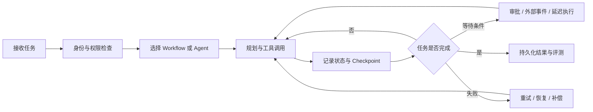
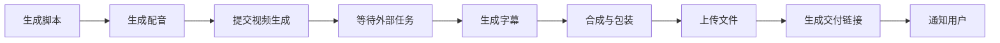

# 从 Agent Demo 到 Agent Platform：真正的挑战是工程化

现在很多人做 AI Agent，实际上还停留在一个非常初级的阶段：接入一个大模型，配置几个 Tool，通过 MCP 连接外部服务，再写一套 Prompt，让模型能够自主规划、调用工具、执行任务，就认为自己做出了一个完整的 Agent 系统。

这样的系统可以完成 Demo，也可能在某些场景下表现得非常惊艳。

但一旦进入企业生产环境，就会发现：

> 能调用工具，和能稳定交付任务，根本是两回事。

一个 Agent Demo 的核心，是让模型完成一次任务；而一个真正的 Agent Platform，需要解决整个任务执行过程中的权限、状态、调度、记忆、可靠性、可观测性，以及系统出现问题之后如何恢复。

它不仅要回答“模型能不能完成任务”，还要回答：

- 任务由谁发起，属于哪个用户和租户？
- 系统应该使用哪个 Agent、模型或执行策略？
- 当前任务执行到了哪一步？
- 哪些工具已经调用，哪些操作已经产生外部副作用？
- 任务失败后能不能安全重试？
- 服务重启或连接断开后，任务应该如何恢复？
- Agent 是否有权限执行当前操作？
- 高风险操作是否需要人工审批？
- 系统为什么成功，又为什么失败？
- 修改 Prompt、模型或工具以后，系统是否真的变得更可靠？

这也是为什么，未来 AI Agent 的竞争不会只停留在谁的模型推理能力更强、谁能接入更多 MCP Server，而会逐渐转向整个 Agent Runtime 和 Harness 的工程能力。

模型决定了 Agent 的能力上限；Orchestration、Runtime、Memory、Permission、Task Queue、Durable Workflow、Checkpoint、幂等、Observability、Evaluation 和 Agent Gateway，则决定了这些能力能不能真正转化成一个可交付、可恢复、可验证、可治理的系统。

---

## 一、Agent Platform 管理的不是一次调用，而是完整的任务生命周期

传统的大模型应用，通常围绕一次请求展开：

```text
用户输入 → 模型生成 → 返回结果
```

但 Agent 的执行过程更接近一个持续运行的任务：



这个过程可能持续数秒、数分钟，甚至数小时。期间还可能发生：

- 模型多次推理；
- 多个工具调用；
- 外部 API 超时或限流；
- 用户关闭页面；
- WebSocket 断开；
- Worker 重启；
- Agent Runtime 崩溃；
- 人工审批等待；
- 任务暂停和恢复；
- 多个执行节点之间的重新调度。

因此，Agent Platform 管理的不是一次模型调用，而是从任务接入、执行、暂停、恢复到最终交付的完整生命周期。

一个合理的平台通常可以拆分为以下几个层次：

| 层级 | 主要职责 |
|---|---|
| 接入与 Gateway | 身份认证、会话归属、协议、限流、任务路由 |
| Orchestration | Workflow 与 Agent 选路、状态推进、重试与恢复 |
| Agent Runtime / Harness | 模型交互、Plan-Act-Observe 循环、工具调度 |
| Skill 与 Tool | 业务口径、参数校验、并发、分页、结果压缩 |
| Permission Engine | 权限检查、风险分级、审批与审计 |
| Durable Execution | Task Queue、Workflow 状态、Checkpoint、幂等 |
| Memory 与 Storage | 会话、任务状态、长期记忆、用户偏好 |
| Observability 与 Evaluation | Trace、日志、成本、评测与回归 |
| Platform Governance | Registry、版本、模型路由、工具治理、资源配额 |

这些层不一定需要一开始就拆成独立服务，但职责边界应该清晰。否则，随着系统复杂度增加，Prompt、业务逻辑、工具代码、权限判断和状态管理很容易混在一起，最终变成一个无法维护的执行黑箱。

为了更具体地理解这些问题，可以考虑两类典型任务：

### 案例一：Badcase 复核

用户提交一条被误拦截或漏放的数据，希望系统重建当时的审核决策链，判断是规则、特征、模型还是数据配置出现问题。

这类任务通常有明确步骤：

1. 根据资源 ID 查询原始记录；
2. 查询当时命中的模型、规则或敏感词；
3. 查询场景配置和依赖关系；
4. 重建审核决策链；
5. 汇总证据；
6. 生成复核结论。

流程本身相对固定，更适合确定性 Workflow，而不是让模型每次临场决定要查什么。

### 案例二：视频创作 Agent

用户提交一个视频创作任务，系统需要完成：

1. 生成脚本；
2. 生成配音；
3. 生成数字人或视频素材；
4. 生成字幕；
5. 合成视频；
6. 上传文件；
7. 生成交付链接；
8. 通知用户。

这个任务可能持续数分钟甚至数小时，涉及多个外部 API，还会产生实际费用。它更能体现 Task Queue、Durable Workflow、Checkpoint、幂等和恢复机制的重要性。

这两类任务分别说明了两个核心问题：

- 并不是所有任务都需要完全自主的 Agent；
- 任务能够开始执行，距离可靠交付还有很远。

---

## 二、Orchestration：不是每一步都需要 Agent

一个真正的 Agent，不应该只是执行一次 Prompt，然后调用几个工具就结束。

它需要在 **Plan、Act、Observe** 之间持续循环：

1. **Plan**：理解目标并制定下一步计划；
2. **Act**：调用工具、查询数据或执行动作；
3. **Observe**：读取工具结果和外部环境变化；
4. 根据新的信息重新判断下一步；
5. 必要时修改计划、拆解任务或进入异常处理流程。

在这个循环之外，编排层还要管理：

- 当前上下文；
- 任务执行状态；
- 工具调用结果；
- 子任务依赖关系；
- 超时和取消；
- 重试策略；
- 人工审批；
- 异常恢复；
- 最终结果交付。

因此，Orchestration 不是一个简单的 Prompt Runner，而是任务生命周期的控制器。

### 1. 确定性 Workflow 和自主 Agent 应该共存

一个常见误区，是把所有步骤都交给模型，认为只要模型能够动态规划，就应该让模型决定每一步。

但对于步骤固定、输入输出明确、失败边界清晰的任务，确定性 Workflow 往往更可靠。例如：

- 数据格式转换；
- 字段校验；
- 固定接口调用；
- 审批状态流转；
- 文件上传和结果回填；
- 按固定顺序执行的业务检查；
- 生成固定格式的交付物；
- 已经标准化的审核或复核流程。

这些步骤通常不需要模型临场决策。强行引入 Agent，只会增加随机性、Token 成本、调试难度和失败概率。

而以下环节更适合交给 Agent：

- 用户意图不完全明确；
- 需要动态选择信息源；
- 下一步依赖工具返回结果；
- 需要在多个方案之间判断；
- 需要进行开放式分析或排障；
- 无法提前写死完整执行路径。

因此，更合理的设计是混合编排：

```text
明确、稳定、可枚举的步骤 → Workflow
需要判断和处理不确定性的步骤 → Agent
高风险操作和最终业务决定 → Permission Engine / 人工审批
```

### 2. Badcase 复核为什么更适合 Workflow

以安全策略运营中的 Badcase 复核为例，任务目标是重建一条历史审核记录的决策链。

它的查询步骤、证据类型和输出结构相对稳定，因此没有必要让模型自由选择所有执行路径。更可靠的方式是：

```text
接收 Badcase
  → 校验资源标识
  → 查询原始审核记录
  → 查询命中规则、模型和特征
  → 查询场景配置
  → 重建决策链
  → 汇总 Evidence
  → 生成复核报告
```

这类 Workflow 可以直接调用领域服务，甚至不需要经过 Agent Runtime 和 MCP Tool。模型可以参与最后的解释或摘要，但不必负责决定证据链应该怎样查询。

这样做有几个优势：

- 执行路径稳定；
- 查询结果完整；
- 失败位置明确；
- 结果更容易回归测试；
- 不会因为模型改变而漏查关键证据；
- 整体 Token 和延迟更可控。

如果用户在复核完成后继续追问“应该如何修改规则”，系统可以再把 Workflow 的结构化结果注入 Agent 上下文，由 Agent 负责开放式分析。

也就是说，Workflow 和 Agent 不需要互相排斥：

```text
Workflow 负责稳定地获得事实
Agent 负责基于事实进行判断和解释
```

### 3. 视频创作任务同样不应该全部交给模型

视频创作 Agent 也不应该让模型自由决定所有步骤。

模型可以负责：

- 理解用户创作意图；
- 生成脚本；
- 设计视频结构；
- 选择风格；
- 根据素材结果调整方案。

但以下部分更适合确定性 Workflow：

- 音频格式转换；
- 视频生成任务提交；
- 外部任务状态轮询；
- 字幕时间轴处理；
- 文件合成；
- 文件上传；
- 交付链接生成；
- 通知发送；
- 失败重试和补偿。

模型负责创意和不确定性，Workflow 负责稳定执行。这比把整个视频生产流水线都交给一个自由规划的 Agent 更可靠。

### 4. 任务路由应该显式

对于已经明确类型的任务，平台可以通过结构化字段进行路由：

```json
{
  "task": {
    "kind": "badcase-review",
    "params": {
      "resourceId": "..."
    }
  }
}
```

或者：

```json
{
  "task": {
    "kind": "video-generation",
    "params": {
      "projectId": "...",
      "templateId": "..."
    }
  }
}
```

编排层可以根据 `task.kind` 判断：

- 进入确定性 Workflow 还是自主 Agent；
- 使用哪个模型；
- 开放哪些工具；
- 使用什么超时策略；
- 是否允许自动重试；
- 是否需要人工审批；
- 应该保存哪些 Checkpoint。

这种结构化路由比让模型从自然语言中猜测所有执行模式更稳定。

### 5. 子 Agent 越多，不代表系统越智能

多个 Agent 同时工作，可能带来更多问题：

- 上下文传递成本增加；
- 子任务状态需要同步；
- 多个 Agent 可能调用同一个高风险工具；
- 并发执行可能产生资源冲突；
- 多个结果可能互相覆盖或矛盾；
- 错误定位更加困难；
- 调度和 Token 成本显著上升。

如果一个确定性 Workflow 或一次聚合工具调用就能完成任务，就没有必要强行拆成多个 Agent。

只有在以下情况下，子 Agent 才可能真正带来价值：

- 子任务边界清晰；
- 子任务可以独立执行；
- 并行确实能降低整体延迟；
- 不同子任务需要不同能力或权限；
- 合并结果的规则明确；
- 收益能够覆盖通信和协调成本。

> 多 Agent 是一种任务分解和执行策略，不是一种智能标签。

---

## 三、Agent Gateway：统一管理任务接入和执行边界

在 Demo 中，业务系统可以直接调用 Agent，Agent 再直接调用模型和工具。

但在生产环境中，通常需要一个独立的 Agent Gateway 作为统一入口。

Agent Gateway 不只是一个 HTTP 代理。它需要承担：

- 身份认证；
- 用户、租户和会话归属校验；
- HTTP、WebSocket 或事件协议接入；
- Agent 和 Workflow 路由；
- 模型路由；
- Session 与 Turn 生命周期管理；
- 会话锁和并发控制；
- 权限策略注入；
- 审批状态管理；
- 任务取消、暂停和恢复；
- 事件持久化；
- 断线重连和结果回放；
- Trace、审计与成本记录。

### 1. Run 是服务端任务，连接只是订阅者

长时间运行的 Agent 任务不能与某个 HTTP 请求或 WebSocket 连接强绑定。

更合理的设计是：

> Run 是服务端持有的任务，WebSocket 或 HTTP Long Polling 只是 Run 的订阅方式。

用户提交视频生成任务后，平台应该先创建一个持久化 Run，再异步执行任务。即使浏览器刷新、网络断开或用户关闭页面，任务也不应该自动取消。

客户端重新连接时，可以通过 `requestId`、`runId` 和事件游标恢复：

- 当前任务是否仍在运行；
- 视频生成到了哪个阶段；
- 哪些素材已经完成；
- 是否正在等待外部 API；
- 是否需要人工确认；
- 是否已经上传；
- 是否已经生成交付链接。

同样，Badcase 复核也不应该因为 WebSocket 断开而丢失已经查询到的证据。

### 2. Progress 和 Report 应该区别处理

Agent 执行期间会产生大量高频事件：

- 模型文本增量；
- 当前执行阶段；
- Tool Call 开始；
- Tool Call 完成；
- 外部任务等待；
- 上传进度；
- Token 使用变化。

这些事件适合实时推送，但不一定需要永久存储。

因此，可以区分：

- **Progress**：高频、临时，用于实时交互；
- **Report**：低频、持久，表示一次任务或阶段的正式结果；
- **Audit Event**：必须保留的权限、审批和高风险操作记录；
- **Checkpoint**：用于恢复执行的关键状态。

对于视频生成，实时的“渲染进度 63%”可以只作为 Progress；而“视频生成任务已提交，外部任务 ID 为 xxx”则应该作为 Checkpoint 持久化。

### 3. 同一 Session 的并发需要明确约束

如果两个 Turn 同时写入同一个 Agent Runtime 或同一份 Session 状态，就可能造成：

- 两轮模型事件交错；
- 工具结果归属不清；
- 上下文互相污染；
- 状态更新冲突；
- 事件序号重复；
- 最终结果覆盖。

因此，同一个 Session 通常需要串行执行 Turn，或者拥有严格的并发隔离机制。

---

## 四、Agent Runtime 与 Harness：隔离不同执行引擎

不同 Agent Runtime 可能使用完全不同的协议和状态模型：

- 有的通过 HTTP API；
- 有的通过 stdio JSON-RPC；
- 有的使用 JSONL 事件流；
- 有的使用 Thread；
- 有的使用 Session 文件；
- 有的支持原生 Tool Approval；
- 有的需要通过扩展机制实现审批；
- 有的可以注入历史事件；
- 有的只能通过 Prompt 恢复上下文。

如果 Gateway 和编排层直接依赖某一种运行时，未来切换引擎时，大量上层代码都会受到影响。

因此，可以定义统一的 Agent Harness 契约：

- 创建或恢复 Session；
- 启动 Turn；
- 发送 Prompt；
- 接收增量事件；
- 等待 Agent 空闲；
- 中断当前 Turn；
- 获取 Token Usage；
- 处理 Tool Call；
- 注入 Workflow 结果；
- 保存和恢复运行时状态。

不同 Runtime 通过适配器实现这个契约。Gateway、客户端协议和业务编排不需要感知底层差异。

### 1. 能力不对称必须显式暴露

抽象不意味着假设所有 Runtime 的能力完全相同。

例如：

- Runtime A 支持原生 Thread Resume；
- Runtime B 只能通过 Session 文件恢复；
- Runtime A 支持 MCP 健康检查；
- Runtime B 没有对应接口；
- Runtime A 支持原生审批请求；
- Runtime B 需要扩展机制拦截工具调用。

这些差异不能通过伪造成功状态掩盖。

如果某个运行时无法证明 MCP 工具健康，健康检查就应该明确显示 `unsupported`，而不是返回成功。如果审批扩展没有加载，高风险任务应该拒绝启动，而不是静默降级。

> 能力不对称可以接受，静默降级不可接受。

### 2. Agent 进程应该按 Session 复用

如果每轮任务都重新启动 Agent 进程，会重复支付：

- 进程启动成本；
- Runtime 初始化成本；
- MCP 加载成本；
- 模型和工具握手成本；
- Session 恢复成本。

因此，Runtime 层通常需要进程池或 Worker Pool：

- 按 Session 复用进程；
- 限制最大活跃 Session 数；
- 空闲后回收；
- 使用 LRU 等策略淘汰空闲实例；
- 正在执行的实例不能被驱逐；
- 进程异常后丢弃；
- 下一轮根据持久化状态恢复；
- 每个实例拥有独立读写锁。

---

## 五、Skill、Tool 和 Domain：业务口径与执行机制应该分离

很多 Agent 系统把 Skill、Tool、CLI、外部接口和业务规则混在一起，最终导致 Prompt、代码和数据源之间高度耦合。

更清晰的分工是：

| 层 | 负责什么 | 不负责什么 |
|---|---|---|
| Skill | 业务口径、分析方法、执行建议、结果表达 | 不直接访问网络 |
| Tool | 参数校验、分页、并发、限流、结果压缩 | 不决定业务目标 |
| Domain | 封装外部系统、领域模型和错误语义 | 不负责模型交互 |
| Gateway | 身份、路由、会话、审批、状态和恢复 | 不实现具体领域分析 |

一句话概括：

> Skill 负责“应该查什么”，Tool 负责“怎么查得对、查得快”，Domain 负责“如何稳定访问业务系统”。

### 1. Tool 层应该承担确定性计算

不要把所有执行细节都留给模型。

例如，Badcase 复核需要查询规则、模型、特征、敏感词和场景依赖关系。如果模型逐个调用工具，会产生多轮模型往返。

更合理的方式，是提供一个聚合 Tool 或固定 Workflow，在内部并发查询多个只读接口：

```text
reconstruct_decision_chain
  ├─ 查询审核记录
  ├─ 查询规则命中
  ├─ 查询模型结果
  ├─ 查询特征快照
  └─ 查询场景配置
```

对于视频任务也一样。轮询视频生成状态、下载产物、校验文件和上传对象存储，应该由确定性代码完成，不需要每隔十秒让模型决定一次“是否继续查询”。

Tool 层还应该负责：

- 参数类型和范围校验；
- 上游超时；
- 并发上限；
- 分页和结果行数限制；
- 时间窗口处理；
- 错误归一化；
- 结果字段裁剪；
- 数据紧凑化；
- Evidence 生成。

真正应该交给模型的是判断和分析，而不是机械地循环调用接口。

### 2. 工具结果需要 Evidence

企业 Agent 不能只给出一句结论，还需要让结论可回查。

工具结果可以附带：

- 数据来源；
- 调用接口；
- 上游 Request ID；
- 原始状态码；
- 查询时间范围；
- 结果摘要；
- Content Hash；
- 分页和截断信息；
- 已知限制。

在 Badcase 复核中，Evidence 可以证明某个结论来自哪条审核记录、哪条规则和哪次上游请求。

在视频创作中，Evidence 可以记录：

- 脚本版本；
- 语音生成任务 ID；
- 视频生成任务 ID；
- 素材 Content Hash；
- 合成参数版本；
- 上传对象键；
- 最终文件校验和。

这些信息既用于问题排查，也用于恢复、审计和避免重复生成。

---

## 六、工具与权限：MCP 解决连接问题，但不解决安全问题

MCP 的价值在于，为 Agent 发现和调用外部工具提供标准化接口。

通过 MCP，Agent 可以连接 GitHub、数据库、文件系统、企业业务系统和第三方服务。这显著降低了工具接入成本，但 MCP 本身并不能保证工具调用安全可靠。

一个同时拥有 GitHub、数据库、文件系统和业务系统访问能力的 Agent，如果没有明确的权限边界，实际上非常危险。

### 1. 平台需要独立的 Permission Engine

权限判断不应该只写在 Prompt 中，也不能依赖模型“自觉遵守”。

真正的 Agent Platform 需要独立的 Permission Engine，在工具执行前进行确定性检查。

至少要区分：

- 读取数据和修改数据；
- 查询信息和导出信息；
- 创建资源、更新资源和删除资源；
- 测试环境和生产环境；
- 普通操作和高风险操作；
- 单条操作和批量操作；
- 公共数据和敏感数据；
- 无成本操作和会产生费用的操作。

以下行为通常不应该默认开放：

- 删除文件；
- 执行任意系统命令；
- 修改生产数据库；
- 发布代码；
- 发送邮件或消息；
- 批量修改业务数据；
- 访问敏感用户信息；
- 对外发布内容；
- 创建订单或执行扣费；
- 修改线上配置。

视频生成同样可能是高风险操作，因为它会调用付费 API。平台可以设置：

- 单任务预算；
- 单用户每日额度；
- 最大视频时长；
- 允许使用的供应商；
- 允许重试次数；
- 高成本任务审批；
- 生成后自动删除临时素材的策略。

> 自主决策不等于无限授权。

### 2. 只读能力和写入能力应该分离

生产系统可以优先开放只读工具，把分析与执行分开：

```text
Agent：分析问题、查询证据、生成建议
Gateway：校验方案、计算风险、记录状态
Permission Engine：检查权限、触发审批
用户或受控服务：执行最终写操作
业务系统：保存结果
Gateway：通过只读 Probe 核对执行结果
```

例如，在安全策略运营场景中，Agent 可以生成规则或特征修改建议，但不直接调用生产写接口。平台先校验方案并发起审批，用户再通过受控表单保存，最后由 Gateway 通过只读接口核对结果。

这种方式既保留了 Agent 的分析能力，也避免模型输出直接变成线上配置变更。

### 3. 审批是任务状态，不是一个弹窗

人工审批应该是可持久化、可恢复、可审计的任务状态：

```text
RUNNING
  → WAITING_APPROVAL
  → APPROVED / REJECTED / EXPIRED
  → RESUMING
  → RUNNING
  → COMPLETED
```

审批记录应绑定：

- Session；
- Request；
- 审批 ID；
- 操作类型；
- 风险等级；
- 待执行内容；
- Payload Hash；
- 申请时间和过期时间；
- 审批人；
- 审批结果。

前端回传审批结果时，应带回原始 Payload Hash。Hash 不一致意味着用户批准的内容与即将执行的内容不同，系统必须拒绝继续。

---

## 七、Memory：向量数据库不是 Agent Memory 的全部

很多人提到 Agent Memory，就直接想到向量数据库，认为给 Agent 接一个 Vector DB，就实现了长期记忆。

但 Session Memory、Task State、Long-term Memory 和 User Preferences 根本不是一回事。

### 1. Session Memory

Session Memory 解决当前会话上下文问题，包括：

- 当前对话；
- 用户需求；
- 最近的工具结果；
- 临时决策；
- 当前 Thread 或 Session 指针。

### 2. Task State

Task State 记录任务的结构化执行状态，包括：

- 当前处于哪个阶段；
- 哪些步骤已经完成；
- 哪些步骤正在执行；
- 哪些步骤失败；
- 调用了哪些工具；
- 工具返回了什么结果；
- 外部操作是否已经产生副作用；
- 当前是否等待审批；
- 失败后应该从哪里恢复。

Task State 不是聊天记录，也不是向量检索结果，而是能够驱动任务继续执行的数据。

对于视频创作任务，Task State 可能是：

```json
{
  "status": "RUNNING",
  "currentStep": "video_generation",
  "script": {
    "status": "COMPLETED",
    "artifactId": "script-001"
  },
  "voice": {
    "status": "COMPLETED",
    "artifactId": "audio-001"
  },
  "video": {
    "status": "RUNNING",
    "providerTaskId": "provider-task-123"
  },
  "subtitle": {
    "status": "PENDING"
  },
  "upload": {
    "status": "PENDING"
  }
}
```

如果服务重启，系统可以根据 `providerTaskId` 继续查询视频生成状态，而不是重新提交视频生成任务。

### 3. Long-term Memory

Long-term Memory 用于保存跨会话仍然有价值的信息，例如：

- 已确认的业务事实；
- 历史任务结论；
- 用户长期关注的对象；
- 可复用的解决经验；
- 经过验证的组织知识。

不能把模型生成的所有内容都无条件写入长期记忆，否则错误信息会被持续放大。

### 4. User Preferences

User Preferences 保存跨任务适用的个性化配置，例如：

- 输出语言；
- 文档格式；
- 视频风格；
- 默认分辨率；
- 常用配音；
- 报告详细程度；
- 通知渠道；
- 审批偏好。

这些信息通常是结构化配置，不一定适合存入向量数据库。

### 5. 任务恢复不应该依赖模型“记得”

长时间运行的任务不能因为上下文压缩、服务重启或模型切换，就丢失之前已经完成的工作。

更可靠的方式是由平台持久化任务状态，并在恢复时重新注入：

- 当前任务目标；
- 已完成步骤；
- 最后一个 Checkpoint；
- 已有工具结果；
- 审批状态；
- 待处理步骤；
- 已产生的外部副作用。

---

## 八、Task Queue：让任务脱离请求生命周期

对于简单问答，Agent 可以在一次请求中完成执行。

但很多企业任务持续数分钟甚至数小时，并且会调用多个外部 API，还可能受到限流、网络波动、服务重启和人工审批的影响。

这类任务不能只依赖一次 HTTP 请求。

Task Queue 可以将任务从前端请求中解耦：

1. 接收任务；
2. 创建持久化任务记录；
3. 将任务放入队列；
4. Worker 获取任务并执行；
5. 持续更新状态；
6. 通过事件、轮询或回调返回结果。

Task Queue 通常需要支持：

- 并发控制；
- 优先级；
- 延迟执行；
- 资源隔离；
- 限流；
- 失败重试；
- 任务取消；
- 超时；
- 死信队列；
- Worker 故障转移。

例如，视频生成通常受供应商并发额度限制。即使平台收到一百个视频任务，也不能立即并发调用一百次外部 API。Task Queue 可以按照：

- 用户等级；
- 任务优先级；
- 供应商配额；
- 视频时长；
- 预算；
- Worker 资源；

进行调度和限流。

但 Task Queue 只能解决“任务什么时候由哪个 Worker 执行”，不能独立解决“一个多步骤任务执行到哪里、如何暂停和恢复”。后者需要 Durable Workflow 和 Task State。

---

## 九、Durable Workflow：让执行过程可以持久化

Durable Workflow 的核心，是把多步骤任务建模为一个可以持久化、暂停、恢复和重放的执行过程，而不是把所有逻辑放在一个长时间运行的函数中。

以视频创作 Agent 为例：



整个过程可能调用多个外部 API，并持续数分钟。

如果系统只是把这些步骤写在一个函数中，那么任何中途异常都可能导致状态丢失。服务重启后，系统甚至不知道哪些步骤已经执行过。

Durable Workflow 应该持久化：

- 当前步骤；
- 每个步骤的输入和输出；
- 步骤状态；
- 重试次数；
- 外部任务 ID；
- Checkpoint；
- 审批状态；
- 错误信息；
- 下一次调度时间；
- 补偿状态。

任务状态也不能只分成“运行中”和“失败”，还应该包括：

- Pending；
- Running；
- Waiting for Approval；
- Waiting for External Event；
- Paused；
- Completed；
- Failed；
- Cancelled；
- Compensating；
- Requires Manual Intervention。

等待外部视频生成完成不是失败，而是 `Waiting for External Event`。等待用户确认高成本生成任务也不是失败，而是 `Waiting for Approval`。

---

## 十、Checkpoint：视频生成中断后应该怎么处理

Checkpoint 是长任务可靠恢复的关键。

系统应在重要步骤完成后保存检查点，例如：

- 脚本已经生成；
- 配音已经生成；
- 视频生成任务已经提交；
- 外部服务已经返回任务 ID；
- 视频文件已经下载；
- 字幕已经生成；
- 视频已经合成；
- 文件已经上传；
- 交付链接已经生成。

假设视频创作任务执行到以下状态：

```text
脚本生成：完成
配音生成：完成
视频任务提交：完成
视频渲染：外部服务处理中
字幕生成：未开始
视频上传：未开始
```

此时 Worker 突然重启。

正确的恢复方式应该是：

1. 从持久化存储读取 Task State；
2. 发现视频生成步骤已经拥有 `providerTaskId`；
3. 调用供应商查询接口确认任务状态；
4. 如果仍在处理中，继续等待；
5. 如果已经完成，下载现有结果；
6. 从字幕生成步骤继续；
7. 不重新生成脚本；
8. 不重新生成配音；
9. 不重新提交视频任务。

错误的处理方式则是从头重新执行整个任务。那会导致：

- 重复生成脚本；
- 重复调用配音 API；
- 重复提交视频生成任务；
- 再次扣费；
- 产生多个互相冲突的成品。

### 工具调用边界也是 Checkpoint

对于 Agent Tool Call，可以在工具调用边界记录：

- Runtime 或 Harness；
- Session 文件或 Thread；
- 当前执行轨迹位置；
- Tool Call ID；
- Tool 名称；
- 调用参数摘要；
- 是否已经获得结果；
- Attempt；
- 结果 Hash；
- 外部 Request ID。

如果进程在 Tool Call 过程中退出，恢复时需要知道：

- 哪些调用已经有完整结果；
- 哪些调用只开始但没有完成；
- 哪个位置是最后一个可靠检查点；
- 未完成调用能否安全重试。

对于没有结果的调用，可以显式标记为 `tool_interrupted`，让 Agent 知道调用被中断，而不是误以为工具成功执行。

---

## 十一、重试、幂等与补偿：避免重复执行造成更大损失

任务失败后，最容易想到的方案是自动重试。

但不是所有操作都可以安全重试。

| 操作 | 重试风险 |
|---|---|
| 查询数据 | 通常可以安全重试 |
| 读取文件 | 通常可以安全重试 |
| 创建订单 | 可能重复创建 |
| 发送邮件 | 可能重复发送 |
| 扣费 | 可能重复扣款 |
| 提交视频生成任务 | 可能重复生成并重复扣费 |
| 修改生产配置 | 可能覆盖新状态 |
| 删除文件 | 可能无法恢复 |

因此，可靠的 Agent 系统不能把重试当成统一的故障处理方式，而要根据操作性质决定策略。

### 1. 幂等键

对于可能重复提交的逻辑操作，应尽可能使用幂等键。

例如，视频生成步骤可以使用：

```text
idempotency_key =
  task_id + step_name + input_content_hash + step_version
```

同一个任务、同一生成步骤、同一输入内容和同一版本，应对应同一个逻辑请求。

如果第一次请求超时，系统再次提交时仍使用相同幂等键。外部服务或平台可以据此判断这是同一操作，而不是新的生成任务。

### 2. Request ID 也是任务级幂等键

客户端提交任务时，可以提供稳定的 `requestId`。同一个 `requestId` 被重复提交时，平台根据已有状态处理：

| 上一次状态 | 重复请求的处理 |
|---|---|
| 已完成 | 回放已保存结果，不重新执行 |
| 已失败且有正式结果 | 回放失败结果 |
| 仍在执行 | 返回当前执行状态 |
| 执行中断 | 要求调用方明确选择恢复或重跑 |
| 等待审批 | 返回暂停状态，不允许绕过审批 |
| 请求内容发生变化 | 拒绝复用同一个 Request ID |

如果不提供幂等键，网络超时后客户端无法判断任务是否已经提交成功，重试很容易创建重复任务。

### 3. 恢复和重跑必须区分

恢复和重跑不是同一件事：

- **Resume**：从最后一个可靠 Checkpoint 继续；
- **Retry**：明确确认后，从头重新执行；
- **Replay**：回放已经持久化的结果；
- **Cancel**：终止当前任务；
- **Compensate**：执行反向或清理操作。

对于视频任务，如果生成任务已经提交，Resume 应继续查询原任务；Retry 则意味着放弃原任务并重新生成，可能再次产生费用，两者必须明确区分。

### 4. 外部系统不支持幂等时怎么办

如果外部视频 API 不支持幂等键，平台需要在调用前后保存状态：

```text
SUBMITTING
  → 保存本地操作记录
  → 调用外部 API
  → 保存 providerTaskId
  → SUBMITTED
```

但如果外部 API 已成功创建任务，响应却在返回途中丢失，平台可能停留在 `SUBMITTING`。

这时不能直接重试。系统应优先通过以下信息查询外部状态：

- 业务唯一键；
- 外部 Request ID；
- 任务名称；
- 输入 Content Hash；
- 创建时间窗口；
- 供应商查询接口。

请求超时不等于操作失败。

### 5. 补偿机制

有些操作无法真正回滚。这时需要设计补偿机制：

- 视频生成失败后清理临时素材；
- 上传成功但交付失败时删除临时对象；
- 预留额度后失败时释放额度；
- 已发送通知但任务最终失败时发送更正通知；
- 无法自动恢复时创建人工处理任务。

补偿本身也可能失败，因此需要独立状态、重试策略和审计记录。

---

## 十二、会话持久化、断线恢复与事件回放

Agent 的状态不能只保存在内存中。

一个可以恢复的 Session 通常需要持久化：

- Session ID；
- 用户和租户；
- Agent 或 Harness 类型；
- Thread ID 或 Session 文件；
- 当前状态；
- 最后事件序号；
- Turn 账本；
- Checkpoint；
- Report 事件；
- 待审批事项；
- 必要的运行时会话文件；
- 工作目录中的必要产物。

### 1. 事件日志和单调序号

每个持久化事件应该拥有单调递增的序号，例如 `seq`。

这可以用于：

- 断线重连；
- 增量回放；
- 判断客户端缺失了哪些结果；
- 比较本地和远端状态；
- 避免旧状态覆盖新状态。

客户端重新连接后，可以请求 `seq > afterSeq` 的事件，而不是每次加载整个会话。

### 2. 本地工作副本与远端持久化

一种实用设计是：

1. 当前 Worker 使用本地状态作为工作副本；
2. 关键事件先原子写入本地；
3. 将 Session 标记为 Dirty；
4. Report 和 Checkpoint 尽快异步同步到持久化存储；
5. 其他状态由后台定期 Flush；
6. 同步失败后保留 Dirty 状态并重试。

这样，远端对象存储或数据库的短暂延迟不会直接阻塞当前任务。

但需要明确一致性边界：对象存储镜像不是天然的强一致工作流数据库。如果任务需要严格的跨实例并发控制，就必须额外引入租约、版本号或事务存储。

### 3. 不要把所有进度都永久保存

模型 Token 增量、思考事件和高频进度可能非常多。全部永久保存会造成：

- 存储快速增长；
- 敏感数据风险；
- 回放成本上升；
- 日志噪声增加；
- 关键事件被淹没。

因此，Progress 可以只短期保留，而 Report、Checkpoint、审批和高风险操作需要持久化。

---

## 十三、多副本运行：会话亲和、分布式租约与 Fencing

在单实例环境中，进程内锁可以保证同一 Session 串行执行。

但在多副本环境中，如果同一个 Session 同时被两个实例处理，就可能发生：

```text
Pod A：读取 last_seq=5 → 写入 seq=6
Pod B：读取 last_seq=5 → 写入 seq=6
```

两个实例都认为自己是合法执行者，并可能互相覆盖状态。进程内锁无法解决这个问题。

因此，多副本部署至少需要考虑：

- Session Affinity；
- 分布式 Lease；
- Fencing Token；
- 乐观锁或版本号；
- 任务所有权；
- 旧实例写入阻断。

入口层可以根据 Session ID 做一致性哈希，使同一个 Session 尽量落到同一个实例。但会话亲和只是一种路由策略，不是严格的一致性保证。

更完整的方案是：

1. 实例执行任务前申请 Lease；
2. Lease 记录当前 Owner 和过期时间；
3. 执行期间持续续租；
4. 其他实例看到有效 Lease 时拒绝执行；
5. 每次获得新 Lease 时生成递增的 Fencing Token；
6. 存储层拒绝旧 Token 的状态写入。

对于视频生成任务，这可以避免两个 Worker 同时恢复同一个任务，并重复提交外部生成请求。

---

## 十四、Observability：知道任务为什么成功，也知道为什么失败

一个 Agent 执行失败了，你至少应该能够知道：它当时收到了什么任务，选择了哪个模型，调用了什么工具，工具返回了什么结果，为什么进行了下一步决策，以及失败到底发生在哪个环节。

如果没有完整的 Trace、日志、Token 成本记录和必要的评测机制，你甚至无法判断系统到底是模型推理错误、工具接口异常、权限不足，还是上下文管理出现问题。

而且记录执行过程只是第一步，更重要的是建立可复现的评测和回归测试机制。每次修改 Prompt、模型、工具接口或编排逻辑，都应该能够验证任务成功率、成本、延迟和失败类型是否发生变化。

否则系统越复杂，你越不知道它为什么成功，也不知道它为什么失败。

### 1. Trace 应该覆盖完整执行链路

一条完整的执行 Trace，不应该只有模型输入和最终回答，还应该覆盖：

- 任务接入；
- 身份认证；
- Agent 或 Workflow 路由；
- 模型选择；
- Prompt 和上下文版本；
- Plan-Act-Observe 循环；
- Tool Call；
- 权限检查；
- 人工审批；
- 外部 API 请求；
- 状态持久化；
- Checkpoint；
- 重试和恢复；
- 最终结果。

这些信息可以通过统一的关联字段串起来：

```text
trace_id
  ├─ tenant_id
  ├─ user_id
  ├─ session_id
  ├─ request_id
  ├─ run_id
  ├─ turn_id
  ├─ workflow_step
  ├─ model
  ├─ harness
  ├─ tool_call_id
  └─ upstream_request_id
```

对于 Badcase 复核，Trace 应该能够回答：

- 查询了哪条资源记录；
- 使用了哪些只读接口；
- 哪个证据查询失败；
- 最终结论基于哪些 Evidence；
- 是否有数据缺失；
- 是否调用了模型生成解释。

对于视频创作任务，Trace 应该能够回答：

- 使用了哪个脚本版本；
- 调用了哪家配音和视频供应商；
- 外部任务 ID 是什么；
- 哪一步发生超时；
- 是否重试；
- 是否重复扣费；
- 最终交付文件来自哪次生成任务。

### 2. 不只是记录错误，还要记录状态转换

对于长任务，状态变化本身也是重要证据：

```text
PENDING
→ RUNNING
→ WAITING_EXTERNAL_EVENT
→ RUNNING
→ FAILED
→ RETRYING
→ RUNNING
→ COMPLETED
```

每次状态转换应记录：

- 原状态；
- 新状态；
- 触发原因；
- 操作者；
- 时间；
- 关联事件；
- 错误码；
- Checkpoint；
- 是否可恢复。

### 3. 成本和延迟需要分阶段记录

只记录总耗时不够。至少需要拆分：

- 排队时间；
- 模型推理时间；
- Tool 执行时间；
- 外部 API 时间；
- 权限检查时间；
- 人工等待时间；
- 视频渲染时间；
- 文件上传时间；
- 状态持久化时间；
- 重试次数；
- Input Token；
- Output Token；
- 外部 API 成本。

否则，一个任务虽然成功了，也可能比上一版本更慢、更贵，或者更依赖人工介入。

### 4. 可观测性不等于无限记录

Prompt、工具参数和工具结果可能包含用户隐私、业务数据、凭证、文件内容和生产配置。

因此，平台需要定义：

- 哪些字段允许记录；
- 哪些字段必须脱敏；
- 日志由谁读取；
- 数据保留多久；
- 是否允许进入评测集；
- 是否允许跨租户使用；
- 删除请求如何执行。

可观测性必须服从数据治理和最小权限原则。

---

## 十五、Evaluation：判断系统是否真的变可靠了

Agent 的行为会受到很多因素影响：

- Prompt；
- 模型；
- 模型参数；
- Tool 定义；
- Tool 返回结构；
- Skill；
- 编排逻辑；
- 上下文注入；
- 权限策略；
- 外部系统数据。

任何一处变化，都可能改变最终结果。

因此，Agent Platform 需要可重复运行的评测集和回归机制，而不能只依赖几个精心挑选的演示案例。

### 1. 评测不应只看最终答案

| 维度 | 需要回答的问题 |
|---|---|
| 任务结果 | 是否正确完成任务 |
| 执行路径 | 是否选择了正确的 Workflow、模型和工具 |
| 证据质量 | 结论是否有真实、可回查的证据 |
| 权限合规 | 是否越权，是否正确触发审批 |
| 状态可靠性 | 中断后能否正确恢复 |
| 副作用安全 | 是否发生重复写入或重复扣费 |
| 成本 | Token 和外部 API 成本是否变化 |
| 延迟 | 总延迟和各阶段延迟是否变化 |
| 稳定性 | 成功率、重试率和人工介入率如何 |
| 失败分布 | 模型、工具、权限、上下文、基础设施分别占多少 |

“最终回答看起来不错”并不足以证明系统可靠。

### 2. 不同任务需要不同评测方式

对于 Badcase 复核，可以评测：

- 是否查询了完整证据链；
- 是否遗漏关键规则或模型结果；
- 结论是否与人工复核一致；
- Evidence 是否可回查；
- 数据缺失时是否明确说明限制；
- 是否错误地把推测表达为事实。

对于视频创作 Agent，可以评测：

- 脚本是否符合要求；
- 视频是否成功交付；
- 音画是否同步；
- 字幕是否完整；
- 中断后能否从 Checkpoint 恢复；
- 是否重复生成或重复扣费；
- 平均交付时间；
- 单个视频的平均成本；
- 外部供应商失败时的恢复成功率。

### 3. 回归比较必须覆盖成本和失败类型

每次修改 Prompt、模型、Tool 或编排逻辑后，至少应该比较：

- 成功率；
- 正确率；
- 平均和 P95 延迟；
- Token 消耗；
- 外部 API 成本；
- Tool Call 数量；
- 重试次数；
- 人工介入率；
- 恢复成功率；
- 权限拦截率；
- 各类失败占比。

有时总成功率不变，但失败类型已经发生变化。例如，模型错误减少了，工具超时却明显增加；平均成本下降了，但 P95 延迟恶化。只看一个综合分数，会掩盖这些问题。

---

## 十六、Agent Gateway 与统一治理

当企业只有一个 Agent 时，很多问题可以通过简单代码解决。

但当企业内部出现几十个 Agent，分别服务于销售、客服、内容生成、研发和数据分析时，统一身份认证、Agent Registry、模型路由、工具注册、权限策略、版本管理和审计就会逐渐成为实际需求。

这时，Agent Gateway 会进一步演化为企业 Agent 的统一控制面。

### 1. Agent Registry

Agent Registry 可以记录：

- Agent ID；
- 负责的业务领域；
- 当前版本；
- Prompt 和 Skill 版本；
- 默认模型；
- 允许使用的模型；
- 允许使用的工具；
- 权限策略；
- 资源配额；
- Owner；
- 发布状态；
- 评测结果；
- 回滚版本。

Agent 不应该只是一段散落在代码中的 Prompt，而应该成为可注册、可版本化、可审计的运行单元。

### 2. Model Routing

统一模型路由可以根据以下条件选择模型：

- 任务类型；
- 数据敏感等级；
- 成本预算；
- 延迟要求；
- 上下文长度；
- 推理能力；
- 工具调用能力；
- 模型可用性；
- 租户策略。

例如，Badcase 证据查询本身不需要高成本模型；只有最终复杂分析可能需要更强模型。视频脚本生成可以使用创作能力较强的模型，而状态轮询、文件上传和任务恢复根本不需要模型参与。

### 3. Tool Registry

Tool Registry 可以管理：

- Tool 名称和版本；
- 输入输出 Schema；
- 权限等级；
- 是否只读；
- 是否存在外部副作用；
- 超时和重试策略；
- 幂等能力；
- 数据敏感级别；
- 所属团队；
- 健康状态；
- 使用量和失败率。

Agent 能看到哪些工具，不应该只由 Prompt 决定，而应由平台根据身份、任务和环境动态生成工具白名单。

### 4. 统一资源治理

平台还需要管理：

- 每个用户的并发任务数；
- 每个 Agent 的 Token 预算；
- 每个租户的模型配额；
- Tool 调用速率；
- 外部 API 并发；
- 视频生成供应商额度；
- 长任务数量；
- Worker 资源；
- 失败重试预算；
- 最大任务持续时间。

否则，一个异常 Agent 可能通过循环调用模型或工具，迅速消耗大量资源。

### 5. 版本、灰度和回滚

Prompt、Skill、Tool Schema、模型和编排逻辑都应该版本化。

发布新版本时，可以：

- 先运行离线评测；
- 在影子流量中执行但不产生副作用；
- 对少量用户灰度；
- 比较成功率、成本和失败类型；
- 出现回归时快速回滚；
- 保留每次任务实际使用的版本信息。

如果 Trace 中只记录“调用了 Agent”，却不知道使用的是哪个 Prompt、模型和 Tool 版本，就无法复现历史问题。

---

## 十七、从 Demo 到 Platform，核心是把能力变成可交付的系统

AI Agent 工程真正值得深入研究的，已经不只是 Prompt Engineering、Function Calling 或 MCP，而是整个 Agent 系统的软件工程问题：

- 什么时候使用确定性 Workflow，什么时候需要 Agent 动态规划？
- 什么时候引入子 Agent，什么时候直接调用工具？
- 为什么 Badcase 复核适合固定证据链，而开放式排障适合 Agent？
- 视频生成中断后，如何从已有外部任务继续，而不是重新扣费？
- 如何让长任务脱离 HTTP 和 WebSocket 生命周期？
- 如何通过 Task Queue 调度异步任务？
- 如何用 Durable Workflow 管理多步骤执行？
- 如何通过 Checkpoint 从可靠位置恢复？
- 如何区分 Resume、Retry、Replay 和 Cancel？
- 如何使用幂等键避免重复执行？
- 如何处理已经产生的外部副作用？
- 如何设计补偿机制？
- 如何控制高风险工具调用？
- 如何让审批可持久化、可恢复和可审计？
- 如何区分 Session Memory、Task State 和 Long-term Memory？
- 如何在多副本环境中避免同一任务被多个实例同时执行？
- 如何记录完整 Trace、Token 成本和工具调用链？
- 如何评测系统是否真的比上一版本更可靠？
- 如何通过 Agent Gateway 统一管理身份、路由、权限、版本和资源？

很多 Agent 项目在 Demo 阶段表现得非常惊艳，但一旦接入真实业务，遇到任务中断、状态丢失、重复执行、权限冲突、API 限流、上下文污染、跨实例并发和人工审批，系统的可靠性问题就会迅速暴露。

真正成熟的 Agent，不是能够自主调用多少工具，而是能够在真实业务约束下，持续、可靠、可控地完成任务。

未来真正有价值的 AI 应用工程师和 FDE，不应该只是会调用模型、搭建 Workflow、配置 MCP，而是能够把这些能力组织成一套完整的工程体系：

- 任务能够被路由和调度；
- 状态能够被持久化；
- 执行能够被追踪；
- 中断能够被恢复；
- 重复请求不会产生重复副作用；
- 高风险操作能够被授权和审批；
- 结果能够被验证；
- 失败能够被解释；
- 系统能够持续评测和演进。

模型决定了 Agent 的能力上限，而 Orchestration、Runtime、Memory、Permission、Task Queue、Durable Workflow、Checkpoint、幂等、Observability、Evaluation 和 Agent Gateway，决定了这些能力能不能真正转化成可交付的系统。

**从 Agent Demo 到 Agent Platform，中间隔着的不是更多 Prompt，也不是更多子 Agent，而是一整套真正的软件工程能力。**
